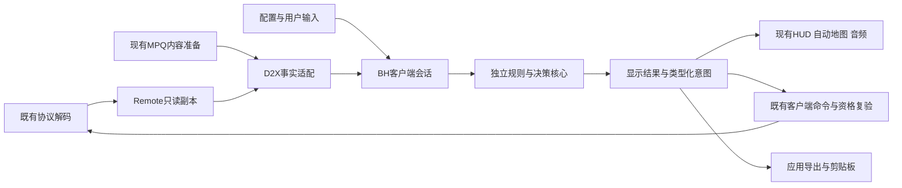

# BH源码模块分析与D2X独立接入方案

## 身份与范围

本页分析本地公开BH源码，设计可作用于D2X的独立代码边界，不把BH与ProjectDiablo核心合并为同一规则层。这里只编写方案，没有复制源码进入产品、修改参考仓库、构建或加载原DLL。

| 对象 | 固定身份 | 适用范围 |
| --- | --- | --- |
| 官方BH源码 | Project-Diablo-2/BH，92e9d319f20113b5fbd382ad0fd3df9480116d04，2026-10-19 | 本页主要模块依据，本地reference/pd2-bh |
| 历史CN源码 | weili0677/BH-CN，68f7343342eed668190d464b7111849a6cc0ce89，2022-12-27 | 仅解释旧S6分支差异，本地reference/pd2-cn-bh；不能认证当前CN行为 |
| 目标BH.dll | 依[DLL取证](../resources/PD2_CN_DLL_ANALYSIS.md)所属样本摘要 | 文件名相同不证明由上述提交构建；源码／二进制一致性需独立确认 |

源码已在本地，无需重新下载或切换分支。“切下来”建议指抽取可维护的源码层，不是复制整个注入式BH工程，也不是创建新Git分支。未来真正移植时冻结提交、保留文件级来源和本地修改清单；不将reference整体纳入产品源码。

## 首要边界

官方BH::Initialize显式创建GameSettings、ScreenInfo、Gamefilter、Bnet、Item、Party、StashExport、MapNotify、ChatColor九个模块，StatsDisplay独立创建。D2Handlers把原游戏循环、绘制、键鼠、消息和入退局转成模块事件。初始化同时安装原模块地址补丁、替换WNDPROC、启动任务池及轮询线程；这些是原客户端宿主适配，不是可直接接入D2X的业务内核。

官方BH/CMakeLists.txt仍列BitReader.cpp、MPQInit.cpp、MPQReader.cpp、TableReader.cpp及Modules/ItemMover等当前目录不存在的源文件，并未准确列全实际注册模块。不能将该清单当作当前可独立编译的模块契约；后续须以实际源文件、BH::Initialize和Visual Studio工程交叉重建最小目标，不在D2X直接add_subdirectory(reference/pd2-bh)。

推荐采用“可移植BH决策层＋D2X客户端适配层＋应用IO层”，替换原D2Ptrs／Patch／D2Stubs／WNDPROC／绘制Hook，保留有意义的过滤与展示规则。BH不持有第二份权威库存、地图或角色状态，不直接扣物品、授予状态或写D2S。

## 许可与源码复用路线

官方及历史CN仓库的LICENSE.md是AGPL-3.0文本，另有Apache许可文件及ThirdParty；不能据存在Apache文件就认定整个BH采用Apache。D2X当前项目使用GPL-3.0，来源记录见[THIRD_PARTY](../resources/THIRD_PARTY.md)。

**路线A：直接抽取并改造源码。** 最利于保留过滤语言等细节，但发布前必须逐文件核验版权与许可、保留声明、提供相应源码和修改说明，并评估组合后的AGPL适用义务，包括适用时的网络交互条款。GPLv3与AGPLv3存在组合机制，不等于可以把BH代码改标成单独GPLv3。拆静态库、动态库或进程不自动免除许可义务；最终组合与发布方式需合规确认。

**路线B：依据明确行为契约独立实现。** 可避免直接带入注入平台代码，但不能承诺无需分析便达到全部过滤语义。必须有独立实现和来源记录；已经阅读BH源码的工作不能仅凭“重新写了一遍”称为严格clean-room。不得复制后删除声明或以改名规避许可。

建议先完成模块契约与D2X桥接设计，再由项目决定实际采用路线；本页未授权改项目许可证，也未将BH源码编入产品。过滤配置、模板、图形与第三方库另核许可，不假定用户文件可以再分发。

## 分析依据与完成口径

以下模块分析来自实际初始化、回调及关键算法的人工阅读，不是全函数语义恢复或与当前BH.dll逐字一致认证。官方源码定位统一为固定提交下的`BH/`；[模块注册](../../reference/pd2-bh/BH/BH.cpp)、[事件绑定](../../reference/pd2-bh/BH/Modules/Module.cpp)、[事件分派](../../reference/pd2-bh/BH/D2Handlers.cpp)与[VS工程](../../reference/pd2-bh/BH/BH.vcxproj)是入口。参考目录可被清理，故每项同时保留文件及符号名称、固定提交身份。

“效果相同”分四项验收：同一完整输入下规则判定与文本相同；展示位置／颜色／声音及输入手势相同；配置重载、通知去重和入退局时序相同；发出的用户意图与服务器确认流程相同。必须另列缺失数据、旧版本语义和故意修正的旧缺陷，不能因界面看起来相似就认证全部兼容。

BH::Initialize的构造顺序不等于加载顺序：ModuleManager::Add规范化名字后放入std::map，LoadModules按键序调用Load，各模块再通过MSVC `__hook`订阅事件。因此迁移时应显式记录有依赖的先后关系，不能换成无序事件总线后宣称时序不变。

## 按模块分析

### M01 Item与ItemDisplay

**实际职责。** [Item.cpp](../../reference/pd2-bh/BH/Modules/Item/Item.cpp)读取原运行表建立类型／属性元数据，安装名称、查看装备、常显地面名称、地面／入容器与掉落声音拦截；OnLoop按过滤等级清缓存并初始化规则。ItemNamePatch区分赌博、商店确认及普通物品名称，调用过滤规则并处理药剂隐藏、发现状态强制显示及分配掉落样式。部分属性提示Hook已注释，不能按函数存在宣称全部已安装。

**核心规则。** [ItemDisplay.cpp](../../reference/pd2-bh/BH/Modules/Item/ItemDisplay.cpp)的Rule::Convert把条件序列变为索引树，EvaluateTreeInternal对AND／OR短路；名称和描述按RuleList顺序逐次Apply，遇stopProcessing终止。名称过滤等级0时，空结果不覆盖原名。MapActionLookupCache先收集匹配动作，地图绘制再按stopProcessing截断。不能统一改成“首个匹配立即返回”或按条件排序。

**拆分建议。** 将语法、条件树、动作替换、公式注册和文本格式决策抽为核心；将UnitItemInfo中的UnitAny*与原表指针改为只读ItemFacts／CatalogView。名称生成、描述、地图动作与可见性保持不同输出。默认保留原物品位流、完整属性与原名，过滤仅改变展示。

**D2X落点。** [RemoteInventory](../../src/client/remote_inventory.hpp)提供已解码事实，适配器读取其read()；[remote_ui_items](../../src/client/remote_ui_items.cpp)提供已准备描述／报价，[remote_ui_inventory](../../src/client/remote_ui_inventory.cpp)提供操作投影。新增独立filter调用处，不在RemoteInventory::decode中夹入隐藏逻辑，不引入第二解码器。查看其他玩家装备只使用服务器已公开的物品数据，缺少数据时不构造虚假库存。

**未闭合。** 全部条件／替换token、未鉴定可知字段、商店价格、动态主人值、技能／镶孔层、地图及发现记录仍须逐项映射。暂未在D2X源码中找到loot.filter／filterLevel等同名引擎入口，不据此断言所有相关展示能力不存在。第一优先实现真实过滤引擎，不搬整个Item.cpp。

### M02 MapNotify

[MapNotify::OnDraw／OnAutomapDraw](../../reference/pd2-bh/BH/Modules/MapNotify/MapNotify.cpp)遍历当前Act的Room1物品，过滤隐藏项不给通知和地图点；规则匹配后按filterLevel／pingLevel、detailedNotifications及ITEM_NEW决定通知，声音还检查有效记录、非loop且SoundGroup不为2。原NO_EXPERIENCE与REVEALED位被借用为“已检查”和“需要标记”，并非玩法经验／探索语义。

独立核心输出NotificationDecision和MapMarkerDecision；D2X适配器按已接收物品进入／变化事实驱动，维护自己的展示状态，不改原生单位位。绘制交给[automap_view](../../src/presentation/world/automap_view.cpp)，位置变换沿公共自动地图；声音交给[scene_audio](../../src/presentation/audio/scene_audio.cpp)，实际Sounds记录由内容准备。

标记含边框、填充、点及像素层，不能只留下一个颜色。源码读取lineColor但所读OnAutomapDraw段未绘制连线，不据动作字段存在自行添加。它不是地图生成器，也不应因此揭示未收到的房间／物品。原逐帧扫描改为事件驱动后，必须证明首次观察、旧地面物品、拾起再落地、重载与换幕的通知次数；未证明前不能宣称通知时序完全等价。

### M03 Gamefilter

[Gamefilter::OnRealmPacketRecv](../../reference/pd2-bh/BH/Modules/Gamefilter/Gamefilter.cpp)接管原大厅列表与角色滚动条，MCP05读取gs／lootAlloc扩展字节，按游戏名去重、玩家数和难度筛选，再建立原控件。纯匹配位于[ParsedFilterString](../../reference/pd2-bh/BH/Modules/Gamefilter/ParsedFilterString.cpp)：ASCII大写、`gs:`逗号列表、gs+1显示编号，其余词合成名称子串。难度开关在外部，不能把头文件示例误读成解析器内置难度语法。

适合优先独立抽取“解析查询＋匹配GameEntry”；移除windows.h与原GameListEntry指针依赖，采用值记录。MCP解码继续归[realm_session_mcp](../../src/network/realm_session_mcp.cpp)，结果交[realm_frontend](../../src/presentation/frontend/realm_frontend.cpp)过滤／排序，不由BH层解析裸包或阻断公共列表同步。

缺失gs字段需显式未知，原版无扩展不能按0假装gs1。列表过滤保留全量源数据、刷新请求代次、选中项稳定身份及空列表结束条件。原角色滚动条补丁由D2X现有列表布局替代，不照搬Control内存结构。

### M04 Bnet

[Bnet::OnGameJoin／OnGameExit](../../reference/pd2-bh/BH/Modules/Bnet/Bnet.cpp)保存上一局名、密码、描述，非公会局在退局时按末尾数字递增；15字符上限可能导致序号回1。其他函数通过补丁填原输入框并调整入局失败处理。

抽取NextGameName与自动填充决策，传入已确认入退局事件和表单值；适配器调用现有realm前端表单，不在核心内自动连接或创建游戏。失败入局不伪装成成功退局，不更新到错误“上一局”。密码保留在应用已有秘密／会话边界，不写普通过滤配置、日志或导出；不能为了原行为相同扩大凭据持久化。公会标志未收到时不猜公会退出规则。

### M05 Party

[Party::CheckParty](../../reference/pd2-bh/BH/Modules/Party/Party.cpp)先校验Roster一致性，求最低有效partyId，按邀请状态加入／邀请或离开其他组；用循环计数节流。HC尸体拾取授权独立开关，并记录已发送玩家；退局清空记录。

拆成RosterSnapshot上的决策函数与会话内待确认状态；输出Invite／Accept／Leave／GrantCorpseLoot意图，由既有社交命令发送并等待回包。原源码按名字记已发送，不代表服务器已接受；D2X应以连接／游戏代次及玩家身份处理重试，明确这是确认机制改造而非逐指令复制。

自动组队与尸体权限应默认不擅自开启，显示明确开关；不可把同队等同自动拥有尸体权限。25次OnLoop不直接换成25毫秒，须确定所选兼容行为的调度频率。缺Roster或HC事实时不发意图，避免将不完整副本当合法空队伍。

### M06 ScreenInfo

[ScreenInfo](../../reference/pd2-bh/BH/Modules/ScreenInfo/ScreenInfo.cpp)包含经验增量／速率、游戏时长／本地时间、区域等级与自动地图模板、聊天剪贴板粘贴；OnDraw还会为错过入局消息的注入场景限次请求任务信息。部分状态警告和窗口标题代码已注释。

计时、统计及模板替换可抽成纯展示模型；当前经验、等级、区域、延迟由D2X已知副本提供，时钟由应用输入。剪贴板与文本输入仍归平台／UI，不向核心暴露HWND。固定800×600聊天命中矩形不移植，使用实际控件区域；从当前MPQ取经验表，旧静态表若不同必须记录兼容差异。

任务同步应接D2X会话已有请求策略，不能让绘制帧反复发包。GAMEPASS默认脱敏，ACCOUNTNAME等敏感模板按用户设置显示，不附带到诊断／物品导出。腐化区域固定85等源码表述需绑定服务端版本和已知区域状态，不能据BH展示常量修改D2X怪物等级。

### M07 GameSettings

[GameSettings](../../reference/pd2-bh/BH/Modules/GameSettings/GameSettings.cpp)的General／Interaction大段UI创建已注释；当前OnKey仍遍历App.hotkeyToggles，在UI_GAME且无Ctrl时消费键并在抬起时切换与保存。注释中列出的快捷移动、Quick Cast和Buff Timer不能算该模块已执行实现。

只抽设置schema、热键条件与切换语义；D2X设置由[client_preferences](../../src/app/client_preferences.cpp)所属应用层持久化，UI复用现有组件。下压／抬起、聊天焦点、金币输入、重复按键及Ctrl冲突需显式建模。新增设置名不自动开通命令能力；既有原版操作约束不能被旧注释当成授权绕过。

### M08 ChatColor

[ChatColor::OnChatPacketRecv](../../reference/pd2-bh/BH/Modules/ChatColor/ChatColor.cpp)对游戏内BNCS0F事件4的指定发送者查颜色，替换原显示；Print负责原代码页转换和游戏字符串调用。核心只需“已解码聊天消息＋会话状态＋配置→显示样式／替换文本”，不再接BYTE*。

D2X在网络完成长度／编码校验后交[chat_view](../../src/presentation/hud/chat_view.cpp)；仅压制重复显示，不丢聊天历史或协议状态。匹配名的大小写规则、颜色控制码、Unicode与换行须定义；不要把用户消息当格式串，也不能将私聊内容自动写入日志。

### M09 StashExport

[StashExport](../../reference/pd2-bh/BH/Modules/StashExport/StashExport.cpp)中OnLoad的设置／模板初始化被注释，但OnKey仍可进入WriteStash或CopyItemJSONToClipboard；不能简单标成“全部关闭”。WriteStash遍历当前玩家库存链，按设置排除装备，以名称子串排除Potion／Scroll／Tome并合并相同JSON，最后输出JSON或Mustache模板。名称过滤可能受本地化影响，不能按中文名字照搬就称等价。

分离“只读InventorySnapshot→导出值树→文本”和文件／剪贴板IO。D2X使用已有JSON库可减少依赖，但需保持字段、充能编码、镶孔递归、重复计数及模板转义语义；替换Mustache实现前核模板兼容。输出文件路径由应用选定，净化账户／角色名、防路径越界和无提示覆盖，失败保留原文件。

这里导出的是客户端可见快照，不是D2S保存，不代表服务器全部仓库页。未同步页明确标不完整，不为导出遍历共享仓库或发送取出命令；未知属性保留未知，不生成假roll。默认不自动在ESC触发磁盘写入，是否保留该模式需用户显式设置。

### M10 StatsDisplay

[Drawing/Stats/StatsDisplay.cpp](../../reference/pd2-bh/BH/Drawing/Stats/StatsDisplay.cpp)不是九个Module之一，GameDraw另调用；读取本人或佣兵属性，计算抗性上限、难度修正及其他统计并绘制面板，使用内部经验／帧率表。其展示公式不应作为PD2战斗权威实现。

抽取StatRows和必要显示计算，输入须注明“原始值／已投影值／已含难度修正”，避免重复减抗或重复计算属性。优先复用[remote_ui_character](../../src/client/remote_ui_character.cpp)的已知属性投影及公共已核公式；不直接调用server或读取宿主内存。佣兵事实不足时显示未知，不能借主人数值补齐。

逐项比较显示公式与当前MPQ／核心；源中有硬编码表不等于可以替代资源参数。数字相同、像素布局相同与战斗公式相同分别验收。D2X无需复刻原D2Win字体调用，必须保留字体／颜色／行顺序及裁剪需求的明确渲染契约。

### M11 配置、公式和公共工具

[Config::Parse](../../reference/pd2-bh/BH/Config.cpp)按行去掉`//`后缀、以首个冒号分键值，同时保留orderedKeyVals；ReadMapList按原顺序取规则。JSON设置与loot.filter是不同语言，不应统一改成JSON后声称旧过滤文件兼容。[Formula.h](../../reference/pd2-bh/BH/Formula.h)使用float AST和可注入resolver，支持条件、逻辑、数学函数及错误类型，是较好的抽取候选；不能替换为D2X技能公式语言或整数公式引擎。

需要逐项固定优先级、短路、隐含连接、数值精度、除零／NaN、字符串编码、大小写、转义及错误恢复。原读文件／全局App由应用提供不可变ConfigSnapshot，规则编译与IO分开，重载先构造新版本再切换，错误保留旧可用版本及行号诊断。输入大小、AST深度、规则数及正则工作量需有界；收紧异常输入属于显式兼容边界。

JSONObject／Mustache／LRU可分别评估复用，不能因为都在BH目录就一起复制。通用格式化和数学若与D2X已核契约同义可直接调用；BH公式的float不能复用F02的PD2战斗double百分比来假装统一。

### M12 注入、绘制和任务平台层

Patch、D2Ptrs、D2Stubs、D2Intercepts、DllMain、WNDPROC、GameThread及MSVC __hook／__raise均属于原宿主层，不进入可移植核心。D2Handlers::GameThread轮询原控件／PlayerUnit判断入退局；D2X已有明确会话事件，应该直接驱动生命周期，不再启动常驻轮询线程。

Drawing及AsyncDrawBuffer输出含原函数调用／捕获UnitAny指针的闭包。替换为无原生指针的DrawCommands，主渲染线程消费；异步编译只处理不可变规则或值快照，完成时复验会话与配置代次。不能让后台持有RemoteInventory、玩家裸指针或调用GPU。

保留原模块所需的绘制层次、坐标域、裁剪、字体、颜色、透明度和命中区域，但由D2X完成屏幕／自动地图变换和声音资源加载。D2GL查询仅影响显示能力，可映射为RendererCapabilities；不加载glide3x.dll或ddraw.dll来满足BH。

## 历史CN模块单列

旧CN BH::Initialize另注册ItemMover与AutoTele，不注册StashExport；目录另有MultiStash，但“目录存在”不证明被初始化。该分支没有作为当前CN源码的认证。

| CN模块 | 已读证据及职责线索 | 接入决定 |
| --- | --- | --- |
| ItemMover | Modules/ItemMover/ItemMover.h含库存格数组、ActivePacket、锁、移动／堆叠／药剂／回城和ParseItem入口 | 只分析操作决策及等待状态；不复制旧包解码、格尺寸或裸包发送。若另行开放操作，必须走RemoteInventory::submit及既有请求确认，并遵守当前UI范围 |
| AutoTele | Modules/AutoTele/AutoTele.h含路径、区域加载、Cast／Interact、计时与线程句柄 | 仅完成接口级分析，未逐分支恢复；不是官方九模块的前置项。不能把隐藏地图读取或自动路径加载混入普通MapNotify；另定功能和联网服务允许范围 |
| MultiStash | 本轮仅确认目录存在，未确认注册与执行路径 | 明确待核；D2X当前CN分页／材料已有独立协议实现，不复制一套旧库存所有权，也不扩大本地宿主共享仓库范围 |

所有CN附加操作默认排除出首批移植。旧配置／中文字符串可以作为语义线索，但版本化指令、材料控制码和存储权限以当前服务证据为准，不能靠注释或同名函数推断。

## 最大独立程度的目标结构

以下为**建议新结构，尚未创建**。许可路线A与B都使用同一适配契约，但源码来源记录分别处理。

```text
src/client/bh/contracts/       值类型、能力说明、结果与错误
src/client/bh/core/            过滤、公式、文本动作、大厅匹配、统计决策
src/client/bh/session/         通知去重、规则缓存、自动组队待确认状态
src/client/bh/d2x/             Remote副本、内容目录和命令适配
src/presentation/bh/           DrawCommands与现有HUD／自动地图桥接
src/app/bh/                    配置文件、重载、导出及剪贴板请求组装
```

目录按实际代码量合并，不要求为每个类型建文件。保留核心namespace与少量可追踪上游函数名有利于更新；不保留原指针结构。若直接采用第三方代码，可将原样可复用部分放独立vendored源目录、改造部分单列，最终目录和许可通知由合规决定，不能复制到普通D2X文件后丢失来源。

**可独立构建的核心目标**建议为`d2x_bh_core`：仅C++20标准库、自己的contracts及经许可的必要工具，不依赖Win32、原DLL、network、server、resources、raylib或D2X大型聚合头。适配器依赖核心及已有client接口；presentation依赖适配输出；app持有IO。不要让核心反向链接适配器，也不要为了抽取少量功能引入动态插件ABI。



BH层没有服务端执行入口。单机和自研联机也只能读取与远端相同的客户端事实，不能为了信息完整直接访问嵌入宿主，从而造成远端与本地行为不一致。

## 数据与能力契约

建议类型名称只表达职责，不要求按此逐字创建接口。优先值输入，只有昂贵且必要的查询才用窄只读能力。

| 输入／输出 | 必需字段和约束 |
| --- | --- |
| ItemFacts | 会话／游戏代次、单位类型与GUID、物品revision、基底身份、品质、已鉴定、位置、分配状态、公开属性层及各字段known标记；不得包含UnitAny或Store指针 |
| CatalogView | 当前内容身份、编译ID链接、物品类型祖先、TBL名称、技能／属性／地图／声音元数据；由已有content准备，不让核心自行加载MPQ |
| CharacterFacts | 角色身份、等级、职业、难度、当前公开属性、装备与状态完整性、revision；不得把未知当0 |
| DiscoveryFacts | 候选暗金／套装变体集合、任意／全部发现、任意／全部拥有及unknown；与物品GUID无关的全局revision |
| SessionFacts | 当前连接阶段、模式、区域、公开Roster、游戏列表代次、时间、延迟、能力；敏感信息默认不提供 |
| FilterResult | 原名与最终富文本、可见性、描述附加、地图动作、有序通知／声音选择、依赖及诊断；不是库存修改 |
| CommandIntent | 动作、来源、目标ID／revision、期望会话及前置条件；适配层复验后提交，queued不代表server accepted |
| ExportDocument | 完整性说明、已知物品值树、schema与内容身份；不含账户凭据、原包证明或未知仓库内容 |

尽量不要设计`GetStat(anyId)`、`FindAnyUnit`、`SendRawPacket`、`GetGlobalPointer`等全能接口，否则只是把D2Ptrs换成虚函数。原公共／私有函数的复用遵循[PD2代码分离设计](PD2_CODE_ISOLATION.md#公共与非公共函数调用规则)：跨模块只取窄结果，不公开RemoteUiClients::Impl或私有解码器；同域实现可以通过成员或内部helper桥接。

### 三项核心导出的替代

| BH原依赖 | D2X替代及缺口 |
| --- | --- |
| PlaySoundWithCustomVolumeOrPriority | 输出声音意图，内容核定Sounds记录及资格，presentation/audio播放；不由核心直接调用设备 |
| GetItemDiscoveryState | [OnlinePd2State](../../src/contracts/online_pd2_state.hpp)已有discovered及unknown语义，但未在该接口提供BH所需全部拥有状态。未鉴定时BH传FFFFFFFF并按基底覆盖候选变体，不能只查单一fileIndex；需独立核查询契约与数据来源 |
| GetItemStorageType | 由已知位置、存储域／页及能力映射；CN共享材料和普通物品位置分开，未知位置不默认背包 |

无导出时官方DiscoveryStateCondition返回false；D2X数据不完整则可能是unknown，两者并不天然等价。首批采取保守策略：依赖未知数据的规则不给隐藏／操作授权，保留原显示并报告原因。必须标为受限兼容，不能宣称与完整BH输入下逐项相同；后续补齐事实才能消除差异。

## 缓存、线程与生命周期

原[RuleLookupCache](../../reference/pd2-bh/BH/RuleLookupCache.h)容量100，以GUID及flags／mode／ItemLocation比较；原注释也提及GUID复用疑虑。D2X不直接沿用这个完整性假设。

建议缓存键至少含游戏代次、单位身份、物品revision、规则编译revision、内容身份、语言、过滤等级；凡条件依赖人物属性／区域／难度／发现／拥有／商店报价，再带对应revision或明确依赖集。规则不改变物品却依赖人物等级时也必须失效。初期宁可重算小快照，不以错误缓存换速度。

通知状态按“真实地面出现”的生命周期与规则重载策略维护，不只按GUID永久标已通知；重新观察旧物品与真实新掉落须由输入区分。重载是否重放声音、是否只重算标记单独设定并与原行为核对，不随缓存清空自动重复播报。

退出游戏／断开清理物品、通知、Roster与待确认意图；配置保留在应用，编译规则可以按内容身份复用。原裸指针闭包改为不可变值及generation校验。第一阶段规则求值可同步执行；只有编译或导出量确有需要才用现有异步机制，不搬Task线程池和GameThread。

输入事件先由已有UI决定焦点与消费，再由BH功能处理获准手势；动作不可在渲染回调中发起。网络所有包仍先经过边界检查和唯一解码，BH只消费结构化事实，不通过blockPacket阻断物品／角色同步。

## 实施步骤与验收

| 阶段 | 具体步骤 | 完成条件 |
| --- | --- | --- |
| B0 来源与兼容边界 | 固定官方提交，核选中文件及第三方许可；确认是否直接采用源码；区分目标DLL／官方／历史CN | 有来源清单与发布约束，未认证版本不写“当前BH完全兼容” |
| B1 可移植最小核心 | 抽Formula及ParsedFilterString，去Win32／全局App；建立值契约和显式错误；单独维护最小CMake目标 | 核心无D2Ptrs、UnitAny、__asm、MSVC事件、文件和网络依赖；实际构建等待授权 |
| B2 物品规则编译 | 按Config顺序恢复条件、动作、替换和公式resolver；逐类记录支持／未知字段 | 不能静默跳过未知token或将缺字段判0；重载原子切换，失败保留旧规则 |
| B3 D2X物品适配 | 从RemoteInventory及已准备内容生成快照，接名称／描述／可见性；补依赖revision | 隐藏只影响展示，未鉴定不泄漏，商店原名分支及过滤等级0边界可解释 |
| B4 标记与通知 | 实现MapNotify输出、独立去重状态、绘制／音频桥接 | 已观察物品范围正确；首次／旧物品／重载／换区无误报，声音条件和图层明确 |
| B5 只读外围 | Gamefilter、Bnet表单、ChatColor、ScreenInfo、StatsDisplay依次接入 | 不重复解包，不凭显示常量改权威；未知属性显式，密码脱敏，输入焦点正确 |
| B6 带操作功能 | Party和导出分别接用户开关、类型化意图／应用IO | 服务器确认、失败／过期／断线不误重发；HC尸体权限明确；导出不改存档或猜未同步页 |
| B7 扩展与原效果核对 | 再评估历史CN功能和像素／声音／文本一致性 | 单独授权范围和来源；不能以CN旧ItemMover扩大本地宿主能力 |

“切库”的首个交付建议只包含纯公式、大厅匹配及contracts，不是整个BH目录。最有用户价值的首个闭环是过滤→名称／可见性→标记／通知，先关闭副本完整性问题，再接自动操作。导出及统计可在接口稳定后并行，协议、公共视图和CMake由集成方统一修改，避免多方同时扩大公共模型。

后续获授权时复用已有构建与诊断，不新增测试脚本／用例／专用程序。静态审阅需覆盖全部导入文件及调用；运行对照至少检查：规则顺序与短路、float边界、未知字段、未鉴定、重复层、配置失败回退、GUID复用、鉴定／移物、人物属性变化、掉落与重复通知、不同分辨率／字体、HC权限和断线重入。旧BH可能不能用修改版连公网，遵循其README的单机调试限制，不上传改造二进制冒充原BH。

## 待核实事项与结论

仍未完成全ItemDisplay条件／动作清单、Formula全部运算边界、所有StatsDisplay公式、当前BH.dll与官方提交对应、Discovery拥有状态来源，以及历史CN扩展的内部实现。文档列出的是模块级落地设计与关键源码证据，不是全量函数已迁移声明。

D2X当前已有物品解码、描述、原图、自动地图、角色投影、聊天、大厅和协议请求能力；应复用这些事实和入口，而不是把它们复制到BH内部。没有找到同名过滤引擎不能抹去已有公共能力；有某项副本也不能直接推出所有BH条件可求值。

最大可行独立性是：**BH核心可独立理解和编译，只计算规则与展示决策；D2X适配器负责真实数据、输入、命令和生命周期，原宿主注入层全部替换。** 在许可允许且输入契约完整的部分优先保留原算法，以减少语言兼容偏差；缺数据或缺规则证据的功能明确受限。独立库不是第二客户端，更不是第二套PD2权威规则。