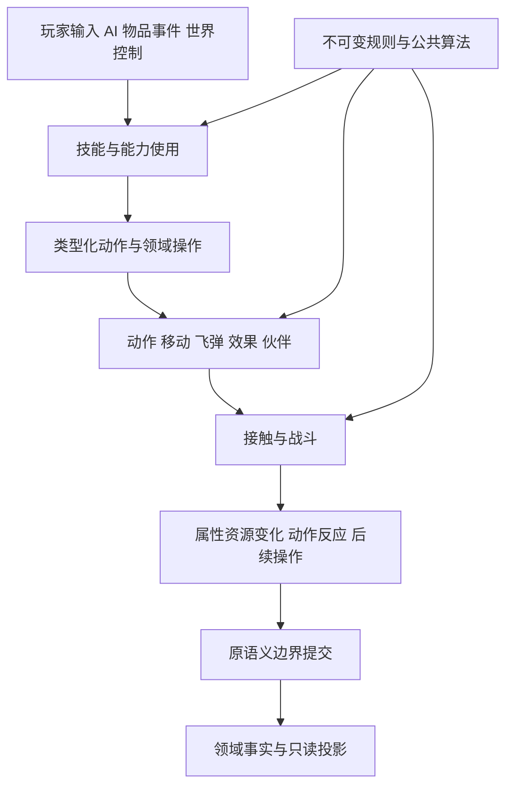

# 战斗领域与组合设计

## 1. 设计任务

本文回答“完整战斗服务端应当怎样分工，为什么这样分工”，不以当前类名、目录或迁移成本决定目标。版本与证据边界见[总纲](SERVER_COMBAT_RECONSTRUCTION.md)，原算法提取见[公共规则设计](COMBAT_SHARED_RULES.md)。本文全部是目标契约，不是现有功能声明。

提前重构应稳定机制，避免后续每加一种怪物、物品或技能就重新实现属性、动作、命中、飞弹或触发。设计不预先实现所有内容，也不追求任意游戏都能使用的通用引擎；服务对象就是经典资料片的完整规则及其组合。

架构评判顺序：原版行为准确、状态所有权清楚、跨内容可组合、公共计算可复用、失败语义完整、依赖可控，最后才是目录美观和迁移方便。某个架构名词、设计模式或文件数不是目标。

## 2. 六个必须分开的概念

| 概念 | 回答的问题 | 例子与边界 |
| --- | --- | --- |
| 定义 | 原内容是什么 | 原技能／物品／飞弹／怪物记录、公式、程序号；不可变 |
| 能力 | 某单位能接受哪些操作 | 可受伤、可施法、可装备、可成为尸体；不是按职业复制接口 |
| 来源 | 这次能力与效果由谁提供 | 学习、物品充能、装备光环、AI 技能；不等于操作者或归功者 |
| 机制 | 多种内容共有的执行规律 | 动作、属性、接触、召唤配额、效果撤销；不是具体技能名称 |
| 程序 | 哪种特殊行为及其顺序 | SrvStart／Do、MissileHit、属性函数、AI 家族；具名代码可组合 |
| 实例 | 本局已经发生并持续存在的状态 | 一次动作、一颗飞弹、一项诅咒、一个触发订阅、一个尸体 |

这六者不能塞入同一个 SkillSpec 或 Unit 对象。也不能要求每个概念都对应一个独立库：逻辑边界必须明确，物理拆分以依赖、所有权和编译隔离的实际收益决定。

## 3. 模块边界与理由

### 3.1 规则与事实基础

| 模块 | 负责与拥有 | 输入／输出 | 独立的理由与禁止事项 |
| --- | --- | --- | --- |
| 规则编译与目录 | 原表解析、符号链接、公式编译、元数据、程序支持信息 | 资源 → 不可变规则包 | 资源格式变化不应影响每帧执行；不持运行单位、不决定掷值 |
| 数值与公式 | 定点／受控整数、公式和曲线、随机原语 | 显式值 → 数值／下一随机状态 | 相同语义只实现一次；不隐式查询世界 |
| 属性 | 带参数属性、来源贡献、查询层次、派生依赖与有效快照 | 基础值／贡献变化 → 已提交属性视图 | 物品、被动、效果、形态都消费；不承担效果期限或世界目标选择 |
| 身份与单位能力 | 原身份、实体代次、可查询能力与领域句柄 | 实体引用 → 窄只读视图 | 跨玩家／怪物复用操作；不是重新集中所有运行态的巨型对象 |
| 空间与关系 | 房间／区域、权威位置与动态占位、关系判定 | 显式查询 → 候选／关系／碰撞结果 | 所有接触使用一致世界；索引不是位置真值，阵营不是所有技能资格 |

属性的基础值、贡献和派生缓存构成一个受约束的逻辑账本；可以作为各类单位存储中的组件，不必集中成全局 StatStore。来源模块持贡献句柄，不再持另一份可独立修改的最终属性。当前生命／法力等可变资源也只有一个权威位置，属性快照中的对应字段不得形成第二份真值。

### 3.2 运行机制

| 模块 | 负责与拥有 | 对外契约 | 不应承担 |
| --- | --- | --- | --- |
| 动作与模式 | 当前动作、模式、形态动作映射、序列相位、中断／恢复和事件游标 | 请求模式／动作、推进、取消、原动作事件 | 技能全部业务、像素渲染、直接结算伤害 |
| 技能来源与使用 | 可用技能来源、等级求值、起手／Do／ItemEffect、费用策略与使用实例 | 使用意图、资格结果、动作请求及类型化操作 | AI 决策、所有单位动作时钟、专属伤害存储 |
| 飞弹 | 发射／继承、Do／Hit／Damage、路径与接触、子弹、期限／结束 | 发射计划、接触请求、子弹请求、结束事实 | 玩家特有技能列表、直接写目标资源、图像对象 |
| 效果与光环 | 效果来源、叠加／覆盖、期限／周期、光环发射与接收、贡献／订阅绑定 | 效果变化、贡献变化、周期操作、撤销 | 最终属性第二副本、所有类型事件总线 |
| 反应与触发 | 订阅索引、事件匹配、触发顺序、一次性／递归资格 | 有序反应结果、带来源的技能／效果操作 | 任意回调修改世界、统一猜测冷却、把 OnAttack 当 OnHit |
| 战斗结算 | 接触发生、命中与防御、分通道伤害、阶段反应与结果 | 已计划资源／状态变化、动作反应和致命通知 | AI、掉落生成、协议编码、技能专属生命副本 |
| 移动执行 | 路径推进、位置／占位的原子变化、击退／冲锋／跳跃的位移结果 | 移动请求、进度／阻挡反馈 | 重新解释技能伤害、由渲染坐标决定接触 |
| 生命与尸体 | 致命发生、死亡流程、尸体可用性／消耗及退役 | 死亡／尸体事实、奖励与任务通知 | 每技能一套尸体锁、根据 hp=0 重复发奖 |

动作独立，是因为攻击、施法、走跑、格挡、受击、死亡都使用模式／帧机制。技能可以跨多个动作，动作也可以不属于技能；光环可在没有施法动作时持续存在。把动作藏进技能会迫使怪物、受击和变形另建时钟。

反应模块是服务端内部可复用机制，可与效果模块共库，但职责必须独立。装备与被动也会订阅事件，不都具有临时效果实例。属性层不能知道“某件装备击中时放什么技能”，效果层也不能反向编排整套伤害。

### 3.3 内容生产者与外围

| 模块 | 唯一职责 | 与机制的关系 |
| --- | --- | --- |
| 物品实例与装备 | 物品归属、装备有效性、孔／套装上下文、耐久／数量／充能 | 产生属性贡献、技能来源和反应订阅；消费物品费用计划 |
| 物品生成与掉落 | TC／品质／词缀／属性生成、来源资格、唯一性与掉落发生 | 纯规划可共享；真实种子、奖励资格及实例安装只在服务端 |
| AI 与感知 | 家族状态、目标保持、思考时钟、策略及失败反馈 | 产生移动／技能／等待意图；不绕过动作和战斗机制 |
| 人口与实体生命周期 | 出生身份、区域活动、休眠／恢复、准入与退役 | 提供单位能力、初始属性和行为绑定；不代替 AI |
| 伙伴与控制 | 主人／控制者、配额、替换、命令、同行和归功关系 | 组合人口、属性、AI 与技能；不维护第二份实体生命 |
| 世界物件与任务 | 门／陷阱／机关状态、任务控制和奖励资格 | 用显式环境来源调用飞弹／战斗／召唤，不假造玩家 |
| 调度与提交基础设施 | 逻辑帧、工作顺序、预算、版本守卫、预留／安装／事实 | 提供机制，不判断某技能、装备或怪物是否应成功 |
| 宿主与适配器 | 资源准备、连接绑定、原包投影、持久化和实例调度 | 无另一套规则执行；网络与存档格式不进入公共计算 |

## 4. 依赖不能靠事件总线掩盖

### 4.1 静态依赖方向

公共层从下到上是数值／身份小类型、规则值与局部算法、领域特定的纯规划。各领域只依赖所需窄契约，不通过公共头包含其他领域全部运行态。`rules` 不是集中全部游戏类型的巨型聚合头，公式执行核心也不反向依赖全部单位与物品模型。

权威执行层由组合根绑定读端口、领域命令处理器和提交参与者。组合根只接线，不掌握技能特例。生产者可以提交具名操作，消费者不需回调生产者的 System；结果用发生标识和类型化反馈表达。

这是职责流向图，不是每个技能都必须经历的固定执行顺序，也不是要求将箭头全部异步化。实际技能程序选择操作和原顺序；状态修改在相应领域完成。

### 4.2 三种协作形式

| 形式 | 合适用途 | 时间与所有权 |
| --- | --- | --- |
| 同步只读查询 | 当前抗性、来源、位置、模式许可、关系 | 在明确阶段读取，借用不跨提交；未知不伪装零 |
| 结算内局部求值 | 护盾修改本次伤害、属性聚合、动画推进 | 同步、有序、无任意世界修改；返回局部结果或计划 |
| 类型化领域操作／事实 | 创建弹体、消耗尸体、应用效果、死亡通知 | 由原程序确定即时还是定时；排队不自动代表下一帧 |

`combat → 反应 → 技能 → 弹体 → combat` 是合法的运行因果关系，不意味着这些模块必须互相包含 System 或递归任意调用。注册的具名操作处理器在受控执行上下文中分派，保留原嵌套顺序；同帧栈与未来帧定时工作明确区分。

不引入“任意事件名称＋任意 payload＋全局订阅”作为统一世界接口。新增技能特例不能靠监听所有伤害后修正生命；应在原语义所在的计算或反应阶段扩展。

## 5. 数据、程序与状态如何组合

### 5.1 原定义与执行定义

原始定义视图保留表身份、字段和原程序号，执行定义提供已解析的 ID、公式句柄、机制参数和具名程序引用。二者可共享存储，不要求复制两套全表；重点是既可追溯，又不让热路径反复解析字符串。

技能定义不能内嵌完整怪物／弹体定义，彼此用带类型 ID 引用。程序注册按角色分表，版本绑定由规则编译完成。一个程序可服务多个定义，一个定义也可能组合开始、执行、效果、飞弹和事件等多个程序。

适合数据表达：原字段、公式、目标标志、技能槽、程序绑定和原资源动作元数据。适合具名代码表达：条件控制流、专用动作回滚、特殊终结、不同的目标枚举与原事件顺序。不为追求数据驱动发明任意操作字节码，将复杂原程序藏进不可检查的配置。

### 5.2 实例键与关联

| 实例 | 关联字段 | 不应混用 |
| --- | --- | --- |
| SkillSource | 来源种类、原技能、来源实体／物品、等级规则、来源代次 | 来源物品 ID 与施法单位 ID |
| SkillUse | 本次发生、来源、目标、阶段、费用与程序局部状态 | 可用技能定义与一次施放 |
| Action | 单位、模式、相位、事件游标、动作代次、可选 SkillUse | 行走／死亡和技能释放时钟 |
| Effect | 来源、接收者、叠加键、贡献／订阅句柄、期限／周期 | 可见状态位与唯一效果身份 |
| Missile | 来源／发射器／归功、父发生、规则 ID、运动／伤害状态 | 视觉弹体与权威伤害实体 |
| Contact | 来源发生、目标、接触次序、结算阶段与结果 | 反重试标识与 NextHit 游戏规则 |

局部参数采用机制专用结构或有限 variant，而非所有技能共用的参数数组／几十个可选字段。原 `nPar1` 等槽可以在兼容适配处保留对应关系，领域代码中用具名含义表达。

### 5.3 采样时点是一部分规则

每项属性注明在开始、释放、子弹创建、接触、每次周期还是提交时读取。不会因为引入不可变快照就把所有加成冻结，也不会因为公共查询方便而让全部数值实时变化。版本守卫只处理计划失效，不替代原采样语义。

一个来源失效可能停止新动作，但不必销毁已经释放的弹体；效果所有者死亡也不必立即移除所有接收效果。存续、归功与后续资格分别判断，不能只靠一条 `sourceAlive` 规则。

## 6. 时间与原子边界

### 6.1 调度是机制，不是玩法大循环

调度器负责帧号、原排序类别、持续／定时事件、插入序和取消代次；动作、AI、效果与弹体拥有自己的状态。定时索引只引用工作，不复制另一份持续时间与运行实例。原队列策略与现代容器可以不同，行为顺序不可以无依据改变。

逻辑帧、动画定点相位、渲染时间和网络墙钟分开。暂停／积压不会使技能按实际毫秒补伤害；网络超时则不能依赖被暂停的游戏帧。实例内部串行与实例间并行兼容，不先并行化有共享随机和目标竞争的结算。

### 6.2 原子性按领域发生划分

装备变更必须把有效贡献、技能来源、触发订阅与资源边界一致安装；不能先切装备，下帧再移除光环来源。召唤材料、配额替换及新实体准入需要完整准备；伤害提交与当前伤害相关的护盾消费不能分别失败。是否将死亡触发与普通伤害合并在同一提交内，按原路径决定，不由“一切事务化”口号决定。

提交基础设施可以协调参与者的预留与无失败安装，但不了解具体伤害公式。参与者保留自身状态所有权，协调器不克隆全世界。已提交事实才供外部投影；原语义要求的结算内反应先作用于计划，不等待网络回包。

### 6.3 容量与背压

必要约束是容量失败不产生半个领域发生、不重复掷数、不中途改变有效帧。可恢复帧游标是一种目标实现选择，但不是默认让任何队列满都暂停全局；另一可行安排是在进入本帧相关工作前保证必要容量，并对新工作实施有界准入。具体策略需按工作类型证明语义与容量上界。

慢连接由网络队列策略处理，不能决定命中率或永久卡住权威时钟。既有单位的必要伤害／死亡事件不能像可拒绝的新管理请求一样随意丢弃。真正无法继续完成的实例应进入明确受限／故障状态并保留诊断，不伪造成功或无限等待。

## 7. 全生命周期一致性

| 变化 | 必须共同保持的契约 |
| --- | --- |
| 换装／破损／切组 | 物品原始值不重掷；属性、来源、光环／订阅按原时点生效；已释放动作另判 |
| 形态改变 | 原身份不变；模式、动画、能力、属性和资源转换一致；不复制一份“变身人物” |
| 控制／敌意改变 | 控制代次、候选关系、既有弹体／效果存续、归功各自有规则 |
| 死亡／尸体 | 致命发生唯一；死亡动作、尸体阶段、可消费标志、奖励和退役不混为同一布尔值 |
| 尸体竞争 | 每次动作复验同一尸体版本；不同技能不能各自认为消费成功 |
| 换房／换区／休眠 | 位置与索引一致；AI／效果／弹体时钟按具体生命周期处理，不一律重置或补算 |
| 伙伴替换／主人退出 | 配额、名册、控制、实体退役、效果／触发来源及保存例外共同收敛 |
| 保存／恢复 | 只持久化原格式允许的事实；重建派生值，不把临时索引／订阅／弹体写回角色档 |

注销用具名原因驱动每个领域清理，不能依靠析构回调串起隐式世界操作。公开查询只读；已退役句柄和旧代次不可重新绑定新对象。

## 8. 内容扩展的设计检验

本节是架构推演，不是测试脚本、测试用例或运行结论。它检查未来内容是否有合理归属；具体技能规则仍以原表和同版本证据为准。

| 组合场景 | 应当组合的机制 | 不合理设计的信号 |
| --- | --- | --- |
| 玩家／怪物／佣兵使用同一弹体族 | 来源策略＋技能程序＋独立飞弹定义＋共同结算 | 三份伤害公式，飞弹内部遍历玩家技能树 |
| 带装备光环与触发属性的佣兵 | 装备贡献＋技能来源＋光环实例＋反应订阅＋AI | effects 只能收 PlayerId，怪物直接模拟玩家按键 |
| 多段武器技能叠加蓄气与命中触发 | 手位策略＋动作事件＋接触阶段＋蓄气／终结程序 | 以一次动画只允许一次命中，触发只能排下一帧 |
| 变形单位受击／格挡后继续动作 | 形态映射＋模式仲裁＋相位／中断策略 | 技能系统和怪物系统各维护当前动画帧 |
| 父飞弹结束时散射并留下持续区域 | 结束原因＋子弹继承＋持续碰撞／效果＋来源归功 | 客户端图像消失被当作服务端爆炸触发点 |
| 多个技能争用同一尸体 | 通用目标资格＋尸体生命周期＋材料提交 | 每职业单独存“已消费尸体”集合 |
| 首领死亡触发、任务与掉落 | 致命发生＋死亡动作／程序＋任务／奖励领域 | AI 的死亡分支直接造物品并改任务档 |
| 套装／符文之语提供来源后切组 | 原始实例＋装备有效性＋贡献和来源撤销 | 每帧从名称重建加成，拆卸时无法定位自身贡献 |
| 陷阱／影子／特殊召唤 | 配额＋实体能力＋专用 AI／技能策略＋生命周期 | 所有召唤都复制主人属性或被当作普通飞弹 |

只有新增定义而机制未变时，应主要修改数据链接／绑定；原版出现新机制时，应新增窄算法或程序并复用既有提交和状态机制。不强迫特殊首领进入普通 AI，也不允许以“特殊”为由绕过数值、关系、生命周期和事实边界。

## 9. 物理组织建议

概念依赖先于文件划分。建议公共层有数值／公式、属性、动作、技能、飞弹、战斗、物品、单位／空间几何等内聚模块；服务端有对应权威执行模块和 AI、伙伴、人口、生命／尸体、世界控制。属性、动作、来源等基础契约必须轻量，不包含所有系统头。

可按共享依赖强度拆静态库，也可先在库内使用私有实现隔离。拆库的判断是消费者是否不同、是否需防止错误链接、公共头是否稳定以及编译影响，而不是“一张表一个库”或“一项技能一个目录”。供客户端链接的目标不能通过传递依赖带入宿主、网络、文件保存或权威世界。

实现应有层次明确的具名文件，不用 `common.cpp`、万能工具集合或大注册文件承载全部行为。注册表只描述编号和处理器绑定，程序实现在自己的机制族内；职业可作检索分组，不是算法复制边界。

## 10. 目标架构定稿标准

1. 每项权威状态有唯一所有者；每种跨域修改有具名契约、提交点和失败结果。
2. 动作、属性、来源、效果、触发、弹体与 AI 职责互不代办；逻辑因果环不转成随意的可变 System 引用环。
3. 公共算法保留精确语义和数据单位；相同机制不因职业／施法者类型／服务端与客户端而复制实现。
4. 专用程序可表达原版例外；没有强迫全技能使用同一费用时点、伤害顺序、目标策略或存续规则。
5. 所有后续内容类别在机制图中有归属；尚未实现内容缺的是定义／程序，而不是必须推倒基础状态模型。
6. 对典型跨域组合能解释来源、帧、随机、状态、提交和撤销；不能仅画出依赖图却说不清一次行为如何发生。
7. 在这些条件明确之后再编写当前工程的迁移任务；目录兼容或少改代码不能否决必要解耦。