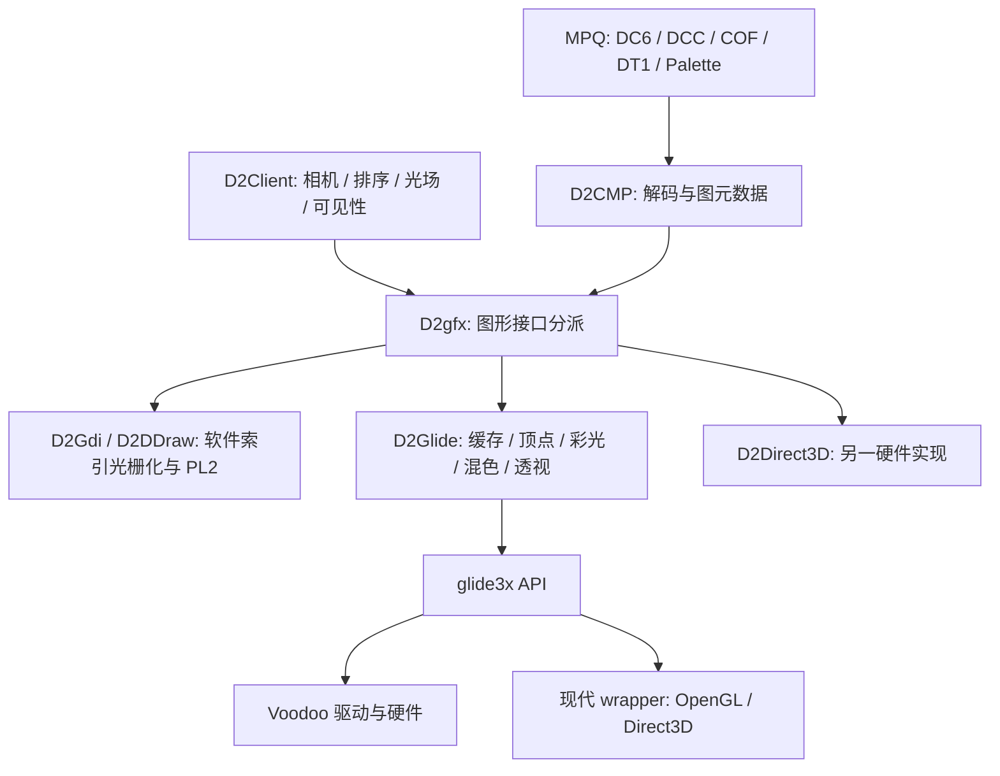
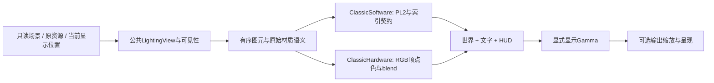

# Diablo II 1.13c Glide/3dfx 渲染分析与 D2X 改造方案

分析日期：2026-10-25。本文讨论 Diablo II / Lord of Destruction 1.13c，不是 Diablo I，也不把现代 Glide wrapper 的增强效果视为原版 Voodoo 硬件的固有功能。

## 范围与证据原则

目标是解释原版 Glide 后端的画面来源，对照当前 D2X，并给出未来可实施的改造方案。本文不是已实施功能清单；分析依据为已注明的静态证据，不包含原版抓帧或D2X运行认证。后续执行授权遵循项目验证指南。

本地原版样本来自 `D:\Downloads\Diablo II V1.13C`。原始 DLL、MPQ 和逆向中间产物不纳入源码提交，不将加载原版 DLL 作为 D2X 的实现方案。

证据分为本轮直接核对的源码／二进制事实、公开 API／第三方实现资料，以及仍需目标后端抓帧核实的推论。静态存在某个 API 不等于已确认所有场景都会调用，也不能代替实际图像比较。

## 按问题查找

| 需要判断什么 | 证据与差异 | 方案与验证 |
| --- | --- | --- |
| 样本是否属于同一原版后端 | [样本身份](#11-本地二进制身份)、[链路职责](#2-原版链路与后端职责) | [固定比较条件](#111-先固定比较条件) |
| 彩光为何与当前PL2不同 | [光照](#4-光照最大且最直接的差异)、[差异矩阵](#8-与当前-d2x-的差异矩阵) | [双呈现语义](#91-两种呈现语义共用场景准备)、[纹理与shader](#93-纹理与-shader-设计) |
| 透明、发光与阴影怎样混色 | [DrawMode](#51-精灵-drawmode-的原样本表)、[顺序与风险](#5-混色与绘制顺序) | [OpenGL映射](#94-opengl-状态映射)、[批处理](#96-批处理与缓存) |
| 哪些图元可以平滑或透视 | [过滤](#33-过滤应逐图元决定)、[几何透视](#6-透视几何规则不是滤镜) | [图元契约](#92-图元数据必须保留的语义)、[手工矩阵](#112-手工核对矩阵) |
| 先实现什么、哪些不能宣称等价 | [推荐](#结论与推荐)、[未知边界](#12-未核实边界与后续优先取证) | [改造顺序](#10-分阶段改造顺序)、[源码归属](#101-预计修改入口与归属) |

证据、差异和方案保留同页以便逐项对照，不另建重复证据册；新增结论仍按对应章节维护，不能把方案段当作当前功能。

## 当前已确认的 D2X 基线

- [场景照明](../gameplay/world/LIGHTING.md)与 [lighting_view.cpp](../../src/presentation/world/lighting_view.cpp)：已有原版定点距离、独立强度与 RGB 累积、传播遮挡、区域环境与部分光源生命周期。RGB 保留在光场中，不等于已经显示硬件彩光。
- [palette_blend_view.cpp](../../src/presentation/world/palette_blend_view.cpp)：世界来源按 `pal.pl2` 的 `Shadows[32][256]` 查表取光；即使光源有颜色，最终路径仍消费强度而非 RGB。透明墙与 Screen 特效也有专门查表着色器，不能将当前实现概括成普通 alpha 精灵。
- 世界目标为 RGBA，部分组合精灵及混色目标通过最近色反查索引；重复 RGB 索引无法完整保留原索引身份。该问题属于索引语义／软件兼容性，不应直接与 Glide 的 RGB 合成目标混为一谈。

## 结论与推荐

**推荐在现有 raylib/OpenGL 渲染之上新增原版硬件风格模式，而不是给 D2X 安装 Glide wrapper，也不是重写成全三维游戏。** 复用现有 MPQ、动画、光源网格、遮挡、可见性和排序，分别补齐硬件 RGB 调制、逐 DrawMode 混色、Gamma、地形细分与透视。当前 PL2 软件风格保持独立、可切回。

“3dfx 效果好很多”需要拆成四类问题：

| 说法 | 判断 | 对 D2X 的实际意义 |
| --- | --- | --- |
| 彩色光照、半透明与发光效果更丰富 | 相比软件 PL2 路径有明确的算法差异；本轮已核实 Glide 普通精灵的 RGB 调制与混色状态 | 是优先改造项，不需要更换图形 API |
| 透视更有层次 | 原后端确有几何位置／缩放变换，且不是整屏后处理；Direct3D 也有硬件透视接口 | 需要独立投影、地形几何和拾取方案，成本高于彩光 |
| 图像更平滑、更清晰 | 原 Glide 普通精灵仍是点采样，地面等特定路径才切换双线性；现代 wrapper 的缩放和 AA 是另一层 | 不应把所有资源改为双线性，尤其不能对调色索引插值 |
| 更流畅、支持高清和高帧率 | 历史性能口碑与现代 wrapper 增强应分别评价；未做同机性能对照，不能给倍数结论 | D2X 已是现代 GPU 路径，真正风险是背景复制、索引反查、批次碎片及资源上传 |

Glide 的优势不是提高原 DC6/DCC/DT1 的固有分辨率，也没有把预渲染角色换成实时 3D 模型。它把这些索引资源交给硬件纹理／三角形流水线，通过顶点颜色插值、RGB 混色和可选透视改变最终呈现。Direct3D 同样属于原版硬件后端，不能将“软件 vs 硬件”的全部差异说成“D3D vs Glide”。

本轮没有在 Voodoo 真机或指定 wrapper 下抓帧，因而不认证“Glide 全场景优于 Direct3D”或“D2X 已可像素级复刻 Glide”。下面的可实现契约与待核实边界应一起使用。

## 1. 样本与证据索引

### 1.1 本地二进制身份

以下样本均来自上述目录。文件版本资源读取为空；目录名和同组 Client 摘要与项目已有 1.13c 证据吻合，但**不能把 PE OptionalHeader 的 ImageVersion 1.11 当成游戏版本号**。采用摘要绑定结论。

| 模块 | 字节数 | SHA-256 |
| --- | ---: | --- |
| D2Glide.dll | 98304 | `7cf5907e9eb19b783b73fa45a5a7aa4491cb750e0d83df8c59b12d089310db6a` |
| D2Direct3D.dll | 110592 | `61d3b38b852138173835bbf5e7398dbe19240da5445aa7489b4cc4bebb4dc519` |
| D2DDraw.dll | 69632 | `32be89c456cd229c5eb9873c0488515539e6a22062b9ab5c2166af16eb05909c` |
| D2Gdi.dll | 53248 | `8737430c828031b29e8c5e59684faba050a7bf3c7cae38d34fa530212cd16047` |
| D2gfx.dll | 77824 | `50284647a28e8839028e8acb021a6ebe48c006e431139969ccd0fe126e6e8811` |
| D2Client.dll | 1093632 | `dd8bc6025de921216a97c17f97cd1a50fbb85926e838ec60e13451448836d906` |

D2Glide 为 PE32/x86，首选 ImageBase `0x6F850000`，唯一导出 ordinal `10000` 位于 RVA `0x92D0`，返回 VA `0x6F8649F0`，即 RVA `0x149F0` 的图形接口表。下文未特别注明的 RVA 均属于此 D2Glide 样本；运行时地址须用实际模块基址加 RVA。

本地目录顶层未发现 `glide3x.dll`。这不否定原游戏支持 Glide，但不能据此声称本机已安装某个 wrapper，或当前截图来自 3dfx。

### 1.2 参考与可信度

- D2MOO 本地快照：`5596f5cb6c5251a0a07c6637d26458b06099d516`。使用其 [D2Gfx 接口定义](https://github.com/ThePhrozenKeep/D2MOO/blob/5596f5cb6c5251a0a07c6637d26458b06099d516/source/D2Gfx/include/D2Gfx.h)、[分派与设置](https://github.com/ThePhrozenKeep/D2MOO/blob/5596f5cb6c5251a0a07c6637d26458b06099d516/source/D2Gfx/src/D2Gfx.cpp)、[Scale](https://github.com/ThePhrozenKeep/D2MOO/blob/5596f5cb6c5251a0a07c6637d26458b06099d516/source/D2Gfx/src/Scale.cpp)、[DrawMode](https://github.com/ThePhrozenKeep/D2MOO/blob/5596f5cb6c5251a0a07c6637d26458b06099d516/source/D2Gfx/include/DrawMode.h) 解释结构。其注释中的绝对地址不直接套用到 1.13c。
- Glide 常量／ABI：[sezero/glide 固定快照的 glide.h](https://github.com/sezero/glide/blob/2f226f0f9225ce8ee83e6a4a7042981e719d19ee/glide3x/h3/glide3/src/glide.h)。用于解释 `GR_*` 数值，不代表 D2 启用其全部功能。
- D2DX：以下网络源码按仓库 `main` 于本分析日读取，仅用作现代实现交叉参考，不是原版 DLL 的替代证据：[API 适配](https://github.com/bolrog/d2dx/blob/main/src/d2dx/glide3x.cpp)、[GamePS](https://github.com/bolrog/d2dx/blob/main/src/d2dx/GamePS.hlsl)、[GammaPS](https://github.com/bolrog/d2dx/blob/main/src/d2dx/GammaPS.hlsl)、[功能说明](https://github.com/bolrog/d2dx)。D2DX 是外部项目，与本仓库 D2X 不同。
- Sven：[wrapper 原理](https://www.svenswrapper.de/english/whatis.html)、[FAQ](https://www.svenswrapper.de/english/text/faq.html)。属于作者说明与历史经验，不是受控画质／性能实验。

证据标识：**原样本事实**表示本轮直接核对指令或数据；**源码事实**表示当前 D2X 或指定参考代码可定位；**方案**表示未来设计；**待核实**表示不能用于宣布原版等价。

## 2. 原版链路与后端职责



D2MOO 显示 D2gfx 按显示模式加载驱动 DLL，获取 ordinal10000 的 `D2GraphicsInterfaceStrc`；透视能力、Gamma、调色板、地面、墙、阴影、精灵与矩形各有入口。D2Client 仍负责游戏语义和绘图次序，后端不是独立游戏引擎。

**原样本事实：D2Glide 对 `glide3x.dll` 使用普通 PE 导入表，非全部通过 GetProcAddress 动态绑定。** 导入的主要函数包括：

| 类别 | API | 作用 |
| --- | --- | --- |
| 表面／交换 | `grGlideInit`、`grSstSelect`、`grSstWinOpen`、`grBufferClear`、`grBufferSwap` | 选择设备、创建显示上下文、清屏与交换 |
| 顶点／光栅化 | `grCoordinateSpace`、`grVertexLayout`、`grDrawVertexArray`、`grDrawVertexArrayContiguous` | 提交屏幕坐标顶点、颜色和纹理坐标 |
| 纹理 | `grTexSource`、`grTexDownloadMipMap`、`grTexDownloadTable`、`grTexFilterMode`、`grTexCombine` | 缓存纹理、更新调色板、选择采样和纹理组合 |
| 混色／透明 | `grColorCombine`、`grAlphaCombine`、`grConstantColorValue`、`grAlphaBlendFunction`、`grChromakeyMode/Value` | 来源色计算、整体透明度、颜色键及目标混合 |
| Gamma | `grGet`、`grLoadGammaTable`、`guGammaCorrectionRGB` | 查询硬件表容量／位数并应用输出曲线 |
| 其他 | `grDepthMask`、`grColorMask`、`grDitherMode`、`grLfbLock/Unlock` | 写入开关、量化相关状态与线性帧缓冲访问 |

RVA `0xDC90` 的表面创建路径选择 640×480 或 800×600，传 `GR_COLORFORMAT_RGBA=2`、左上原点、两个颜色缓冲、零辅助缓冲。`0xDE46` 调 `grDepthMask(false)`，颜色写入开 RGB、关 alpha。**RGBA 在这里是颜色参数的打包格式，不等于请求了 32 位帧缓冲。** 不能从这一个常量推出 Voodoo 实际位深，也不能把现代 wrapper 的 RGBA8/10bit 输出说成原版硬件行为。

此路径没有靠完整三维 Z-buffer 解决前后遮挡；按原顺序覆盖与混色仍是关键。D2X 不能因为增加顶点／透视就任意按纹理排序，或改为普通 3D 深度测试。

### 2.1 继续分析时的函数入口

接口表顺序按 D2MOO 定义解释，并与本轮实际函数内容交叉核对；未展开的入口只表示已定位，不表示算法已完整恢复。

| 函数／数据 | D2Glide RVA | 已核实内容／用途 |
| --- | --- | --- |
| 后端接口导出／表 | `92D0` / `149F0` | 唯一导出返回 54 个函数指针构成的接口布局 |
| Detect / Init | `D6E0` / `D760` | 初始化分配缓存与表，调用 Glide 初始化 |
| CreateSurface / 内部建表面 | `DF60` / `DC90` | 创建显示上下文、设置顶点与纹理状态 |
| SetPaletteTables / SetPalette | `CF50` / `CF80` | 复制 0x120 字节表指针描述；转换 256 个 PALETTEENTRY 并上传 |
| SetAmbientColor | `B7D0` | 保存传入 RGB；完整消费者仍需逐分支追踪 |
| 颜色乘法表初始化 | `B7F0` | 256×256 字节表，`floor(intensity * channel / 255)` |
| CelDraw / FlatSprite / Color | `B190` / `B270` / `B0E0` | 普通精灵已追到状态机与顶点组装，其他专用变体仍需展开 |
| 精灵混色状态机 | `9F60` | DrawMode 跳转表位于 `A090` |
| 精灵来源色／采样 | `A0B0` | `A0D7` 设纹理乘插值顶点色，`A0F5` 设点采样，`A11E` 起展开打包光照 |
| TileDrawLit / TileDrawTrans | `72F0` / `7320` | 都进入 `7080`，分别传255／调用者alpha；完整内部混色仍待核实 |
| ShadowTileDraw | `71B0` | 已定位，专用阴影状态需继续核对 |
| FloorTileDraw | `B9E0` | 调缓存 `8EB0`；按末尾指针是否非空切换采样，按质量分支生成顶点颜色 |
| UpdatePerspective | `CC40` | 保存投影中心 |
| PerspectiveTransform | `CB90` | 带高度／bias 的定点坐标变换 |
| PerspectiveTransformScale | `CAA0` | 位置变换及单位缩放状态 |
| ClearPerspectiveScale | `CA90` | 缩放状态复位为256 |
| 透视表初始化 | `CCC0` | 8192 项有符号倒数表 |
| SetGamma / GammaCanBeControlled | `D1A0` / `D190` | 查表／指数接口两路；支持查询返回1 |
| Glide API 跳板 | `5FC0` / `5FDE` / `6008` | 分别为 ColorCombine / TexFilterMode / AlphaBlendFunction |

## 3. 纹理、调色板与缓存

### 3.1 原图仍是索引图

原版资源格式的角色／怪物动画由 DCC/DC6、组件顺序由 COF、地形由 DT1 描述。Glide 接收到的是解码／拼装后的纹理和绘图描述，不会在 GPU 上解析 MPQ，也不会替代 COF 的方向／层顺序。

本轮核实的 `GrTexInfo` 实例：

| 描述 RVA | smallLOD / largeLOD / aspect / format | 含义 |
| --- | --- | --- |
| `14BC8` | `5 / 5 / 0 / 5` | 32×32、单 LOD、P8；被 `8E21` 上传路径引用 |
| `14BDC` | `8 / 8 / 1 / 5` | 256×128、单 LOD、P8；被 `8F59` 路径引用 |
| `14C1C` | `4 / 4 / -1 / 5` | 8×16、单 LOD、P8；被 `7C49` 路径引用 |
| `14BF0` / `14C04` | `8 / 8 / 2 / 10` | 256×64、RGB565；由 Smacker／视频相关路径消费，不是全部世界图元格式 |

`grTexDownloadMipMap` 的名字不意味着这些纹理有完整 mip 链；上表 smallLOD 等于 largeLOD。不能直接对 D2 精灵生成 mipmap 并称为原版。

`CF80` 把 PALETTEENTRY 的 RGB 重排为 `0xFFRRGGBB`，`D043` 调 `grTexDownloadTable(GR_TEXTABLE_PALETTE=2, table)`。同一组索引可以在调色板、颜色平移或材质变化后得到不同 RGB，所以后续纹理缓存要区分“索引像素身份”和“调色／平移身份”，不能只有解码文件名。

### 3.2 透明并非黑色 alpha

原 `DEA1` 将 chromakey 设置为数值 `0xFF`，结合 RGBA 打包应按 API 语义解释，不能把它读成“索引255透明”。现代 D2DX 的 GamePS 在 chromakey 开启时用索引0丢弃片元，这是该 wrapper 对 D2 资源约定的适配；不能据此未经核对就把任意黑色 RGB 判为透明。

D2X 已用索引0产生覆盖 alpha。新路径应显式保存覆盖语义，避免 RGB565／视频、实心矩形、世界索引图和 UI 共享一个错误的透明判定。双线性边缘的色键执行阶段、透明邻居颜色贡献和原硬件结果尚需专门抓帧。

### 3.3 过滤应逐图元决定

已确认的调用：

- 精灵 `A0F5`：TMU0 的 min/mag 都是 `POINT_SAMPLED=0`；第二 TMU 可用时同样设置。
- 普通墙相关 `7136`／`7274`：设置点采样。
- 地面 `B9E0` 中 `BA8B` 检查最后一个栈参数，对照接口即 `pTileData`：非空进入 `BAA5` 的双线性，空进入 `BAD4` 的点采样。**该指针在 Client 中何时非空，本轮未闭合，不能将条件直接改名为“透视开关”。**
- 视频相关 `8718`、另一个状态切换器 `CD6B` 也出现双线性；`CD91` 可恢复点采样。

D2X 如采用 P8 的现代等价 `R8UI`，硬件不能直接替它做“调色后双线性”。必须读取四个整数索引、各自查 palette 得到颜色、再在颜色域插值，或者缓存已展开 RGBA 的特定地面页。对数值索引直接 `texture()` 双线性会制造完全无关的颜色。

## 4. 光照：最大且最直接的差异

### 4.1 共用上游，分开消费

公共光样本的原版布局为四字节 `[Intensity, Red, Green, Blue]`。D2X 的 `Color` 用 `[R,G,B,A]` 保存同一含义，其中 A 是强度，不是覆盖透明度。未来应在窄接口处使用具名类型或明确转换，避免把 light.a 当材质 alpha。

D2X 已具备的距离／衰减／遮挡规则继续以 [照明基线](../gameplay/world/LIGHTING.md) 为准。改变 GPU 后端不应顺带改灯光半径、环境底光、随机闪烁、状态期限或服务器25Hz时序。

当前软件风格的概念关系是：

$$
index_{lit}=Shadows[\lfloor intensity/8\rfloor][index_{src}],\qquad C_{src}=Palette[index_{lit}]
$$

然后再按 PL2 的透明／Screen 表与目标索引合成。32 行是离散索引变换，不能与“原 RGB 乘某个亮度”视为相同运算。

### 4.2 Glide 普通精灵的已核实运算

`B7F0` 用整数除255初始化65536字节表。`A11E` 从输入打包光照的低字节取得强度，分别用后三字节查表，然后写到四个精灵顶点的 PARGB 字段。

对每个颜色分量：

$$
L_c=\left\lfloor\frac{I\,RGB_c}{255}\right\rfloor,
\qquad C_{src,c}\approx Palette[index]_c\frac{L_c}{255}
$$

其中第一步的整数取整已核实；第二步是 `grColorCombine(SCALE_OTHER, LOCAL, ITERATED, TEXTURE, false)` 的数学意义，实际 Voodoo 光栅化／定点乘法与帧缓冲量化不保证等于现代浮点乘法逐像素结果。

重要的实施细节：

1. 先计算并量化顶点 RGB，再插值／乘纹理；不能随意交换为“先插值 I 与 RGB，再相乘”，两者通常不相等。
2. 普通精灵四顶点共用单位取光结果，不按角色头顶屏幕位置反算地面光；现有 `LightingView::sample(item.position)` 可复用。
3. `A14C` 还有标准色表分支，`HIGHLIGHT` 还会走不同纹理／调色准备；不能把所有精灵都强制走上述普通分支。
4. 已经使用硬件 RGB 调制后，不应再套一次软件 Shadows，否则会重复压暗。
5. 这种彩光是低密度光场与预渲染图像相乘，不是法线贴图、PBR、实时投影阴影或体积光。

### 4.3 地面与墙不能用同一张屏幕光罩替代

地面入口 `B9E0` 的低质量分支 `BB01` 起读取四角 `D2GfxLightExStrc` 的强度与颜色，经过同一整数乘法表，提交四顶点 triangle fan。高质量分支从 `BC62` 开始，本轮未完整恢复其细分拓扑、全部角点和绘制桶。

D2X 地面目前使用61×61光场、四邻点整数平均、双线性采样强度和 PL2 行选择。要复刻 Glide，不能简单把该 shader 改为 `source.rgb *= light.rgb * light.a` 就算完成：光样本的平均位置、顶点量化、三角形划分、颜色插值和过滤边界仍会改变渐变。

墙体则使用 DT1 LightDirection 相关的六个样本和分块几何。当前 [world_renderer.cpp](../../src/presentation/world/world_renderer.cpp) 的 `tileLights` 主动返回白色 RGB，只保留强度；新硬件路径首先需要保留真实 RGB，但必须继续遵守普通／备用面选择和前墙状态。地面、竖墙、屋顶、阴影是不同 primitive 类别，不因共用原图纹理就共用一套取光算法。

## 5. 混色与绘制顺序

### 5.1 精灵 DrawMode 的原样本表

`CelDraw(B190) -> 9F60` 按 ESI 中的 DrawMode 切换；`A090` 的五项跳转表依次对应模式3至7。下面列出正常到达该状态机时的 RGB 方程，颜色归一化到0..1，结果受目标格式截断／饱和影响。

| 模式 | D2MOO 名称 | Glide RGB 因子 `(src,dst)` | 概念输出 |
| ---: | --- | --- | --- |
| 0 | TRANS25 | `(SRC_ALPHA, ONE_MINUS_SRC_ALPHA)`，常量alpha64 | `src*(64/255) + dst*(191/255)` |
| 1 | TRANS50 | 同上，alpha128 | `src*(128/255) + dst*(127/255)` |
| 2 | TRANS75 | 同上，alpha192 | `src*(192/255) + dst*(63/255)` |
| 3 | MODULATE | `(ONE, ONE)` | `clamp(src + dst)`，名字不能替代实际方程 |
| 4 | BURN | `(ZERO, SRC_COLOR)` | `dst * src` |
| 5 | NORMAL | `(ONE, ZERO)` | `src` |
| 6 | TRANSHIGHLIGHT | 进入通用透明状态，但此函数不重新设置0/1/2的常量alpha | 还依赖调用前状态／专用前处理；不能假定等于50% |
| 7 | HIGHLIGHT | `(ONE, ZERO)` | 混色覆盖；颜色／纹理准备有特殊分支，不能据此当成NORMAL |

这里 alpha combine 在透明／加色等分支取常量，纹理的覆盖由 chromakey 等机制决定。新实现不能无条件把 PNG 风格纹理alpha、顶点alpha和整体opacity相乘三次。

一般硬件混色公式为：

$$C_{out}=C_{src}F_{src}+C_{dst}F_{dst}$$

上表的模式3不是数学 Screen：`1-(1-src)*(1-dst)`。D2X 当前 `screenBlend` 选择的是原 PL2 Screen 查表路径；即使视觉上都用于发光，也不能默认逐色等同于加法。后续应恢复原 DrawMode 身份与消费者，不要靠现有 `screenBlend` 布尔值猜所有材质。

### 5.2 墙体、阴影和矩形是独立契约

当前 D2X 透明墙按64／128／192阈值查三张 PL2 表，低于64不画。Glide 的 `TileDrawTrans(7320)` 将实际alpha交给 `7080`，本轮尚未展开其全部状态分支，不能直接照搬软件阈值。

地面 `B9E0` 已确认：alpha255走覆盖；其他值走常量alpha混合，并将传入值用于 `grConstantColorValue`。这至少证明原硬件接口存在连续opacity消费，不能把所有图元都压成软件三档。

单位阴影、地形阴影、屋顶、UI实心框、自动地图淡出分别需要恢复自身入口的状态。原图形接口保留这些区分是有实际意义的；切换硬件风格时保留这些类别比增加几十个全局布尔开关更可靠。

### 5.3 当前 D2X 的成本与正确性风险

[palette_blend_view.cpp](../../src/presentation/world/palette_blend_view.cpp) 的 `drawWall`、Screen 分支和矩形会刷新当前批次，用 `rlBlitFramebuffer` 在 GPU 内复制受影响矩形到独立纹理，再采样目标并查表。不是 CPU 回读，也不是每次必定复制整帧。

背景反查先用6bit/通道的 LUT 加精确 RGB 检查，失配时扫描256色；其他混色 shader 直接做256色最近色搜索。重复 RGB 的索引身份丢失，已调制的非调色颜色也会量化。这是软件兼容路径的技术债，但硬件 RGB 路径不需要为每次普通透明／加色／乘色做背景复制，现代固定功能 blending 即可完成。

优化的正确方向是减少实际需要目标采样的图元，而不是先把所有特效合成到一个独立层再叠回世界。透明／加色与墙、单位的交错具有顺序依赖；同一“效果类型”也不能跨遮挡边界移动。

## 6. 透视：几何规则，不是滤镜

### 6.1 已核实的原版实现

`CC40` 保存两个投影中心值；`CB90` 变换带bias的坐标；`CAA0` 变换单位位置并写全局精灵缩放；`CA90` 将缩放恢复256。公共 Scale 接口明确区分位置、位置加缩放及复位。

`CCC0` 生成8192项32位有符号倒数表。令表索引为0..8191：

$$
T[k]=\operatorname{trunc}_{0}\left(\frac{3072000}{\operatorname{clamp}(k-4096,-2999,2999)-3000}\right)
$$

这里 `trunc_0` 表示 x86 `idiv` 向零截断。投影例程再通过 `&0x1FFF` 查表，使用 `0x2D4=724`、`0x376=886` 等整数系数、算术右移10／20位；不能替换为三角函数相机并称逐像素等价。

`CB90` 的简化过程，**仅描述正常范围的数学关系，非可直接粘贴的完整移植**：

```text
axisX = sar32(wrap32((inputX - centerX) * 24), 16)
axisY = sar32(wrap32((inputY - centerY) * 24), 16)
heightTerm = wrap32(bias * 1228)
depthTerm = wrap32((axisX + axisY) * 724)
lookup = (sar32(wrap32(depthTerm * 886 + (heightTerm << 9)), 20) - 4096) & 8191
factor = T[lookup]
screenX = width / 2 + sar32(wrap32((axisY - axisX) * factor * 724), 20)
screenY = height / 2 - 32
		+ sar32(wrap32(sar32(wrap32(heightTerm * 886 - (depthTerm << 9)), 10) * factor), 20)
```

`sar32`／`wrap32` 在上述记法中表示目标32位机器语义，不允许在 C++ 中直接用有符号溢出或负值左移模拟。输入单位、Client 的固定点传参、面板偏移和bias来源必须从调用者继续确认。

`CAA0` 另用中心坐标的近地／抬高投影差产生单位scale，`bOrder` 分支乘1228或1126后右移10；写入 RVA `15F14`，复位值256。这证实“单位缩放”和“瓦片角点透视”不是同一操作。

### 6.2 D2X 的现状与影响面

[scene_view.cpp](../../src/presentation/scene_view.cpp) 的 `screen/world` 是等距投影及其逆变换，加视口中心、zoom和screen shake；打开侧面板时重算世界视口中心。世界地形在当前渲染路径中以完整 Sprite 矩形提交，尚无对应的原生透视几何链。

未来必须一起解决：

- 地面菱形／子块与竖墙的顶点位置、UV、三角形拓扑、裁剪与边界一致性；整张高墙矩形变形会造成墙脚漂移。
- 单位脚点、组件偏移、投影高度、阴影、飞弹高度、地面物品名与血条位置；UI不参与世界透视。
- 鼠标地面定位、sprite命中检测与遮挡选择。仅改绘制而沿用 `unproject` 会造成点击落点偏移。
- `Levels.NoPer` 区域限制及原Client调用条件，从当前MPQ读取；不能凭室内／室外分类替代。
- 分辨率／左右面板引起的投影中心变动，宽屏范围与原版限制，房间剔除范围扩大后的瓦片空洞。

因此透视应排在彩光与混色稳定之后，默认关闭直至完成几何和输入联动。不要为追求3dfx观感引入全三维碰撞／寻路或改服务器坐标。

## 7. Gamma、位深与现代增强

### 7.1 原版 Gamma

RVA `D1A0`：当全局控制值 `17B28 > 0` 时，查询 `GR_GAMMA_TABLE_ENTRIES=5` 与 `GR_BITS_GAMMA=0x2A`，分配表并调用 Fog 导入的表生成 helper，再把同一表作为 R/G/B 三通道传给 `grLoadGammaTable`。helper 跳板为 `5F12`，其全部公式／控制值来源本轮未恢复。

否则 `D251` 起把传入的整数Gamma乘 RVA `124A8` 的 `0.01f`，三通道传给 `guGammaCorrectionRGB`。这个备用路径的参数映射已核实，但不能据此跳过主查表路径和对比度语义。

D2X 当前没有对应的原版用户Gamma链。方案应使用渲染输出 LUT，不写系统全局Gamma ramp，以便 Windows/Linux、窗口化及截图行为一致。曲线与取样按目标模式恢复；“不受世界光照影响的HUD”不等于“不受最终显示Gamma影响”。截图要标注是否经过输出Gamma，避免拿 pre-gamma 缓冲对比显示器画面。

### 7.2 不混淆颜色空间与历史精度

原固定功能路径的计算不能默认当作现代线性光工作流。首个兼容实现建议用普通非 sRGB 纹理／颜色目标表达原资源编码值，显式关闭自动 framebuffer sRGB 转换，只在输出阶段应用已确认的LUT。若另做线性光增强，需要独立命名，不能静默改变默认效果。

Voodoo 各代的帧缓冲精度、抖动、扫描输出滤波与现代 wrapper 的高精度目标不是同一件事。本轮观察到 `grDitherMode(0)` 在部分精灵模式被设置，但未恢复所有状态交错，也没有指定真机型号，不宣称已经模拟“3dfx 16位／22位观感”。输出前单次RGB565量化也不等价于每次目标混合后的低精度量化。

D2DX 公开说明中的高帧率运动预测、宽屏／分辨率修改、选择性边缘AA、Catmull-Rom／sharp-bilinear缩放和更高颜色精度，均属于现代增强。Sven FAQ 也明确普通单机仍受25fps限制；wrapper 不自动改变玩法／动画节奏。D2X 的显示插值可以继续独立演进，但不属于本次 Glide 规则移植的先决条件。

## 8. 与当前 D2X 的差异矩阵

| 维度 | 原版 Glide 已知行为 | 当前 D2X | 建议 |
| --- | --- | --- | --- |
| 技术栈 | x86后端DLL + Glide3 + 驱动／wrapper | C++20、raylib、rlgl、GLSL330 | 保留现有跨平台栈，不加载原DLL |
| 资源 | 原索引图、组件／分块、P8缓存 | 原MPQ解码；部分源保留索引，另有RGBA组合 | 延后RGB展开，明确palette／transform身份 |
| 单位彩光 | `floor(I*RGB/255)` 顶点色乘纹理 | PL2 Shadows，只消费I | 首先实现最小普通精灵分支 |
| 地面光照 | 顶点彩光，有低／高质量分支 | 光场采样强度并查PL2 | 逐步恢复硬件细分与量化位置 |
| 墙体 | 六点／分块与硬件图元链 | 六点标量；`tileLights`丢弃RGB | 分离硬件样本消费，保持原取样面 |
| 透明／加色 | 常量alpha、加法、乘色、覆盖各自状态 | PL2透明／Screen + RGBA目标反查 | 用类型化DrawMode映射，不复用一个加色布尔 |
| 目标缓冲 | RGB固定功能合成，原硬件精度依设备 | RGBA渲染目标，查表需复制背景矩形 | 硬件模式使用固定功能blend，软件模式保留独立目标策略 |
| 过滤 | 精灵／普通墙point；地面条件bilinear | 源纹理point；光图bilinear | 来源过滤与光照插值分开配置 |
| 透视 | 定点倒数表、几何变换、单位scale | 线性等距screen/world | 独立功能阶段，联动拾取／裁剪 |
| Gamma | LUT或guGammaCorrectionRGB | 尚无同等用户链 | 输出LUT，并区分资源值与显示变换 |
| 遮挡顺序 | 图元顺序依赖，非完整Z-buffer场景 | stable_sort的SceneOrder，屋顶单独绘制 | 复用已有排序并单独补原版差异，不按材质全局重排 |
| 屏幕尺寸 | 已核实表面640×480／800×600 | 世界按实际窗口尺寸，HUD另有缩放 | 原尺寸对照模式与扩展视口分开 |
| 高频显示 | 不等于新动画帧／新玩法tick | 有独立客户端显示与25Hz宿主 | 不把GPU帧率绑定状态／灯光随机消费 |

## 9. 推荐架构与实现契约

以下类型名／字段均为**建议**，不是当前已经存在的API；实施时按现有领域归属做最小扩展，不先造通用渲染引擎。

### 9.1 两种呈现语义，共用场景准备

建议配置一个明确的世界呈现策略 `ClassicSoftware` / `ClassicHardware`，并将 `Perspective`、输出缩放、AA 等增强选项正交处理。不要把“硬件模式”命名为“所有效果都更高质量”，也不要将 `lighting=false` 错当成后端选择。



场景排序、光源生命周期、资源选择和动画帧仍只有一个主人。GPU策略只改变取色、几何／采样、混色和输出；玩法、网络包、存档不能因画面选项变化。

### 9.2 图元数据必须保留的语义

| 建议字段 | 必须解决的问题 |
| --- | --- |
| `PrimitiveKind` | 区分floor、wall、roof、unit、shadow、overlay、UI，不从texture尺寸猜 |
| `PaletteHandle` / `TransformHandle` | 当前幕调色板、组件染色／颜色平移，带代次／revision |
| `NativeDrawMode` | 保留0..7等来源身份；未知值不能默认为普通alpha |
| `CoverageMode` | 区分color-key、明确alpha、无透明，不用RGB黑色判断 |
| `LightSamples` | 明确I和RGB的独立意义，单位一点、墙六点、地面顶点集 |
| `Opacity` | 与灯光强度、覆盖mask分开；地面连续alpha不能提前三档化 |
| `SamplingMode` | source point／已核实的palette-aware bilinear，独立于光场采样 |
| `ProjectionData` | 世界脚点、原图偏移、bias、高度、面板状态、透视资格 |
| `OrderKey` | 保留稳定原序和相邻提交范围，透明命令不全局材质排序 |

不要把原 DLL 的地址、Win32结构或指针布局直接暴露给公共场景头。原字段是恢复规则的证据，不是 D2X 必须复用的 ABI。

### 9.3 纹理与 shader 设计

第一阶段可沿用现有 RGBA8 的 R通道存索引与A通道存覆盖，减少对 raylib 的改动；shader 用点采样或 `texelFetch`，整数化后查palette。稳定后再衡量 `GL_R8UI`／`GL_RG8UI` + `usampler2D` 的收益，注意raylib默认纹理格式与批处理未必直接支持整数采样器，需要独立的窄GL资源适配。

硬件普通精灵最小公式：

```glsl
uint sourceIndex = loadSourceIndex(pixelCoord);
if (coverageIsColorKey && sourceIndex == transparentIndex) discard;
vec3 sourceColor = fetchTransformedPalette(sourceIndex);
vec3 shadedColor = sourceColor * interpolatedQuantizedLightRgb;
```

这是拟定接口表达，不包含所有DrawMode／高亮／色键边缘。`interpolatedQuantizedLightRgb` 必须来自原版取整后的顶点颜色，不能把灯光纹理的A当作片元opacity；PL2模式继续用其自身光照与混色链。

若要做调色后双线性，四邻居分别索引查色后再插值，严格定义边界clamp／atlas gutter与覆盖处理。先在已核实地面路径启用；UI、文字、普通精灵维持point。不要对 `R8UI` 生成mipmap，也不要让atlas边缘从相邻材质取色。

COF组合要保留每层原索引／颜色平移／绘制模式和顺序。能确认为不透明覆盖的层才可合成索引画布；含加色或透明的层不能提前压成单一RGBA图后再统一取光，否则会改变层间混色与背景依赖。

### 9.4 OpenGL 状态映射

| 已确认语义 | 推荐GL实现 | 注意事项 |
| --- | --- | --- |
| 普通覆盖 | 关闭blend或 `ONE,ZERO` | 覆盖先做color-key discard |
| 常量透明 | `FUNC_ADD`，`SRC_ALPHA,ONE_MINUS_SRC_ALPHA` | shader输出alpha为该图元常量，避免再乘重复alpha |
| 加色 | `FUNC_ADD`，`ONE,ONE` | 来源先取光；RGBA8目标自然饱和；浮点目标需显式决定饱和阶段 |
| 乘色 | `FUNC_ADD`，`ZERO,SRC_COLOR` | 透明区域仍discard，不把黑mask乘到背景 |
| 软件PL2 | 保留现有目标复制／查表契约 | 不以固定功能alpha冒充索引查表 |

原Glide表面关闭alpha写入。D2X如在内部目标保留alpha，应明确设为恒1或使用单独alpha写掩码／`glBlendFuncSeparate`策略，避免乘色后alpha变0导致最终整屏呈现异常。UI开始前完整恢复状态，包括shader、blend、scissor、sampler和framebuffer；参数改变前刷新raylib待提交批次。

### 9.5 精确软件索引目标是独立工作

如果目标包含严格软件模式一致性，应逐步消除 RGB→index 反查，而不是为硬件模式强制回到256色：

1. 不透明PL2输出直接保留结果索引，透明／Screen表返回索引，最后统一映射RGB。
2. 使用整数颜色附件时，普通OpenGL blending不支持目标索引语义；必须显式目标采样／ping-pong／有界复制。
3. 同一texture作为当前绘制attachment又被采样会产生feedback风险，不能靠“看起来可用”提交；兼容GL3.3方案继续独立读写目标。
4. 并行保存索引附件与RGBA附件并不自动解决问题：一旦颜色离开palette，必须标识索引是否有效。软件模式与硬件模式分开通常更清晰。

这项工作改善软件精确性，不是显示Glide彩光的前置依赖，应避免把它变成首个阶段的大型重构。

### 9.6 批处理与缓存

- 仅合并有序队列中相邻、状态兼容的图元；batch key至少涵盖纹理页、palette/transform、DrawMode、采样、投影与shader变体。
- 把可逐顶点传递的颜色与opacity放顶点／实例数据，减少每个单位uniform切换；不要在未flush的批次中更新共享uniform或palette内容。
- 按实际解码来源／帧／方向／transform代次建立缓存身份；palette变化尽可能更新小表，非无条件重传全部纹理。
- 缓存设置内存预算与可解释的淘汰策略，预热与冷热性能分开记录；不照搬Voodoo的TMU显存地址／对齐作为现代GPU限制。
- 保持资源准备与GPU上传线程边界，GL调用在正确context线程；缺图／未知材质仍按项目规范报告，不造资源替代。

## 10. 分阶段改造顺序

实施授权与验证流程仍遵守 [测试指南](../development/TESTING.md)。下面是未来工作包与完成条件，不表示本轮已实施或已运行。

| 阶段 | 改动范围 | 交付与准入条件 | 风险 |
| --- | --- | --- | --- |
| G0：参考固定 | 指定1.13c模块、MPQ、wrapper或真机、分辨率、Gamma与开关 | 确认真正的Glide路径；形成固定场景的前后端状态与图像依据 | 配置差异会使后续比较失效 |
| G1：材质语义 | 现有Sprite／特效消费者到绘制入口保留索引、DrawMode、opacity | 维持ClassicSoftware输出；列明原模式6/7等未知项 | 布尔screenBlend不能覆盖全语义 |
| G2：普通单位硬件光照 | 复用LightingView，新增硬件shader／策略 | 普通单位显示整数调制RGB；全亮不重复压暗；UI不吃世界光 | 单位颜色平移与高亮不能遗漏 |
| G3：混色与墙体 | 按已确认规则实现透明／加法／乘色；补齐墙体7080和阴影 | 多层特效与遮挡正确；普通硬件透明不再依赖背景反查 | 错误重排、alpha写入和墙体阈值 |
| G4：地形精确化 | 恢复高质量地面拓扑、分块颜色、过滤条件及屋顶 | 三角形边界无裂缝；原地面／墙面局部对齐，覆盖多个LightDirection | 当前整Sprite提交与原子块链差异较大 |
| G5：显示曲线 | 补齐Fog helper与Gamma／contrast映射，新增输出LUT | 灰阶／彩阶、暗部及HUD行为可解释，截图阶段明确 | 双重Gamma／自动sRGB转换 |
| G6：可选透视 | 恢复Client传参、NoPer、定点投影、单位scale及逆映射 | 走动、面板开合、遮挡、点击与地面目标均一致 | 影响所有世界位置和输入，为高风险阶段 |
| G7：现代增强 | 可选缩放、选择性AA、精度与显示平滑 | 与原版兼容模式分开；关闭后恢复兼容路径 | UI变糊、错误颜色空间、与动画时钟耦合 |

G2/G3最可能带来明显的3dfx风格收益；G4/G5决定能否可信对齐；G6是层次感增强但不是第一步。G5可以提前做曲线取证，正式比较G2/G3时应先固定同一输出条件。不要先引入Vulkan／DirectX11或整套第三方wrapper再寻找差异。

### 10.1 预计修改入口与归属

| 当前文件 | 后续职责 |
| --- | --- |
| [lighting_view.cpp](../../src/presentation/world/lighting_view.cpp) | 保留公共光场；按证据提供原始／角点样本，不混入图形API选择 |
| [world_renderer.cpp](../../src/presentation/world/world_renderer.cpp) | 选择图元类别、保留墙RGB与稳定顺序；逐步准备地形几何 |
| [palette_blend_view.cpp](../../src/presentation/world/palette_blend_view.cpp) | 当前PL2路径保持；硬件实现成独立私有模块，避免无限增加shader分支 |
| [graphics.cpp](../../src/presentation/graphics/graphics.cpp) | 索引上传、组件／颜色平移身份、纹理缓存及覆盖 |
| [scene_view.cpp](../../src/presentation/scene_view.cpp) | 世界投影与逆变换；仍只持窄渲染句柄 |
| [frontend.cpp](../../src/app/frontend.cpp) | 世界目标尺寸、显示输出／Gamma的组合入口，不承载光源规则 |
| [escape_menu.cpp](../../src/presentation/hud/escape_menu.cpp) | 仅消费能力与偏好，未支持选项维持不可用 |

阶段实现时才新增必要的硬件renderer／geometry文件及CMake登记。本轮不创建占位源码，不改变公共玩法模型、网络或D2S。

## 11. 未来对照与验收条件

### 11.1 先固定比较条件

参考端记录：模块摘要、MPQ挂载顺序、游戏版本、`-3dfx` 实际生效情况、加载的glide3x来源／版本、驱动与输出格式、分辨率、窗口／全屏、Gamma／contrast、Lighting Quality、Perspective、Blended Shadows、wrapper增强开关。

普通 `-w` 不能单独当作Glide证据；Sven FAQ指出窗口模式需要相应 `-3dfx` 选择。本地现有光照文档中的普通窗口截图只认证其当时条件，不能直接升级为3dfx对照结果。

两个客户端还需固定区域／种子、世界坐标、观察者、昼夜／任务环境、装备光、状态、物件模式和动画时刻。最好使用同一只读场景输入；无法同步时将动态像素和静态区域分开，不对整帧误差做伪精确解释。

### 11.2 手工核对矩阵

以下是未来获得运行授权后的观察项目，不新增测试脚本／专用程序：

| 场景 | 要区分的风险 |
| --- | --- |
| 白光暗洞与全亮切换 | PL2与RGB调制、重复压暗、Gamma影响 |
| 冰／火／毒色光照向同一白灰地面与单位 | 真RGB是否被消费，I和RGB是否乘错两次 |
| 两种色光重叠、满强度饱和 | 上游顺序／整数舍入与下游顶点插值 |
| 高墙／角墙／屋顶与玩家前后移动 | 六点取光、备用面、透明连续度、排序 |
| 门边、挡视线地形与多个玩家光源 | 保留现有传播遮挡，不混成屏幕径向渐变 |
| 多层发光飞弹／光环覆盖单位和墙 | 加法、乘色、透明顺序与目标alpha |
| 角色组件染色、无形装备、选中高亮 | 原索引、变色表、DrawMode特殊分支 |
| 640×480、800×600及宽屏窗口 | 缩放与扩大视野分离、atlas边缘与UI清晰度 |
| 透视开关、NoPer区域、侧面板开合 | 投影、裁剪、标签、拾取逆映射一致 |
| 菜单／退局／跨幕／改尺寸 | 调色板代次、FBO恢复、Gamma与缓存生命期 |

比较指标应分层：原索引／调色变换一致性、来源光照中间值、单图元混色、静态区域RGB误差、连续移动的闪烁／裂缝、点击误差，以及CPU/GPU耗时／draw calls／上传字节／背景复制面积。不同输出精度可以预先设容差，但不能用提高容差掩盖错图、错层或错误混色公式。

性能结论必须同分辨率、同场景、冷热缓存分开统计，并同时记录GPU与CPU时间；目前只能说明硬件混色有机会消除一类复制／反查，不承诺实际加速倍数。

## 12. 未核实边界与后续优先取证

1. `7080` 墙体／屋顶／阴影的完整RGB混色、alpha门槛和颜色插值；不能把软件后端三档规则当成硬件结论。
2. 地面 `BC62` 高质量细分拓扑、每个角点的平均／量化次序，以及Client给 `pTileData` 赋值的控制条件。
3. 精灵模式6、7、颜色平移、平面精灵、裁剪和组件缓存之间的全部相互作用；原模式名不代表可直接按现代同名blend实现。
4. `D1A0 -> Fog helper` 的Gamma／contrast表公式、设置来源和与最终输出的关系。
5. 原chromakey在不同过滤模式下的边缘规则，所有palette中的透明保留项与特殊UI图元约定。
6. 透视的Client侧输入固定点单位、bias、NoPer控制、拾取／标签与两侧面板调整，及全部纹理Q坐标的赋值。
7. 若目标是真Voodoo逐像素一致，还需指定硬件代次／驱动、精度、抖动及输出处理；现代wrapper不能替代该认证。
8. D2Direct3D本轮仅核对样本、基础依赖与公共接口定位，没有逐函数恢复其纹理格式回退和所有状态；没有证据证明其彩光／透视必然弱于Glide。
9. 当前D2X已知的原绘图桶、光源生命周期、天气／闪电与环境同步缺口不会被更换shader自动修复，继续归现有专题维护。

## 13. 许可、复查与使用方式

二进制分析只在用户本机进行，文档记录规则、函数入口和摘要，不分发原DLL、反编译源码或MPQ图像。D2MOO按项目既有许可约束使用；D2DX源码声明GPL-3.0-or-later且包含其他许可组件，不能未经许可审查直接复制到本仓库。Glide公开源码也有其自身许可，不因可在线读取就视为无条件可用。

未来复查优先使用现有只读工具，例如：

```powershell
Get-FileHash 'D:\Downloads\Diablo II V1.13C\D2Glide.dll' -Algorithm SHA256
objdump -p 'D:\Downloads\Diablo II V1.13C\D2Glide.dll'
objdump -d -M intel --start-address=0x6f859f60 --stop-address=0x6f85a0a4 'D:\Downloads\Diablo II V1.13C\D2Glide.dll'
```

PE `-p` 输出较长，读取时必须包含最后的glide3x导入描述，不能因终端截断误判为动态绑定。反汇编从已知函数／指令边界开始，函数表是数据而非指令；跳板地址与导入名先对应，再解释参数。

**最终建议：先保留软件模式，实施具备明确DrawMode的索引取色＋整数顶点彩光＋硬件混色，再补Gamma与地形精确化，最后做联动输入的可选透视。** 这条路线能利用D2X已有成果，不依赖原版DLL或特定Windows wrapper，也能把原版复刻和现代增强保持为两项可独立评价的目标。