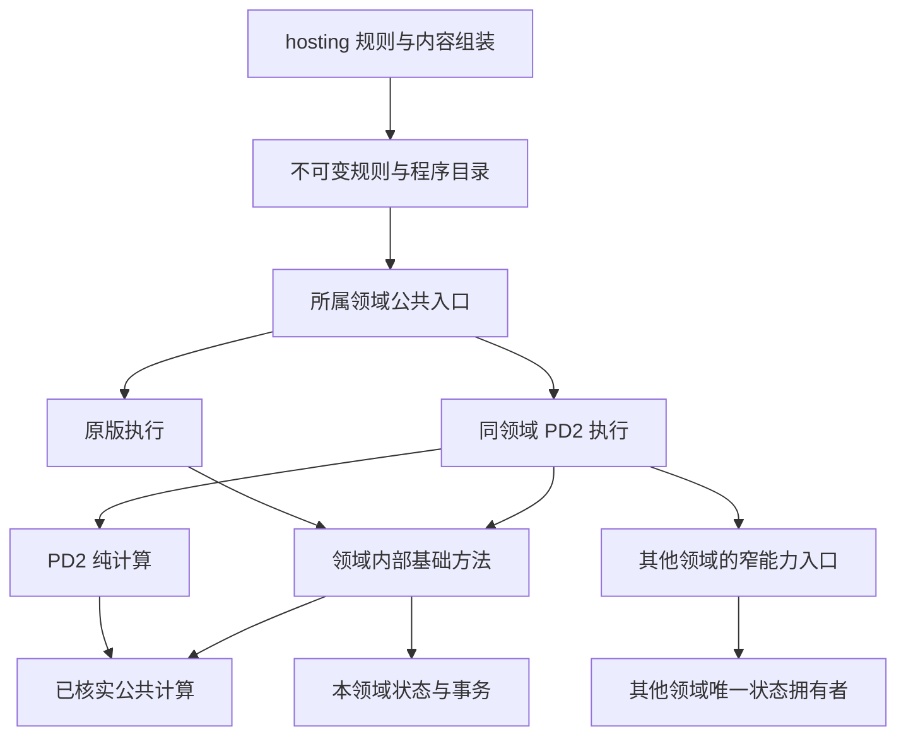

# PD2代码分离与基础能力复用计划

## 定位与结论

本页是待实施的代码组织设计，不是已完成重构声明，也不新增产品功能范围。输入为[逐函数等价性审查](../pd2/FUNCTION_PARITY.md)、[缺口与补齐计划](../pd2/GAP_PLAN.md)、[现有架构](OVERVIEW.md#agent速览)及[差异隔离约束](PD2_COMPATIBILITY.md#共享入口与pd2专属函数)。本轮只编写文档；行为依据、版本及未决项仍由PD2负责分册维护。

**推荐方案：按领域内置分离，公共能力复用，状态和提交仍归原领域。** PD2的大块纯算法、执行流程、内容准备及表现分别放在所属层的PD2文件中；公共入口在明确的规则边界选择实现。同领域私有成员允许在PD2文件中实现，跨编译单元的内部纯helper通过最小内部头共享，跨领域副作用只通过拥有者的窄能力入口调用。

第一阶段追求的是源文件、职责和契约独立，不是独立进程、可热插拔DLL、完整独立静态库或一键删除所有PD2代码。代码分离与行为修复分开推进；移动到pd2目录不会自动消除F02浮点缩放、手位或充能列表的语义差异。

## 目标与非目标

| 目标 | 可观察的结果 |
| --- | --- |
| PD2规则可集中阅读与修改 | 定位一项功能时能找到规则入口、领域执行和公共依赖，而非到处查同一profile分支 |
| 能复用基础公共及非公共函数 | 依据所有权选择直接调用、私有成员、内部helper或领域能力；不复制内部实现来绕过访问控制 |
| 原版路径稳定 | 未选择PD2时不创建其专用状态、不执行专用副作用；公共算法不因PD2修复改变原版契约 |
| 同一权威、同一时钟与事务 | 无PD2副本PlayerStore、事件循环、库存真值或随机管理器；延迟、重试和保存沿公共生命周期 |
| 可渐进迁移 | 每次只处理一个已分析功能及其必要依赖，原入口保持可定位，缺证据的程序继续明确拒绝 |

非目标：不加载ProjectDiablo.dll／BH／mdll1，不复刻地址Hook、CRT跳板及Windows ABI；不为每个技能建立虚类；不要求每个短小if都抽文件；不建立覆盖内容、网络、UI、存档和战斗的万能Pd2System。不因分离计划扩大本地共享／材料仓库范围，也不把CN协议需求强加给自有宿主。

## 当前可复用基础

| 现有事实 | 对分离方案的约束 |
| --- | --- |
| [combat/system](../../src/server/systems/combat/system.hpp)将preparePd2MissileCritical等声明为private，[pd2/critical](../../src/server/systems/combat/pd2/critical.cpp)在独立文件定义同一System成员 | 已能分文件而不扩大public接口；优先沿用，不另建可访问全部系统的PD2管理器 |
| [skills/pd2/charge](../../src/server/systems/skills/pd2/charge.cpp)通过现有Ports调用effects.skillAuraState | 跨领域的状态创建仍由effects负责；专用技能可以独立编排，但不直接修改别域容器 |
| [skills/runtime](../../src/server/systems/skills/runtime.hpp)持有运行状态和PD2延迟数据 | 状态随skills实例生存，不移入静态全局；是否继续收拢类型依据实际依赖，不扩大runtime头的可见面 |
| [公共随机](../../src/core/random.hpp)与[整数运算](../../src/gameplay/rules/arithmetic.cpp)在F06／F09所审输入下可复用 | 不为PD2复制一套同义SEED或nativeAdd；PD2事件随机及CRT流仍保持不同契约 |
| [物品倍率](../../src/gameplay/combat/pd2/item_modifiers.cpp)、[主人属性](../../src/gameplay/stats/pd2/owner_values.cpp)已有领域内PD2纯逻辑 | 从现有职责继续收敛，避免重命名和目录搬迁替代真正的缺口修复 |
| [CMake](../../CMakeLists.txt)把PD2纯规则编入d2x_rules，领域执行编入d2x_server | 现阶段可以沿现有目标增删源文件；没有必要先制造server与pd2_server互相链接的库 |

以上只是已读入口，不表示所有PD2代码均符合目标边界。完整调用等价性仍须逐函数审查，尤其是隐藏在调用者中的手位、来源和提交时点。

## 四种独立程度

1. **逻辑独立**：命名、输入输出、前后条件明确，短分支可留公共函数。适用于纯字段或小条件差异。
2. **源文件独立**：PD2算法或长流程有专属实现文件，公共入口保留一次分派。此为主要目标，可在原namespace与原class中实现。
3. **内部接口独立**：多个实现文件共享领域内部helper，或同一能力有原版／PD2计算策略；只有真实重复／耦合出现时增加内部契约。
4. **构建目标独立**：依赖图稳定后可选拆纯规则对象库或源集合；不以此作为前三级完成的前置条件。独立动态插件需要另外设计ABI、版本与卸载，不在本计划内。

目录不是访问权限，静态库也不是C++封装边界。反过来，private成员实现位于不同文件并不会失去访问本类私有成员的权限。

## 分层归属

下表优先使用现有目录；“建议”表示未来位置，不表示文件或API已经存在。

| 层 | PD2部分 | 公共部分及禁止跨越的边界 |
| --- | --- | --- |
| resources／content | 已有资源身份检查、content/pd2表解释与差异元数据 | MPQ读取、TXT／BIN链接由本层完成；只向下交付纯值，不把Archives传给server |
| hosting | 已有hosting/pd2准备、规则选择、角色与协议组装 | 复用实例、异步内容及存储服务；不执行命中、库存裁决或另一条游戏循环 |
| gameplay | 按combat／stats／items／skills／maps归属放纯PD2计算 | 复用数值、公式、StatList与数据类型；不读取实体Store、网络、设备或隐式全局种子 |
| server领域 | skills／combat／effects／missiles／travel等各自的pd2实现 | 领域采样、资格、续办和提交仍由原System持有；不互相包含private runtime来修改状态 |
| network | 固定方言的编解码及PD2／CN接收器 | 只处理协议；核心玩法、资源解析和保存不随收包分支执行 |
| client／presentation | PD2只读投影、客户端程序、专用显示算法 | 复用Remote副本及场景；效果看起来相同不能替代权威数值，未知输入继续保持未知 |
| persistence | 版本化物品和原生扩展段规则 | 格式边界统一，既有旧format保留；运行态不借分离新增私有存档段 |

不把所有pd2子目录搬成一个顶层src/pd2。那会让表读取、权威状态、客户端副本和存档形成横向依赖，反而破坏现有层次。

## 公共与非公共函数调用规则

这里的“非公共”必须拆成实际的C++访问场景，不能一律要求开放为public。原DLL内部函数／未导出符号只说明取证身份，不决定D2X的访问级别。

| 被复用能力 | 推荐方式 | 不采用的方式 |
| --- | --- | --- |
| 无状态、契约已核实的公共函数 | 直接包含最小头并调用，例如nativeAdd、limitedRandom | 为PD2复制同义函数，或新建统一函数服务定位器 |
| 只用于一个System、需要其私有状态的方法 | 在所属pd2实现文件定义同一System的private成员；必要时增加少量private声明 | 将字段改public、向外暴露整个System内部或广泛friend |
| 同领域多个实现文件需要的无状态helper | 从匿名namespace／static函数提取到所属领域内部头和实现，使用明确参数及内部namespace | include另一个.cpp、复制算法、把内部helper升到全项目公共头 |
| 跨领域共享的纯计算 | 经语义核对后下沉gameplay相应领域；只接受值／只读规则 | 纯函数依赖server Store，或把整套领域System下沉gameplay |
| 跨领域有副作用的操作 | 使用拥有者现有的prepare／commit或类型化领域方法；确有缺口才扩窄接口 | 直接访问对方private容器、绕过revision／事件容量／事务校验 |
| 只为一个调用者服务的内部细节 | 保持私有，调用上层能力获得所需结果 | 为“以后也许用到”提前抽象成公共能力 |
| PD2与原版同名但语义不同的算法 | PD2专属函数，名称体现数值／规则差异 | 仅因参数相同就复用错误算法，或偷偷改变原版公共函数语义 |

### 同类私有成员

以preparePd2MissileCritical为模板：公共接触流程决定何时调用，PD2实现文件可以调用本类private方法并访问ports_／state_；外部仍只看到原公共命令。分离不改变类实例、this身份、调用位置或缓存寿命。

这不意味着每个PD2函数都应变成System成员。纯概率、筛选、倍率等应留gameplay或领域纯helper，避免为了访问方便把全部算法和规则放进System。成员函数只承担需要领域能力的采样、阶段控制和提交。

### 编译单元私有helper

匿名namespace和文件级static具有内部链接，另一个.cpp即使加声明也不能合法复用原符号。需要复用时先判断它是否真的无状态，以及是否依赖原调用时点：

1. 只有一个调用者时不移动。
2. 同领域两个消费者确需同一算法时，提取为领域内部函数；声明放邻近内部头，定义保留唯一一处，包含依赖显式写出。
3. 需要System私有状态时保留成员，或由成员准备值后传纯helper，不让自由函数拿整个System指针。
4. 跨领域需求若其实是“获得结果／执行操作”，新增拥有者的窄能力，而不是共享其所有内部步骤。

不得通过宏改写private、include实现文件或暴露原始容器引用来解决调用问题。内部头不依赖于命名就自动受保护：当前编译目标可能允许其他文件包含它，需靠include审查和模块约定约束，不宣称编译器已强制领域私有。

### 窄能力与现有Ports

现有领域Ports可以继续使用，不为每个函数立刻创建接口类。只有PD2自由函数需要远小于现有Ports的能力、且依赖开始外溢时，才引入局部窄视图或参数集合。建议能力包括“按实际手位采样属性”“准备一个状态来源”“提交一组伤害候选”“登记或取消所属单位帧事件”，每项都由原领域实现。

能力需要写清只读／准备／提交、失败状态、可重试性、身份代次及句柄有效期。不能提供“查任意系统”“写任意stat”“执行任意command”的通用后门。接口持有引用的生命周期不得超出实例，异步续办只保存身份和已准备值，不保存可能失效的PlayerState指针。

## 分派与配置

PD2规则身份、网络方言、内容准备模式、物品保存format是不同维度。它们由组合边界验证兼容组合，但不合并为传遍玩法的巨型Profile，也不依赖remoteLobbyOnly等产品标志决定算法。

1. 启动／连接边界核定资源构建与协议；hosting准备实例不可变规则及受支持的程序表。
2. server收到自己的只读规则选择或程序编号，不接收network::ClientProfile、MPQ路径和认证对象。同一实例不得在运行中随未知包切换规则。
3. 少数算法用显式分支或已有可选PD2规则即可；存在大量表驱动程序时沿已有程序目录登记具名回调，不为每项临时if增加虚函数。
4. 未实现程序在准备或领域准入时明确拒绝，不能用空回调当成功。只有已核实的原版回退分支才允许委托公共实现。
5. 各协议接收器也保留自己的“已消费／附加后继续／不适用／格式错误”契约，不能把网络bool处理模式照搬成玩法执行状态。

公共入口内只保留选择和共同编排。若PD2改变前后顺序，则允许独立执行函数重组已核定的基础步骤；不能为强行共享模板而把已用技能、状态或随机采样移到不同时间。禁止使用任意before／after钩子串联全部领域；扩展点必须有具体语义和确定执行次数。

## 依赖结构

箭头表示代码依赖或能力调用，不表示任意跨层访问。

不能形成gameplay→server、server→hosting／content／network、权威代码→presentation的反向依赖。同领域的共同入口调用PD2实现和PD2实现调用内部基础方法在同一目标内是正常结构；若未来拆库，则必须重新检查链接依赖，不能把它伪装成两个互相链接的独立模块。

## 状态、随机与生命周期

代码文件可独立，状态不能再造第二份。PD2运行数据可作为所属State／Runtime的具名成员，体量增长后再收拢为PD2子结构；是否用optional／unique_ptr由真实构造成本、可见类型和清理需求决定，不机械改现有所有字段。

| 状态／动作 | 拥有者与分离约束 |
| --- | --- |
| 单位资源、装备及完整属性 | 保持PlayerStore、monsters和属性来源体系；PD2仅通过领域快照或候选修改使用 |
| 接触中的暴击／阶段标记 | 保留原SpellImpact／contact生命周期；成功提交后才标记已消费，拒绝／过期与背压区别处理 |
| 单位SEED、PD2事件随机、CRT流 | 分别注明算法及所有者；借用候选种子并复验提交，不把全部随机集中成Pd2Random全局对象 |
| 充能时钟、命中间隔和延迟触发 | 原frameEvents拥有时间推进；所属领域拥有key及处理程序，取消、死亡、离区、退局沿同一生命周期 |
| 地图实例及开图待办 | travel／world持有唯一上下文，PD2控制数据作为实例组成；不复制门户与房间状态 |
| 客户端计数／效果与协议时钟 | 保持原连接代次和副本清理；不与服务端状态共用可写对象 |
| 保存 | 只持久化原生格式允许的值；临时状态、回调指针、快照及规则对象不写入存档 |

必须保留三类时点：命令接受时冻结的事实、执行时重新采样的事实、提交时复验的事实。不能为了给PD2函数一次性传齐输入而把延迟触发所需的“执行时装备”改为“施法时装备”。

准备阶段不表示一切都允许延后：原版要求分步提交或同步事件可见性的流程仍保留阶段。统一事务不能改变伤害事件、状态撤销和掉落冻结顺序。Capacity／PendingContent等待同一候选，Stale按原资格重新判定；已提交随机与物品不可因重入再次消费。

## 九项审查的落位

本节把F01–F09转成代码组织决策，不重复其算法依据，也不把未决问题预先判成接口设计错误。

| 审查 | 保留或分离的位置 | 允许调用的能力／尚需闭合 |
| --- | --- | --- |
| F01 暴击判定 | 保留gameplay/combat/pd2纯函数 | 用公共nativeAdd及SEED；由combat准备实际武器、掌握和属性，不让纯函数自行查Store |
| F02 浮点百分比 | 建议先加入现有gameplay/combat/pd2数值接口；跨已核定领域复用后再考虑gameplay/rules/pd2 | 与原版整数百分比并存，不能全局换公共算法；跨领域提取以真实第二消费者为条件 |
| F03 生命门槛 | 保留PD2纯谓词，调用仍在资源修改所属流程 | 来源与候选由combat／attributes准备，提交由原事务；不要公开任意写生命能力 |
| F04 充能 | PD2选层／编码／间隔决策与公共物品时钟、事务分开 | inventory/items持有注册和续订；先证明运行列表和保存列表映射，不能为分离绕过FullStats |
| F05 倍率应用 | combat/pd2同类private成员及小型纯缩放函数 | 公共接触保留调用顺序、成功标志和提交；不复制完整命中／死亡链 |
| F06 随机桥接 | 不移植包装器；复用core/random对应算法 | 原函数绑定作为文档证据；非零偏移和其他随机种类逐项核定 |
| F07 参数层 | 保留gameplay/items的PD2筛选能力 | 输入实际武器、装备关系及有序属性；公共装备选择是否可复用须先完成原getter核对 |
| F08 动态主人属性 | gameplay/stats/pd2做重算，effects／attributes提供当前资源和来源 | 复用StatList和真实主人，不另设PD2属性缓存；与装备资格共享的内部helper按所有权抽取 |
| F09 nativeAdd | 保留公共整数函数 | 不新增PD2包装转发；需要CF／OF的算法另核，不滥用局部等价 |

后续技能、AI、地图、客户端和存档也用同样分类，但不能假定九项样本足以决定全库所有函数归属。每完成一个函数审查即更新原逐函数条目，再决定是保留、提取内部能力还是新增专用程序。

## 典型调用链设计

### 暴击与伤害

保持“公共接触资格→所属领域采样→PD2判定／倍率→公共接触后续”的明确边界。采样可以调用本类内部方法与effects公开能力；算法只接收值及候选随机，返回kind、倍率及必要结果。确定成功后由原提交路径更新种子及contact缓存，再按原位置施加物理倍率。

F02数值修复应作为独立行为改动，不与大规模文件移动合并。先保留原版倍率路径，给经证据确认的PD2消费者明确调用新契约，再考虑把相同采样步骤提为内部helper。禁止先将武器槽0封装成“通用实际武器接口”而固化尚未确认的手位语义。

### 充能与物品再生

公共入口负责物品定位、代次、所属容器、事件时钟、事务和通知；PD2部分负责原充能资格、首记录选择、编码更新和间隔。它应返回明确的“不适用／不再续订／续订但不改值／修改并续订”等语义，而不是用一个bool混合所有结果；具体类型在实现时复用已有结构或做最小扩展。

不复制库存和地面两套PD2调度器，也不把两种通知／提交压成同一套未经核定的行为。数据准备必须能表达原运行列表所需事实；缺资料时保持未支持，不为便于接口而只传最小保存层。

### 技能与延迟事件

长技能程序放skills/pd2，复用公共动作、目标筛选、公式、状态和飞弹能力。需要skills内部运行游标时用同类私有成员或既有内部执行结构；调用effects时保留其领域方法，不直接修改列表。延迟记录保存原目标身份、来源及必要参数，回调时按原规定重新采样，不能捕获跨帧裸指针。

基础步骤若需要被原版和PD2复用，应先从大函数中提取真正共同的阶段，不复制一个只有几个编号不同的完整技能系统。原版回退只能发生在原函数明确委托原版的条件下，不是PD2缺程序时的默认后备。

### 地图与特殊控制器

地图规则与控制数据放对应PD2纯规则／travel领域，公共world提供布局准备与房间能力，population／death持有人口及奖励。跨域协作通过已有prepare／commit和类型化上下文，不向控制器传GameSystems。

特殊场景可有具名控制状态，但仍归实例及原帧队列调度；先闭合控制器、AI、阶段、死亡、奖励、结束，再解除入口拒绝。不能为了“PD2模块自己管理”另开线程、时钟或奖励队列。

## 头文件与构建安排

第一阶段保持现有CMake目标，新增实现登记到实际拥有者：纯值规则沿d2x_rules／d2x_gameplay的现有依赖，执行沿d2x_server，内容和协议沿各自目标。内部头不放公共聚合头，非模板实现尽量留.cpp，避免改一项PD2规则导致所有领域重编。

依赖范围遵循：公共类型确需下游可见才用PUBLIC；实现依赖用PRIVATE。PRIVATE只控制CMake使用需求传播，不会自动使C++函数私有，不能作为领域访问控制的替代。

第二阶段只有在构建依赖确实成为问题时，考虑各层的PD2源集合或OBJECT库。对象库的编译配置须显式一致，不能假定最终库的编译选项会自动传给对象编译。源码只编入一次，避免同一实现同时进入原库与新库。不要拆成d2x_server→d2x_pd2_server→d2x_server循环，再靠链接器分组掩盖依赖。

若未来必须可选关闭PD2，应另立任务处理注册、实例状态、类型引用和用户配置拒绝路径；当前计划不承诺移除目录即可编译，也不引入无需求的构建开关。

## 实施顺序与文件归属

以下A项只定义分离工作，业务补齐优先级仍沿[缺口计划](../pd2/GAP_PLAN.md)。R1为PD2相对独立，R2为合法复用公共／非公共能力，R3为原版与状态生命周期不变，R4为渐进且可复核的迁移。

| 顺序 | 任务与具体入口 | 依赖、完成条件及归属 |
| --- | --- | --- |
| A01 | 对准备迁移的每个函数补“当前可见性、状态拥有者、公共依赖、内部依赖、调用时点”，写入FUNCTION_PARITY原条目 | 先证据后设计；一项分析一项落盘，未审函数不批量分类。覆盖R1／R2／R4 |
| A02 | 以F02为首个小型数值切片，在现有gameplay/combat/pd2接口旁设计原浮点缩放；逐调用修改missile_contact及经核定的weapon_damage分支 | 先关闭数值未知项，再做行为修复；不改公共整数契约。纯规则负责人＋combat集成者，覆盖R1／R3 |
| A03 | 复核combat/system.hpp与pd2/critical.cpp的采样／判定／提交边界，能复用的内部步骤保持private | 依赖F01／F05／F07手位证据；无新增公共Store访问，无重复随机。combat负责，覆盖R1／R2／R3 |
| A04 | 逐个处理实际阻碍跨.cpp复用的匿名helper，优先保留成员；确需共享时提到所属领域最小内部头 | 不先创建通用internal.hpp大集合；调用者同时迁移，定义唯一。所属领域负责，覆盖R2／R4 |
| A05 | 收拢充能专属选择与间隔，保留inventory/replenishment、items系统的时钟及事务 | 依赖F04元数据／列表审查；满值、交易、移物、跨区及续办仍有明确路径。inventory/items共同集成，覆盖R1／R3 |
| A06 | 核owner_values、effects/amazon、attributes无形计数的能力边界，复用运行属性查询 | 依赖F08资格与采样时点；不增加第二缓存，不公开全部StatList可写引用。attributes/effects负责，覆盖R2／R3 |
| A07 | 按现有skills/pd2与runtime抽取长执行流程；新增延迟阶段留原生命周期与frameEvents | 先做普通可达技能，不一轮重排全部System；重试不会再次掷数或提交。skills及事件拥有者负责，覆盖R1／R3／R4 |
| A08 | 普通地图与特殊控制器按travel/world/population/death职责继续分离；网络、表现、存档也各在自身层收拢 | 不能先放开未知程序；共享接口改动由集成者统一。各域负责，覆盖R1／R2／R3 |
| A09 | 功能切片稳定后核对头文件和CMake依赖，必要时整理各层源集合 | 不要求拆新库；无反向链接或重复编译。构建集成者负责，覆盖R4 |
| A10 | 更新领域基线、函数对应及完成边界；按授权执行最小原版／PD2观察 | 文件拆分与语义认证分别记录；不提交DLL、反编译全集或运行产物。覆盖R3／R4 |

实施中同一批不要同时做“大目录迁移＋公共模型重构＋数值修复＋新功能”。可分别提交给用户审阅的最小工作单位是：一个已核函数、必要内部接口及全部已确认调用者。先修影响已开放玩法的数值，不能为了等待完整架构分离推迟P0。

多agent并行只按文件归属切分：纯数值、技能程序、物品、网络与表现可在接口确定后并行；System公共头、runtime基础模型、CMake、存档编码与总组装由集成者统一处理。发现同文件其他修改时重新读当前内容，不覆写并行成果。

## 审阅与验收

| 维度 | 必须回答的问题 |
| --- | --- |
| 源码隔离 | 主要PD2算法是否可在所属目录阅读？保留的公共分支是否足够短且语义清楚？是否新增无意义转发或复制完整流程？ |
| 内部调用 | private成员是否仍由本类实现？匿名helper是否正确提取？跨域是否仅调用拥有者能力？是否存在include.cpp或大范围friend？ |
| 规则分离 | 实例规则、网络方言、内容准备和保存format是否各守边界？原版是否可能执行PD2副作用？ |
| 数值与来源 | 相同参数类型是否掩盖不同算术／随机语义？手位、主人、快照和公式输入是否在正确时点采样？ |
| 生命周期 | 身份代次、状态来源、事件取消、死亡撤销、背压重试和随机消费是否保持原顺序？ |
| 依赖 | gameplay是否纯值？server是否未引入MPQ／网络／GPU／Win32？内部头有没有扩散成公共聚合依赖？ |
| 数据与保存 | 表参数是否仍读MPQ？旧format是否保留？是否误持久化PD2运行缓存或修改未知原生段？ |

默认按[验证指南](../development/TESTING.md)只做静态核对，不新建测试脚本、用例或专用程序。获授权后，使用已有构建及诊断入口，先检查原版不新增副作用，再核目标PD2正常／拒绝／重试／死亡／换区与保存恢复；多人、远端与本地范围分别描述。公共helper局部等价、源码分离完成和原生完整还原是三个独立结论。

## 最终维护规则

功能规则只维护于PD2负责分册；函数等价性只回填FUNCTION_PARITY；业务优先级归GAP_PLAN；本页维护代码分离方式和实施边界。新发现若推翻公共函数的等价性，先修审查条目与受影响任务，再决定重用／专用，不为了维持既定抽象而改变原规则。

完成后的理想形态不是“PD2完全不碰公共代码”，而是“PD2只在明确入口使用已核定的公共能力，大块差异有独立实现，所有状态仍有唯一拥有者”。这是当前项目能渐进实现且可逐函数复核的分离程度。