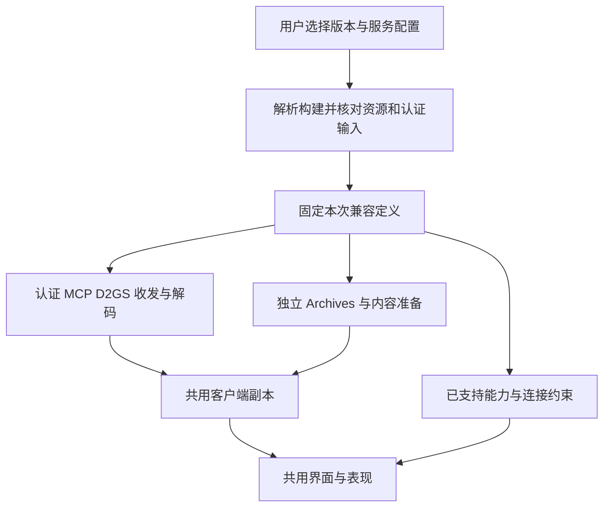

# 原版与 PD2／CN 兼容分析

更新：2026-10-22。本页维护初始化补丁、资源与协议差异的证据，以及D2X接入范围和后续适配边界。固定CN Normal／TCP目标已完成真实登录、既有角色选择、大厅、建房入场及罗格营地原图显示；**已接城镇与基础战斗输入，不代表完整联机兼容**。当前能力以[基线](../../BASELINE.md)、[联网模块](../modules/NETWORK.md)为准，整体实施顺序由[总计划](MULTIPLAYER.md)维护。目标DLL地址、长度表和版本化物品编码详见[CN Normal样本取证](../resources/PD2_CN_DLL_ANALYSIS.md)。

## 结论与证据范围

优先保持现有 LoD 1.13c 路径，在客户端外围增加有版本依据的资源集合与协议差异适配，是目前最合适的方向。公开 BH 仍调用原游戏模块、沿用多条原 C2S 命令，支持大量基础设施复用；但不能据此认定 PD2 全协议、物品位流或地图程序均与原版相同。

产品控制方式为**同一套客户端程序，启动时显式选择版本配置，连接前固定协议与资源上下文**。兼容实现随源码构建，资源／服务连接由配置绑定；切换版本重新启动同一个EXE。PD2只连接远端服务，不提供单机、局域网、自研宿主或PD2本地存档。Play.cmd保留原版入口，PlayPD2.cmd选择固定CN样本并直接显示账号页。方案比较及更新规则见[版本选择与发布方式](#版本选择与发布方式)。

### 当前代码接入范围

选角卡片按服务器返回的HC／死亡标志显示名称颜色与原TBL Hardcore标签，存活HC可继续选择，死亡HC仍拒绝入场；未把这项显示修正当成死亡幽灵造型或全部称号的还原。已用当前CN服务的既有1级HC天梯死灵法师核对GS1普通难度建房、罗格营地原图、城镇走动、正常退局及新进程重新入局；心跳及CN周期报告正常收发，角色退局后保持存活HC。该范围不包含HC实服死亡／尸体许可、共享仓库分组或野外战斗。CN建房新增原资源GS1–GS9选择，每次建房通过类型化参数传入MCP扩展；原版保留原表单与包布局。服务器名称取CN副本的原中文TBL，GS编号不转换为固定IP或端口。

分支为`pd2`，普通启动默认原版。PD2已迁到共用frontend，宿主仅原版实例化；已核实当前CN服务的登录、既有Ladder角色选择、角色原图、大厅列表与返回选角；PD2登录默认选择服务器返回的第一个Realm，原版选择流程保留。建房编码补齐两字节后，MCP创建／加入均获成功回复，4000连接拒绝后按BH证据修正为4001，已收到首批角色／物品／房间同步。游戏握手、初始同步、本人／NPC／HUD及罗格营地原图已实际显示，正常退局返回选角。已核对基础城镇显示及走动，并用普通角色跨入鲜血荒地；连续跨区、持续攻击及完整玩法仍待覆盖。新账号注册未重测，建角／删除和房间详情关闭。

| 代码入口 | 已接入范围 | 尚未完成的边界 |
| --- | --- | --- |
| [启动绑定](../../src/app/client_setup.cpp)／[PlayPD2](../../PlayPD2.cmd) | 挂载前核对固定核心、认证输入和目标MPQ摘要；配置绑定原副本／pd2目录；不装载native DLL | 仅本Normal／TCP样本；未知关键文件拒绝，不自动更新或降级 |
| [共用前端](../../src/app/frontend.cpp)／[RealmSession](../../src/network/realm_session.hpp) | 固定会话版本，共用Remote*；PD2不创建EmbeddedRealm、本地角色存储或TCP/IP传档 | 无窗口PD2、建角／删除和房间详情未开放 |
| [认证](../../src/network/protocol/auth.cpp)／[MPQ资源](../../src/network/protocol/native_auth_resource.cpp) | CN ASCII小写BSHA1、独立Realm摘要、MPQ来源key／owner和0x51证明获当前服务接受；秘密仅内存使用 | 非MPQ来源、未知校验模块、D2X重新注册与native逐字节比对未完成 |
| [MCP](../../src/network/realm_session_mcp.cpp) | 角色／Ladder、带filter列表和两字节列表扩展；建房追加GS／loot分配字节；创建和加入成功 | 已通过建房后入场／城镇显示及退局；公开Join已获票据并建立GS，完整Join场景组合另验 |
| [角色原图](../../src/content/character/realm_portrait.cpp) | 已知版本4／10／13；按原连续前缀规则构造组件编号，支持当前CN无装备及基础装备的职业预览 | 非FF染色、新PD2全部装备组件未完成 |
| [分帧](../../src/network/protocol/d2gs_stream.cpp)／[副本](../../src/client/remote_world.cpp) | 固定目标双向长度；按角色核对Ladder；允许连接与加载路径；未知CN世界消息明确报错 | 已收到初始同步，全部原包处理器、初始状态和Warden仍未认证；扩展物品storage不降级解释 |
| [内容准备](../../src/content/classic_data.cpp) | 独立RemoteDisplay缓存与入场前准备，不准备原版宿主技能程序／掉落／合成；职业背包／装备及仓库／方块几何读取目标Inventory表；准备名称／特殊原图及消耗品元数据 | 已接初始装备、10×8背包、腰带、10×15个人仓库和4×4方块原图；全部图形／分辨率及像素对照、交易与公会界面未完成 |
| [物品](../../src/client/remote_inventory.cpp) | CN完整分支按format选择9／10位stat ID及S12／S13／当前Save列；compact按独立原入口使用当前列；独立0x3E九位增量及严格尾位检查；个人移物／消耗品／存储请求与公会数据隔离 | 初始法杖、药水、卷轴及丢地／拾回已接通；指定消耗品、装书／鉴定／普通堆叠、切组与个人仓库／方块已接受限请求；全部品质／旧格式、复杂双手／增量／存储缓存未认证；公会写入与共享金币仍关闭；个人金币、方块合成、佣兵及本人交易容器已沿确认上下文开放，实测边界见城镇分项 |
| [基础交互](../../src/network/realm_session_commands.cpp) | NPC与物件点击共用原02／04靠近、13交互；NPC沿27对白／31已阅／30关闭，传送点沿63菜单／49选择或关闭；删除早期按PD2配置整体拒绝NPC和非仓库物件的限制 | CN商店／赌博、版本化候选报价、买卖／维修／鉴定及任务／旅行原请求已接；Charsi菜单、货架、出售／购回及维修回执已实服核对。未知费用不提交；后续幕、佣兵和奖励待用户准备角色实测，双客户端交易未认证 |
| [诊断](../../src/app/debug/online_commands.cpp) | 既有online-*、UI输入、截图、公开状态及包ID／计数；可请求建房／加入 | 不记录SID／MCP证明或票据；D2GS日志对0x68脱敏，不是完整认证抓包 |

当前原客户端大厅崩溃在D2GL同址复现；D2X不加载该模块，已独立显示基础城镇。当前已接装备／腰带、受限消耗品和个人扩展容器请求，最终资格与库存结果由服务端裁决；完整native资格、复杂装备和全部存储格式仍待覆盖。后续先补足前三项的未覆盖组合，再推进移动／战斗、角色业务及保存重连；未核实交互继续明确拒绝。操作方法见[PlayPD2](../development/BUILD_AND_RUN.md#pd2-cn远端账号大厅)。

物品显示复用RemoteInventory → RemoteUiClients → 公共InventoryView／地面原图链路。CN职业行提供10×8、29像素格与装备几何，面板原图读取有符号DC6偏移；原版继续使用原布局、九位属性ID与原请求／存档边界。RemoteDisplay只准备名称、特殊图形及原始属性描述，不通过原版的生成资格过滤已由服务器指派的暗金／套装／词缀；不启用PD2宿主程序或本地保存。个人物品操作开放Take／Place／Swap／Drop／Pickup／Equip／Unequip／BeltPlace／BeltSwap／BeltAuto、指定Use／Stack／Book／Identify／Socket／SwitchWeapons及个人存储请求，由原回包更新身份与位置；UI、RemoteInventory及RealmSession复验来源、目标、page与revision，不在本地预提交成功。详细布局及操作边界见[包裹界面](../gameplay/items/INVENTORY_UI.md#pd2只读显示)，位流依据见[DLL专题](../resources/PD2_CN_DLL_ANALYSIS.md#完整物品位流版本与字段)。

当前只投影完整解码、已知基底及合法容器坐标的物品；普通装备、背包、腰带和地面共用原图、染色、镶孔子项身份及落地动画。preview标志不投影成本人库存，0x9C/action19–1A及0x36公会展示独立隔离，不投影为可写个人库存。未解码原因保留在online-snapshot，未知尾部不当作解码成功。只读提示暂不计算PD2最终攻防、装备资格及套装激活层；镶孔修饰尚未齐全时明确提示。完整位流、图形、名称和真实会话的组合对照仍待完成，不能由源码接通声明全部物品正确。

周期报告候选已接入：CN专用函数发送`0x5C/0xFF00`单调tick、`0x5C/4`本地路径整数坐标，以及特殊`0x15/FF/FF`通道的实际BH文件CRC32；另关联`0x9D/0x2C`回显。原版不启用这些发送，普通移动与6D心跳路径保留。`online-status.online.pd2Reports`提供逐类计数；三类报告已在CN实服城镇反复跑动及正常退局中核对，本轮未复现移除；布局、原生周期和未闭合的拒绝条件见[周期报告证据](../resources/PD2_CN_DLL_ANALYSIS.md#原客户端抓包确认的周期上报与候选修复)。启动白名单允许原Normal核心及当前`17d5fb1b049d8076226d27295487b49c8b5f2629553c193a01aa1e3d8afaba57`核心，同次更新的三份资源MPQ也只按已核对的精确摘要登记；其他文件仍要求登记摘要。新核心只完成相关入口对照，不代表全部行为认证。

### 基础战斗与地图预载

技能选择／快捷键／施放／单点学习已取消PD2整体拒绝和普攻／火弹白名单，保留当前MPQ、实际等级／来源及目标校验；属性加点仍关闭。请求复用公共RemoteCombat，学习包由固定CN配置追加数量字节，伤害及奖励只接受服务端事实。公共鼠标Hold沿已有本地追击／动作时钟提交下一次普通攻击，不在动作结束前固定120毫秒重发；引导技能仍可更新目标。Q任务面板已实服核对邪恶洞穴激活状态及当前说明，不代表完整任务奖励已认证。

客户端飞弹显示不依赖原版宿主规则目录，RemoteDisplay复用已有显示源和当前MPQ加载Clt程序／原图；当前支持的原生程序才会生成飞弹，不把未实现回调伪装为火弹。CN83限时效果消息已严格消费并保留，暂不绘制其计时图标；未知消息仍明确报错。详细字段及证据见[基础战斗与限时效果消息](../resources/PD2_CN_DLL_ANALYSIS.md#基础战斗与限时效果消息)。

原房间07／08仍是视野消息来源；客户端按25Hz推进既有DRLG邻房预载，不用退出重入或猜造请求触发，也不以显示预测新增服务端视野。首次城门黑区、持续普攻、飞弹及受击中断继续分别验收，不能用单次协议指令成功替代鼠标操作验证。

### 后续客户端接入顺序

| 顺序 | 范围 | 当前入口与完成条件 |
| --- | --- | --- |
| 1 | 装备与腰带 | 基础穿脱、同部位换装、腰带取出／放置／交换／自动入带已开放；新增双手腾挪变体的双方身份与背包空位检查、切组确认。完整装备资格、多职业／多品质、同部位与双手装备交换及腰带容量变化仍需逐项覆盖 |
| 2 | 位流与物品使用 | 独立0x3E仍为9位，CN增加严格尾部检查；已开放指定药水／卷轴、普通堆叠、装书、鉴定及镶孔的受限原请求。全部品质／旧格式、腐化／符文之语／孔内组合及拒绝／中断仍需覆盖 |
| 3 | 扩展容器 | 仓库10×15、方块4×4及原图／上下文已接；公会展示独立隔离。已定位CN的mdll1个人／账号共享控制链，替换错误的核心55绝对页请求；候选已接3A相对翻页／切域、9D自定义确认、32位页号与域隔离缓存、原StashBtns按钮及超时隔离，见[静态依据](../resources/PD2_CN_DLL_ANALYSIS.md#个人与账号共享仓库的范围)。用户确认100共享页及HC分组；模块上限不等于服务页数。已通过实服个人／共享首页切换、共享1→2→1及卷轴跨页缓存显示，并回归原版卷轴存取；首次打开按原入口初始化，确认前不猜测域。已接索引／主索引、首页／最后非空页及独立共享材料页；材料原图、98项代码计数、鼠标／自动安置取出和受限存入已接，实服核对单个／5个往返。已接原3:1材料升级并实服核对计数；CSL／CSR实际为方块转移，要求真实可访问方块。批量存放／页改名／共享金币仍关闭，继续核对跨角色保存、边界拒绝、HC及更多页 |
| 4 | 城镇分项 | 按[城镇交互逐项接入](#城镇交互逐项接入)依次完成NPC商店浏览、买卖计价、维修鉴定、城镇物品／存储、佣兵和旅行；每项分别核对原回包、拒绝、中断与原版兼容 |
| 5 | 移动与战斗 | 普通区域跨区、房间／碰撞、怪物／状态位流、技能与飞弹表现；新增地图程序分别登记，不以进城替代玩法验收 |
| 6 | 角色业务与完整回归 | D2X注册、建角／删除、分页／名字、断线重连与保存；原版和CN分别核对正常／拒绝／中断路径，其他模式独立认证 |

### 城镇交互逐项接入

以下按PD2 CN固定配置逐项推进；不启用本地宿主，不把现有原版服务自动视为PD2兼容。实现与实服核对分开记录在所属专题。

| 顺序 | 范围 | 当前状态与完成条件 |
| --- | --- | --- |
| 1 | NPC交谈与普通商店浏览 | 已接当前NPC会话、38/action1、9C货架与关闭／代次失效。Charsi实服菜单、52件货架、原图与关闭已核对；Akara实服47件货架及候选报价已核对，并按原图修正CN格顶42与出售按钮。Gheed、空货架及全部切换组合仍待补验，商品继续取服务器坐标 |
| 2 | 普通买卖与补给 | 已接当前表与固定核心价格差异、原32／33及2A回执。实服完成回复药剂出售与购回，金币和新物品身份一致；普通装备、多件补给／multibuy、全部折扣与拒绝组合未认证 |
| 3 | 治疗、维修、鉴定与赌博 | 已接原NPC服务与候选费用；不发目标已改为12字节空回调的原39治疗。Charsi维修全部获回执，但现有装备满耐久；实际恢复、充能、凯恩鉴定与赌博成交未实测 |
| 4 | 城镇物品与存储 | 已有地面／装备／腰带／消耗品、个人与共享仓库；本轮增加个人金币、原方块合成、原材料转换箭头及方块转移。实服核对个人金币1存入／取回、材料源扣3／目标加1、材料存入及取出；曾在无实体方块时测试CSR使物品进入cube，现增加真实方块前置拒绝以防不可访问。批量存放／页改名／共享金币与跨角色保存待完成 |
| 5 | 佣兵与NPC专用服务 | 已开放36／62／61、26喂药与原任务服务，七槽装备几何从目标MPQ读取；资格与费用仍以服务器和已知任务事实为准。后续幕、佣兵、灌注／打孔／署名／重置等实服测试按用户安排等待新角色 |
| 6 | 玩家交易 | 已接原邀请／锁定／确认／取消与本人page3报价移物；对方page2只读。缺双客户端实测，成交、取消、满格、断线及保存均未验收 |
| 7 | 城镇旅行及闭环回归 | 传送点、传送门与跨幕NPC旅行复用原请求、上下文和换区失效。罗格营地传送点菜单及关闭已实服核对；普通／HC、后续幕、旅行拒绝与持久化组合仍待覆盖，不能由原入口存在推定PD2全部旅行已完成 |

各项按固定样本逐步开放并保留原版路径；现有入口不代表全部组合或完整CN客户端程序完成。资源与协议前置关系见[建议依赖顺序](#建议依赖顺序)。

本轮静态已核实[状态扩展接收链](../resources/PD2_CN_DLL_ANALYSIS.md#状态扩展接收链)：0x9D保留普通物品action，mdll1在原action上界之外接自定义分派；0x22为本地虚拟玩家数量、0x23为服务器标签与延后仓库初始化、0x29为扩展存储可用标志、0x26为分配掉落状态。0x2E更新仓库复位、地图信息索引、外观资格、分配掉落及16槽热键；0x85／0x88分别为材料计数与物品发现快照。核心0x85计数与CN mdll1独立材料页的代码计数不是同一布局，不合并解释；0x85／0x86及0x88／0x87的核心功能仍待接齐，当前保存原文不等于对应功能完成。这些直接接收分支没有即时认证应答，不能据此猜造回包或认定移除原因。

用户提出的“PD2 通过原版动态读取自己的 MPQ”在资源承载层有依据。需要分开确认：MPQ 容器能打开、成员格式能解码、数据定义能解释、对应客户端程序能执行。新增 DLL 可同时修改后两层，单独换表不能自动补出程序。

| 证据 | 固定范围 | 能说明什么／限制 |
| --- | --- | --- |
| 官方 BH | `92e9d319f20113b5fbd382ad0fd3df9480116d04`，本地 `reference/pd2-bh` | 原客户端钩子、部分协议消费、核心 DLL 导出调用；不是 ProjectDiablo 核心源码 |
| 历史 BH-CN | `68f7343342eed668190d464b7111849a6cc0ce89`，2022-12-27，提交说明“S6最新”，本地 `reference/pd2-cn-bh` | 旧汉化分支的加载和协议实现；不能代表当前 CN |
| 官方启动器／安装脚本 | 固定版本见[资料来源](../resources/THIRD_PARTY.md#本地参考目录) | 更新清单、游戏启动、安装目录；不能据更新先后推出游戏 MPQ 查找优先级 |
| D2MOO | `5596f5cb6c5251a0a07c6637d26458b06099d516`，本地 `reference/d2moo` | 原 D2Common／D2Game 调用链；存在版本差异，缺完整 D2Client |
| D2X | 当前源码；本页初次核对基于 `600bb367` | 以下列出的现有适配入口与限制；后续修改须重读实际代码 |
| 用户提供的启动器 | `PD2LauncherCN.exe`，4,513,792 字节；SHA-256 `a68b21f74d1e9463f6e4023434c3a21ce017d524b1ace6c618a4810679b8e23c` | 只读 PE／字符串证据；其文件版本 `1.0.0.0` 不能标识 PD2 赛季、协议或更新后的核心版本 |
| CN 更新取得的目标文件 | 本页下表记录的 Normal 配置样本，启动器界面为 v1.6.5 | 已取得 DLL、MPQ 并作只读静态分析；不能把启动器版本、PE 时间戳或模式名称当作线上协议版本 |

以下把“源码明确读取／写入的值”和可定位的目标静态行为作为已确认事实，把“可能复用”作为设计推断。已取得本次 Normal 配置的目标文件，并实际运行 REA／Ghidra 静态分析；已核对当前服务的账号大厅回复，未保存原始认证载荷，也未完成全部初始化分支或游戏入场复核。参考代码与工具不加入 D2X 产品运行依赖，许可及使用范围见[资料来源](../resources/THIRD_PARTY.md)。

## 已取得的 CN 目标样本

用户授权在原版的独立副本中运行启动器。目标文件位于副本的 `pd2` 子目录；启动器创建 `Game.exe` 子进程，游戏日志中的 Application Path 也指向该副本。本轮仅据此确认程序启动，不认证选角、入局或完整游玩。后续D2X已使用用户提供的联调账号核对账号大厅及MCP票据；未保存原始认证载荷，未完成游戏场景。

配置快照为 `seasonMode=Normal`、`gamemode=bnet`、`udpMode=0`、`noUpdate=0`。界面另有单机、TCP／UDP(KCP)／UDP(QUIC)、直连／中转等选项；这些只能说明启动器提供相应入口，尚不能推出隧道内部报文格式或所有模式使用相同资源。主 `pd2data.mpq`／`ProjectDiablo.dll` 与各自 `.sn` 文件的大小、SHA-256 一致；`.ss` 文件不同。切换模式后必须重新核对配套文件，不能混用。

| 文件 | 字节数 | SHA-256 |
| --- | ---: | --- |
| ProjectDiablo.dll | 5,230,080 | `9c2b4d4627112d7f14ab959e71c56e947b7ceeb6f16424a637364f614d39122f` |
| PD2_EXT.dll | 83,456 | `c253dec5a9fab068f2cc64c816392ddc3ed97dfa9822aa5725ace3e64a02d6ab` |
| pd2data.mpq | 2,259,046 | `6ce1d885dfcb16ac0ff7a183d56c56baeaad591d8779ce9e843e16dfc2756002` |
| pd2assets.mpq | 143,872,381 | `70baa8e5334b38dd2c4e3cb8f6517eab0a1cc46e49f667e111af687f764b7ac7` |
| pd2maps.mpq | 5,240,058 | `ad704b94aab4fa4142fb4fe37b38bd3fe7ae43a94c14518baf0d6cb0ca00d33a` |
| pd2monchars.mpq | 373,591,568 | `ae2abade85c5f393db5d8089cb4b6566b2cfed2adea0f573bc0f4220ef733217` |
| patch_d2.mpq | 2,108,703 | `b976e7847dda696f54198a9477819f96579c4894f54381c72afb4937e919e0a9` |
| Game.exe | 61,440 | `065aedaa998adcd337b93ccf33457e3bac589bab3bfd894351b6fa834399985d` |
| D2Common.dll | 679,936 | `0406922db7b9959484a08f83bcc6a0fe9d11a157cb2322a061033e8d37480217` |
| D2Win.dll | 147,456 | `6015e0b67834a8f3c657b32ea440cb04dad42e01e8bcf5782f90b14323769e0c` |
| Storm.dll | 372,736 | `cc848eb2fc29068fb61cb258c1c8b9e8a191c5543805939762ed835b50fb194d` |

另外包含 D2MultiRes、SGD2FreeRes、CheckRevision 相关包及 loose `Data` 目录，不能将目录内所有 MPQ 都当作游戏数据扩展。更新时出现的 `zylpd2update.tmp` 是文件名和十进制校验值的临时清单，更新完成后已移除；本页仅采用此前读到的字段，不依赖该缓存仍存在。这些数值的算法未在本轮确认，不能当成 SHA-256 或发布者签名。

分析产物在忽略的 `reference/pd2-cn-analysis/`：`TARGET_REFERENCE.json` 记录 60 个输入文件、28 个提取表文件的大小与摘要，另有 PE 元数据、静态反汇编；提表使用已有资源工具的只读 list／extract 路径。提取资源、目标 DLL 和分析缓存不纳入源码提交。

## 初始化补丁：公开部分已经能定位到哪里

### 官方 BH 的启动链

入口为 [BH/DllMain.cpp](https://github.com/Project-Diablo-2/BH/blob/92e9d319f20113b5fbd382ad0fd3df9480116d04/BH/DllMain.cpp) 与 [BH/BH.cpp](https://github.com/Project-Diablo-2/BH/blob/92e9d319f20113b5fbd382ad0fd3df9480116d04/BH/BH.cpp)：

1. `DLL_PROCESS_ATTACH → BH::Startup`。有 `reserved` 时按 `cGuardModule` 取路径并设置 `cGuardLoaded`，否则用当前模块所在目录。这里只能确认 BH 的入口约定，尚不能还原提供该参数的加载器及其完整握手。
2. `BH::Initialize` 创建配置和过滤器，调用 `CheckForD2GL`、`CheckForPD2`；异步等待游戏窗口后替换窗口过程。
3. 创建 GameSettings、ScreenInfo、Gamefilter、Bnet、Item、Party、StashExport、MapNotify、ChatColor 等模块；`ModuleManager::LoadModules → Module::Load → OnLoad` 注册事件并安装各模块自己的补丁。
4. 安装 `BH.cpp::patches[]` 中的中央钩子；未入局时安装 `oogDraw`，然后创建 `GameThread`。因此只枚举中央数组会漏掉模块补丁；只搜索 `new Patch` 又会包含尚未安装或已注释的路径。

`CheckForPD2` 通过 `GetModuleHandleA("ProjectDiablo.dll")` 解析三个导出：`_D2Client_PlaySoundWithCustomVolumeOrPriority@20`、`_D2Client_GetItemDiscoveryState@12`、`_D2Client_GetItemStorageType@4`。这证明 BH 使用核心提供的声音、物品发现与存储接口，不能由导出名推导全部字段、算法或服务器实现。

### 已确认的 BH 补丁入口

下表为 `BH.cpp` 中中央数组的部分入口；数值是**目标原游戏模块内的偏移／RVA**，不是 BH 内的 RVA 或网络偏移。两列分别来自源码的 1.13c／1.13d 项，不代表 D2X 已支持 1.13d，也不代表当前核心 DLL 的全部补丁。

| 目标模块／入口 | 1.13c | 1.13d | 写入方式／覆盖长度 | 对后续分析的作用 |
| --- | --- | --- | --- | --- |
| D2Client／GameLoop | `0x44230` | `0x45280` | CALL／7 字节 | 帧循环与模块事件 |
| D2Client／GameDraw | `0xC3DB4` | `0x1D7B4` | JMP／6 字节 | 游戏绘制 |
| D2Client／AutomapDraw | `0x626C9` | `0x73469` | JMP／5 字节 | 自动地图绘制 |
| Bnclient／ChatPacketRecv | `0xEAB6` | `0xCEB6` | CALL／8 字节 | BNCS 聊天与大厅 |
| D2MCPClient／RealmPacketRecv | `0x69D7` | `0x6297` | CALL／5 字节 | MCP 逻辑包观察点 |
| D2Client／GamePacketRecv | `0xACE61` | `0x83301` | CALL／5 字节 | D2GS 逻辑包观察点 |
| D2Client／GameInput | `0x70B75` | `0xB24FF` | CALL／5 字节 | 游戏内输入 |
| D2Win／OOGDraw，单独条件安装 | `0x18911` | `0xEC61` | CALL／5 字节 | 局前绘制 |

[BH/Patch.cpp](https://github.com/Project-Diablo-2/BH/blob/92e9d319f20113b5fbd382ad0fd3df9480116d04/BH/Patch.cpp) 的 `Install` 先按 `D2Version` 选择偏移，保存旧字节，构造 NOP 填充与相对 CALL／JMP，再修改页面权限并写入。`GetDllOffset` 正值使用模块基址加偏移，负值使用导出序号；后续证据表必须区分这两种寻址。`D2Version.cpp` 识别 `Game.exe` 的 `1.0.13.60`／`1.0.13.64`，不能仅凭名称相同套用地址。

物品模块还有独立证据：[Item.cpp](https://github.com/Project-Diablo-2/BH/blob/92e9d319f20113b5fbd382ad0fd3df9480116d04/BH/Modules/Item/Item.cpp) 的 `OnLoad` 实际安装 NewGround、DropToGround、OldGround、PutInContainer 四个 CALL 钩子，对应 D2Client `0xAE0DA`、`0xAE0F8`、`0xAE108`、`0xAE117`。这些声明只给出第一版本项，不应自行补齐另一版本地址。附近部分属性字符串补丁的 `Install` 被注释，不能算作启用功能。

上述钩子适合作为后续静态分析的定位入口。D2X 有自己的客户端与渲染，不需要复制 Win32 注入、内存偏移和跳转补丁；需要还原的是补丁引入的外部行为、数据语义与协议契约。

### 当前样本的实际引导与表结构补丁

以下地址均限定于上述摘要对应文件，使用模块内 RVA；绝对地址只用于解释该样本的指令，不能直接跨构建复用。证据来自只读 PE／反汇编，没有采样当前进程的实际补丁后内存。

1. 副本 `Storm.dll` 的导入模块由原版的 `VERSION.dll` 改为 `PD2_EXT.dll`。后者的版本信息 API 导出转发给系统 `version` 模块，形成代理 DLL 的装载入口。此处是修改原模块导入依赖，不是 Game.exe 静态导入表直接增加 ProjectDiablo；Game.exe 的模块导入名称列表与原版一致。
2. `PD2_EXT.dll` 的 PE 入口 RVA 为 `0x1590`；RVA `0x11C0` 的 reason=1 分支把 Game.exe RVA `0x82DD` 的 CALL 改向自身 RVA `0x1080` 并保存原目标。后者再把 Game.exe RVA `0x763F` 的 CALL 改向自身 RVA `0x1000`、保存原目标，并对 Game.exe RVA `0x83EF` 起 33 字节写 NOP。原指令的全部业务含义尚未复核，不把这些补丁直接移植到 D2X。
3. `PD2_EXT` RVA `0x1000` 先调用保存的原目标；返回值非零时，通过 LoadLibraryA 装载字符串 `ProjectDiablo.dll`（字符串 RVA `0x12CCC`）。后续还有按 Fog 指令特征判断的条件补丁，不能据此把所有启动分支视作相同。
4. 目标 `Game.exe` 与原版只差 7 字节：DOS 保留区偏移 `0x20` 写入 `ZYLPD2`，以及 PE Characteristics 偏移 `0x116` 的低字节由 `0x0F` 变 `0x2F`，增加 Large Address Aware 位。其文件版本仍是 `1, 0, 13, 60`，因此版本号相同不代表字节相同。
5. 目标 `D2Common.dll` 与原版只差 1 字节：文件偏移／RVA `0x82CB4` 把比较立即数 32 改为 33。完整指令位于 RVA `0x82CAE`，比较原 Inventory 记录数并进入断言分支；对应 D2MOO `DataTbls/InvTbls.cpp::DATATBLS_LoadInventoryTxt` 的数量校验。目标 Inventory.bin 恰有 33 条，见下文；这是可定位的局部补丁，并不证明其他数据结构也保持原样。

本次 D2Client、D2Net、D2MCPClient、Bnclient、D2Game 与原版摘要一致；D2Win、Fog、Storm、D2gfx 等有差异，尚未完整逐项归因，不能只凭相同文件大小推定原版。用于复核原模块 RVA 的目标摘要列于上表。

### 核心补丁登记与剩余边界

已查公开仓库未找到完整 `ProjectDiablo.dll`／`PD2_EXT.dll` 核心实现及完整 PD2 游戏服务器构建。本次已从核心确认 CRT attach → RVA `0x342B60 → 0x3425F0`，模块加载、四包打开与补丁安装的调用关系。安装器 RVA `0x3420B0` 按五 DWORD 记录应用模块／RVA、值、相对位移和填充长度；主表 RVA `0x496390–0x4A2640` 有 2,492 条描述，另有条件表、字节块和初始化函数直接改写的程序表。主表数量不等于运行时成功应用数量。

关键替换包括 D2Common 完整物品 codec、D2MCPClient 房名起点和 Bnclient 认证发送路径；核心 RVA `0x368600` 另行修改 D2Client 处理器与 D2Net 收发长度表。磁盘 D2Net 相同不能证明协议未变。详见[登记与调用地址](../resources/PD2_CN_DLL_ANALYSIS.md#磁盘差分与运行时初始化)。仍需补齐：

- 原 MPQ 打开／搜索路径、数据表装载及内存结构扩展。
- 主表之外的收发钩子、全部扩展字段、分帧／压缩与加载器要求的线上对照。
- compact／旧物品分支、增量属性、扩展仓库权限及新地图客户端程序。

DLL 磁盘入口与运行时跳板要分别记录；同一原地址可能被多个模块依次改写。静态发现某补丁声明，还需追到实际安装条件，不能直接声称每次启动都会生效。

## MPQ：复用格式与重建加载契约

### 包名与加载顺序的现有证据

历史 [BH-CN/BH.cpp::LoadMPQData](https://github.com/weili0677/BH-CN/blob/68f7343342eed668190d464b7111849a6cc0ce89/BH/BH.cpp) 取 `Game.exe` 所在目录的 `pd2data.mpq`，不存在时退回 `Patch_D2.mpq`，随后调用 `ReadMPQFiles → InitializeMPQData → Tables::initTables`。`BH::Initialize` 通过任务队列执行这条路径。

关键边界在 [MPQReader.cpp::ReadMPQFiles](https://github.com/weili0677/BH-CN/blob/68f7343342eed668190d464b7111849a6cc0ce89/BH/MPQReader.cpp)：它加载 BH 目录的 StormLib，**单独打开选中的一个包**，读取 `data/global/excel/` 下的 Weapons、Armor、Misc、ItemStatCost、Properties、Skills、CharStats 等 15 张 TXT。这是 BH 自身的辅助表读取器，不能用来证明游戏全局只挂一个 MPQ，或证明所有 PD2 包的覆盖顺序。

汉服维护页列出的常见更新文件为 `ProjectDiablo.dll`、`PD2_EXT.dll`、`d2data.mpq`、`d2maps.mpq`、`d2assets.mpq`；页面同时说明独立子目录及单机 `-txt` 用法。这是维护者文档的文件名，不应擅自统一改写成带 `pd2` 前缀的名称，也不能当作当前完整清单。[来源：PD2CN，页面版本 24063](https://wiki.projectdiablo2.cn/w/index.php?title=PD2CN&oldid=24063)。

用户提供的启动器是 i386 PE32、CLR 目录为零，静态字符串中能找到 `pd2data.mpq`、`ProjectDiablo.dll` 及更新相关名称。本次实际取得的扩展包使用 `pd2` 前缀，并新增 `pd2monchars.mpq`；这些实物证据优先于维护页的概括列表，但仍限定于当前样本。

目标 `ProjectDiablo.dll` RVA `0x3425F0` 内可见四次连续装载调用：`pd2data.mpq → pd2assets.mpq → pd2maps.mpq → pd2monchars.mpq`，具体调用 RVA 为 `0x342680`、`0x34269D`、`0x3426BA`、`0x3426D7`。每次传 `0x1770`（6000）给包装器 RVA `0x39F020`；包装器把该值放 EAX，将其余参数转交动态解析的 D2Win RVA `0x7E60`。对应 D2Win 的 RVA `0x7E79` 保存该值，RVA `0x7DC0` 的打开路径把它传给归档打开入口，符合原归档优先级参数的调用链。D2MOO `D2WinArchive.cpp::ARCHIVE_LoadArchives` 的基础／资料片／原 Patch 优先级分别是 1000／3000／5000。

当前 Storm ordinal 266／RVA `0x2A0B0` 把新打开的同优先级归档插到旧归档前面，ordinal 268／RVA `0x28960` 的全局搜索从链表头向后进行。因此四包成功打开且无 loose／更高优先级覆盖时，同名成员优先级是 **monchars > maps > assets > data > 原 Patch > expansion > base**。调用与查找证据见[MPQ 搜索顺序](../resources/PD2_CN_DLL_ANALYSIS.md#mpq-搜索顺序)。特定 archive handle、loose files、根／子目录同名包及其他模块仍需分别确认。

### 哪些内容可能直接复用

| 层次 | 可以复用的基础 | 必须确认的差异 |
| --- | --- | --- |
| MPQ 容器 | 当前 StormLib 的只读路径／成员查找 | 目标包是否可读、实际目录、成员覆盖、是否使用外部 loose files |
| 原图与音频 | DC6、DCC、COF、PL2、TBL、WAV 等现有消费者 | 成员实际格式、额外布局／字体／高清资源的消费者；不能按扩展名保证可解码 |
| TXT 数据表 | 按列名、原 ID、代码和引用动态加载 | 新列、行数、ID 含义、缺失列、表之间引用及原版消费者的边界 |
| BIN 表 | 原客户端可动态加载编译后的表 | BIN 的结构大小、字段顺序和配套 DLL；不能把任意 BIN 当原版结构 |
| 地图 | DS1／DT1 与原 Levels／LvlPrest／LvlTypes 等入口 | 新区域、布局程序、随机消费、碰撞、任务／传送程序；素材存在不证明地图重建一致 |
| 行为 | 原版技能、属性与描述程序可按证据复用 | 表中的函数编号仍选择编译程序；新函数、溅射／腐化／堆叠／共享仓库语义不由 MPQ 自动实现 |

原版 `D2Common/src/DataTbls/DataTbls.cpp::DATATBLS_CompileTxt` 明确区分 TXT 编译和 BIN 装载，BIN 路径取记录数后按结构使用；依据为固定 D2MOO。D2X 的 [classic_data.cpp](../../src/content/classic_data.cpp) 与 [remote_inventory.cpp](../../src/client/remote_inventory.cpp) 当前直接读取 TXT。因而即使原客户端读取 PD2 BIN 成功，也不能证明 D2X 所读同名 TXT 与它一致；如果 PD2 只覆盖 BIN，D2X 还可能从低优先级原包读到旧 TXT。缺配套表时应停止该功能，而不是静默套用原表。

### 当前样本的表差异

以下从同一主 `pd2data.mpq` 提取，对照用户原版安装按正常覆盖顺序读出的成员。记录长度按 BIN 的四字节记录数前缀和文件总长计算，并与核心字段定义定点交叉核对；相同记录数／长度不认证 TXT 和 BIN 的全部字段语义一致。

| 表 | 原版记录数／每条字节 | 当前目标记录数／每条字节 | TXT 最大数字 ID，原版 → 目标 |
| --- | --- | --- | --- |
| ItemStatCost | 359／324 | 511／348 | 358 → 510 |
| Inventory | 32／240 | 33／240 | 按原行号布局，无上述 ID 列 |
| Levels | 137／544 | 211／544 | 136 → 210 |
| States | 185／60 | 245／60 | 184 → 244 |
| Skills | 357／572 | 610／572 | 356 → 609 |

ItemStatCost 增加六列：`Save Bits S12`、`Save Add S12`、`Save Param Bits S12`、`Save Bits S13`、`Save Adds S13`、`Save Param Bits S13`，注意 `Adds` 的实际拼写。核心 RVA `0x2E4D43` 起构造对应字段定义，依次放入结构偏移 `0x144`、`0x148`、`0x14C`、`0x150`、`0x154`、`0x158`，RVA `0x2E4E49` 传入记录大小 `0x15C`（348）。这同时解释 BIN 比原版多 24 字节；原 BIN 结构不能直接复用。本次已追到 RVA `0x381680` 的真实列选择器和完整物品消费者，具体格式规则见下文。

通用列中已有明显变化：ID 17／18 的 Save Bits 从 9 变 11、Save Add 从 0 变 400；ID 31 的 Save Add 从 10 变 300；火焰最小／最大伤害位宽变 11；毒最小／最大伤害位宽变 16。ID 206 在目标中命名 `desecrated`，ID 360 命名 `corrupted`，后者 Save Bits／Save Param Bits 均为 10。这些是该表字段，不足以独立认证网络属性组与物品版本选择。

Inventory 的 Amazon／Amazon2 为 10×8，Big Bank Page 1／Big Bank Page2 为 10×15，方块为 4×4。其中 Big Bank Page 1 的 gridTop 为 **-14**。D2X `classic_data.cpp` 当前拒绝 stash 的负 top，因此这一真实目标表会触发内容准备边界；不能简单把文件挂上就视为已兼容，也不应把该坐标静默截成零。后续要核实目标面板坐标基准、实际资源与仓库身份，再调整相应客户端适配。

### D2X 当前挂载中的具体风险

[archive.cpp::Archives::mountDirectory](../../src/resources/archive.cpp) 只枚举传入目录顶层的 MPQ。当前按历史精简包 `-1`、普通包 `0`、`d2exp.mpq` `2`、`patch_d2.mpq` `3` 排序，同级按路径排序，依次挂载；`read` 逆序搜索，**后挂载覆盖前挂载**。未知 PD2 包归普通包，单纯把它们放入原目录不保证覆盖 d2exp／Patch_D2；子目录也不会自动递归加载。

[application.cpp](../../src/app/application.cpp) 先挂 `mpqSupplement`、后挂主 MPQ。现有补充目录用于中文字体等缺项补齐，是低优先级路径，不能直接当作覆盖原版规则的 PD2 扩展层。

挂载会清除 `readCache_` 与 `prepared_`，但已经借出的只读定义、图形对象和会话副本不会因此变成另一版本的数据。后续资源切换应在会话开始前组装独立 `Archives` 和消费者；不能在游戏中途增包并继续使用旧索引。当前 `mountIdentity` 使用包名、大小、修改时间，不是文件内容的 SHA-256，也不适合作为目标版本认证。

建议建立显式、有序的资源集合：保留原版集合；为某个 PD2／CN 构建记录基础安装、扩展包绝对路径、顺序和摘要，以及关键成员最后由哪个包提供。本 Normal 样本的全局归档覆盖次序已有上文证据，loose／路径策略继续单列。先核对 `ItemStatCost`、`Inventory`、`Skills`、`States`、`Levels` 及配套图形的来源与 TXT／BIN 一致性，再允许该集合进入会话。

## 协议：已确认的局部差异及未知边界

### MCP 0x05 房间列表有明确的版本分歧

官方与旧汉服源码均为 `BH/Modules/Gamefilter/Gamefilter.cpp::OnRealmPacketRecv`。下表偏移均以**包号 0x05 为偏移 0，不含线上 MCP 的两字节长度前缀**。所有多字节整数按该协议小端布局读取。

| 字段 | 原版布局／旧 S6 BH-CN 读取 | 固定官方 BH 快照读取 |
| --- | --- | --- |
| requestId，u16 | 1 | 1 |
| index，u32 | 3 | 3 |
| players，u8 | 7 | 7 |
| flags／status，u32 | 8 | 8 |
| gs，u8 | 无此独立字段 | 12 |
| lootAlloc，u8 | 无此独立字段 | 13 |
| 零结尾房名 | 12 起 | 14 起 |
| 零结尾描述 | `13 + 房名字节数` 起 | `15 + 房名字节数` 起 |

官方源码把 `gs` 和 `lootAlloc` 标注为非原 1.13c 字段；历史 CN 源码仍直接从 12 读取房名。证据分别见[官方解析器](https://github.com/Project-Diablo-2/BH/blob/92e9d319f20113b5fbd382ad0fd3df9480116d04/BH/Modules/Gamefilter/Gamefilter.cpp)与[历史 CN 解析器](https://github.com/weili0677/BH-CN/blob/68f7343342eed668190d464b7111849a6cc0ce89/BH/Modules/Gamefilter/Gamefilter.cpp)。**当前下载的 CN BH** 在 RVA `0x142F80` 读取两个附加字节，房名从 14 开始；核心也将 D2MCPClient RVA `0x644C` 改为 +14。此样本布局与固定官方快照一致，线上字段值与业务语义仍需核对，不能把不同年代的差异归为官方／CN 固有差异。

D2X [realm_session_mcp.cpp::handle_mcp](../../src/network/realm_session_mcp.cpp) 的 `packet.body` 已去掉包号，因此原房名偏移为 body 的 11；若采用上述官方扩展，则应为 body 的 13。未来按已核实构建选择解析方式，并核对终止条目、零填充、房间信息／创建请求等相邻消息。两个布局都可能碰巧产生合法字符串，不能用“哪个能读出房名”进行静默猜测，也不能统一在所有 MCP 消息加两字节。

### 其他网络层的复用依据与缺口

本轮恢复了核心 RVA `0x368600` 的 26 个 S2C 处理器改写入口、配套长度写入及 20 个 C2S 长度改动；[完整差异表](../resources/PD2_CN_DLL_ANALYSIS.md#d2gs运行时长度表与处理器)注明方向和逻辑包长度。原来未使用的消息被启用，S2C `0x66` 从 7 缩为 5，C2S `0x22` 从 5 扩为 11。D2X 必须按目标选择双向长度表与完整字段；旧包补零、接收后忽略都不能构成兼容。

| 层次／入口 | 当前证据 | D2X 后续关注点 |
| --- | --- | --- |
| 常见 C2S 动作 | 官方 `BH/D2Helpers.cpp` 的 RunTo 仍发 `0x03`／5 字节，SetSkill 发 `0x3C`／9 字节，CastOnMap 发 `0x08` 或 `0x0F`／5 字节 | 适合作为复用候选；不证明全部出入包相同，也不证明核心不再加工这些消息 |
| BNCS 认证与账号 | 当前 CN 核心改写 `0x51`，发送 SHA-256 十六进制证明和额外 WORD；D2X 已准备 CN 账号小写及独立 Realm 摘要，默认原配置保持现有行为；CN已接MPQ来源的独立证明编码，当前实际挑战与0x51／0x3A接受已核实 | 新模块、非MPQ来源及更多拒绝码仍待核实，不任改版本常量或全局改变原版账号语义，详见[最小闭环](../resources/PD2_CN_DLL_ANALYSIS.md#最小闭环认证注册选角与入局) |
| MCP 选角／建房 | D2X按固定33字节头像解析，原版拒绝Ladder；CN允许既有Ladder并与游戏标志核对，Normal不推导成非Ladder | 原构造 `0x01／02／07／19／03／04` 已定位；实际回复、资格、聊天启动顺序与 CN 额外选项待确认，不能删除检查后宣称兼容 |
| D2GS 入局 | 当前原 D2Client `0x14A50` 的 `0x68` 为 37 字节、版本 13 和原资料片签名，与 D2X 骨架相符；主表未直接改写此构造区 | 候选复用；仍需完整运行时、顺序及拒绝样本，发送成功不等于初始加载完成 |
| D2GS 分帧 | 已恢复目标运行时修改的双向长度表；D2X按会话固定的原版或CN长度表切逻辑包 | 先引入构建对应的分帧与解码契约；压缩外框、变长路径及其他模块的附加改写还需核对 |
| Warden／加载器约定 | 官方 `D2Handlers.cpp::GamePacketRecv` 对 `0xAE` 按 `cGuardLoaded` 分支；D2X `protocol/lod113c.cpp` 明确不支持 Warden | 这不是完整挑战／响应实现；目标若要求未实现的认证，应明确报告不支持，不能以丢包冒充兼容 |
| 中文／名称 | 汉服有中文输入改造；D2X `game_chat` 目前只接受 1–255 个可打印 ASCII 字节，入局名称也有原限制 | 字体、输入、编码、线上的字节限制分开确认，不按“能显示中文”推定 UTF-8／GBK |
| 仓库／分配／其他扩展 | BH 核心导出及 `gs`／`lootAlloc` 表明客户端存在额外概念 | 确认请求、确认回包、容器身份、可见性和权限；StashExport 的存在不等于已获得在线共享仓库协议 |

### 物品是不能靠“原包号没变”跳过的重点

BH 的 `px9c` 结构与物品钩子能提供原 0x9C／0x9D 路径的定位线索，不能证明整个 packed 数据段与原版一致。当前 [RemoteInventory](../../src/client/remote_inventory.cpp) 具有以下已核实的原版假设：

- 从物品位流读 32 位 flags、10 位 format、固定位置字段；部分名称按 7 位字符解码。
- 原版属性ID为9位／511终止；CN按format选择9位或10位／1023终止；堆叠数量仍读9位，当前表索引最大510。
- 原版属性数值取当前ItemStatCost Save列；CN按完整物品format选S12／S13／当前列，保留`Save Adds S13`的实际拼写。
- 连读属性组固定为 17／48／50／52 再读一个、54／57 再读两个；质量、词缀、镶孔、容器等也有各自编码与边界。

本次从核心完整读入 RVA `0x382E40`、写出 `0x381AA0` 及选择器 `0x381680` 确认：物品内部 format<102 时 ID 为 9 位／511 终止，format≥102 时为 **10 位／1023 终止**。数值列另外选择：format≤102 用 S12，103 用 S13，之后通常用当前列；旧外层 dwVersion<93 还有原 1.09 分支。当前表的最大 ID 仍为 510，并没有阻止核心使用十位编码。

这要求按物品 format 与外层契约选择 codec，保留原版九位路径。不能全局改成十位、只按赛季名选列，或只扩大 `statRows_` 上限。当前网络完整分支数量仍读九位；ID206 的 current／S12／S13 参数位数还不同，错选会造成位流错位。字段骨架、属性连读组和网络／磁盘条件见[完整物品证据](../resources/PD2_CN_DLL_ANALYSIS.md#完整物品位流版本与字段)。

另外，0x9C action `0x19／0x1A` 由扩展库存路径单独消费；0x36 有需要按 offset/count/total 重组的固定长度分片；0xAC 怪物尾部的 stat ID 也改为十位，但数值使用 Send 列。这些分别影响 `remote_world.cpp`、`remote_inventory.cpp` 和 `remote_combat.cpp`，不能仅修物品提示解码。增量属性与状态消息仍需继续追查。

官方 `Item.cpp::BHOnPropertyBuild` 使用 `STAT_UNUSED205` 与 `STAT_CORRUPTED` 读取腐化相关属性；在该快照的 `Constants.h` 中，两者实际编号为 **206** 和 **360**。前者宏名中的 205 不是数值证据，也不能把这两个编号当作全部赛季固定规则；最终对应关系应由目标表与核心消费者共同确认。

网络物品位流与磁盘 D2S 的 JM 记录不是同一编码。PD2 存档编辑器、单机物品能读取，只能作对应文件格式的证据；不能直接替换网络解析器，也不能据此让原版 v96 存档自动迁移。

## 对 D2X 的改造边界与实施顺序

### 版本选择与发布方式

**选择：单一发行包＋按构建登记的兼容实现＋外部版本配置。** 普通发行同时包含已支持的原版和 PD2／CN 适配代码；用户用配置选择资源目录和服务，应用在挂载资源、构造前端及开始认证之前解析并固定选择。一条连接生命周期只使用一套已核实契约。这里的“运行时选择”发生在组合入口，不是在每个包或玩法分支里重新判断是否 PD2。

| 控制方式 | 对本项目的影响 | 取舍 |
| --- | --- | --- |
| CMake 开关分别编译原版／PD2／CN | 每修复一个公共问题都要处理多个成品；包身份与资源仍可能配错，不能代替运行时构建核对；赛季与 CN 分支继续增加组合 | 不作为正常发行方式；只有确有依赖、许可或体积要求时才考虑裁剪可选组件 |
| 全局 `isPd2`，按目录或收到的包动态猜测 | 无法表达官方／CN／不同构建、旧新物品格式并存及本地宿主支持范围；一旦错选长度，流已错位，之后猜测无法可靠恢复 | 不采用全局开关和试解析后回退 |
| 原生 DLL 插件 | 需要另维护稳定 ABI、生命周期、Windows／Linux 装载及接口版本；当前只有少数兼容目标，收益不足以抵消复杂度 | 首阶段不做可执行插件系统；适配模块随主程序构建 |
| 启动时选择版本配置，组装内置适配模块 | 保留同一客户端／UI／副本和公共协议代码；差异集中到认证、MCP、分帧、物品及必要的客户端程序；版本与资源能整体校验 | 推荐；普通发行提供一个客户端，按已支持目标选择 |

“随主程序构建”不要求把全部第三方库静态链接，现有 BNCSutil 等动态库及许可安排保持各自边界。也不把 `ProjectDiablo.dll`、BH 或 PD2_EXT 当作 D2X 插件加载：这些 DLL 已知会修改原 Game.exe／D2Client 等特定地址与内存结构，并不提供面向 D2X 的扩展接口。必要行为应在已确认的客户端边界实现；尚未恢复的认证要求继续作为阻塞项，不能靠配置宣布支持。

#### 共享入口与PD2专属函数

固定ClientProfile在边界选择已核实的行为；共用do_it流程保留，少量差异可用局部if／else，大块差异再用do_it_pd2式函数消费同一契约。例如`clientCompatibility`选择包长函数，`applyStoragePacketPd2`独立处理CN存储包，`service_game_heartbeat_pd2`处理CN持续心跳与断流判断。原版未经过这些专属消费者。版本分派不进入宿主玩法，不加载原native Hook或按缺字段猜测模式。

管理系统消息与心跳断流分别记录；S2C0x26出现精确移除通知时，终态优先报告服务器已通知移除，并保留底层断流错误与有界系统消息。通知不作为保存确认，也不用于推断服务端具体拒绝策略。字段和消费者见[游戏保活与服务器通知](../resources/PD2_CN_DLL_ANALYSIS.md#游戏保活与服务器通知)。

CN入场选项通过`send_game_options_pd2`在本人指派且身份匹配后每局发送一次；自动地图计数来自真实房间初始化和揭示刷新事件。周期tick、路径整数坐标及BH文件CRC32分别调度，不补发积压周期。全部专用发送限定目标profile，原版沿用既有路径；格式、原生入口和版本依据统一见[CN入场及运行协议](../resources/PD2_CN_DLL_ANALYSIS.md#cn入场选项与自动地图报告)。

函数拆分便于将原DLL的补丁入口、结构和执行顺序逐项映射，但Hook形式本身不证明等价；共享部分不复制两份，MPQ可表达的尺寸／容量仍读表。准确性依据是目标版本的实际字段、调用前后条件与服务端回包，不是函数后缀。

**实现约束：按差异规模隔离，保持代码清晰。** 原DLL的Hook／替换入口用作识别行为边界的证据；D2X在对应语义入口选择行为，不模拟机器码注入。少量字段、常量、布局选择或短小条件差异可保留局部if／else，不要求每项差异都拆函数。大块算法、独立流程、状态或生命周期差异优先抽成同契约的do_it_pd2式函数或所属层的PD2策略，必要时再拆文件。主流程保留公共编排、代次和错误处理；避免重复扩散版本判断，也不为隔离而拆碎逻辑、增加无意义转发或复制整套原版流程。

- 分派依据为启动时固定的ClientProfile／已核实兼容定义；原版默认走原实现，PD2专用收发、解码和副作用不得落入原版路径。官方与CN只有经证据确认等价的部分才共用。
- 专用代码仍归认证、协议、Remote客户端、内容准备或表现各自模块；差异增长后可在所属模块建pd2文件／目录，不建立跨层的万能PD2模块，也不引入依赖原游戏DLL的运行时插件。
- 资源尺寸、图形与表定义继续由内容层从目标MPQ准备；UI只读已准备的布局／能力／状态并提交命令。差异算法不依赖UI、全局布尔或大应用配置，协议模块不读取MPQ／GPU。
- 专用函数登记目标版本与字段／补丁入口依据，保留原条件、执行顺序、拒绝和生命周期；验收分别覆盖目标PD2行为及原版无新增副作用。隔离性是维护与复核要求，不能代替实际协议正确性。

当前已隔离包长、完整物品位流、CN存储消费者、入场及周期上报等入口。城镇计价中的短小价差、请求资格和布局选择允许保留局部分支，不因存在if／else就列为待拆分项；若后续形成完整替代算法、独立状态流程或相同判断多处重复，再收拢为版本化函数／策略。向UI投影普通布局和能力值；remoteLobbyOnly只表达远端产品边界，不能长期代替具体协议版本，这与是否拆函数是两个问题。已独立的onlinePd2*／onlineCnMaterial*辅助函数可复用，不因文件名未含pd2便重复实现。

#### 配置和实现分别负责什么

下列组合约束由--client-profile与PlayPD2落实；没有原生插件系统，固定协议定义及当前开放范围见[当前代码接入范围](#当前代码接入范围)。

| 责任 | 建议内容 | 约束 |
| --- | --- | --- |
| 用户的连接配置 | 选择已登记的兼容定义、原资源／PD2 根目录、账号服务与游戏端点、语言、允许的传输；凭据仍由独立秘密存储提供 | 配置可以选择实现，不能自定义任意解包代码、取消边界检查或填写伪造证明 |
| 版本清单／构建身份 | 适配定义版本、目标核心／关键认证文件及资源摘要、有序归档、关键表／loose 成员来源、已支持能力 | 家族名、启动器版本、赛季名、文件存在或服务器域名都不足以标识协议；当前 `mountIdentity()` 也不能代替内容摘要 |
| 内置兼容定义 | 选择经核实的账号规范化／认证、MCP 布局、双向长度与消息 codec、物品格式选择及客户端内容 schema；声明已核实组合 | 不允许任意拼接“CN 认证＋最近的官方 GS＋任意 MPQ”；只有验证过的组合可登记并复用公共实现 |
| 已解析的连接／内容上下文 | 持有本次固定的协议描述、只读内容定义及能力值；由应用组合分别交给网络、Remote* 和表现 | 网络不接收 Archives／GPU／整个应用配置；玩法不读取版本目录或网关；避免把一个大 Profile 对象传遍所有模块 |

至少区分四个维度：**权威来源**（自研宿主／远端服务）、**协议契约**、**内容构建**、**传输方式**。版本配置绑定合法组合，不能用一个 `pd2=true` 同时推导它们。例如 CN 初期仅开放远端 Realm／TCP，并不因此支持 PD2 单机、自建 PD2 游戏服或 KCP／QUIC。Ladder、共享仓库、中文聊天等能力由适配实现的证据与实际服务器状态共同约束；UI 读取能力和状态，网络提交时再校验，不能让一个可编辑 JSON 字段直接开放未知命令。

原版保留默认入口。PD2 官方及 CN 分别登记，未实现的目标不出现在可用列表；同一实现可覆盖多个**已证明等价**的构建，不必为每个资源更新复制全部代码。默认原版仅用于未选择扩展目标的启动；已显式选 CN 却缺文件或遇到未知构建时停止该配置，不静默回落到原版。目录扫描最多识别候选并提示选择，不充当线上协议协商。

#### 与当前代码的衔接

当前代码说明仅新增登录选项还不够：

- [application.cpp](../../src/app/application.cpp) 在进入 `runFrontend` 前创建 Archives、挂载补充包和主目录并选择语言；[frontend.cpp](../../src/app/frontend.cpp) 随后构造 RealmFrontend、RealmSession、EmbeddedRealm、RemoteInventory 等。版本选择必须前移到资源准备之前，并贯穿无窗口入口；仅修改 `LoginOptions` 会留下已经按另一套资源创建的对象。
- [frontend_config.hpp](../../src/app/frontend_config.hpp) 原路径保留pvpgn／keys，CN仅接受显式pd2-cn和匹配的固定构建定义；从父目录原MPQ准备合法材料，从pd2目录读取认证文件，配置定义绑定启动时摘要，旧配置不会自动识别成CN。
- [D2gsStream](../../src/network/protocol/d2gs_stream.cpp) 已改为持有固定 `ClientProfile` 并调用对应长度选择，SID／MCP 也消费同一会话定义；`reset()` 只清理流状态。CN已允许请求GS连接，但完整消息消费者仍有原版假设，未知消息与未支持交互明确拒绝；开放请求不代表游戏兼容认证。预认证 Realm／TCP/IP 入口也核对配置，不能靠仅在登录时设置标志覆盖全部入口。
- [sharedClassicData](../../src/content/classic_data.cpp) 缓存属于传入的 Archives；`Archives::prepared<T>` 按类型保存，原版ClassicData和RemoteDisplay包装类型使用独立缓存，不能把原版宿主规则与远端显示准备混用。[RemoteUiClients](../../src/client/remote_ui_clients.cpp)、[RemoteScene](../../src/presentation/remote/remote_scene.cpp) 及其他资源消费者会保留引用。为每个活动配置创建独立资源集合和消费者；不在原对象上追加 PD2 包后继续沿用旧定义。
- 网络解码、内容准备和表现可能都要扩展公共值的表达范围，例如新的 stat ID／存储身份；共享模型应能表示这些事实，原版限制继续在原版边界校验。UI 使用已归一化状态和从 MPQ 准备的布局，不直接判断品牌名来决定包偏移或属性位宽。
- CN仅作远端客户端，由frontend共用账号／选角／大厅和Remote*，不构造EmbeddedRealm或PD2本地宿主。原版Single Player／TCP/IP和v96保存范围按原契约保留。

实现可先采用模块函数、只读表和少量必要策略，不需要把每个包都改成虚函数。分帧／MCP／item codec 等真实差异单独归属；相同的传输、会话生命周期、客户端副本及 UI 请求契约继续共用。客户端需要的技能／地图程序也由明确的内容与程序选择承接，不把协议配置变成第二套权威结算。

#### 切换、更新与发行

**首阶段采用启动时选择，切换重新启动。** 可以提供“原版”和“PD2 CN”两个快捷方式，指向同一个客户端 EXE，分别选择自己的配置；无需编译两个成品。版本参数为--client-profile，与启动计时startupProfile和无窗口headlessProfile独立；实际命令见运行指南的PlayPD2章节。

后续若需要主菜单内切换，应先完成保存／退局及有界等待，停止旧 worker 和传输、退役所有票据与连接代次，释放 Remote*／场景／界面／音频图形资源，再创建新的资源与会话组合。切换失败停留在可恢复的选择界面；保存结果不明不能当作保存成功。第一阶段不承诺同一进程保留多个内容构建，也不支持局内切换或通过重挂 MPQ 热更新。

配置隔离还要覆盖账号服务身份、凭据引用、地图探索及其他持久缓存。当前登录记忆按配置路径区分；后续需确认稳定的服务身份，避免原版、官方 PD2 和 CN 自动互用凭据。同一服务的赛季／文件更新不必强制换账号秘密存储身份。资源缓存按内容身份、schema、语言及覆盖来源区分；视图和请求仍受连接／游戏／区域代次约束。普通音量等与内容无关的用户偏好可以继续共享。远端 CN 角色由远端服务保存，不使用原版 D2S 目录代替它。

发行包只分发本项目程序、兼容定义及可分发的依赖／清单；原游戏和 PD2 文件由用户已有目录提供，核心 DLL 可作为构建／认证来源的只读输入，具体读取范围以已确认认证行为为准。初始化先核对输入并固定内容集合；使用期间不得由启动器原地替换这些输入。摘要用于识别已登记构建，不等于已完成线上认证或证明服务器合法。

当更新只涉及已经支持的表值／素材，且协议、schema、程序选择和认证行为已确认仍在现有实现范围内，可更新版本清单而复用程序；出现新包布局、位流、校验算法、地图／技能程序等行为变化时必须更新兼容代码并发布新版。未知更新先标为待支持，不能靠替换摘要、修改赛季字符串或放宽校验自动放行。开发时的组件编译开关只能用于依赖裁剪，不应成为用户在原版与 CN 之间切换的日常机制。

### 适配放置位置

维持[架构速览](OVERVIEW.md#agent速览)的“一套客户端，两种权威来源”。连接 PD2 时，PD2 服务器承担命中、掉落、库存和持久化权威；D2X 负责认证、请求、协议副本、地图重建和客户端表现。远端连接不要求先在自研服务端复刻全部 PD2 规则，但新增客户端程序、布局或地图算法仍可能是必要条件。

| 当前入口 | 建议职责／需要改变的边界 |
| --- | --- |
| `app/frontend_config.hpp`、应用组合 | 在资源准备之前解析版本配置，将连接端点、已核实协议、资源及能力绑定；PlayPD2已使用显式固定版本配置；切换重启同一客户端 |
| `resources/archive.cpp` | 接受经证据确定的有序包集合，能解释关键成员来源；保留原版目录挂载语义 |
| `content/classic_data.cpp`、客户端表消费者 | 检查远端表现／地图真正需要的表依赖，避免因本地宿主专用规则未支持而过早拒绝远端资源；不跳过客户端自身必需的校验 |
| `network/realm_session_*`、`network/protocol/*` | 复用原会话生命周期，在真实差异处选择认证、MCP 结构、包长和消息解码；不把 `if(pd2)` 分散到 UI 和玩法 |
| `client/remote_inventory.cpp`、Remote* 副本 | 在相同外部状态契约下解释已核实的位流、容器与属性；新增状态明确归属，不伪造服务器确认 |
| `world/native_map.cpp`、地图内容准备 | 以目标种子、区域表和程序重建客户端房间；不能只因成功解析 DS1／DT1 就认证新地图 |
| `presentation`、客户端描述／动作 | 动态读取原图、布局和表，按证据增加新表现；UI 继续只读副本、提交命令 |
| `hosting`、`server`、`persistence` | 本轮不扩展为 PD2 权威服务或 PD2 存档支持；原版存档／自研宿主语义保持独立 |

`sharedClassicData`由RemoteUiClients和RemoteScene共用。OriginalRules保持原版完整准备与严格校验；RemoteDisplay使用独立缓存，不准备原版宿主技能、武器飞弹结算、碰撞规则、掉落、合成、镶孔生成和装备派生。职业背包／装备和个人仓库／方块几何及物品显示元数据单独准备，容器访问仍须服务器确认。技能树与资格按当前 Skills／SkillDesc 导入，并核对 TXT/BIN 身份、布局、需求及客户端程序编号；隐藏技能保留授予身份但不可分点。场景接只读显示公式和已核实的 CltDo8／100–103／117，未支持的 PD2 程序与缺少输入的公式仍明确暂缓；完整发射、子弹体和提示数值尚未认证，详见[技能证据](../resources/PD2_CN_DLL_ANALYSIS.md#角色技能树与客户端程序)。装备战斗派生返回不可用，不能因未准备镶孔／套装而显示假定数值。新增程序、镶孔派生、特殊存储权限和页缓存仍需逐项适配；只开放上文列出的个人物品及存储动作，其他物品、战斗和服务继续拒绝。

### 建议依赖顺序

下面是本专题的前置条件，不另替代项目总计划；版本启动与账号大厅闭环已接入，后续范围依次受角色业务、内容与入局消费者约束。

1. **先固定原版对照。** 保存独立原版资源和配置；确认当前原版选角、入局、物品、技能、换幕、保存归属等已支持范围与缺口。后续改造继续保留该路径，不能用 PD2 分支覆盖它。
2. **固定构建与资源集合，并建立版本选择入口。** 本 Normal 样本及全局归档顺序已取得，继续补齐关键 TXT/BIN 一致性、loose 来源和成员摘要；按上述单一发行方案，在资源挂载之前解析端点、模式、协议定义、资源及能力的绑定。先用显式原版配置承接现有路径，CN 仅在相应门槛满足后登记可用；不同时引入热切换或原生插件 ABI。每次启动器更新或切模式重新确认，未知构建明确拒绝，不能用“CN 差异小”选最近版本。
3. **账号大厅已闭合，再补角色业务与入局。** 按[最小闭环取证表](../resources/PD2_CN_DLL_ANALYSIS.md#最小闭环认证注册选角与入局)依次解决 CN `0x51` 与 CheckRevision、账号大小写、独立 Realm 摘要、票据／头像／Ladder、建房／加入及游戏握手；每阶段必须有真实服务端回复支持。用户已反馈原客户端注册及建角成功；D2X已独立完成真实登录与既有角色大厅，注册／创建新角色另验，官网占位注册页面不是已开放接口。先以 Normal／TCP、合法 ASCII 名称和普通区域为目标，其他模式分别确认。
   首次加载就要使用目标包长、初始物品及状态位流，不能把这些推迟到进城之后；同时核实地图必需资源和程序，达到现有 `ProtocolReady` 的身份／位置／环境／加载完成条件后，才计为基本入局。后续再恢复上表全部扩展 C2S／S2C 的有效载荷、边界和消费对象。失败不自动改用原版解释，抓包原始认证内容不进入源码或通用日志；[取证方案](../resources/PD2_CN_DLL_ANALYSIS.md#后续合法客户端流量取证)已取得原客户端游戏中途的收发记录，首次入场完整连接仍待采集。
4. **按依赖开放客户端能力。** 版本化codec、原图投影和基础背包／地面移物已有入口；继续覆盖已／未鉴定、全部品质及混合旧格式，并核对0x3E增量的独立ID宽度，不能由完整位流十位推出增量相同。基础穿脱、同部位换装及腰带安置已有入口，最终位置／交换两侧确认与客户端原图资格需逐项对照；使用、堆叠、鉴定、镶孔及腐化／符文之语各自闭合。0x47／48只刷新已有单位的显示版本，完整native装备资格尚未恢复。扩展仓库需0x2F重建／脱离分支、0x9C/action19–1A、分片身份及请求／确认／权限闭合，不能只映射格子。同步补足怪物／状态Send位流、技能表现、普通区域与新地图程序。内容准备继续采用原图原表，不以跳过原校验掩盖缺程序。
5. **PD2保持远端客户端边界。** 本任务不实施PD2单机、局域网、自建权威服务或本地存档；下节仅保留此前关于服务端开源范围的调研事实。

完整接入的验收需覆盖：原版路径仍可用；目标从认证、角色、房间到入局的真实字段准确；连续消息及分片无错位；新旧 format 混合、已／未鉴定、腐化、符文之语、镶孔、数量及扩展库存一致；怪物／状态／技能表现正确；普通区与新地图的房间／碰撞一致；断线、保存／重连、权限拒绝及服务器拒绝不变成本地成功。TCP 与 KCP／QUIC、Normal 与其他模式分别认证，不能相互代替。账号大厅已按固定样本核对，后续实际观察按[测试指南](../development/TESTING.md)及当时授权执行，不新增测试脚本或专用程序。达到全部门槛前不声明“完美接入”。

## 自建战网与开源范围

应把两种目标分开：

- **用 D2X 连接现有 PD2／CN Realm：** 可以在现有 BNCS／MCP／D2GS 客户端基础上分析和适配；可行范围取决于实际目标认证、协议及客户端程序。当前已完成CN账号大厅及MCP创建／加入成功回复，已实际显示罗格营地并正常退局，完整玩法未认证。
- **自行部署具有 PD2 规则的 Realm：** PvPGN／D2CS／D2DBS 可以提供原体系的账号、大厅、房间与角色存取框架，但还需要 PD2 游戏服核心、规则、扩展协议和保存实现。原版 D2GS 外壳或把 MPQ 交给 D2X 宿主，不会自动获得这些能力。

已找到公开 BH、启动器及安装脚本等部分；没有找到完整公开核心和可据此重建完整 PD2 战网的配套服务端源码／构建链。准确表述是“公开部分不足以重建完整 PD2”，不能把公开 DLL 下载等同于开源，也不能仅因没搜到就断言所有相关代码永远不公开。此前查到的 `weili0677/d2gs_113c` 是历史原版 D2GS 分支，其 2015 年提交不能证明它实现当前 PD2／CN。

客户端静态分析最多恢复可观察协议和客户端逻辑，不能据客户端反编译推导完整服务器掉落、反作弊、持久化和隐藏规则。是否能私下部署已有兼容服务端，与是否有可公开复现的完整开源实现，也是不同问题。D2X 当前自建原协议服务入口仍见[PvPGN 服务端](../development/PVPGN_SERVER.md)。

## REA 的后续分析任务与记录要求

本地 `reference/rea` 仍是固定版本纯文本节选；另在忽略的 `reference/rea-runtime` 安装并实际运行 npm REA 6.7.0／Ghidra 12.1.4，完成核心、Storm、当前 BH 和原 D2Client 静态查询，未执行目标 DLL。有效输出、版本与限制见[工具证据](../resources/PD2_CN_DLL_ANALYSIS.md#工具证据与复核入口)和[资料来源](../resources/THIRD_PARTY.md#本地参考目录)。裸汇编包装器和大函数的参数恢复需交叉核对，不能把反编译伪代码当作原始源码。

原规则先读 D2MOO，版本差异或可疑点再定点核对 DLL。主补丁、归档顺序、MCP 布局、双向长度、完整物品版本选择，以及账号／Realm 摘要和 CN `0x51` 发送布局已有结果；非MPQ来源的证明组合、资源解码对照和真实服务器挑战仍是首要缺口。以下工作继续维护证据覆盖，不能因工具环境已可用就视为全部完成：

| 任务 | 已有锚点 | 需要形成的结果 |
| --- | --- | --- |
| 初始化补丁清单 | BH 中央钩子、模块 OnLoad、核心导出名 | 每个核心补丁的调用条件、目标模块／RVA、旧／新去向、覆盖范围与相互顺序 |
| 全局资源加载 | 原表装载入口、历史 BH 辅助读取器 | 实际挂载与搜索顺序、路径基准、同名成员胜出来源、TXT／BIN／loose files 选择 |
| 认证与最小闭环 | 核心 `0x3947E0／0x393F80／0x3943E0`，Bnclient 账号与 Realm 构造，当前版本校验包 | 完整证明语义、当前挑战／拒绝、注册政策、选角／建角资格、真实入局及再次登录；保留原版摘要语义 |
| 协议边界 | MCP／D2GS 接收钩子、原 `lod113c_packet_size` | 方向、阶段、线上外框、逻辑包头／长度、扩展字段与未知消息处理 |
| 物品位流 | 四个 Item 包构建钩子、D2MOO 序列化、目标 ItemStatCost | 网络与磁盘分列的位字段表、属性组与容器身份；每项能追到真实消费者 |
| 新地图／客户端程序 | Levels、技能／飞弹表的函数选择及相关原入口 | 新增程序、原程序改动、客户端需要的状态和地图恢复条件 |

每条结论保留：目标文件 SHA-256／构建范围、函数或导出、模块内 RVA、相关调用链、已知输入与输出、与原版差异、证据类别及未知项。协议偏移注明是否包含线上长度前缀、包号、压缩外框；位流注明起点与端序。跨构建函数匹配只提供名称／字节／结构候选，不能当作行为等价证明。

本次静态结果已确定多项必须实现的真实差异。其他模式与服务端配套版本、loose 最终覆盖、完整认证／消息字段、主表外的追加改写、compact／增量／状态消费、新地图程序及扩展仓库权限仍需闭合。资料已能指导分层适配，完整接入仍需代码实现和同版本实际会话验证。
