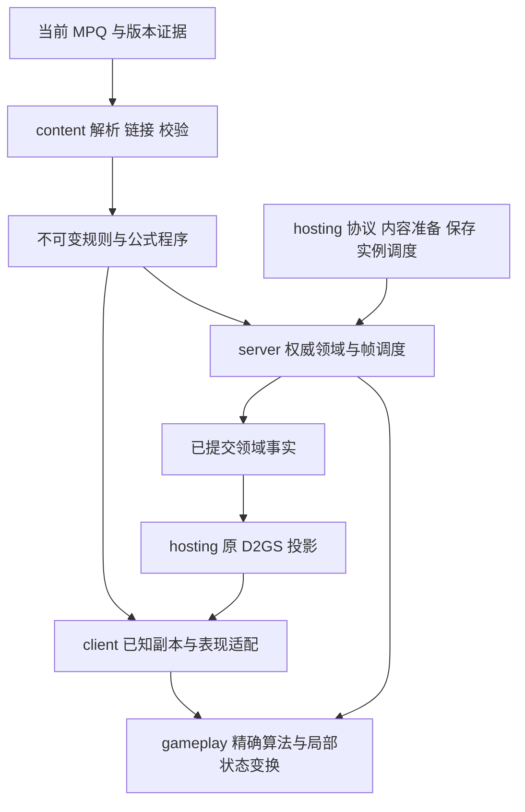

# 服务端战斗复刻目标架构

## 定位与使用

本文首先回答：怎样的服务端架构能够准确、完整地承载全部物品、技能、飞弹、怪物和战斗组合，并允许客户端复用有依据的公共计算。提前重构的目的是让后续内容建立在稳定的规则与执行机制上，避免先堆专用分支再重复返工；不是以整理当前目录或保留当前接口为目标。

本文是目标总纲与源码证据索引，不是已实现清单，也不授权立即改造代码。设计先由完整玩法、原版语义、所有权和合理依赖决定，再评估现有代码如何满足它。当前能力以[基线](../../BASELINE.md)、[内核子系统](../modules/SERVER_SYSTEMS.md)和各玩法专题为准；R0–R7实际阶段、剩余步骤和优先级统一由[总计划2.3节](MULTIPLAYER.md#23-战斗重构实际阶段与剩余步骤)维护。

目标是复刻经典资料片 1.13c 服务端战斗语义，包括数值、属性来源、动作帧、技能与飞弹程序、怪物决策、物品与触发、死亡和奖励。当前 MPQ 的摘要、覆盖顺序和适配标识见[MPQ](../resources/MPQ.md)，不能仅凭资源存在推断版本一致。客户端未来可以调用相同的纯计算，但不能由此取得权威世界、隐藏随机或提交权限。

### 文档分工

| 页面 | 负责的问题 | 不负责的问题 |
| --- | --- | --- |
| 本总纲 | 完整复刻范围、原版证据地图、跨域行为要求与验收 | 不以当前代码差距决定目标架构 |
| [战斗领域与组合设计](COMBAT_DOMAIN_DESIGN.md) | 为什么分模块、各自拥有什么、怎样协作、未来内容如何组合；目标模块职责以该页为准 | 不编排当前文件搬迁，不复制逐技能状态 |
| [公共规则与原版算法设计](COMBAT_SHARED_RULES.md) | 哪些原算法应共享、怎样直接适配、函数输入输出及准确性契约；提取标准以该页为准 | 不把 D2Common 全体函数视为纯计算或客户端权威 |

设计阅读顺序为“总纲定位 → 领域设计 → 公共规则 → 总纲第4–13节的行为约束 → 验收”。第14–15节只作目标确定后的现状／实施参考，不是架构设计的出发点；后续具体迁移任务另外按已定稿契约组织。三页共用本文的版本与证据边界，不形成新的完成台账。

### 证据边界

- 本地 D2MOO 固定版本以[资料来源](../resources/THIRD_PARTY.md)为准；其 [README](../../reference/d2moo/README.md)明确基于 1.10f，重建代码并不保证无误，也不提供完整 D2Client。
- 本次直接核对的本地提交为 `5596f5cb6c5251a0a07c6637d26458b06099d516`。后续更新参考版本时重新核对受影响的控制路径，不沿用旧结论认证新快照。
- D2MOO 用于解释控制流与算法；当前 MPQ 提供实际定义和资源参数。版本冲突由同版本原程序证据裁定，不能把 1.10f 函数号、结构偏移或行为直接宣布为 1.13c 规范。
- 本文区分“源码事实”“目标设计”和“待核实”。只读分析不能认证原版逐帧一致，也不把已有功能数量视为全组合完成度。
- 参考源码、原 DLL、MPQ、导出表和运行证据不纳入源码提交；许可与归属沿用[资料来源](../resources/THIRD_PARTY.md)。

### 首要架构判断

采用“外围适配与内容准备 → 权威领域执行 → 可复用规则计算”的分层，因为三者具有不同的变化原因、状态所有权和使用者，而不是因为当前项目恰好存在这些目录。现有 `hosting → server → gameplay` 与该方向相容，但内部职责、模块边界和公共接口仍须服从目标设计，不能成为不解耦的理由。不恢复万能会话，不逐技能建继承树，也不把 D2Common 整体搬作纯函数库。

原版依据：[D2MOO Skills.cpp](../../reference/d2moo/source/D2Game/src/SKILLS/Skills.cpp)通过 SrvStart／SrvDo 函数表复用执行族；[Units.cpp](../../reference/d2moo/source/D2Common/src/Units/Units.cpp)承载通用模式与动作推进。应共享可证明一致的算法和机制，保留各来源及专用程序差异；目录或类结构相似并不能证明行为一致。

可证伪的目标：给定相同版本规则、初始状态、命令及相应随机状态，重构前后以及原版对照中的关键事件应能逐项解释帧、顺序、数值、来源和消耗差异。静态核对先追踪一个攻击的“开始 → 动作事件 → 接触 → 结算 → 后续触发”，不能仅核对最终生命值。

后续实施前应逐领域读取本文指定的源码锚点和负责专题；本文不替代具体技能或怪物的完整分支契约。未知程序明确暂缓，不用普通攻击、默认数值或显示效果伪装完成。

阅读路线：[D2MOO 证据](#2-d2moo-证据地图) → [目标结构](#3-目标分层与代码结构) → [数据与公式](#4-数据与公式底座) → [数值与随机](#5-精确数值与随机) → [属性与效果](#6-属性状态与效果) → [动作帧](#7-动作动画帧与服务端时钟) → [技能](#8-技能程序与全部来源) → [飞弹](#9-飞弹是独立程序系统) → [伤害](#10-伤害流水线与死亡) → [物品](#11-全物品战斗能力) → [怪物](#12-怪物ai召唤与环境) → [提交与共享](#13-提交事实与客户端复用)。实施前再读[现状差距](#14-当前-d2x-的结构差距)、[迁移顺序](#15-重构与补缺顺序)与[验收契约](#16-对照与验收契约)。

## 1. 结论与复刻标准

**推荐模块化单体服务端：以领域机制组织执行，以原版语义组织公共计算，以数据定义组合具体内容。** 每个游戏实例串行推进权威状态，实例之间可以并行；共同算法不拥有世界。采用组合、值类型、受限公式解释与具名程序注册，不引入每技能虚类、通用脚本世界、全局服务定位器或为重构而实施整套 ECS。

合理性的主要判据是：新增一个使用已有机制的怪物、物品或技能，主要增加定义与程序绑定；新增一种真正不同的机制，只扩展负责该机制的模块及必要契约，不要求修改所有职业、全部单位存储或网络适配。这个判据不要求“所有内容都零代码接入”，原版专用程序仍应由具名代码准确表达。

“全部物品／技能／飞弹”不能用七职业数量或者导入表行数定义。必须覆盖当前规则包中所有可达定义及其传递依赖：玩家、怪物、佣兵、宠物、装备充能／触发／光环、物件陷阱、任务／首领控制器、子弹体、状态、死亡事件和奖励来源。表中禁用、保留、仅客户端、参考版本才存在的记录也要有明确分类。

复刻分为五个独立维度；任何一个未验证，不写“精确复刻完成”：

| 维度 | 要求 | 不足以证明它的现象 |
| --- | --- | --- |
| 定义一致 | 正确版本、表身份、覆盖顺序、公式、原程序编号及资源事件 | 找到同名技能／物品 |
| 数值一致 | 原始定点、取整顺序、上下限、技能来源、难度和双方类别 | 面板大致相同、平均伤害相近 |
| 时间一致 | 开始／释放／接触／到期／中断的帧和同帧顺序 | 25Hz、总动画时长相同 |
| 状态一致 | 归属、叠加、撤销、费用、伤害、死亡、尸体、奖励和失败分支 | 正常单次施法成功 |
| 可观察一致 | 正确原包、可见性、动画事件和状态恢复；不重复创建视觉弹体 | 自研客户端能显示效果 |

同种子一致是更强的独立要求：除了递推算法，还需相同随机流树、调用次数、候选顺序和创建顺序。当前项目不能据已有原递推函数宣称全战斗同种子一致。安全拒绝、背压、越界防护等现代实现可以不同，但不得暗改有效输入下的战斗结果；确需偏离的行为记录版本、理由和影响。

## 2. D2MOO 证据地图

本节覆盖战斗体系的主要控制入口与横向依赖，不声称已经逐行审计 D2MOO 全仓库或核实每个 1.13c 分支。证据分为本次直接阅读的控制路径和后续实现必须继续展开的入口；代码中的未知命名、TODO、空函数表槽及重建疑点不能被文档消除。

### 2.1 直接核对的结构

下列路径相对本地参考仓库；链接进入实际文件。D2MOO 的 DLL 边界是历史复用边界，不等于 D2X 的目标模块边界。

| 原模块／入口 | 源码观察 | 对目标架构的约束 |
| --- | --- | --- |
| [GAME/Game.cpp](../../reference/d2moo/source/D2Game/src/GAME/Game.cpp#L1844) | 房间恢复／人口准备后处理事件，再更新客户端及排队单位；任务和房间维护另有周期 | 房间活动、事件、复制、休眠有先后关系，不只是一条技能循环 |
| [GAME/Event.cpp](../../reference/d2moo/source/D2Game/src/GAME/Event.cpp#L175) | 单位类别分队列；每类先持续事件后到期事件；飞弹→玩家→怪物→物件→物品 | 明确定义兼容排序，不能把当前领域阶段顺序当原版证明 |
| [Event.cpp 的插入](../../reference/d2moo/source/D2Game/src/GAME/Event.cpp#L338) | 到期帧不大于当前帧会推至下一帧；到期事件尾插，持续事件头插；回调删除有延迟标记 | 仅按 `(frame, id)` 排序并不足够；插入、取消、自删除也是语义 |
| [Units.cpp](../../reference/d2moo/source/D2Common/src/Units/Units.cpp#L1020) | 序列相位、剩余长度、显示帧、模式与动作事件分别维护；定点推进、跨帧扫描 | 不能用动画百分比或单一 releaseTick 代表所有动作 |
| [Units.cpp 的速率选择](../../reference/d2moo/source/D2Common/src/Units/Units.cpp#L1704) | 先转换形态／模式，再选 FCR、格挡、受击、击退、移动、攻击或其他速率分支 | 变身、双持、序列与基础动作共同决定时序；函数名称亦需对照实现 |
| [D2Skills.cpp](../../reference/d2moo/source/D2Common/src/D2Skills.cpp#L482) | 技能／描述公式分别取代码区；参数回调可以读取其他技能、飞弹及属性；被动安装／撤销属性列表 | 公共公式需显式输入与上下文；被动不是一次性加数值 |
| [D2StatList.h](../../reference/d2moo/source/D2Common/include/D2StatList.h#L464) | 属性列表带来源、状态、技能／等级、到期帧、父子列表、移除回调；基础值与全值分开 | 保留带参数的属性键及贡献来源；不能只保留最终 Totals |
| [SKILLS/Skills.cpp](../../reference/d2moo/source/D2Game/src/SKILLS/Skills.cpp#L2445) | SrvDo 可被 ItemEffect 替换；还有通用 SrvMissile 路径；费用、数量和延迟有条件分支 | 空 SrvDo 不等于未实现；物品触发不等于正常按键施法 |
| [UNIT/SUnitDmg.cpp](../../reference/d2moo/source/D2Game/src/UNIT/SUnitDmg.cpp#L760) | 伤害／时长／吸取分槽；双方类别缩放、吸收事件、抗性及吸收按顺序处理 | 分通道和分阶段契约优先，不把所有路径塞进总伤害乘数 |
| [UNIT/SUnitEvent.cpp](../../reference/d2moo/source/D2Game/src/UNIT/SUnitEvent.cpp#L128) | 同步调用单位事件；注册顺序、自注销、一次性事件影响遍历 | 修改当前伤害的回调与提交后的新动作要分开 |
| [MISSILES/Missiles.cpp](../../reference/d2moo/source/D2Game/src/MISSILES/Missiles.cpp#L70) | 创建同时解释发射来源、速度、期限、激活帧、路径、碰撞和主人 | 飞弹定义、发射计划和运行实例必须分离 |
| [MISSILES/MissMode.cpp](../../reference/d2moo/source/D2Game/src/MISSILES/MissMode.cpp#L4990) | 碰撞资格、命中、NextHit、SrvHit、SrvDmg、伤害标志及销毁互相配合 | 接触不等于命中，命中不等于扣血，结束不等于碰墙 |
| [Items/ItemMods.cpp](../../reference/d2moo/source/D2Common/src/Items/ItemMods.cpp#L4308) | 一个 Properties 记录顺序执行多个函数，首函数结果传给后续；属性函数可改耐久等实例状态 | 不可将每列都当独立随机 stat；生成与装备聚合分离 |
| [ITEMS/ItemsMagic.cpp](../../reference/d2moo/source/D2Game/src/ITEMS/ItemsMagic.cpp#L34) | 词缀选择按格式／等级／类型／资格分支，使用物品种子，再安装属性 | 品质、词缀、属性和实例随机不能由装备刷新重掷 |
| [AI/AiGeneral.cpp](../../reference/d2moo/source/D2Game/src/AI/AiGeneral.cpp)／[AiTactics.cpp](../../reference/d2moo/source/D2Game/src/AI/AiTactics.cpp#L214) | AI 有专属控制与命令状态；UseSkill 经怪物模式转换；Idle 取消旧思考事件并重排 | AI 只决定动作意图；失败等待、模式与技能执行仍保留 |
| [SkillAss.cpp](../../reference/d2moo/source/D2Game/src/SKILLS/SkillAss.cpp#L164)／[SkillDruid.cpp](../../reference/d2moo/source/D2Game/src/SKILLS/SkillDruid.cpp#L45) | 蓄气状态、召唤参数、形态模式与技能处理相连 | 刺客／德鲁伊依赖通用状态、动作和召唤底座，不宜继续孤立补分支 |
| [D2Seed.h](../../reference/d2moo/source/D2Common/include/D2Seed.h) | low／high 种子递推；有界掷数的无效上界不消耗随机 | 明确流所有者、范围端点、条件消费与父子流 |
| [MonsterUnique.cpp](../../reference/d2moo/source/D2Game/src/MONSTER/MonsterUnique.cpp#L234) | 百分比函数在部分分支先除后乘 | 数学等价改写可能改变整数结果，不统一为一个“更精确”公式 |

### 2.2 实施时必须继续展开的原入口

这些是完整覆盖的追踪路线，不是本次已验证的全部分支。已有同版本证据集中在[参考设计](REFERENCE_DESIGN.md)和[资料来源](../resources/THIRD_PARTY.md)。

| 范围 | 后续阅读入口 | 必须追踪到的终点 |
| --- | --- | --- |
| 玩家动作 | [PlrModes.cpp](../../reference/d2moo/source/D2Game/src/PLAYER/PlrModes.cpp)、[SUnit.cpp](../../reference/d2moo/source/D2Game/src/UNIT/SUnit.cpp) | 模式准入、序列回滚、中断、扣费、动作事件及死亡 |
| 怪物动作／精英 | [MonsterMode.cpp](../../reference/d2moo/source/D2Game/src/MONSTER/MonsterMode.cpp)、[MonsterUnique.cpp](../../reference/d2moo/source/D2Game/src/MONSTER/MonsterUnique.cpp) | A1／A2／S1–S4／MonSeq、暴击、词缀初始化／受击／死亡回调 |
| AI 全家族 | [AiThink.cpp](../../reference/d2moo/source/D2Game/src/AI/AiThink.cpp)、[AiUtil.cpp](../../reference/d2moo/source/D2Game/src/AI/AiUtil.cpp) | 家族参数、特殊状态、目标排序、房间感知、队伍／主人与路径失败 |
| 物品全生命周期 | [Items.cpp](../../reference/d2moo/source/D2Game/src/ITEMS/Items.cpp)、[ItemMode.cpp](../../reference/d2moo/source/D2Game/src/ITEMS/ItemMode.cpp)、[D2Common Items.cpp](../../reference/d2moo/source/D2Common/src/Items/Items.cpp) | TC／品质、装备与失效、消耗／充能／耐久、网络和保存投影 |
| 方块／符文之语 | [HoradricCube.cpp](../../reference/d2moo/source/D2Common/src/DataTbls/HoradricCube.cpp)、ItemMods、服务端配方调用者 | 资格、原始属性继承／重掷、孔顺序、原子消费和输出 |
| 召唤／伙伴 | [PlayerPets.cpp](../../reference/d2moo/source/D2Game/src/PLAYER/PlayerPets.cpp)、Skills、各职业文件 | 所有者／归功、限额、替换、召唤装备、尸体消耗、死亡和退出 |
| 表与公式 | [SkillsTbls.cpp](../../reference/d2moo/source/D2Common/src/DataTbls/SkillsTbls.cpp)、[MissilesTbls.cpp](../../reference/d2moo/source/D2Common/src/DataTbls/MissilesTbls.cpp)、[ItemsTbls.cpp](../../reference/d2moo/source/D2Common/src/DataTbls/ItemsTbls.cpp) | 字段语义、名称链接、编号、公式代码及缺失值 |
| 动画／碰撞 | [SequenceTbls.cpp](../../reference/d2moo/source/D2Common/src/DataTbls/SequenceTbls.cpp)、[AnimTbls.cpp](../../reference/d2moo/source/D2Common/src/DataTbls/AnimTbls.cpp)、[PathMisc.cpp](../../reference/d2moo/source/D2Common/src/Path/PathMisc.cpp)、[D2Collision.cpp](../../reference/d2moo/source/D2Common/src/D2Collision.cpp) | 固定点相位、事件、方向、碰撞掩码、尺寸、房间边界 |
| 生命周期／原包 | [SUnitInactive.cpp](../../reference/d2moo/source/D2Game/src/UNIT/SUnitInactive.cpp)、[SCmd.cpp](../../reference/d2moo/source/D2Game/src/GAME/SCmd.cpp)、[SUnitMsg.cpp](../../reference/d2moo/source/D2Game/src/UNIT/SUnitMsg.cpp) | 休眠／恢复、公开状态、可见性、更新顺序与终态 |

## 3. 目标分层与代码结构

### 3.1 依赖方向



图中的数据输入不表示反向链接：规则值类型定义在资源无关的公共层；`server` 不链接 `content`。客户端可以链接共享计算，不能链接权威执行器以运行第二份伤害。嵌入宿主与独立宿主继续复用同一服务端内核。

### 3.2 建议目录

下面是逻辑职责到目录的一种映射，**不是现有目录清单，也不冻结最终文件／库数量**。拆分以独立职责、消费者、所有权及依赖隔离为准，需要解耦时不受现有类或构建目标限制；不因追求模块数量拆出没有独立语义的空壳。物理组织原则见[领域设计](COMBAT_DOMAIN_DESIGN.md#9-物理组织建议)。

```text
src/
	core/                         身份、受控整数运算、原随机递推等小工具
	gameplay/
		rules/                      纯值定义、表身份、版本、受限公式程序
		units/                      公共单位能力值、形态、资源
		actions/                    模式、速率、序列与动作局部推进
		stats/                      StatKey、贡献聚合、派生依赖与状态规则
		combat/                     命中、六通道、时长、减免、武器效果、几何
		skills/                     等级来源、参数求值、序列、技能族局部算法
		missiles/                   弹体定点运动、路径、接触几何、发射模式
		items/                      生成／属性／装备／数量／耐久／配方纯规划
		monsters/                   怪物数值与家族决策的显式输入输出
	content/                      MPQ 解码、字段链接、公式编译、原动画元数据
	server/
		runtime/                    调度、命令、发生标识、可靠出口、诊断
		systems/actions/            单位模式、动作实例、中断与原动作事件
		systems/skills/             技能来源、使用实例和服务端程序注册
		systems/missiles/           权威弹体、碰撞候选、生命周期和子弹准入
		systems/effects/            效果、光环、贡献与订阅句柄、定时工作
		systems/reactions/          有序反应与触发机制，可与effects共库
		systems/combat/             接触结算编排、结果提交与后续工作
		systems/attributes/         属性贡献入口、已提交派生快照
		systems/ai/                 控制器、感知、决策时钟与动作请求
		systems/monsters/           非玩家实体真值和活动／休眠生命周期
		systems/companions/         主人、限额、替换、同行、召唤准备
		systems/inventory/          装备／容器及费用计划
		systems/death/              死亡、尸体、经验／掉落协作
		systems/transactions/       类型化提交机制，不承接规则求值
		systems/...                 保留世界、关系、掉落、任务及复制等所有权
	hosting/                      准备规则、准入、原包、持久化与执行预算
	client/                       副本输入、共享算法适配与视觉程序
	presentation/                 原图、声音、渲染和交互，不决定战斗帧事件
```

注册按原程序角色区分 `SkillStart / SkillDo / ItemEffect / MissileDo / MissileHit / MissileDamage / UnitReaction / AiThink`。编号须与版本及所属表绑定，不能用一个整数或技能 ID 混用所有角色。实现用具名函数和紧凑的类型化表，复杂族可有私有 `variant` 状态；避免一个装满任意回调、任意字段的 `SkillContext`。

### 3.3 唯一所有权与通用单位

“通用单位”是**公共能力视图及操作契约**，不是让怪物伪装成玩家，也不要求集中所有状态到一个巨型 UnitStore。基础属性／资源采用同一语义组件，物理存储可以按生命周期选择；现有 PlayerStore 或怪物存储只是实现选择，不是目标架构的先验约束。

| 对象 | 唯一所有者 | 公共访问契约 |
| --- | --- | --- |
| 玩家与非玩家基础属性／资源 | 各实体拥有的统一语义属性／资源组件，具体存储不预设 | CombatantView／ResourceView，只读借用或带版本快照；保存为独立投影 |
| 权威位置／占位 | 世界位置及移动领域的唯一组件；索引只派生 | 全类型共用位置／碰撞查询，不复制到技能或战斗 |
| 主人／控制／归功 | companions 与各实际身份所有者；关系由 social 查询 | SourceBinding，区分 emitter、controller、credit、original identity |
| 装备／物品实例 | 原 inventory／items 所有权 | ItemView、EquipmentSnapshot、具体手位及来源 |
| 动作实例／模式／相位 | 独立动作领域 | ActionId、actionGeneration、AnimationCursor；技能、受击、死亡共用，不另存可写时钟 |
| 效果实例 | effects | EffectId、来源、目标、到期、贡献／订阅句柄 |
| 反应订阅与有序触发 | reactions，效果／装备／被动各持注册句柄 | 来源、事件角色、原顺序、移除策略；不把所有订阅当临时效果 |
| 弹体 | missiles | MissileId、父动作／父弹体、来源绑定、独立随机与阶段 |
| 伤害发生／重试 | combat | ContactId／OccurrenceId、阶段游标、已计划结果 |
| 帧定时索引 | runtime 调度器 | 仅存 due frame、事件身份和安全句柄，不拥有另一份领域状态 |

能力至少区分可攻击、可受伤、可治疗、可复活、可消耗尸体、可控制、可装备、可学习和可使用技能。`isMonster`、`hostile` 或“有主人”都不足以代替这些能力。原类型／模式、内部 ID、协议 GUID、表行 ID 和代次分别建模；不把容器下标当身份。

对象借用不得跨提交点保存。每个计划注明读取的是开始、释放、接触还是提交时的属性；只有原版要求快照的字段才冻结，不能为了重试方便冻结所有资格。形态变化改变能力和动作解释，不改变玩家真实身份或保存职业。

当前源码已将AreaNpc的运行位置、生命、属性根、随机种子和状态消费接入唯一非玩家Actor；AreaNpc只保留身份引用、出生点与服务／剧情能力。act5pow等友军与怪物／佣兵／召唤物共用Participants、MonsterResourceTrace、期限／死亡处理和状态数值复制，逃离则移除真实实体及事件。不同原程序的接收规则独立保留，详见[公共效果边界](../gameplay/skills/COMMON.md#跨单位接收与载体边界)。已有载体／原生状态／再生／飞弹切片不能等同全部跨单位组合完成；构建与有限运行范围以[运行包记录](../development/BUILD_AND_RUN.md#运行包记录)为准。

### 3.4 接口契约

以下是建议的值契约，不是要求立即新增一组同名公共头文件。类型由完整语义与消费者决定，可复用满足契约的现有值；私有运行状态与行为族参数不得经聚合公共头传遍全部领域。

| 契约 | 最小语义 | 禁止隐含行为 |
| --- | --- | --- |
| RulesetView | 规则版本、原定义 ID、不可变查询、字段来源 | 反向加载 MPQ、按不存在的 ID 返回普通定义 |
| CombatantView | 身份／代次、类别／能力、属性查询模式、位置／形态、来源关系 | 暴露可写 PlayerStore 或把未知状态返回零 |
| SkillUseIntent | 来源键、操作者、目标类型／位置、绑定代次、请求角色 | 以客户端技能等级、命中结果或控制者为权威 |
| ActionAdvance | 下一动作值、事件角色／阶段、费用计划与取消原因 | 直接调用网络或任意修改目标生命 |
| MissileAdvance | 下一弹体值、接触候选、子弹请求和结束原因 | 未准入即分发视觉成功、把碰撞直接写成致命结果 |
| DamagePlan | 阶段、原始／中间数值、读取版本、掷数结果、状态／资源与后续计划 | 重试重新掷数、混入不明来源的最终浮点值 |
| EffectChange | 来源、叠加策略、贡献／订阅增删、期限／周期、移除原因 | 只改图形状态位便宣称效果已生效 |
| CommitResult | Applied／Stale／Invalid／Unavailable／NotImplemented／Capacity 等明确原因 | 将已排队等同已成功、吞掉未支持程序 |

纯函数优先返回小值；局部状态机返回下一状态与类型化操作。需要随机的求值显式接收与返回流状态／消费结果，不与无随机公式混为一个“纯查询”。服务端适配器提供候选与状态，规划器不通过万能回调自行遍历世界。

### 3.5 性能与扩展边界

先维护可观察顺序再优化：不可变规则共享、ID 直达定义、公式编译一次、窄快照／借用、增量属性缓存、房间与空间索引、弹体／事件紧凑存储。避免每次命中复制完整库存、每帧解释全部表、每技能创建堆对象；也不能为节省内存丢掉重试所需的已提交结果。

确定性并不来自容器名称：更换 map／vector／哈希表、批处理目标、并行伤害或 SIMD 聚合，都可能改变顺序／取整／随机。实例内战斗默认串行；内容准备和不同实例可以并行，结果按带代次的确定边界安装。性能指标沿现有诊断记录阶段时间、候选量、事件与计划积压、弹体／效果数和内存，不设未经测量的吞吐目标。

## 4. 数据与公式底座

### 4.1 规则包

宿主在建局／准入前交付不可变 `Ruleset`：版本配置、MPQ 摘要与覆盖顺序、定义目录、链接结果、公式程序、动作元数据及程序支持表。定义按原始 ID／code 保存，名称仅用于链接和诊断；不能删除空行后重排原 ID。当前 TXT 导入与原版通常读取 BIN 的差异独立记录，未核实布局前不宣称 BIN 等价。

至少纳入以下依赖；表名为原资源概念，实际大小写和存在性由当前 MPQ 解析确认：

| 定义族 | 关键输入 | 不可遗漏的关联 |
| --- | --- | --- |
| 技能 | Skills、SkillDesc、CharStats、SkillCalc 类公式数据 | SrvStart／Do、ItemEffect、Srv／CltMissile、被动、光环、目标、消耗、延迟、形态、召唤 |
| 飞弹 | Missiles | Do／Hit／Damage、子弹体、路径、速度／加速度、期限、激活、NextHit／Delay、碰撞、SrcDamage、ClientSend |
| 属性／状态 | ItemStatCost、Properties、States、Events | stat 参数层、op 依赖、存储位宽、状态掩码、事件角色和移除 |
| 物品 | Weapons、Armor、Misc、ItemTypes、ItemRatio、QualityItems、MagicPrefix／Suffix、AutoMagic、UniqueItems、SetItems、Sets、Gems、Runes | 品质与类型树、staffmods、automods、套装层、孔内上下文、符文顺序、充能和技能来源 |
| 生成／掉落 | TreasureClassEx、CubeMain、等级／难度／怪物关联表 | TC 递归与升级、NoDrop、品质回退、MF／GF、任务首杀、唯一性及配方资格 |
| 怪物／伙伴 | MonStats、MonStats2、MonLvl、MonProp、MonUMod、SuperUniques、MonEquip、MonType、Hireling、PetType | 难度／人数、模式、尺寸、AI 参数、技能槽、召唤归属、装备、词缀和尸体资格 |
| 动作／世界 | AnimData、COF 事件、MonSeq、原硬编码角色序列、路径／碰撞、房间活动 | 形态／武器类／双持／模式到帧和事件的映射；硬编码算法表须有版本证据 |

不能把全部动画资源加载到服务端：内容层提取必要的帧数、速率、事件、序列和模式映射；DCC／DC6 像素、纹理、音频仍留表现。不同元数据冲突时按对应原动作路径裁定，不以“任选一个有值”回退。

### 4.2 公式与字段解释

目标是一个**受限、无世界副作用的整数公式执行器**，并非嵌入 Lua 或复制原全局求值环境。编译放 content，程序表示与求值放 gameplay；技能、飞弹、物品、描述采用不同的具名参数环境，共用已核实的运算核心。

当前 [description_formula.hpp](../../src/content/skills/description_formula.hpp)转发到公共[formula](../../src/gameplay/rules/formula.hpp)，保留既有描述表达式子集，不能未经核实就当战斗公式完整实现。随机表达式必须显式拥有流输入输出；客户端描述没有该信息时返回未知，而不是抽一个随机值。

必须保留：基础等级／有效等级／指定等级、技能来源、协同引用、单位基础／装备技能／总属性查询、missile 与 skill 各自的伤害曲线、ln／dm 等参数语义、条件求值与取整。不要把所有公式预烘焙为有限等级数组；依赖目标、装备、形态或实时状态的部分须在正确阶段求值。

编译与链接诊断区分 `MissingField`、`InvalidReference`、`UnsupportedOpcode`、`UnsupportedProgram`、`CyclicDependency`。空值、原合法零值、无程序槽和未知程序不是同一种情况。公式必须有深度／指令预算与安全算术；合法原内容不得因任意小上限被截断。

### 4.3 覆盖以依赖闭包为准

对每个开放入口记录 `定义 → 原程序 → 公式 → 属性／状态 → 动作 → 子弹体／召唤 → 协议事实`。支持状态至少分“仅导入”“依赖已链接”“程序已接”“源码核对”“授权运行”“同版本对照”；沿用现有专题 C／S／V 口径，不另算一个模糊完成百分比。

合法默认程序／无操作槽按原控制流处理，不能一律报错；未知非空程序必须可定位到表、行、列、编号及受影响入口。未经支持的玩法入口不开放；已存在存档遇到未支持必要语义则按保存规则拒绝，不能删属性后继续。

## 5. 精确数值与随机

### 5.1 数值类型

目标权威热路径避免 `float → 定点 → float` 往返。采用业务命名类型，例如 `Life256`、`Mana256`、`Damage256`、`PoisonRate`、`Frame`、`AnimPhase256`、`PathPosition`、`StatValue`；这些名称是设计示意，实际类型落点按现有代码决定。**不是所有字段都用 8 位小数**：毒速率、HitShift、路径坐标、速度、序列以及表自身单位必须分别核实。

每个原算法说明输入单位、位宽、有符号性、中间扩宽、截断、右移、钳位时点和除零策略。数学上等价不代表兼容，例如先协同后 shift 与先 shift 后协同、先除后乘与乘后除、先减少时长再应用抗性。不能借 C++ 有符号溢出实现原 x86 行为；需要兼容的环绕／移位用明确无符号操作描述，其余无效范围明确拒绝。

当前[CharacterRecord](../../src/gameplay/character/record.hpp)、[资源事务](../../src/server/systems/transactions/resources.cpp)已使用Fixed8；[伤害请求](../../src/server/systems/combat/requests.hpp)、[减免](../../src/gameplay/combat/mitigation.hpp)和主要飞弹数据采用整数／定点。[damage_resolution](../../src/gameplay/combat/damage_resolution.hpp)也已提供原整数入口，不再以“人物资源仍为浮点”描述当前差距。剩余工作是逐消费者核对位宽、取整、负中间量及转换边界；例如[missiles/damage.hpp](../../src/gameplay/missiles/damage.hpp)仍有float区间适配，不能由主链定点推断全来源精确。展示允许转浮点，原版明确的double回调保留其语义，D2S／原包各按原契约编码；运行态类型变化不自动授权改磁盘格式。

### 5.2 随机契约

[core/random.hpp](../../src/core/random.hpp)已实现原递推、初始高字和父流派生。继续复用，重点审计调用者：

1. 每次掷数记录语义所有者：游戏／房间／单位／物品／弹体及必要子流；不能默认全部读取实例全局流。
2. 区分闭区间属性 roll 与伤害路径实际采用的端点；相等／反序／无效范围的消费次数也保留。
3. 候选排序不任意改成 EntityId、距离排序或哈希遍历。确定性顺序和原版顺序是两种要求。
4. 在原语义点消费随机；费用不足、失败分支也可能有原消费，不能统称“失败绝不推进”。容量不足重试则不能产生第二次逻辑掷数。
5. 已完成逻辑掷数保留结果与阶段，不能回写过期全局种子。若多个后续事件共享同一流，必须保持原相对顺序，不能用随意分流解决背压。
6. 客户端仅用公开可知的种子／表现随机；共享算法不意味着共享服务器私有流。

服务端可记录受限的随机消费诊断，包含 owner、发生标识、调用点、前后种子与结果；只在管理端、授权诊断中可见，不广播给客户端。

## 6. 属性、状态与效果

### 6.1 属性模型

用 `StatKey = (原 stat ID, layer/parameter)` 表达属性身份；`StatContribution` 标识来源、作用对象、原始值、运算类别、手位／装备上下文和生效条件。基础人物值、物品已掷原始值、装备有效贡献、被动、临时效果与最终派生值分层，但聚合顺序由原查询语义决定，不是随意固定“六层加总”。

必须可以回答一个最终值来自哪里，并能只撤销一个来源。装备失效、破损、武器切组、套装件数、镶嵌、充能变化、形态、光环／诅咒覆盖都更新对应贡献，不能重算时丢掉参数层，也不能重复叠加之前已包含的值。

`ItemStatCost.op` 及属性依赖要有已链接图和明确刷新点。优先在领域事务中同步更新受影响快照；需要缓存时只缓存派生值并带版本，不先引入全局 dirty 队列。属性运算变更可能改变最大资源，但如何夹取／补量／保持当前值由具体操作定义，不全部按同一比例缩放。

### 6.2 效果模型

效果不是一个状态位，也不是只有 duration 和 modifier。实例至少记录来源技能／物品、施法者／归功、目标、等级、起止帧、周期相位、叠加键、属性贡献句柄、事件订阅和移除策略。原 States 负责状态语义，运行实例负责来源与期限；可见图形位只是一种投影。

需区分独立叠加、替换、刷新期限、取高等级、同源合并、互斥组及专用程序；不能默认所有同名状态取最大等级。毒、撕裂、诅咒、冻结、减速、能量盾、骨甲、变身、蓄气、光环和转化按自身规则处理。

移除覆盖到期、解毒／驱散、技能失去、装备卸下、死亡、换区、主人退出、实体退役、状态覆盖。撤销贡献和反应订阅必须恰好一次；被动／形态刷新只触发必要后续，不通过递归广播无限重算。

### 6.2.1 持续效果的实施范围与顺序

光环收尾之后，持续效果阶段必须同时覆盖诅咒、祭坛祝福和野蛮人吼叫；已有技能入口和历史冒烟不等于本轮公共生命周期迁移完成。全部使用当前 MPQ 的 Skills／States／Shrines／ItemStatCost；D2MOO 的 SkillNec、SkillBar、ObjMode 及 D2Common StatList 提供控制流证据，1.10f 与目标 1.13c 的差异按本地原 DLL 核对。

| 优先级 | 工作 | 完成边界 |
| --- | --- | --- |
| P0 | 来源列表、逐属性传播、原始期限／移除事件和资源候选 | 玩家、怪物、佣兵及召唤使用同一撤出路径；同帧覆盖／到期、死亡、解毒和背压不遗漏或重复回调 |
| P1 | 全部死灵诅咒与其他诅咒生产端 | 普通属性诅咒的首项分配／逐槽写入、同级延长、吸引保护、AI 控制与难度期限、破免通道，以及净化／祭坛互相覆盖均按实际原入口核对 |
| P1 | 祭坛祝福、恢复祭坛及井水解除 | Shrines 参数动态准备；保留原状态互斥、诅咒清理、技能／抗性／防御／命中／资源回调及移除顺序；物件可用次数／重置由 objects 拥有 |
| P1 | 野蛮人吼叫 | Shout、Battle Orders、Battle Command 的友方来源、重复施放、等级刷新及生命／法力／耐力上限回调；Howl、Taunt、Battle Cry、War Cry 的敌方控制、减益、眩晕和伤害各走原专用程序 |
| P2 | 其余增益、减益与持续伤害 | 女巫冰甲／附魔／能量盾、骨甲、Holy Shield、毒／撕裂／冰冻／减速、药水持续恢复及形态／蓄气状态逐生产端迁移；未实现职业的入口仍明确暂缓 |
| P2 | 结算与事件整合 | 护盾消耗、反伤及事件订阅接实际伤害阶段；完整单位事件排序、死亡撤销和房间生命周期继续独立推进 |

公共抽取统一来源、属性写入、计时、撤销和事实发布，不把所有效果简化为同一叠加策略。验收需分别观察数值、当前资源、状态位、控制／事件撤销与正常退局重入；每类规则的未核实分支继续由负责专题声明。

### 6.3 两种事件不可混为一谈

**结算内反应**可以修改当前 DamagePlan，例如吸收护盾、反伤依据、事件专用修正。采用确定顺序的类型化 reducer，在原结算点执行；不是任意世界回调，也不能统统延至下一帧。

**后续动作**例如触发新技能、死亡新星、重生、掉落，形成具名后续计划并保留父发生标识。它们是同帧执行还是未来帧定时由原路径决定；实现使用受控工作栈／队列避免 C++ 递归失控，但必须保留原深度／广度顺序，不用“防递归”改变合法触发。

触发白名单、是否允许 proc 再触发 proc、触发几率合并、武器局部属性和伤害来源按原事件分别核实。不能给所有触发统一加一个猜测的冷却或深度上限。安全预算耗尽应显式失败并可诊断，不默默吃掉一半效果。

## 7. 动作、动画帧与服务端时钟

### 7.1 三种时间

| 时间 | 所有者 | 用途 |
| --- | --- | --- |
| 25Hz 游戏逻辑帧 | 实例调度 | 事件到期、冷却、AI、弹体、恢复和死亡 |
| 单位动作／序列定点相位 | 独立动作领域的实例 | 起手、动作事件、回滚、连续段、结束和模式转换 |
| 渲染／插值时间 | client／presentation | 绘制与声音追随，不反向触发权威释放 |

完整动作模型的目标输入为原单位类型／形态、模式、技能、武器类／手位、动画与序列数据、相应速率属性；输出包含下一相位、显示模式／帧、原动作事件、循环／回滚／结束信息。当前`gameplay/actions/timeline::ActionTimeline`负责玩家起手及动态回卷的事件表／结束帧，已接普通／变形武器动作和已支持序列；它仍不包含完整模式转换、怪物StopSequence及特殊玩家程序，消费者与剩余差距见[内核动作边界](../modules/SERVER_SYSTEMS.md#调度与动作的职责及迁移边界)。服务端消费执行事件，客户端仅消费已知动作的显示投影。

动作事件可能不止一个，且不同值不都表示伤害释放。玩家`SUnit::sub_6FCBCE70`起手时为跨过的标记预排事件，普通模式只在首个1／2执行Do；怪物`UNITS_StopSequence`逐帧更新动作标记，再由模式回调决定消费，不能混用这两个算法。Jab／Impale、Strafe／Fend、Zeal／Fury、Whirlwind、Inferno、变身攻击、双持及怪物MonSeq应分别指定回卷／重排和事件策略。

### 7.2 调度契约

兼容帧事件调度把“何时执行”与“哪个领域拥有实现”分开。当前已有`gameplay/events/frame_queue`和`GameSystems.frameEvents`，实现五类64桶、持续／到期队列与部分事件派发；后续应完成所有调用者迁入，而非再建第二套队列。目标必须支持原类别顺序、持续／定时子队列、插入序、事件替换／取消和action generation；不要求照搬原内存池。

仅 `EVENT_IterateEvents` 的排序已由 1.10f 源码确认，不能据此立即整体调换 D2X `Simulation::step`。先展开玩家／怪物／飞弹模式回调，核对 1.13c 的实际相对执行点，再逐类转到新调度。领域 `step` 可保留准备／清理／提交工作，不再额外推进同一动作。

调度记录至少有 due frame、阶段类别、插入序、实体／动作代次、事件角色、payload 和取消令牌；过期身份仅取消相关工作。动作中断、切换目标、死亡、变形、换区需要明确取消哪些事件、保留哪些已释放实体，不能简单清空所有来源工作。

### 7.3 背压不能改写战斗时间

当前各领域有跨步重试；目标必须明确其语义，不能让同一个接触因 Outbox 满而晚几帧读取新抗性，也不能让先扣血后触发之间无条件跨过到期事件。

必须保证领域发生完整、原事件顺序不变、重试不重复掷数／提交且不偷偷移动有效帧。当前Simulation及帧队列已保存部分阶段／执行游标，宿主仅在完整帧边界按墙钟预算让出并保留帧债务；这不是所有领域、嵌套事件或原版交错均已满足契约的证明。后续仍须逐域核对续执行、预留及有界准入；不能未经容量与活性分析就规定“任意阻塞一律暂停实例”。具体决策按[领域设计](COMBAT_DOMAIN_DESIGN.md#63-容量与背压)区分新请求、已存在的必要工作和网络发送阻塞。

完整背压契约仍是后续收尾要求；已有局部恢复及性能观察不能代替协议节拍、超时、公平预算和长帧行为的范围验收。异步MPQ准备应尽量在准入前完成；确需运行时准备时，明确动作尚未开始或实例在何种边界等待，不凭工作线程完成时刻决定命中帧。

## 8. 技能程序与全部来源

目标入口形态为 `SkillUseIntent + CombatantView + Source + Rules → 资格／计划`。玩家按键、AI、装备触发、充能、宠物和环境来源共享执行族，但保留各自入口策略与权限。

一次技能工作至少区分：资格与来源选择、开始程序、模式／序列建立、开始费用、动作事件、Do／ItemEffect 或默认 SrvMissile、事件费用／数量、延迟、持续／后续动作、结束／取消。原程序没有某阶段时显式说明，而不是所有技能强套相同扣蓝点。

技能来源键包含技能 ID、来源类型、来源物品／单位及代次；基础点数、有效等级、充能等级、触发指定等级、装备授予、怪物技能等级不能共用一个 rank。协同按具体公式取值；换装／切组后不得继续使用失效来源。触发免费并不意味着跳过目标、模式、城镇或 ItemCheckStart 条件。

| 执行族 | 公共计算 | 服务端专属 |
| --- | --- | --- |
| 武器／近战／连击 | 手位伤害、命中公式、范围、序列／回滚、费用规划 | 目标复验、实际命中、弹药／耐久、动作中断、接触发生 |
| 普通法术／射线／连锁 | 伤害曲线、方向、链段几何、跳数与参数 | 完整候选、再命中资格、分支随机和真实目标 |
| 持续施法／地面持续 | 周期／remaining 计算、局部落点、覆盖 | 扣费阶段、周期碰撞、NextHit、创建／销毁 |
| 被动／增益／诅咒 | 属性贡献及资格的纯谓词 | 来源安装／撤销、覆盖、驱散、事件订阅 |
| 光环 | 半径、周期、等级和属性公式 | 发射实例、候选、关系、目标刷新、装备来源叠加 |
| 召唤／尸体／物品变换 | 限额／等级、继承规则、候选出生点 | 材料竞争、实体准入、替换、归属、保存边界 |
| 位移／冲锋／跳跃 | 轨迹、速度和到达条件 | 动态碰撞、落点许可、不可中断段、命中窗口 |
| 蓄气／终结技／变形 | 蓄气贡献、形态属性及动画选择规则 | 状态生命周期、终结消费顺序、手位、模式切换 |

“共用一个执行族”不要求抹掉玩家和怪物的模式入口。长期目标是共用动作／费用／事件机制，加类型化来源策略；不是机械合并当前 `Release` 与 `MonsterRelease` 后增加更多布尔标志。

## 9. 飞弹是独立程序系统

飞弹定义保存原 Do／Hit／Damage／Clt 编号、参数、公式、子弹体链接和碰撞标志；实例保存发射上下文、主人／发射器／归功、定点位置／速度、路径状态、生命周期／remaining、激活门槛、伤害来源快照、随机及接触历史。

原始表定义不应该埋在一个玩家 SkillCastSpec 内，怪物、装备、陷阱和子弹体都应能引用同一个 MissileDefinition。既保留技能继承伤害，也支持独立 Missiles 伤害、SrcDamage、专用 Damage 程序及目标相关修正；冻结与实时读取字段逐程序说明。

建议执行分解为：寿命／激活 → Do 与运动计划 → 扫掠碰撞候选 → 精确资格与顺序 → 接触／命中 → Hit 程序 → Damage 程序 → 战斗结算 → 子弹／结束计划。这是职责分解，**具体先后由原程序定义**，不能强制全部 Do 先移动或全部 Hit 都产生伤害。

必须独立表达以下分支：

- 墙面／地形接触、单位接触、目标丢失、期限到达、主动取消；各自是否调用 Hit／爆发／生成子弹。
- `CollideType`、`CollideFriend`、`CollideKill`、`AlwaysExplode`、可摧毁弹体、城镇许可、激活距离／时间和碰撞占位。
- 命中率、格挡、闪避与穿透次数／穿透随机；接触成功不能预先等同伤害成功。
- `NextHit/NextDelay` 的目标状态作用域、安装点及到期顺序；D2MOO 有命中失败仍安装 JUSTHIT 的路径，不能用弹体私有 set 替代全部规则。不得套用 D2R 后续版本语义。
- 父子弹体的种子、伤害继承、技能等级、主人和结束原因；递归生成必须保持创建及随机顺序。
- `Srv` 与 `Clt` 参数分别保存。`ClientSend` 只决定特定同步方式，不代表所有实际弹体都发创建包；视觉控制器不一定伤害，伤害控制器也不一定绘制。

空间索引只是候选加速；保持房间范围、单位尺寸、原掩码和精确接触算法。高速弹体不能只测终点；几何共享不意味着客户端可见碰撞等同服务端全世界碰撞。相邻区域、房间休眠、主人死亡／退出、转化和宠物替换都需明确弹体存续策略，当前项目策略不能自动当成原版。

当前源码进度：玩家与非玩家弹体数值集中到同一nativeDamage来源；创建期玩家武器固定伤害已撤出，单目标接触前奏、SrvHit及伤害／HP分阶段，范围抽样按原程序区分单元素与FullDamageParams，并沿相邻房间顺序消费。源、父体、弹体与受击者种子及子体发布保留独立游标；已有数值／接触、跨区和HPREGEN切片已纳入构建，实际有限观察以运行包记录为准；完整生命周期、原全局交错、全部专属程序及来源组合仍未闭合，详见[内核飞弹边界](../modules/SERVER_SYSTEMS.md#飞弹数值与接触收尾源码)。

## 10. 伤害流水线与死亡

### 10.1 中间结果

推荐 `DamageBundle` 保留物理、火、冰、雷、魔法、毒的原始量，以及毒率／长度、燃烧、冻结／寒冷／眩晕时长、吸取、转换、SrcDamage、命中结果／HitClass、穿透／绕过标志。`HitAttempt`、`DamagePlan`、`DamageCommit` 和 `FollowUp` 分开；恢复生命不能用负伤害代替全部规则。

每个路径明确阶段读取和修改；公共算子可复用，但以下只列责任，**不是未经核实的统一全局顺序**：

| 阶段 | 必须回答的问题 |
| --- | --- |
| 资格 | 同区／房间、敌意方向、主人、城镇、尸体／无敌／能力、来源是否仍有效 |
| 接触与命中 | 近战距离、跑动／防御、AR、必中、盾挡／武器挡／闪避及随机顺序 |
| 原始伤害 | 武器局部与全局增强、双持、技能比例、元素、支配、暴击／致命、目标类别、转换 |
| 特殊缩放 | 玩家／佣兵／宠物／重生／首领、难度、人数、PvP 及专用例外 |
| 防御／反应 | 护盾事件、固定减伤、抗性、免疫／破免、穿透、百分比与固定吸收的准确先后 |
| 效果 | 冷／冻／毒／眩晕、压碎、撕裂、击退、减防、阻止自疗、击中逃跑／致盲 |
| 提交 | 当前资源、吸收回补、受击／格挡动作、状态贡献、耐久、事实和随机消费 |
| 后续 | 吸血／吸魔、反伤、触发技能、牺牲反冲、击杀恢复、死亡和归功 |

参考源码中 `SUNITDMG_CalculateTotalDamage` 的类别缩放、`UNITEVENT_ABSORBDAMAGE`、状态时长修正、逐通道抗性／吸收是已见顺序；其他路径须追到 `FillDamageValues`、`ExecuteEvents`、`ExecuteMissileDamage` 和技能特例，不能仅凭函数名合并。

### 10.2 死亡不是 hp=0 的副作用集合

由 death 接收唯一致命发生，冻结真实击杀来源、控制者／归功、难度／人数及奖励所需条件。死亡模式／事件、尸体可用性、粉碎／禁止复活、死亡触发、经验、掉落和任务是有顺序的后续过程，不由 AI 或客户端代办。

同一尸体可能竞争召唤、尸爆、复活、寻找物品和特殊任务。尸体版本与消费发生标识属于权威生命周期；不能每技能各放一个“已用尸体”集合。死亡动画未结束不一定意味着所有尸体操作都非法，准确资格按原程序核实。

吸取与反伤可能使攻击者死亡，击杀者也可能是已死亡单位或宠物／环境。SourceBinding 的有效期、击杀奖励与弹体存续分别定义，不一律要求攻击者当前活着；死亡奖励去重不能用客户端请求序号。

## 11. 全物品战斗能力

物品的目标不是“全部 affix 能显示”，而是所有合法来源在生成、装备、使用、命中、失效和保存后仍执行正确语义。

### 11.1 三层模型

1. **定义层**：原类型树、属性程序、品质／词缀／套装／符文之语、孔内上下文、使用与触发程序；不可变，无世界状态。
2. **实例层**：原 ID、品质、ilvl、已掷属性与参数、孔顺序、充能、数量、耐久、鉴定、无形、来源及保存字段；生成后不因重算装备而重掷。
3. **有效贡献层**：当前装备位／手位、武器组、需求、破损、状态、套装件数和技能来源派生；可以重算，不覆盖原始保存属性。

Properties 一个记录的多函数步骤需保留首结果复用和副作用计划；物品属性 op、属性生成函数与战斗事件回调是三种不同程序。未知 op／函数不可静默当普通加法。原 stat 支持保存但尚不支持执行时，必须在准入／玩法支持状态中说明，不把往返成功当执行正确。

### 11.2 必须覆盖的组合

| 类别 | 目标要求 |
| --- | --- |
| 基础／品质 | 普通、劣质、超强、魔法、稀有、套装、暗金、手工；品质失败回退、无形、自动属性和职业 staffmods |
| 镶嵌／符文之语 | 武器／防具／盾牌上下文、孔顺序、类型与资格、底材／孔内／符文之语属性分离 |
| 装备判定 | 力敏／等级／职业／双手／双持、装备依赖与失效、破损、切组、佣兵装备及武器局部贡献 |
| 技能来源 | 全技能／职业／技能树／单技能／oskill、充能、装备光环、触发指定等级、来源选技和失效撤销 |
| 命中属性 | 压碎／致命／撕裂／吸取／击退／减防／慢速／防止自疗／冻结／致盲／逃跑；适用对象、远近战及 PvP 区别 |
| 事件物品 | OnAttack／OnHit／OnGetHit／OnKill／OnDeath／OnLevelUp、ItemEffect／ItemTgtDo／ItemTarget／ItemCheckStart；触发者与受术者可不同 |
| 消耗／维护 | 弹药、投掷数量、耐久损耗、自修复／补充、药水／解毒／解冻、充能消费与维修；事件与事务一致 |
| 生成／掉落 | TC、MF／GF、人数／队伍 NoDrop、怪物／首领／任务来源、唯一物品限制、随机归属及恰好一次安装 |
| 配方／加工 | 输入匹配、原属性继承、重掷与随机顺序、孔／品质／等级、材料原子消费及输出容量 |
| 保存／恢复 | 基础／套装／符文之语 stats 和参数层保留，未知必要语义拒绝；不保存临时效果和当前动作 |

当前 [item_properties.cpp](../../src/content/items/item_properties.cpp)准备输入，已支持的属性步骤与stat求值转入[公共属性程序](../../src/gameplay/items/property_program.hpp)及[stat求值](../../src/gameplay/items/stat_evaluation.hpp)。[item_triggers.cpp](../../src/server/systems/reactions/item_triggers.cpp)具有明确的 ItemEffect／受害者／尸体／起手检查暂缓分支。完整原属性程序的逐步骤随机及首次结果复用仍需接通，佣兵与其他装备单位尚未共用全部事件能力；不能为了“全支持”去掉这些拒绝分支。

掉落与物品准备可以继续通过 hosting 获取内容，但随机决定与资格应最终由拥有相应权威状态的领域驱动。迁移目标是 content 只解析规则、gameplay 规划生成、server 提交实例；不让宿主协议处理器继续扩展为第二个物品规则执行器。旧准备入口以值适配桥接，逐条迁移。

## 12. 怪物、AI、召唤与环境

怪物覆盖以真实 MonStats 身份及难度／rank／模式／技能槽为单位。保留真实身份和实现策略身份；沉沦魔替身只按既有授权用于未实现敌对单位，不算该身份完成，中立单位不可替换。

AI 分为感知输入、家族局部状态、决策、动作提交与失败反馈。共享家族函数接收显式候选／距离／视线／房间／随机，返回下一控制状态与 Move／UseSkill／Idle 等意图；不直接扣血、造掉落或拥有实体生命。可以服务端内多家族复用，不必为了“共享”让客户端运行 AI。

不能把所有家族变成“距离内攻击、否则追逐”。要保留 AITHINK 特殊状态、AiParam、冷却／等待、目标保持、逃跑／群体通知、巢生、复活、隐身／钻地、冲锋、模式失败回退和首领阶段。MonSeq 的多个事件、A1／A2／S1–S4 及附带弹体应共用动作机制，不按怪物名称硬编码一个伤害释放帧。

精英／冠军／超级暗金通过身份、属性贡献和事件程序组合；MonUMod 的生成期、受击期和死亡期行为分别登记，不全部放到掉血后的通用回调。首领／任务世界控制仍由所属领域负责，AI 仅请求经授权的阶段动作。

伙伴使用相同战斗能力与技能程序，独立保留限额、主人命令、跟随、传送／换区、替换与死亡。召唤物的属性继承注明生成快照还是动态刷新；陷阱、影子、藤蔓、灵、乌鸦、墙段、Hydra、重生和佣兵不能都套同一个普通敌怪生命周期。

环境伤害、陷阱和任务控制器不伪造玩家身份；其伤害来源、归功、TC／XP 和退役行为明确表达。动态占位、路径、房间活动与休眠恢复是战斗准确性的前置条件，不能因本计划重点在战斗而忽略跨房追击、飞弹边界或休眠单位计时。

## 13. 提交、事实与客户端复用

### 13.1 类型化提交

保留现有 prepare／commit、版本复验和 Outbox 的基础。目标是在正确原语义边界提交一个完整领域变化，而不是将整次施法强行合成一笔大事务。一次施法可能有起手费用、多个释放、多个独立接触；每个发生各有身份与阶段。

提交计划明确：读取版本、实时资格、资源与物品变化、目标生命／效果变化、随机消费归属、实体准入／退役、后续事件、可见事实。预留容量后以不会中途分配失败的步骤安装；事务机制不读取 MPQ、不计算伤害、不判断技能规则。

对已提交伤害但尚待吸取／反伤的阶段，保留已提交结果和后续游标；重试不得再次减血。对尚未提交且依赖已变化的计划，按原规则重新判定或取消，不能只因版本变化就重复随机。结构优化若改变此边界必须标作行为变更，而非“纯重构”。

### 13.2 原包与保存边界

可靠领域事实描述已发生的动作／资源／状态／物品／死亡，不是直接存某个原包结构。hosting 负责原包投影、本人／他人差异、房间兴趣、ClientSend、字节队列和断线；不根据新快照重新计算当次伤害。

客户端原服与自研共用消费者，不为新内核发私有游戏包。晚入视野重建持久可见状态，不无条件重播历史施法；弹体补同步是否必要及可表达性逐原包路径核实。D2S 仅保存已定义持久值，事件队列／弹体／光环刷新时钟不写入角色档；铁魔等例外遵守[存档](../modules/SAVES.md)。

### 13.3 公共函数的边界表

| 公共能力 | 建议显式输入／输出 | 客户端可用条件 |
| --- | --- | --- |
| 公式求值 | FormulaProgram＋具名已知输入 → 值／未知／错误 | 只传已知属性；未知不当零 |
| 属性聚合 | 原始 stats＋贡献＋上下文 → 派生值与来源解释 | 不凭可见装备猜隐藏词缀或他人技能 |
| 动作推进 | 动作定义＋相位＋速率输入 → 下一相位／原事件信息 | 可驱动显示，不能从事件授权扣费／命中 |
| 弹体运动 | 原规则＋局部状态＋显式几何输入 → 下一位置／接触候选 | 使用客户端自己的视觉世界，结果不是权威 |
| 伤害算子 | 明确数值／类别／规则 → 计算结果 | 面板／预览可用；缺目标状态则只显示范围／未知 |
| 物品规划 | 规则值＋实例／上下文＋必要种子 → 计划 | 报价／预览可用；生成真品／消费不可由客户端提交 |
| AI 决策 | 候选感知＋局部状态＋随机 → 意图与下一状态 | 默认服务端内部复用，不要求客户端调用 |

共享层没有 `GameInstance`、`ClassicData`、MPQ、网络、GPU、文件、隐式随机、任意世界查询回调。需要查定义时传只读窄目录，需要查参与者时由服务端构建输入。算法相同也不保证两端输入相同，客户端未知是合法结果。

## 14. 当前 D2X 的结构差距

本节是次要实施参考，不是目标设计依据。表内是已读取代码支持的可能切入点，不是完整漏洞审计，也不宣称每项已经导致可复现错误。模块边界先按[领域设计](COMBAT_DOMAIN_DESIGN.md)确定，再评估保留／适配／替换；未运行的风险保持“需对照”，不写成已证实原版偏差。

| 当前证据 | 判断 | 最小重构方向 |
| --- | --- | --- |
| [Simulation](../../src/server/runtime/simulation.cpp)固定阶段；trade Blocked 时提前返回 | 领域拓扑不等于原事件序；部分阶段跨步推进需审计 | 明确兼容事件与容量契约，再选择帧游标／预留等实现 |
| [actions/state.hpp](../../src/server/systems/actions/state.hpp)持玩家／怪物释放，所属帧事件推进；combat旧近战队列已撤出 | 当前可达动作／近战消费者已迁移，来源模式策略仍分别保留 | 后续复核完整世界恢复、队列2与全部组合，不再保留旧固定步伤害回退 |
| [SkillRuleSpec](../../src/gameplay/skills/rule_spec.hpp)聚合多种技能专用字段 | 继续补职业会扩大耦合和无效组合 | 原定义＋角色化程序引用＋族参数；只迁移真实重复部分 |
| [missiles/system.hpp](../../src/server/systems/missiles/system.hpp)含 SkillCastSpec、EnemyProjectile、Program 分支 | 玩家／怪物／独立弹体规则尚需统一定义契约 | 独立 MissileDefinition 与发射上下文；保留 Do／Hit／Damage 区别 |
| [combat/system.hpp](../../src/server/systems/combat/system.hpp)含大量专项结果与重试标志 | 已有恰好一次思路，但新增组合易扩大状态组合 | 具名阶段与中间结果，减少互斥布尔状态；逐路径保留原顺序 |
| [资源事务](../../src/server/systems/transactions/resources.cpp)已用Fixed8，伤害与飞弹范围已用原生整数；旧float区间适配已删除 | 主要类型迁移已发生，剩余是完整消费者和算术边界对齐 | 逐入口确认采样／取整／上限回调及原包／保存转换，不再重复迁移已定点资源 |
| [attributes](../../src/server/systems/attributes/system.cpp)查询玩家Totals，非玩家已有MonsterResourceTrace／StatList，NPC接唯一Actor | 基础跨单位载体已建立，不能由此推断所有来源／回调齐全 | 完成直接属性、来源撤出及非玩家消费者；复用同一图和算子，不建立第二份Totals |
| [property_program.hpp](../../src/gameplay/items/property_program.hpp)已有逐操作随机输入，StatList已有原delta传播与FullStats | 公共机制已有实现，完整函数／组合及调用顺序仍未认证 | 沿当前入口补剩余程序和跨来源组合，保留原始stats及具体操作顺序 |
| [item_triggers.cpp](../../src/server/systems/reactions/item_triggers.cpp)独立队列、玩家路径及显式暂缓 | 职业主动技能可用不代表物品来源完整 | 逐 ItemEffect／目标策略接通；再扩充佣兵和其他装备单位 |
| [formula.hpp](../../src/gameplay/rules/formula.hpp)公共受限表达式核心 | 描述接口已转发，战斗完整语义未由此证明 | 保留上下文差异，补原公式所需语义与显式随机 |
| [core/random.hpp](../../src/core/random.hpp)已有原递推 | 不需要再造 RNG；需要审计流和消费点 | 记录原流归属／创建／候选顺序，逐行为排除任意分流 |
| [CMakeLists.txt](../../CMakeLists.txt)已分 gameplay／server／hosting | 顶层方向可保留，无须先推倒 | 收窄公共头、依赖与注册；不把参考 DLL 布局当新目录目标 |

## 15. 重构与补缺顺序

本节是目标设计明确后的能力依赖参考，不是以当前文件为中心的重构任务表；总体产品路线仍由[总计划](MULTIPLAYER.md)维护。先完成[领域设计定稿标准](COMBAT_DOMAIN_DESIGN.md#10-目标架构定稿标准)，再制定实际迁移批次。正常运行只保留一个权威执行器；临时旧／新桥接按类型适配，不长期双写世界，也不未经授权运行影子比较。

| 阶段 | 交付内容 | 进入下一阶段的条件 |
| --- | --- | --- |
| R0 证据与范围 | 当前规则包身份、开放入口依赖闭包、程序／公式缺口、现有行为锚点 | 区分真实支持、替身、缺证据和合法空程序；不因旧台账“已接”跳过 |
| R1 精确公共底座 | 数值单位与算术契约、随机所有者、公式核心、stat 参数与贡献模型 | 普攻和一个既有法术能端到端解释数值；转换边界无静默丢失 |
| R2 动作与帧事件 | 独立动作机制、玩家／怪物模式策略、序列与事件顺序、明确容量语义 | 普攻、Lightning／Jab 等序列、一个多事件怪物、中断均能说明逐帧行为 |
| R3 战斗／状态核心 | 分通道结算、阶段反应、效果来源、尸体与后续提交 | 玩家／怪物／伙伴互相作用，护盾／毒／反伤／死亡的顺序与重试完整 |
| R4 技能与飞弹程序 | 原函数角色注册、独立飞弹定义、Do／Hit／Damage、子弹和 NextHit | 直线、穿透、持续地面、引导、散射／结束爆发分别迁入；无第二套伤害链 |
| R5 物品／伙伴公共消费者 | 属性程序、技能来源、装备光环、物品触发、充能及伙伴事件 | 不再把“主动技能已接”当物品程序完成；装备变化与保存投影正确 |
| R6 既有内容修复 | 已接五职业、第一／二幕、精英／首领／佣兵回到新契约逐项对照 | 旧实现有明确逐项迁移状态，发现差异单独列为修复，不掩盖为搬迁 |
| R7 缺口实现 | 德鲁伊、刺客、第三至第五幕及特殊怪物／物品程序 | 所依赖底座已经具备；每个入口按来源和失败分支验收 |

R1–R5 可以在依赖已满足的切片上交错推进，但不能跳过自己的准入条件。R6 必须覆盖已有内容，不能只把新职业接新内核、老职业永久留旧执行器。修改规则与结构最好分成可独立解释的变更，便于定位原版差异。

本表定义依赖与完成门槛，不记录当前批次。R0–R7的实际阶段及剩余执行顺序统一见[总计划2.3节](MULTIPLAYER.md#23-战斗重构实际阶段与剩余步骤)；具体入口见[内核子系统](../modules/SERVER_SYSTEMS.md#原生帧事件迁移)和[技能公共入口](../gameplay/skills/COMMON.md#当前持续效果入口)，构建与有限运行只见[运行包记录](../development/BUILD_AND_RUN.md#运行包记录)。公共函数存在或局部运行通过不能替代任何阶段的完整门槛。

### 15.1 新职业与怪物的依赖门槛

| 内容 | 先具备的公共能力 | 旧内容同步复核 |
| --- | --- | --- |
| 德鲁伊变形／近战 | 形态模式与动画、生命／属性转换、持续状态、连击／双持策略 | 普通武器、狂乱／狂热相关速度、Zeal／Fury 共用连击机制 |
| 德鲁伊召唤／元素 | 限额／主人／AI、光环、尸体消费、传播状态、地面与路径飞弹 | 死灵召唤／诅咒、Hydra、冰封球／火墙／持续毒 |
| 刺客武学 | 蓄气实例、命中与终结顺序、踢击、双爪、序列、触发隔离 | Jab／Fend／双手动作、武器命中效果和充能来源 |
| 刺客陷阱／影子 | 受控单位施法、召唤技能等级来源、目标 AI、射击次数／期限 | 佣兵、女武神、环境陷阱及怪物技能 |
| 后三幕怪物／首领 | 多模式／MonSeq、家族特殊状态、碰撞与房间、专用弹体、死亡事件 | 第一／二幕同族与精英词缀；不按幕复制同一算法 |

## 16. 对照与验收契约

以下是最终核对要求，实际执行范围与时点以用户授权为准，遵守[测试指南](../development/TESTING.md)，不新增测试脚本、用例或专用程序。复用现有资源工具、游戏、调试管道、原服客户端与已有原版证据。未有可观察入口的关键点先列为诊断缺口，不虚构通过记录；实际交付及观察由运行包记录维护，不在目标设计中追加批次。

### 16.1 单项实施记录

在对应现有专题中维护一条记录，至少包含：原 ID／code 和版本、来源与目标类型、当前表字段／公式／函数号、原函数与调用上下文、D2X 落点、属性采样时点、帧／序列、随机流和消费、费用／接触／效果／死亡顺序、取消／失败／背压、原包与保存、实际证据及未知项。不能只填一个“已实现”。

### 16.2 最小对照矩阵

| 维度 | 必须观察的边界 |
| --- | --- |
| 数值 | 等级分段临界点、基础／有效等级差异、负值／上限、HitShift、最小／最大、免疫及破免、吸收、毒率／时长 |
| 帧 | 起始相位、释放前后、速率断点、多事件、跨帧、回滚、末帧、结束爆发、同帧到期与接触 |
| 来源 | 学习、装备授予、充能、触发、光环、怪物、佣兵、召唤、环境及已死亡来源 |
| 目标 | 玩家／怪物／伙伴／中立／尸体／物件；自我、同队、双向不同敌意、转换往返及不可受伤能力 |
| 装备 | 武器局部与全局、切组、双持／双手、破损、孔／符文之语／套装、数量归零和来源卸下 |
| 生命周期 | 动作中断、施法者死亡、目标死亡／退役、换区／断线、主人退出、房间休眠恢复、重复尸体消费 |
| 提交 | 容量不足、同帧多目标、触发链、伤害已提交后重试、随机恰好一次、死亡与奖励唯一发生 |
| 网络／保存 | 本人与观察者、晚入视野、ClientSend／重复视觉、同一原服消费者；涉及持久值时正常退出再新进程恢复 |

精确核对应比较一条事件轨迹，而不只比较截图或最终 HP：逻辑帧／阶段、动作及父发生、单位／控制／区域代次、公式输入与原始输出、随机消费、接触结果、各伤害阶段、费用／状态变更、死亡／奖励和输出事实。轨迹来自已有管理诊断的后续受控扩展，不进入游戏协议；历史有界环形日志有缺口时不能视为完整审计。

### 16.3 重构完成的硬条件

- 依赖方向仍为宿主准备、领域执行、公共计算；客户端无权威执行，无 MPQ／Win32／GPU 泄入内核。
- 玩家、怪物、佣兵、召唤、装备触发引用同一份已核实规则／算法；必要策略差异具名，不能暗藏第二份近似公式。
- 权威伤害、费用、恢复与动作使用明确单位与取整契约；float 仅在已声明边界，不能在核心热路径隐式往返。
- 调度对同帧事件、取消、自注销、原排序和跨步重试有明确保证；网络背压不导致无记录的规则漂移。
- 当前开放入口的依赖闭包完整；合法空程序、客户端专用、未实现和缺证据分开，无默认普通攻击或猜测数值。
- 属性／效果／装备具有来源和撤销路径；所有状态各有唯一主人，缓存不是第二份真值。
- 原包和 D2S 契约保持或显式更新并校验；旧档不静默迁移，持久与临时状态严格分离。
- 旧实现已迁移或明确隔离到未开放范围；逐项清除桥接，不把目录整理、构建成功或单个技能样例当全系统完成。
- 实际验证状态准确记录，版本差异、未知规则和未运行边界仍可见；Windows 通过不冒充 Linux 认证。

## 17. 尚未裁定的重点

1. D2MOO 1.10f 与目标 1.13c 在事件顺序、技能／物品函数、双持／变形、触发、NextHit 和免疫交互上的全部差异尚未逐项认证；现有原 DLL 证据仅覆盖负责专题声明的范围。
2. 当前 MPQ 的完整可达程序／公式闭包尚未在本次重新枚举，不能给出真实“全部已覆盖”的比例；资源摘要沿用已有记录，未重新导出表或更改原包。
3. 原房间／单位遍历与随机消费的全局一致性、隐含种子继承、休眠恢复时间尚需逐控制链对照；稳定 EntityId 顺序本身不是原版证明。
4. 高速动作跨事件的覆盖语义、变身／双持所有速率分支，以及怪物专属 MonSeq 必须按实际模式回调验证；不能仅用公用时长公式替代。
5. 部分原始异常或未定义内存行为不应照搬；兼容有效行为与安全拒绝的边界需明确记录，不将安全替代宣称原版逐位一致。
6. 帧队列和Simulation部分阶段已有跨背压游标，宿主有帧边界预算；完整领域恢复、嵌套回调及原全局顺序仍需对照，实例公平调度、协议节拍与有界内存尚未整体认证。

**使用结论：先把精确数值、属性来源、动作事件、技能／飞弹程序和提交顺序做成可追溯的公共底座，再沿同一内核修复旧内容和补新内容。** D2MOO 提供控制流证据，当前 MPQ 提供内容，原 1.13c 证据裁定差异；三者共同约束实现，任何一个都不能单独充当“全复刻完成”的证明。
