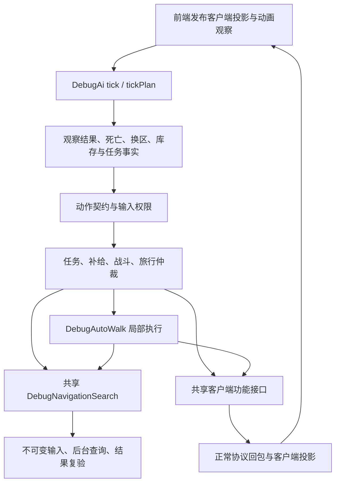

# Debug AI 整体分析与优化方案

## 范围与结论边界

本报告针对当前工作区的客户端调试任务 AI，覆盖 `src/app/debug` 中的计划调度、任务条件图、旅行探索、子行走、战斗、补给和诊断，以及相邻客户端功能接口。分析日期为 2026-11-14，包含当前未提交源码，不代表已构建二进制的行为。

本轮仅做静态分析与文档整理，不修改实现，不构建、运行或新增测试程序。性能影响、跨职业成功率和长时间运行稳定性均不能由源码阅读直接证明。下文将源码事实、设计风险和建议方案分开表述；优化建议不是已确认的运行缺陷。

当前能力与待验收组合仍以[调试任务 AI](DEBUG_AI.md)和[项目基线](../../BASELINE.md)为准；本报告只维护整体分析及优化决策，不复制任务配方、历史修复记录或原版玩法规则。

## 总体判断

**建议继续沿现有分层做增量优化，不重写为另一套行为树、通用工作流或多线程 AI。** 当前主要问题不是缺少任务能力，而是丰富的恢复分支、输入仲裁和观察状态仍集中由 `DebugAi::Impl` 协调，诊断表示与控制逻辑存在交叉，单次决策内也有可见的重复计算。

优先做语义明确、影响可隔离的工作：将真正参与决策的诊断字段改为类型化结果，减少动作权限检查的临时分配，复用同一观察阶段的物品／单位摘要。随后统一错误原因和时间契约，最后根据采样决定是否调整异步查询续接、日志写盘和导航快照。没有测量依据前，不承诺帧率或通关耗时的提升比例。

| 顺序 | 优化项 | 源码证据／主要收益 | 改造风险 |
| --- | --- | --- | --- |
| P1 | 决策结果与 JSON／文本诊断解耦 | 当前诊断字段和阶段文本参与控制；避免展示修改改变行为，为按需序列化创造条件 | 中，须逐消费者迁移 |
| P1 | 动作契约检查去临时分配 | `canInput` 重建 vector，诊断再次重复检查；减少确定存在的重复工作 | 低至中，同帧状态变化不能被缓存吞掉 |
| P1 | 决策内观察摘要和静态定义索引 | 库存／单位／表格重复扫描；降低重复查找与复制 | 中，观察修订及指针有效期必须明确 |
| P1 | 类型化超时／拒绝原因 | 会话错误文案控制 AI 恢复分支；降低跨层隐式依赖 | 中，涉及共享客户端契约 |
| P2 | 显式时间域及状态生命周期 | 多处手动平移和同步 deadline；降低新增恢复分支时漏改的风险 | 高，不能顺手更改现有暂停语义 |
| P2 | 后台查询的定点续接 | `DebugSearchPending` 使下一显示帧重入决策链；减少等待期间重复计划工作 | 高，必须保留安全观察和正常动作资格 |
| P2 | 日志缓冲与分段性能归因 | 行为日志同步逐条刷新，现有计时只覆盖部分调用范围 | 中，收益需测量，故障尾日志必须保留 |
| P3 | 导航元数据快照与结果复用 | 碰撞块已共享，但 Area 容器和 Plan 仍有值复制 | 中至高，先量出复制／复验成本 |
| P3 | 以状态转换封装领域接口 | 文件已拆，跨领域读写仍经同一 Impl；降低耦合和重置遗漏 | 高，分小步实施，不做纯搬文件改造 |

P1 表示可先安排，不表示已确认严重故障；P2 应在基础契约稳定后实施；P3 只有测量或后续功能确有需要时才进入编码。自动练级、装备选择、完整职业策略属于新增能力，不能与本轮性能及结构优化混为一批。

## 已有架构基础

- AI 的决策上下文持有只读 `OnlineObservation`、`const RemoteTown` 及普通客户端功能接口，不应重新引入会话写权限、宿主快照、模拟键鼠或直接发包。
- 导航、战斗、补给和任务状态已有独立状态结构，选敌、攻击及辅助策略也已有拆分；后续重点应是缩小跨域访问和明确交接契约，而不是再次按文件数量拆分。
- 父 AI 与子行走共用 `DebugNavigationSearch`，已有后台查询、知识记忆、路径缓存及性能诊断，不能将“增加异步寻路和缓存”当作尚未实施的方案。
- 请求受理与实际结果分开，动作恢复期间仍有观察和药剂通道。优化必须保留实际身份、请求序号、区域代次与原生动作资格的复验。

入口依据：[调度器](../../src/app/debug/ai_scheduler.cpp)、[内部上下文与组合状态](../../src/app/debug/ai_impl.hpp)、[导航服务](../../src/app/debug/navigation_search.hpp)。

## 当前执行结构

| 层次 | 当前职责与主要入口 | 优化时必须保留 |
| --- | --- | --- |
| 前端组合 | [frontend.cpp](../../src/app/frontend.cpp#L774) 准备动画、技能、生命上限等观察，依次运行父 AI、子行走 | 投影更新仍归前端；AI 不获得更新副本的权限 |
| 命令与计划 | [ai.cpp](../../src/app/debug/ai.cpp#L764) 加载配置、启动／追加／暂停／继续／重载、状态与日志 | 配置整批解析后应用；热重载不替换活动目标或重置已提交操作 |
| 调度与仲裁 | [ai_scheduler.cpp](../../src/app/debug/ai_scheduler.cpp#L178)、[ai_execution.cpp](../../src/app/debug/ai_execution.cpp#L19) 选择决策节奏，先观察再提交 | 恢复结束及时唤醒；药剂、输入独占和已受理操作的优先级 |
| 任务编排 | [ai_quest_graph.cpp](../../src/app/debug/ai_quest_graph.cpp#L134)、各幕配方和任务动作实现 | 私人事实与依赖决定剩余动作；不能用客户端推测代替任务完成回执 |
| 导航规划 | [ai_navigation.cpp](../../src/app/debug/ai_navigation.cpp#L380)、[ai_target_search.cpp](../../src/app/debug/ai_target_search.cpp#L170) 负责旅行、接近、目标核查 | 地图知识、单位订阅、当前指派和经验提示保持不同语义 |
| 局部执行 | [auto_walk.cpp](../../src/app/debug/auto_walk.cpp#L201)、[ai_route_execution.cpp](../../src/app/debug/ai_route_execution.cpp#L106)、[ai_mobility.cpp](../../src/app/debug/ai_mobility.cpp) | 步行受阻、传送落点、清路和战术位移不篡改高层目标；保留任务总预算 |
| 战斗 | [ai_combat.cpp](../../src/app/debug/ai_combat.cpp#L50)、[ai_combat_targets.cpp](../../src/app/debug/ai_combat_targets.cpp#L6)、攻击／辅助／站位策略 | 实际目标身份、攻击范围和射线复验；无净掉血不等于免疫或击杀 |
| 补给与物品 | [ai_supplies.cpp](../../src/app/debug/ai_supplies.cpp)、[ai_quest_items.cpp](../../src/app/debug/ai_quest_items.cpp)、[库存工作流](../../src/client/inventory_workflow.hpp) | Cursor 和物品事务独占；消费／购买受理后不盲目重放；未知数量不变为已知库存 |
| 搜索服务与知识 | [navigation_search.cpp](../../src/app/debug/navigation_search.cpp)、[exploration_memory.hpp](../../src/app/debug/exploration_memory.hpp) | 已取得碰撞与观察知识才可规划；动态占位仍由执行层核查 |

本轮用 PowerShell `Get-Content | Measure-Object -Line` 对相关文件统计非空行，得到较大的实现文件为：导航搜索 1877、父导航 1627、子行走 1099、计划入口 1065、探索记忆 827；内部 Impl 头为 495。它们说明维护跨度，不是复杂度评分或耗时证据。拆分应按状态所有权和调用契约决定，而不是按行数设置硬阈值。

## 优化分析

### 1. 先分离决策值和诊断表示

**事实**：[父导航](../../src/app/debug/ai_navigation.cpp#L1254) 读取 `approachDiagnostics` 的 `decision/purpose/result` 判断是否存在可执行路线；[移动策略](../../src/app/debug/ai_mobility.cpp#L260) 用 `phase=="combat-approach"` 判断战斗移动；[调度](../../src/app/debug/ai_scheduler.cpp#L151) 用 `phase!="quest-drop-notice"` 决定是否进行防御。动作契约的特殊许可及诊断时钟分类也按 `entry.action` 文本比较。诊断目前并非完全可删除的输出层。

**建议**：优先为这些实际控制点返回具名结果，例如接近结果枚举、动作种类、等待原因及移动用途；保留现有对外 phase／JSON 名称，由类型化状态单向生成。不要一次枚举所有日志字符串，更不要仅为了性能关掉 JSON 后期待行为不变。

**完成条件**：内部控制不再读取展示 JSON；改日志文案或关闭详细诊断不改变行动选择、重试和超时。事件中仍能看到目标、请求和拒绝原因。

### 2. 减少动作仲裁的重复构造

**事实**：[actionContracts / canInput / describeActions](../../src/app/debug/ai_execution.cpp#L195) 的依赖关系为：每次 `canInput` 构造一份 `std::vector<DebugActionContract>`；`describeActions` 除了再次构造契约，还对六个 owner 分别调用 `canInput`。调度器在一次决策中多次做权限判断，并可能在观察后、分派后及等待防御后重复生成动作诊断。

**建议**：第一步让权限检查遍历当前契约而不分配临时 vector，或者让同一即时检查中的多个 owner 共用一次契约枚举。详细 JSON 在稳定观察点或状态查询时再生成。可以保留现有规则顺序，无需引入通用任务调度框架。

**关键限制**：不能简单“每帧缓存一次”。一次决策里提交物品、开启门户、挂起战斗会改变输入占用，`OnlineObservation` 也允许看到功能调用后的回执。缓存只限无状态变更的检查段，或明确绑定行动状态版本并在每次提交／转换后失效。

**完成条件**：权限结果与原检查一致，同一次提交后第二个动作不能错误复用旧权限；诊断报告的 owner、占用和期限对应同一观察时点。用契约构造次数及该分段耗时衡量收益。

### 3. 复用决策观察，提前索引静态定义

**事实**：[prepareDecision](../../src/app/debug/ai_scheduler.cpp#L5) 统计药剂、书本和弹药；[战斗](../../src/app/debug/ai_combat.cpp#L88) 再次统计药剂；[补给](../../src/app/debug/ai_supplies.cpp#L108) 的 `portalStock` 每次查 Misc 表容量，`quiverStock` 遍历库存并查询装备定义。`find/owned/observedDrop` 各自扫描集合，任务条件图反复调用这些入口。[ObjectOpened 条件](../../src/app/debug/ai_quest_graph.cpp#L19) 还在运行时逐行查 Objects 表。

**建议**：

- 在 `Definitions` 准备时建立实际消费字段的索引，例如 object ID 到行、回城书容量、已核实供应商身份；复用已有 `skillRows/potions` 模式，不复制整套资源数据库。
- 单次稳定观察阶段建立轻量 `InventorySummary` 和按用途筛选的单位列表，供药剂、补给、任务事实与战斗共享；数量、位置、归属及解码未知保持独立状态。
- 先做决策内复用；只有测量确有必要，再按库存／单位／状态等修订做跨决策缓存。敌人位置、阵营、生命、指派代次变化不能只靠单位总数判断。
- 需要跨功能调用或未来帧保留时存单位键／物品 ID 与 revision，执行前重查；不把当前 `OnlineUnit` 或 `OnlineItem` 引用长期缓存。

**完成条件**：同一输入下目标选择、药剂数量、任务条件和未知值语义不变；新增／撤销单位、换装备、购买、Cursor 交换后不会使用旧摘要。记录实际扫描次数，不以“增加缓存”本身作为完成标准。

### 4. 用机器可判定的错误原因替代文案匹配

**事实**：[recoverSessionInput](../../src/app/debug/ai_scheduler.cpp#L22) 通过四种完整英语错误文本识别货架、传送点、NPC 和蓝门超时；文本生产者位于[会话超时处理](../../src/network/realm_session_game.cpp#L750)。客户端功能接口仍主要返回 `bool + reason()`，AI 的 `submitInput` 用统一间隔等待未受理动作，部分调用点再将超时转换为异常。

**风险**：仅调整错误文案就可能改变恢复分支。临时忙、资格拒绝、上下文失效和结果未知的语义也不宜全部由字符串承担；这不等于当前所有拒绝都会被错误重试。

**建议**：在共享客户端契约中渐进增加原因码和请求上下文，先覆盖上述四类超时，保留原 message 供人阅读；再按真正消费点区分暂不可提交、不可恢复拒绝、已提交结果未知。所有受理后操作仍沿原回执观察，不因类型化而自动重放。

**完成条件**：文案变化不影响恢复；旧请求错误不能关联到新目标或新区域；手动操作和 AI 共用原因语义，不扩展为调试专用协议。涉及公共接口时单独实施，不能夹带在纯性能修改中。

### 5. 明确期限与记忆的生命周期

**事实**：[DebugExecutionClock](../../src/app/debug/action_state.hpp#L11) 区分输入暂停与现实时间；[suspendExecution](../../src/app/debug/ai_lifecycle.cpp#L68) 又按领域手动平移多处期限，并将 PassageWait 的期限同步到门、旅行和任务等待。`describeActions` 用另一组条件标注 `execution/real`。这形成多处需要共同维护的时间语义，并非已证明某个期限计算错误。

| 生命周期 | 已存在的典型状态 | 必须明确的转换 |
| --- | --- | --- |
| 同一游戏知识 | 探索记忆、传送点解锁记忆、区域人口线索 | 新游戏／对应种子变化失效；重启计划不得随意清除已观察知识 |
| 本轮目标搜索 | 核查覆盖、触发事件、初等与搜索期限 | 补给或步骤切换保留本轮；真实新触发／新计划按约定开新轮 |
| 当前步骤／路线 | 子行走意图、局部清路、途经攻击、接近点 | 步骤／区域变化撤销；局部避让不得刷新高层总预算 |
| 已受理操作 | 物品、药剂、施法、交互及转场回执 | 保留身份和请求序号；暂停不将未知结果变成未提交 |

**建议**：先逐类标明当前期限属于执行预算、现实回执期限还是世界事件观察，明确现有通行恢复的例外；随后用小型期限值类型／所属状态操作统一“是否暂停、剩余时间、诊断显示”。同一个语义期限只保留一个所有者，消费者查询它，不再维护镜像字段。暂停、换区、换步骤、新计划、新游戏分别使用具名转换。

**完成条件**：诊断时钟分类与实际推进一致；一次暂停只计入一次补偿；已提交操作不被续期或重放；补给返回、场景变化和新计划的保留／清空行为不变。不把现有相似字段直接合并，也不将所有期限统一成一种时钟。

### 6. 后台查询等待只续接必要工作

**事实**：[defer](../../src/app/debug/navigation_search.cpp#L762) 抛出 `DebugSearchPending`；[父调度器](../../src/app/debug/ai_scheduler.cpp#L233) 捕获后设置 `continueNextFrame`，下一显示帧会重新经过决策准备与结果观察再到查询点。worker 已有优先级、取消及约 2ms 检查点上的高优先工作让出，不缺基本的异步执行机制。父决策的 24 项信号中，部分单位／房间变化只用集合大小表示，仍依赖定时决策兜底。

**建议**：先统计同一 query 在 Pending 期间的重入次数和父链耗时，必要时增加查询票据与具名等待阶段。每帧保留低成本安全观察，到结果就绪、依赖变化或期限到达时续接对应规划阶段。完成通知只发布票据／修订，主线程消费并复验，不允许 worker 调用客户端动作或改写 AI 状态。

**必须保留**：死亡、掉血／药剂、动作恢复、换区、已提交库存结果、等待防御和任务事实更新。事件唤醒逐步使用真实修订，但保留有界定时兜底；不把“地图没变”当作“目标没变”。`Pending`、已完成无路、取消及执行碰撞变化继续区分。

**完成条件**：同一等待不每帧重做昂贵计划前缀；结果就绪不额外增加人为思考间隔；关键观察响应不退化；目标变更后旧查询不能接管新任务。无需先把所有异常改成返回值，先改一个明确热点调用链。

### 7. 导航继续区分知识、估价与执行

**事实**：观察路线缓存最多 64 项，估价缓存最多 16 项，后台待执行队列最多 256 项；已有当前键命中、跨版本逐边复验、路径后缀复用及失败缓存移除。[Area](../../src/app/debug/exploration_memory.hpp#L37) 的掩码块是共享不可变对象，但 `passages/walked/unitObserved/paths` 等仍为值容器。[observedRoute](../../src/app/debug/navigation_search.cpp#L1178) 和估价查询建立 `Area` 副本，路线结果也按值返回。

**建议**：以现有 snapshot／validation／queue／compute／consume 指标分解成本；只有元数据复制占比明显时，才拆出按修订共享的不可变规划快照，执行上下文保持独立。路线过长且结果复制确为热点时再引入只读结果句柄和后缀视图，禁止暴露可变缓存对象。不能再把当前实现称作“每次深拷贝整个碰撞网格”。

[旅行图](../../src/app/debug/ai_navigation.cpp#L380) 已把进入方向和落点纳入成本；`navigationCost` 在没有后台估价时使用启发式未知段成本，这不是实际秒数或通行证明。优先增加估价来源／置信边界诊断与单次决策内相同路段结果复用，不直接换成全局最短路承诺。不要放大起点桶、降低观察频率或绕过路线复验来换速度。

**完成条件**：同一知识输入下规划评分、开口承诺、碰撞资格不变；门变化、房间驻留、传送修正落点仍触发正确复验。记录高水位内存、复制量及复用失效原因；先证明瓶颈，再决定容器或并行度调整。

### 8. 收窄任务、战斗和补给之间的状态访问

**事实**：四类状态已经拆成结构体，但多数操作仍是同一 `Impl` 的成员函数，均可访问全部状态。[局部路线执行](../../src/app/debug/ai_route_execution.cpp#L106) 会直接调整战斗目标、撤退和子行走；任务节点切换会暂存部分观察、调用 `resetStep`，再重建任务运行态。补弹也会标记局部位移恢复。它们有真实交接需求，不能只靠拆文件解决。

**建议**：沿现有操作提炼少量具名转换，例如挂起交战、恢复原路线、完成物品子工作、选择任务节点；由领域对象维护自身不变量，协调层传递意图与结果。先保留当前调用顺序，再逐步收窄 Context，不先引入虚接口层级或事件总线。

任务条件图已有依赖、实际事实和至多 64 节点边界，适合继续使用。图结构的循环／索引检查可在配方准备完成时执行一次，运行期保留防御校验；事实求值先复用本轮观察，不缓存依赖时间投影的物件模式，也不能漏掉短暂尸体／门户证据。各幕配方继续保留可审查的原版依据，不为了“配置化”把整个控制流搬进 JSON。

战斗继续保留选敌、攻击、辅助和站位分离；清路的目标集合与指派代次不能被普通选敌扩大，途经攻击不能变成清屏。补给继续复用正常库存工作流，已开始的补弹事务不因策略关闭而丢失 Cursor。通用装备评价、召唤／陷阱／蓄气管理和自动练级应作为独立需求，不能用优化名义顺带加入。

**完成条件**：状态只有所属领域能够完成转换，跨域调用不用手工清理对方的多个字段；暂停、步骤切换、局部清路、补弹与回程的组合仍保留原请求及总预算。每次只收窄一个实际交接，不同时重写五幕配方和全部导航。

### 9. 诊断路径的同步写盘

**源码事实**：`AiBehaviorLog::event` 格式化一条日志后立即 `output_.flush()`；`phase` 在阶段或原因变化时结束旧阶段并开始新阶段，两个阶段事件都走同一写入入口。该函数没有队列或后台写入层。见[日志实现](../../src/app/debug/ai_behavior_log.cpp#L47)。

**风险而非已测结论**：高事件密度或慢存储可能使调用线程等待。逐条刷新 C++ 流不等同于操作系统持久化保证，既不能据此声称零日志丢失，也不能在没有采样时估算节省的毫秒数。

**建议**：先利用现有帧性能入口区分决策计算与日志写入成本；若同步 I/O 确实显著，再采用有界日志缓冲与单写者。保留事件序号和原采样时间，正常结束排空，失败和关闭路径明确刷新策略。必须公开队列积压、丢弃数量与写入错误，不允许无限排队或悄悄丢失故障末尾；不应为了日志把只读观察对象借用到后台线程。

**验收条件**：授权运行后，比较同一场景的日志耗时、决策帧尾延迟和事件完整性；检查正常取消、写盘失败及退出时的可诊断性。没有运行证据前保留为条件性性能优化。

已有导航采集器在[导航实现](../../src/app/debug/navigation_search.cpp#L94) 中使用有界异步输出，可借鉴其容量／错误表达，不再建无界日志线程或借用其查询执行线程处理文件 I/O。行为日志与导航转储用途和失败尾部要求不同，不能不加分析地合并队列。

## 实施与验证

### 分批实施

1. **明确观测口径与决策类型**：保留当前行为，迁移真正被控制流读取的 JSON／文本；复用现有帧性能、行为日志和导航指标，补必要分段计数。先确认哪些成本可重复出现。
2. **精简单次决策工作**：动作契约无分配检查、诊断单向序列化、静态表索引和稳定观察阶段的摘要复用。按热点逐项实施，不同时改策略评分。
3. **加固恢复契约**：类型化错误原因，统一少量高风险期限所有权；逐类核对暂停与提交后观察，保持公共客户端和手动操作一致。
4. **按测量优化异步等待和 I/O**：先做一个查询链的定点续接，再决定日志缓冲；如果已满足帧预算，不继续增加线程和缓存层。
5. **按实际需要封装状态与快照**：针对仍有明显维护或内存成本的部分处理，不以全部迁移完成作为交付前提。

### 性能口径

[现有 tick 计时](../../src/app/debug/ai.cpp#L1027) 的 `elapsedMs` 围绕 `tickPlan`；随后的诊断构造、`traceDecision`、`observeDiagnostics`、地形观察及阶段日志不都在这个区间内。[前端 Ai 分段](../../src/app/frontend.cpp#L834) 覆盖范围更宽，导航帧准备也在父 tick 之前；子行走另计 Navigation。不能只看 `tickPlan` 变快就宣布整个 AI 帧成本下降。

| 目标 | 建议观察量 | 防止误判 |
| --- | --- | --- |
| 主线程尾延迟 | 完整 Ai／Navigation 分段、父决策、诊断构造和写入各自耗时；有足够样本后看分位数与峰值 | 阶段计时范围一致；不把等待 Host 的墙钟时间当 CPU 时间 |
| 导航有效工作 | 排队／计算／结果消费延迟、Pending 重入、快照／复验成本、缓存失效原因 | 普通路径与观察路线分开；累计统计取区间差值 |
| 实际旅行效率 | 同条件目标完成耗时、步行距离、折返、重规划及失败次数 | 路线成本不是秒数；不同种子／职业／技能资格分组比较 |
| 稳定性与资源 | 查询／日志队列高水位、丢弃、取消、缓存内存和未受理／结果未知次数 | 内存有界不等于行为正确；失败不能被吞成成功 |
| 行为保持 | 目标身份、任务个人位、物品归属、请求顺序及期限 | 受理不代表执行；管理命令准备场景不证明自然流程完成 |

### 后续授权后的验收场景

本轮不执行下列场景，也不新建测试脚本或专用测试程序；后续授权后复用现有图形客户端、隔离角色、调试命令及日志入口，按[测试指南](TESTING.md)执行。

| 受影响部分 | 最小有效场景 | 验收重点 |
| --- | --- | --- |
| 契约与生命周期 | 步行／传送中打开检查面板、显式暂停继续、动作恢复、手动接管、换区 | 计划状态合理保留或取消；现实请求不重放，执行预算不凭空重置 |
| 查询与探索 | 已知长路线、未知入口、延迟指派、门变化、订阅后退订再返回 | 不读隐藏地形；Pending 不误判无路；核查结果不等于目标不存在 |
| 战斗与导航交接 | 步行清路、传送途经一次攻击、等待防御、射线阻挡及修正落点 | 只攻击被授权的目标；能恢复原路线，不刷新总预算 |
| 补给与任务物品 | 空弹药补弹、购买回执延迟、背包不足、Cursor 交换、方块合成与回城 | 已受理消费只观察；所有物品收妥后才完成，未知结果保留现场 |
| 任务条件图 | 部分进度续跑、奖励保留、支线物品插入、跨幕后重新选任务目的地 | 不重复服务奖励，不跳过未满足事实，不把旧局单位身份当作本局事实 |
| 共享接口与日志 | 单机和 TCP/IP、取消退出、写盘失败、开启／关闭详细诊断 | 手动输入不退化，关闭诊断不改变行为，错误与丢日志可见 |

每批只验收受影响路径并报告未覆盖范围；构建、运行、完整五幕／多职业组合需另获授权。结果与现有已知问题分工维护，不把本报告扩写成逐次调试记录。

## 不建议采取的捷径

- 不用降低观察频率、跳过死亡／库存观察、合并原生输入或缩短动作恢复来换性能。
- 不把敌人退订当死亡，不把没有找到当作不存在，不从宿主、隐藏预设或额外开图补齐导航知识。
- 不自动重放结果未知的物品、任务服务或门户消费，不无限延长超时，也不以更换子目标重启总预算。
- 不并行运行会提交客户端动作的多个决策域；后台只处理不可变输入，主线程复验并提交。
- 不引入独立寻路替代原生碰撞资格，不把策略估价当作最优路线或原版规则证明。
- 不因文件较长就整体重写；不在没有热点证据时先换容器、扩大缓存或增加 worker 数。

## 本轮结论

已确认的是结构和调用事实：诊断参与控制、动作契约重复构造、重复集合／定义查询、错误文案耦合、多处期限维护、后台 Pending 的决策重入及行为日志同步刷新。它们构成具体优化候选，但当前证据不足以将任一项定为所有停顿的根因，也不足以报告性能提升或新的稳定性认证。

第一批建议只做“类型化实际决策值 + 动作契约去重复构造 + 静态定义索引”，三者可分别交付和回退。整体方向是保留当前知识边界、正常客户端动作和真实结果观察，把隐含契约变得更明确，再用实际分段数据决定后续投入。