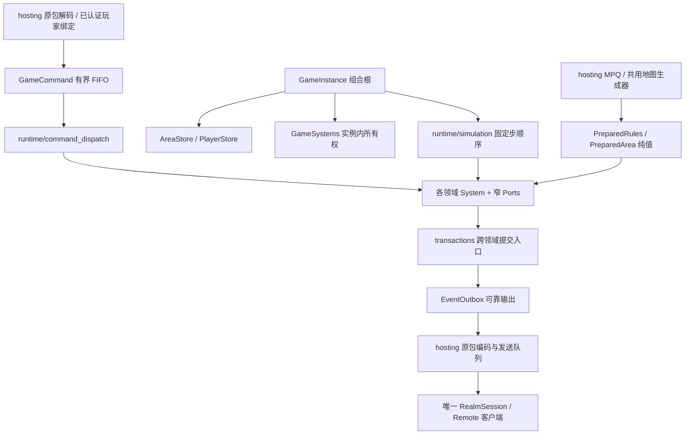

# 自研游戏内核与子系统

本文维护内核入口、所有权和扩展约定；功能顺序见[总计划](../architecture/MULTIPLAYER.md)，原包入口见[服务端协议](SERVER_PROTOCOL.md)。实现范围见[基线](../../BASELINE.md)；各专题维护当前实现、原版依据和明确缺口，不保留自研冒烟台账。

## 按任务查找

| 需要修改或理解什么 | 负责入口 |
| --- | --- |
| 状态归谁、领域如何组合 | [组合与所有权](#组合与所有权)、[领域目录](#领域目录) |
| 命令准入、固定步、暂停与背压 | [命令与固定步](#命令与固定步)、[原生帧事件](#原生帧事件迁移) |
| 内容交接、事务原子性与可靠输出 | [内容、事务与输出](#内容事务与输出) |
| 来源复验、接触继续点与共享属性 | [战斗关系与提交](#战斗关系与提交)；关系规则归[阵营](../gameplay/combat/FACTIONS.md#权威关系与技能资格) |
| 飞弹数值、碰撞／接触、出生与专用程序 | [权威飞弹](../gameplay/combat/MISSILES.md)；客户端表现另见[攻击与弹体](../gameplay/combat/ATTACKS.md) |
| 动态格在出生、移动、提交与回滚时如何维护 | [动态碰撞格](#动态碰撞格的原版语义与迁移边界)；寻路与入场规则归[地图](MAP.md#单位占位与入场) |
| 职业、物品、死亡、物件与任务规则 | [技能目录](../gameplay/skills/README.md)、[物品目录](../gameplay/items/README.md)、[死亡](../gameplay/characters/PLAYER_DEATH.md)、[物件](../gameplay/world/OBJECTS.md)、[任务](../gameplay/quests/SYSTEM.md) |

修改先落在状态所有者和对应接口；具体规则只在负责专题维护。本文保留跨领域执行顺序和失败边界，不以新增入口或历史迁移数量声明完整实现。

## 当前范围

跨单位持续效果的新增源码统一接收标志准备、只读列表查询与复制状态来源；NPC与其他非玩家共用唯一MonsterActor、原生属性和资源，AreaNpc只保留出生／任务／服务元数据。是否接收仍由原技能filter及公共投递／直接分配策略分别决定。三种护盾、非玩家自施法、普通攻击的状态属性消费和召唤物死亡撤出共用实际单位候选；所有者边界、源码入口及未完成事件交错见[公共效果边界](../gameplay/skills/EFFECTS.md#跨单位接收与载体边界)。跨单位／生命周期的完整组合仍待核对。阶段和下一步统一见[总计划2.3节](../architecture/MULTIPLAYER.md#23-战斗重构实际阶段与剩余步骤)。

玩家入场、行走、库存／装备、人物成长、世界换区、多人投影、普通近战、女巫及亚马逊技能、掉落／消耗、玩家死亡、普通物件／NPC和五幕27项个人任务／奖励／旅行由权威内核执行。27个领域加玩家／移动形成29项目录；各自具有独立State、read、类型化请求及显式Ports，由GameSystems持有。inventory规划物品，attributes计算总值，progression规划成长，transactions提交人物事务；World管理区域准备／驻留，Travel提交位置／区域过渡，replication派生可见参与者，social实现广播／私聊、屏蔽关系、队伍邀请／成员权威及可见头顶消息，trade实现双人原子物品／金币交换。其他规则保持NotImplemented；总体未完成，当前范围以本页、[库存](INVENTORY.md)、[人物](CHARACTER.md)和[ACT1](../gameplay/quests/ACT1.md)为准。

命令目录中的Scaffold在入队前被拒绝，不因有函数入口就宣称Queued。3A／3B成长、13的UNIT_TILE及15同局聊天已执行领域入口；传送点、门户、普通物件／NPC、城镇服务及跨幕旅行已接；队伍及有向敌意由social执行；玩家交易见[PLAYER_TRADE](../gameplay/items/PLAYER_TRADE.md)。普通攻击／选技／热键／停止已接skills；人口准入已准备的第一幕普通／精英／首领怪物。世界物品生成与普通掉落已接items／loot，不能据此宣称全部来源规则完成。

属性候选已接当前MPQ的物品单位事件注册链、物品光环逐写回调和运行态计时器；reactions::ItemTriggers消费已发布注册链及原始参数层几率。光环激活／撤销、零值状态撤出、逐来源资源上限、独立状态位及被动刷新在同一候选中按序执行；非零immediate的BasicAura已同步准备拥有者与周围接收者。玩家、佣兵、铁魔及女武神来源，嵌套回调与单人／双库存／人物成组事务已接共享候选图，输出接受和修订复验后一起发布。完整非玩家属性回调、队列2物品事件交错、生命周期及全局排序仍待闭合。具体算法与限制见[COMMON](../gameplay/skills/EFFECTS.md#当前持续效果入口)，当前飞弹／周期事件的迁移及边界见下节。

## 原生帧事件迁移

`GameSystems.frameEvents`单独拥有玩法定时器，`EventOutbox`仍只负责可靠输出；两者没有混用。公共`gameplay/events/frame_queue`保留原五类队列、64桶、持续／到期插入顺序、拥有者索引、逐身份取消、回调延迟删除和跨背压游标。PreparedInsertion与PreparedEdit先分配节点并捕获原登记集合，接受领域候选后再链接，废弃候选不发布；状态列表的本地事件身份随不可变候选保留，实例事件通过payload映射回原状态候选。

`effects/frame_events`接收玩家／单位REMOVESTATE，`monsters/frame_events`接收独立AIRESET。人物事务、单位光环候选及直接佣兵／怪物状态路径一起准备／发布期限，旧每帧批量AIRESET扫描已撤出。`runtime/frame_event_dispatch`只路由至负责领域，`Simulation`保留Events阶段，事件未完成不进入后续逻辑帧；人物离场、怪物实体撤出及任务实体撤出取消各自的实例定时器。诊断frameEvents与可靠输出历史分开。当前派发还包括飞弹MODECHANGE、玩家／非玩家PERIODICSKILLS／PERIODICSTATS／STATREGEN及非玩家MonsterModifier。AI、动作、移动、物件及物品事件的已迁范围见下表；完整房间休眠／激活、死亡取消顺序和全局事件交错仍待闭合。

`missiles::System::frameEvent`提供单单位入口，保留自己的Advance候选；发射批次持续事件先准备节点，再随发射接受发布。玩家、怪物、子弹体及直接技能实际子弹体已准备／发布持续事件，结束自注销；实例事件阶段先刷新只读空间索引，飞弹回调同步推进接受命中，并保留发射／HP阶段，原后续域阶段不再重复推进。Advance记录子弹体／命中／诅咒的调用顺序，逐项发布并同步完成联系后才进入下一项；任意4096弹体阈值已撤出，同步SpellImpact准备不等待后续阶段释放256节点阈值，正常排队联系仍有独立准入限额。持续效果的任意128列表阈值也已撤出，避免同步回调阻塞在尚未执行的REMOVESTATE之前；原列表仍由候选准备实际分配，输出容量独立处理。

装备光环接原PeriodicStats 9，右手光环及雷云风暴接PeriodicSkills 8，旧玩家光环／风暴轮询已撤出。右手选择候选在装备来源更新后清旧拥有者列表、执行immediate或投递无期限空列表，并一起准备custom ID -1；周期读取当前active槽等级。雷云按原目标GUID循环，临时弹体从game seed初始化私有随机流，伤害后通知与重排保留游标。佣兵／召唤光环使用原AssignSkill右手选择及custom ID -1，旧佣兵光环轮询已撤出；正skill ID保留原列表驱动分支。怪物模型新增独立rightSkill槽，单位选择由无人物主请求的事务图准备，复验状态／生命／接收者／定时器后一起发布，避免借用无关人物提交。光环附魔在创建后SetSkills／AssignSkill，都瑞尔在正常AI执行时首次分配原Aura；旧自然怪物双光环轮询已移除，附魔选择不再与当前右手光环并行保留。怪物技能分配通过共享来源／被动刷新候选，创建与机关／任务／诊断准入传入实际逻辑帧。嵌套接收者准备保留Capacity／Stale等失败类别。

child_creation保留拥有式蓝图／创建程序，子体的实际技能、等级伤害与来源属性在有序操作处准备；节点、计时器和事实先分配，SUNIT身份／game seed消费形成独立保留阶段，输出背压不重掷、不覆盖已变化的游戏随机流。正常玩家／怪物发射及寒冰甲反射已从game seed生成弹体私有种子，不再以技能请求注入施放者种子；怪物发射返回其原行动种子。共同依据为固定D2MOO SUNIT_InitSeed、MISSILES_CreateMissileFromParams及SkillSor.EventFunc01；完整1.13c随机顺序仍待核对。

公共missiles/damage_data接原范围构造、逐属性写入、加倍判定及FullDamageParams／单元素投掷；D2Common 1.13c字节确认unsigned加倍判定及来源恶魔ED一次累加，范围投掷与雷云先接新公共入口。普通敌方弹体现保存范围并逐目标进入combat/missile_contact，四类种子的所有者分别持有，格挡／双爪格挡／闪避读取实际受击者属性，内部命中类别游标先于同步回调推进；玩家恢复种子随HP事务提交。子体准备来源范围后一次接受实际拥有者／父体种子贷款。内容层monster_type_data按当前MPQ的MonType三等价关系准备只读目录，伤害的参数层匹配保留原128边界。combat/drain和missile_drain区分百分比／直接吸取，实际来源资源先于目标HP补回，怪物目标资源在HP后写回公共来源。effects/missile_delay为NextHit准备原JUSTHIT状态、空列表与REMOVESTATE，门控等原回调而非到期帧比较，零NextDelay也保留原排期。敌方弹体来源换区／死亡／归属变化不直接删弹，来源撤出抑制后续命中／子体。

佣兵弹体已改为无投掷程序参数与共用伤害范围分开，创建阶段不再生成武器固定伤害；精通按实际当前usedSkill，判定由共享公式目录导入。公共damage_program与逐目标执行接原SrvDmg，转换与额外选定元素投掷保留阶段，冻结／冷却分别传入受击端；GetHit／SoftHit／KnockBack由MPQ和实际不可中断位准备，6／8目标标志与图形按顺序发布。原1.13c D2Game实际31槽表及1–14入口片段已与DLL字节匹配；狂犬病仍要求真实期限参数，缺失不假定。玩家武器弹体旧快照已撤出；技能／物品事件统一顺序、特殊命中程序、全局执行交错及完整数值／随机／来源组合仍待闭合。

装备光环PeriodicStats的节点跟随人物事务／单位生命候选发布；候选放弃不登记，提交无分配链接。来源GUID和技能参数保留，当前聚合等级在单事件开始时采样；取消决定、接收者／伤害阶段和下一期限跨背压保留。玩家死亡事务、怪物死亡／退休取消周期事件；活冻结怪物跳过PeriodicStats，单次事件消耗、持续事件等解冻。旧全单位装备光环扫描和旧飞弹推进公开入口已撤出。完整周期／原版时序仍待核对。

### 调度与动作的职责及迁移边界

调度决定哪个单位在哪一帧执行回调，动作决定动画／序列触发的程序、结束、回绕和中断。可靠输出不承担玩法时钟。

| 原程序／用途 | 当前入口与迁移结果 |
| --- | --- |
| Event：五类单位、持续链／64桶及原插入顺序 | FrameEventQueue持执行游标，Events阶段背压续执行同一逻辑帧；已进入的同步联系不会因自我中断重做。持续节点按原规则忽略显式handler，移动／怪物效果用保留的customId分派、去重及撤销 |
| SUnit：玩家起手及百分比回绕 | gameplay/actions/timeline按AnimData完整标记、起始帧及速率排MODECHANGE／ENDANIM；同帧跨多个标记分别执行，未跨过标记不补造命中。普通／形态武器、SC、Kick及支持序列共用此入口 |
| 专用序列 | Strafe／Fend／Zeal／Fury按MPQ次数及回绕重排，GUID后继／最小GUID回绕；Charge移除250帧超时及手写3／7帧延迟，使用序列4的Rewind8进入近战、Rewind7分配命中；LeapAttack落地Rewind16，普通Leap结束延迟1；DragonTalon按100%回绕重排，DragonFlight等待实际第二标记 |
| Units／MonsterMode：逐帧动画与MonSeq | skills/monster_action_events保留FP8时钟、本次跨越的最后非零标记和内容准备的原事件号（包括4）；monsters::modeEvent推进普通／技能移动和延迟死亡。烈焰之径／蛛网在移动模式读取上次PATH跨格标志；死亡／GH效果按原修饰符到期事件执行，非GH电强化接同步伤害回调。旧怪物批量step、轨迹轮询及精英期限轮询已删除；专用回调及全局交错仍待核对 |
| AiThink：野生AI、复活怪、佣兵、召唤物、陷阱 | 出生／复活、模式结束及AI切换登记单位事件；所选决定与待提交操作保留到同帧接受，输出背压不另抽决定。伙伴step只同步关系／准备结果 |
| ObjMode／ItemMode | objects/frame_events执行结束、陷阱、祭坛重置、井、周期机关及延迟掉落；井每次使用登记独立单次补充。修复／补量由Item STATREGEN逐件执行；库存／地面step只同步时钟和垃圾生命周期，不伪造物品ENDANIM删除程序 |
| flag4模式列表 | 速率列表逐次独立投递；结束、格挡／受击、中断及死亡撤出。旧effects批量模式到期扫描已删除，取消后清理按revision保留新动作列表 |

skills::step不再批量释放玩家／怪物动作，ai::step仅回收控制器，movement::step只登记移动事件。对象／物品固定步维护不是第二套伤害或到期执行器。未加载房间暂停动作／延后物件回调；完整原版休眠序列化及恢复时钟尚属世界生命周期边界，不能等同原房间恢复认证。

### 旧近战链与随机迁移

唯一近战入口为native_weapon_contact／combat::monsterMelee → native_skill_contact，接触保留预分配、事件、资源、耐久及末尾动作的继续点。逐程序差异、随机来源、旧入口撤出及同版本证据统一见[共享近战程序](../gameplay/skills/GENERAL.md#旧近战链与随机迁移)；本标题保留旧引用，不另维护职业规则。

### 飞弹数值与接触收尾源码

`missiles`持有弹体、路径与出生候选，`combat/missile_contact`持有接触和伤害阶段；`NativeBirthPublication`协调ID、随机、房间、定时器及可靠事实的共同发布。数值来源、原Do／Hit／Damage程序、碰撞顺序、专用世界载体和未闭合边界统一见[权威飞弹](../gameplay/combat/MISSILES.md#飞弹数值与接触收尾源码)。本标题保留供旧链接使用，不另维护程序清单。

## 组合与所有权

GameInstance只组装实例级区域、玩家、ID、随机、命令、系统、调度和输出，并提供参与者准入／进入／移除入口；不实现物品、怪物、技能或任务规则。PlayerStore唯一拥有角色值和每人不可变EquipmentRules／CharacterRules，防止后来加入的职业复用房主经验表或物品ID。MovementSystem保留既有寻路／碰撞执行。GameHost负责句柄代次、暂停、固定步预算和参与者快照。NativeRealmHost共享只读MPQ内容、管理房间／地形并每帧只推进一次；每个NativeRealmService持有自己的协议会话、角色名册版本及存档租约。

GameSystems只供组合／分派／调度使用，不传入领域函数。它的构造函数一次性为各系统注入本领域的Ports；领域入口只接收业务参数，调用另一个系统时不必重新拼装对方的依赖。跨域读取为const，可以提交协作请求的引用明确列出；没有字符串服务定位器、万能可变世界对象或能够调用UI／MPQ／socket的回调。

构造函数只保存依赖引用，不访问或调用尚未构造完的同伴；所有系统就绪后才准入玩家并执行命令。GameInstance／GameSystems禁止复制和移动，依赖的规则、玩家、区域和输出先构造、后析构；系统析构不回调同伴。调度线程串行访问实例。跨阶段工作应提交类型化请求或事实，不能通过互相调用执行函数形成递归结算链。

GameSettings按实例保存地图种子和难度，由建房选中角色提供；后来加入者采用房间配置，不能用自己的存档覆盖它。随机流、EntityIds、命令和可靠事件按实例隔离；玩家ID不因离开而复用。最多256个宿主实例、每局1–8人；暂停私有一人局不影响其他实例，共享房间不随客户端ESC／失焦暂停。

PersistentCharacter在PlayerStore中唯一持有，包含库存、人物记录、任务、尸体和铁魔等持久数据。items只持有不属于角色的世界物品；merchant保存句柄／报价版本；trade持有报价状态及不可变取消／保存快照，不形成另一份可写库存。spatial是派生查询，attributes只读已提交Totals；均不另建可写的位置／人物基础属性真值。companions拥有归属和控制关系，活动实体归monsters。公开read只读，不能从UI取得可写状态。

## 领域目录

除players、movement外，路径均为src/server/systems/<目录>/system.hpp／system.cpp；inventory另有planning／placement／equipment规则文件。除明确注明的切片外，表内操作为骨架。

| 目录 | 拥有的运行态／职责 | 操作边界 |
| --- | --- | --- |
| players | PlayerStore中的角色持久值、位置、移动状态和命令序号 | 入场组装；持久导出仍由GameHost交宿主存储 |
| movement | 原生路线、走跑、实时单位碰撞及技能位移执行，数据归PlayerStore；spatial临时视图区分寻路时撤目标与步进时保留目标 | execute／step／suspend；入场／旅行／复活共用实时寻位，依据及未完成边界见[地图](MAP.md#单位占位与入场) |
| world | 区域驻留、准备请求、原生出口／边界／物件身份；AreaStore唯一拥有碰撞 | 请求合并／过期结果拒绝／失败记录／可见邻区；不生成地图，Sleeping保留值不卸载 |
| spatial | 活玩家／活动非玩家网格索引及同步动态碰撞投影 | query／step；当前query尚无玩法调用，返回稳定ID顺序；脚印采样另按实时权威与原房间链派生，不读取该网格 |
| items | 世界物品，沿用ItemInstance／InventoryState | create／resolve；生成不等于提交或放入背包 |
| inventory | 容器访问、摆放／装备／数量规划 | execute已接移动／交换／装备／切组／合堆／入书；新增地面拾取／丢弃、金币丢弃、卷轴／书本鉴定、药水和仓库授权／关闭，库存仍归PlayerStore |
| attributes | 纯派生计算与当前Totals只读查询 | calculate／evaluate；提交前同步求值，无dirty队列；已接支持的临时状态，完整被动仍待恢复 |
| crafting | 方块／镶嵌与原38任务加工事务 | execute／pending／install；hosting准备不可变输出，前置任务资格由quests负责 |
| loot | 掉落选择与来源结算记录 | plan／step；沿用LootRequest／LootPlan，不写死概率 |
| population | 区域选型、密度／预设／任务／物件出生游标及房间阶段 | step／coverage；实际Actor由monsters唯一发布，清场复用覆盖查询 |
| monsters | 活动非玩家实体、身份、位置和版本 | admit／requestMove／remove／step；与人口生成、AI决策分离。nativeTargetPosition只查真实GUID及同幕坐标，保留尸体／跨区目标；接收资格由技能／接触程序判断 |
| ai | 目标、决策时间与控制器 | step；产生动作，不直接结算伤害 |
| skills | 选技／热键／施放及持续动作 | execute／requestCast／step；AI使用实体来源请求，不伪装成玩家 |
| missiles | 弹体实体和寿命 | spawn／step；碰撞后向combat提交结算请求 |
| effects | 状态效果、来源、持续时间 | apply／step；原状态定义由宿主准备 |
| combat | 命中／减免／伤害结算请求 | enqueue／step；死亡转移归death |
| death | 死亡发生标识、复活／尸体回收 | execute／step；死亡终态及击杀奖励去重；经验委托progression，已接死亡结算、城镇复活与本人尸体回收 |
| maps | PD2地图场景运行阶段与特殊死亡游标 | 在普通死亡TC前协作计数、门户和奖励；World、Population、Loot、Travel保留各自权威；当前场景32已接首领技能依赖并在源码准入，已通过Windows Release构建，PD2场景行为仍待实测 |
| companions | 雇佣兵／召唤物／铁魔归属 | summon／execute／step；不复制活动实体 |
| objects | 门、箱、祭坛及任务物件状态 | admit／execute／step；掉落／效果／任务各归其领域 |
| npc | 对话会话和对白确认 | execute／close；商店、雇佣、工艺、旅行各自分派 |
| merchant | 商品句柄、报价版本和买卖／鉴定／维修请求 | execute；成交走事务边界 |
| quests | 游戏级任务状态；个人进度仍归人物记录 | execute／step；资格与奖励不可由客户端授予 |
| progression | 属性／技能分配、经验封顶／升级规划 | execute／award已接；经CharacterEdit提交，step无额外改写 |
| travel | 自然边界／UNIT_TILE、门户及NPC待过渡状态 | walk／execute／step／cancel；按来源校验原邻接或NPC资格、活人、来源代次、碰撞及路线；先可靠事实再改区域／位置。已接传送点、本人回城门、五幕任务门户和Warriv／Meshif旅行；完整特殊场景及队伍锁仍待实现 |
| social | 广播、私聊、聊天屏蔽、头顶消息、队伍邀请／成员及有向敌意 | 原15／14／5D(2,3,4)／5E(6–9)，捕获收件人／关系，头顶消息与公开队伍状态支持晚入；组队范围见[联网](NETWORK.md#组队邀请客户端) |
| trade | 双方报价、同意状态及交换版本 | 原13/4F，库存运行态报价格、只读镜像、原子成交和取消恢复，见[PLAYER_TRADE](../gameplay/items/PLAYER_TRADE.md) |
| transactions | 跨域计划、版本前置条件、提交身份 | prepare／commit已接单人物InventoryEdit／CharacterEdit原子提交；commitInventories接实际双人物交易，commitCharacters接人物技能组及最多8人钱包／地面共同提交；通用Exchange类型仍为stub |
| replication | 每个收件人的兴趣与可见玩家集合 | visible／step；按本人区域及准备好的直接自然邻区过滤，普通怪物使用本区RoomLayout邻室及直接邻区距离过滤；完整房间兴趣仍待实现；编码留hosting |

目录在runtime/subsystems.inc维护身份、阶段和范围。players／movement为walking-slice，inventory为inventory-slice，attributes／progression／transactions为character-slice，World／Travel为world，replication／social为multiplayer；范围表示已接切片，不代表该领域全部规则完成。population／monsters／ai／skills／missiles／combat／death及spatial为combat-slice。items／loot／merchant为inventory，effects为character，objects／npc／quests为world；companions已接Hydra、诱饵／女武神及血乌奖励罗格，完整雇佣服务／通用请求仍明确拒绝；trade为multiplayer；crafting已接方块／镶嵌及原38任务加工，命令按具名意图检查。

## 命令与固定步

GameCommand由服务端产生sequence、来源area及areaGeneration，负载为MovementCommand及13种领域Request的variant。实例绑定由GameHost校验，操作者从PlayerStore构造ActorContext，不信任客户端传来的玩家身份。入队校验玩家、区域身份和代次、递增序号、实现范围和256条容量；固定步执行前再次核对来源区域，防止两个不同区域代次相同而误执行旧命令。未实现请求不占FIFO、不更新acceptedSequence。

runtime/command_dispatch为每个负载显式映射SystemId与领域入口，没有默认成功分支。CommandStatus区分Queued、Applied、NotImplemented、Stale、Conflict等结果。PlayerSnapshot.command只保存最近执行结果，movementSequence单独触发原移动回复；最近结果可以被覆盖，不能用作物品／交易的可靠完成通知。

Travel独立于人物事务：自然边界按原room连接和统一坐标确认接触面，沿既有速度逐步走过接缝；瓦片出口按原13/type=5绑定World分配的UNIT_TILE，接近后进入唯一反向出口，保留LvlWarp的ExitWalk偏移。区域、来源generation、移动意图序号在提交前复验，库存／成长命令不会取消路线；新移动／旅行、退役和离开取消旧过渡。完整TravelFact进入Outbox后才提交区域／位置／新路线，失败不半换区。多重反向出口、原任务锁入口及未核实资格明确暂缓。

runtime/simulation固定顺序为：区域／人口 → 属性 → 初次空间索引 → 伙伴／AI → 技能 → 玩家移动 → 库存恢复／地面恢复与过期 → 怪物／空间索引 → 弹体／效果／战斗 → 死亡 → NPC／商店／加工 → 物件／任务 → 掉落／成长 → 旅行 → 投影。P5补merchant／crafting／items.step调度，不依赖界面操作推进维护。此处不宣称已核实原版全部结算细节；规则接入按生产者／消费者依赖调整。所有步沿用25Hz，不用渲染delta执行玩法。

只有具有运行维护工作的领域被调度，transactions／social在命令边界按需规划／提交。World在准备需求存在时返回Blocked，Travel等待准备或接近路线时返回Blocked，replication更新派生兴趣后Complete；其余stub不产生状态变化。Blocked只描述相应领域，其他阶段／实例继续运行。

FrameFacts是有界的本步临时事实，只允许后续阶段消费；每步开始清空。需要在下一步继续处理的请求必须留在所属系统pending状态，不能靠临时事实延后。可靠通知进入EventOutbox，不能依赖FrameFacts或覆盖式快照。

## 内容、事务与输出

SkillRules只持有公共SkillRuleSpec数值和程序参数，不持有动画／声音资源路径。hosting从当前MPQ的SkillSpec准备rules()纯值；resolveSkill、伤害／耗蓝／持续时间、序列时序和有依据的弹体纯计算供两端调用。服务端skills／missiles／effects负责世界状态与调度，combat负责权威命中／伤害，客户端仅从原包及本人已知属性生成表现。原版公共职责和每项技能分派见[女巫技能](../gameplay/skills/SORCERESS.md#30项公共职责核对)及[亚马逊技能](../gameplay/skills/AMAZON.md#30项职责核对)，不能把D2Game整套执行器解释为客户端共享接口。

PreparedRules持有不可变纯值；全局ItemCatalog共享同一宿主只读内容，玩家规则绑定各自人物及装备身份，不借用房主规则。hosting/game_content与character_content准备碰撞、职业、物品属性、经验、学习、被动及难度抗性；skill_content和各职业／伙伴准备器提供技能、动作、序列及召唤纯值。具体职业范围由[技能目录](../gameplay/skills/README.md)维护，不能沿用早期仅女巫／亚马逊准备的清单。内核不持有ClassicData／Archives或MPQ回调；空规则明确Unavailable，新增或跨人转移物品须准备新身份对应属性，不能套用旧缓存。旧MeleeRules已撤出，近战入口见[共享近战程序](../gameplay/skills/GENERAL.md#旧近战链与随机迁移)。

区域交接由GameHost.pendingAreas／installArea／failArea提供，结果带GameHandle及PrepareArea身份。World合并同目的请求，最多16项在途；来源须为原生邻接，失败地区明确Unavailable，不重复生成或替换地图。宿主prepareWorldArea调用同一NativeMapGenerator准备原房间／碰撞／出口／边界及objects.txt中立碰撞，按调度线程交纯值。按玩家及直接自然邻区派生Active／Sleeping；当前不驱逐已准备区域，地图随实例释放，导航借用保持有效。客户端按原03／07／08及位置包调用同一生成器，不接收地图对象。

transactions的Plan含TransactionId、库存／人物双RevisionGuard、InventoryEdit／CharacterEdit及候选PersistentCharacter／Totals。inventory和progression只改临时值；事务prepare重算总值、装备失效标志和资源，commit复验身份／区域、双版本及发生标识，先插入完整不可变Outbox批，再以不抛异常的值交换提交库存／人物／总值／revision，并按候选技能移除事实清空actions中的玩家used引用；此引用不作为整动作取消命令。经验最后发生标识按玩家仅在成功后更新；事务身份递增，旧计划拒绝，无无界集合。通用ItemTransfer／Reward／Exchange类型仍为stub；实际交易使用commitInventories，人物技能组使用commitCharacters，自然金堆共享使用最多8名同区域人物及一个WorldEdit，先统一预留全部事实，再共同提交钱包及世界；经验及邪恶洞穴奖励由CharacterEdit提交，地面转移／尸体通过WorldEdit及对应计划提交，不假装通用Reward完成。随机物品由hosting读取MPQ准备，领域仅安装值；实例实体ID单调分配不复用，失败可留下空号，不回退为已存在身份。

实现提交时必须一起处理：目标／所有权／版本再校验、所有参与者资源及空间资格、事件容量预留、随机及ID的提交语义、去重，以及完整成功后的状态／事件发布。失败不得部分扣费、移物、推进随机或记录已领奖；不能先改库存再发现输出队列已满。掉落发生标识、任务奖励资格和交易版本均由服务端产生，不能以客户端重试次数结算。

附着单位声音先沿原SUNIT_AttachSound写入每单位一个待同步槽，同帧后写覆盖事件号与接收范围；directSound的原F0直接声音继续作为可靠事实。publish／publishGroup对纯附着声音返回内部序号0表示槽状态已受理，只有帧末flushUnitSounds才分配真实可靠序号，序号0不作为网络ACK。槽在独立UnitSounds阶段按已确定前缀发布；容量不足保留剩余槽与同一逻辑帧，不重跑Objects发布或此前玩法。准入失败、单位完整移除／压缩时清槽，恢复单位不重播旧事件；待发布槽存在时身份映射暂不回收。槽的跨单位顺序与原每客户端房间遍历仍待对照，不能据单槽覆盖实现宣称全部输出交错已认证。

EventOutbox有256批／4096事实容量及有序累计确认。InventoryFact保留当次稀疏物品值，CharacterFact保留前后人物／Totals，TravelFact保留提交区域／位置，ChatFact保留提交时收件人。NativeRealmHost集中路由：库存／人物／换区仅本人，聊天仅已捕获的同局连接。每位接收者完整编码后一次提交字节队列；失败明确终止该连接、移出投影并保留可恢复存档租约，再确认已送达或明确退役的批，不向其他连接重复发送。Area受众按同实例可见区域及单位过滤；未实现事实明确拒绝。玩家／世界／怪物增量由独立player_replication／world_replication／monster_replication编码；只发别人穿戴外观，不发背包、Cursor、私人箱或人物属性。

同一次`NativeRealmHost::advance`的事件前基线与常规状态发布，可按接收者复用`host.visibleMonsters`只读投影；仍分别执行原包编码、命中／状态增量和发送，不跳过第二次发布。投影只在推进与内容交接完成后的发布作用域存活，退出或异常时释放；实际`PlayerSnapshot`共享指针变化即重新派生，失败退局的`host.enter`会发布新指针。其他发布入口不保留投影，不按tick跨轮询缓存，避免未完成帧、换区、私有佣兵字段或可见目标变化造成过期结果。原包字段与先后依据仍由D2MOO `SCmd`／`MonsterMsg`对应编码维护，此复用不改变权威状态与随机消费。

普通攻击／弓弩／左手动作／投掷药瓶统一进入skills.weapon与missiles／combat；隐藏Kick由普通桶OperateFn5调用skills.objectKick，左右键选择不变，objects／loot仍持有破坏和掉落；Unsummon由原程序入口执行，四项卷轴／书本由inventory和travel复用原事务。来源资格、释放复验、公共函数及限制见[通用十项](../gameplay/skills/GENERAL.md)。

玩家武器吸取、压碎和撕裂沿同一combat接触阶段执行，纯值计算见[武器命中效果](../gameplay/combat/WEAPON_EFFECTS.md)。monsters持有伤口和生命；目标命中提交后保留待资源回补阶段，transactions将本人资源与区域原Overlay成组发布，后续反噬背压不会重复目标伤害或回补。replication从活怪物的wound投影原openwounds状态，包含首次可见、重新进入兴趣及背压等待，直到伤口事务真正清理；不能在持续快照中撤销刚发出的开启事实。

## 怪物战斗与生命周期

hosting交付人口纯值、RoomLayout、组件与populationDeferred；population按区域代次／spawn key准入，monsters唯一持活动实体、生命、路线和特殊运行值。ai只决策并提交窄动作，actions持施放记录、玩家used-skill ID／GUID与待释放值，skills执行开始／释放，怪物中断代次仍由monsters持有；missiles／effects分别持运动／接触和状态时钟。combat最多4096待命中动作，每个来源最多一个。死亡、掉落、经验与任务仍由对应领域消费事实，不借AI代办。

当前源码的`combat/participants.hpp`仅提供轻量声明，实现位于`participants.cpp`；复用`PlayerStore::findActor`，不复制生命／位置或维护另一份队伍表。普通玩家法术保留已知怪物目标的直接查询；静态NPC不因此接入敌怪AI。关系、来源和提交边界见下节。

源码入口见[怪物模块](MONSTERS.md)；规则准备、随机／事务／背压及生命周期见[怪物COMMON](../gameplay/monsters/COMMON.md)。[怪物目录](../gameplay/monsters/README.md)唯一链接五幕覆盖、精英／首领、人口、表现与证据，不在本页复制范围或历史运行清单。替身当前适用于邪恶洞穴及第二至第五幕的缺失敌对类型，真实身份保留，中立不替换；具体准入条件以COMMON及源码为准。

## 战斗关系与提交

`Participants`读取真实玩家、非玩家及social关系，不持第二份阵营或位置；`Actor::alignment`是非玩家有效阵营，单位能力与敌意分别判定。关系矩阵、技能专用资格及原版依据统一见[权威关系与技能资格](../gameplay/combat/FACTIONS.md#权威关系与技能资格)，候选和提交均须复验。

`SourceBinding`保存攻击来源、控制者、击杀归功、有效阵营、敌对／转换状态和控制代次。近战入队、弹体创建与法术准备建立绑定，提交重新读取当前身份；死亡本身不改变绑定，换区／断线仍由原来源资格取消，转换往返不会让旧请求重新有效。绑定不保存裸指针，也不写D2S；Hydra等现有主人代理技能的独立emitter仍保留于弹体。

结算保持资格、命中／闪避／格挡、六通道与减免、提交、后续效果顺序。`follow_up.cpp`负责已命中后的转换／牺牲反冲，独立记录转换完成，背压不会再次命中或转换。武器目标首次具备输出容量后预留局部随机流，跨帧重试不覆盖全局随机；每目标保留已扣耐久标记，效果准备移至耐久提交之前。该随机分流与关系复验改变了结算语义，不宣称与重构前随机序列相同。死亡、经验、掉落仍由各领域拥有。

`combat/player_damage.cpp`接玩家目标：共享命中、跑动格挡、闪避、六通道、护盾／减伤／吸收、NextDelay和受击事务；玩家／佣兵／重生怪对玩家先乘17%，持续时长不乘。武器、范围、连锁、周期光环与伙伴候选包含敌对玩家，客户端按相同方向关系允许提交玩家目标。属性诅咒通过成组CharacterEdit原子扣蓝和更新接收者，AI诅咒不用于玩家。生命吸取／反伤／死亡边界由[武器与PvP](../gameplay/combat/WEAPON_EFFECTS.md#pvp伤害)和[玩家死亡](../gameplay/characters/PLAYER_DEATH.md)维护。

近战队列使用稳定list节点，删除不搬移剩余请求；不改处理顺序或4096容量。空间索引按区域与16-subtile网格派生活单位候选，在帧事件前、Actor阶段及移动后同步；保留未跨桶单位的节点并直接更新稳定条目，未变的位置／版本不重复写入，只迁移跨桶／跨区成员并移除死亡／退役成员。query按X、Y两层范围查询并稳定按EntityId排序；当前query／maximumSize尚无玩法消费者，不能将维护该网格视为飞弹已经使用细粒度空间索引。飞弹接触、原生范围收件人及普通房间型AI查找沿各自原房间链执行；恶方AI另保留Targets玩家槽／宠物登记链。脚印查询按请求掩码跳过不能贡献任何位的玩家／怪物，仍保留独立presence位、尸体、出生预留及自身／目标排除。D2MOO `D2Collision.cpp::COLLISION_SetMaskWithPattern／COLLISION_TryTeleportUnitCollisionMask`及`Path/Step.cpp`在移动当时更新碰撞；当前脚印视图同步现建，不跨权威提交缓存，也不能把网格的indexedTick相同当作本次回调状态未变。

飞弹空间优化的当前取舍：有减少重复构造的方向，尚无细分计时证明可取得大幅收益，暂不将通用网格接入原生飞弹，也不迁移持久动态碰撞。D2MOO `MISSILES/MissMode.cpp::MISSMODE_HandleMissileCollision`先按PATH保存步读取碰撞格，仅非零格调用`Units/Units.cpp::D2Common_10407_Impl`，后者按相邻房间及pUnitFirst顺序返回首个重叠且通过回调的单位；版本映射见上方原生碰撞说明。`SKILLS/Skills.cpp::sub_6FD0FE80`的范围回调亦保留房间链；AI玩家槽／宠物插入次序见`GAME/Targets.cpp::D2GAME_TARGETS_First_6FC40170／D2GAME_UpdateSummonAI_6FC401F0`。不能用ID顺序、距离排序或最近目标替换上述次序。

| 候选方向 | 收益判断与实施前置 |
| --- | --- |
| 原房间链加细格候选筛选 | 已有相邻房间粗筛，不是逐弹扫描全世界。细格只能保守剔除绝无重叠者，并恢复原房间／链序；必须覆盖同帧出生、移动、传送、死亡／复活和跨区域原点。现有网格只收活实体，不能直接承担尸体、出生预留及门户碰撞；尚无证据证明新增维护和排序后有大收益 |
| 持久动态碰撞格 | 已由AreaStore维护原生16位常驻格，查询不再遍历／排序单位脚印；维护入口和回滚边界见[动态碰撞格](#动态碰撞格的原版语义与迁移边界) |
| 单次查询的局部脚印 | 常驻格已消除查询时脚印构造；不再另建局部投影。飞弹仅在碰撞掩码非零时枚举原近邻房间单位链，候选及精确命中顺序保留 |
| AI／范围效果 | 房间型查询已有原房间粗筛，Targets链重建是登记索引问题；范围命中还有同步属性／伤害回调。通用空间索引不能统一替换，未证明高收益则保留原调用链 |

后续判断大幅收益须分别观测房间链枚举量、候选／精确判定量、脚印格数及构造耗时、PATH和Do／Hit／伤害事务耗时，再用相同负载复测CPU与长帧。当前按领域累计的missiles时间含嵌套命中／事务，spatial阶段时间只反映索引同步等本域调用；二者都不能单独给出空间查找的CPU占比。

地面物品按items.State.revision缓存区域→GUID索引，发布只合并所需区域并按原GUID顺序返回；拾取、掉落、事务提交、消失和属性恢复后的revision使索引失效。批量掉落一次建立区域地面格占用集合，每次确定落点后更新集合，避免每个候选格反复扫描全部物品；落点环顺序、碰撞、容量、事务和身份分配时点保持原行为。

动作记录、玩家恢复动作以及玩家／怪物待释放队列由[actions/state](../../src/server/systems/actions/state.hpp)唯一持有；技能私有Runtime只持待处理输入并借用两类释放队列，技能程序仍负责推进。释放参数在[actions/release](../../src/server/systems/actions/release.hpp)，不进入公开System头。求值逻辑在`skills/evaluation.cpp`，参与者策略在`combat/participants.cpp`。公共动作计算位于`gameplay/actions`；怪物实体的busy／中断字段、移动和死亡模式尚未统一为同一个动作生命周期，不代表原版事件调度已实现。

物品触发由[reactions/item_triggers](../../src/server/systems/reactions/item_triggers.hpp)唯一持有队列，装备事件生产者通过显式Ports准备并提交，effects仍在既有阶段推进它。actions与reactions由GameSystems直接持有，实例帧队列已加入Simulation的Events阶段。飞弹的状态、发射请求和私有推进候选分开；当前源码的commitAdvance按程序操作顺序逐项发布子弹体、命中及诅咒，同步完成联系后再进入下一项，背压保留已接受阶段。事务计划在[transactions/plan](../../src/server/systems/transactions/plan.hpp)，世界物品候选在[items/state](../../src/server/systems/items/state.hpp)，不通过执行器头暴露。死亡奖励推进位于[death/rewards](../../src/server/systems/death/rewards.cpp)，沿用首次捕获与分阶段重试。

公共减免、物理护盾、法力护盾与六通道接收使用原整数算子；人物资源、施法费用／伤害、光环数值、人物资源事实和快照正在贯穿迁入`Fixed8`。最大资源保留CharStats四分之一点增量及ItemStatCost.ValShift，物品每级资源加成不先截成整点。普通玩家攻击已进入武器技能接触路径，非玩家武器／普通伤害共享分通道减免、吸收及来源类别比例；完整阶段反应和帧顺序仍待闭合。装备贡献记录只解释本次聚合，不是第二份可写属性账本。

属性计算保存带原层的只读来源：玩家／单位基础、实际装备与套装、逐技能被动、逐状态列表及怪物模式分别持有，普通查询消费FullStats缓存；原始SetStat、KeepZero、参数层和MinAccr查询分别表达。FHR／FCR／FBR、基础属性、抗性／吸收、手位与六通道数值已消费该来源，技能公式查询区分基础／总值和基础／有效技能等级，原1.13c递减参数采用公共原整数算子。

效果安装、复用、逐SetStat、旧来源撤出、状态位与移除回调分别准备；人物PlayerResourceTrace及单位MonsterResourceTrace保留中间资源上限，费用／状态／资源与事实在同一候选中复验后发布，避免重复缩放。原始光环、诅咒、护甲、战吼、祭坛及伤害前技能回调已接这些入口，状态期限由实例REMOVESTATE事件处理；兼容效果仍保留自己的维护路径。转换、诱饵／女武神、死灵召唤与Hydra也已接原始属性／技能来源，具体原顺序及未闭合程序分别由所属职业页维护。

玩家与非玩家已接STATREGEN资源事件，非玩家消费当前HPREGEN、States.life／PreventHeal及AI再生桥接，毒／烧伤／开放伤口由原生列表贡献负值；具体期限、药剂与延迟死亡入口见COMMON。完整直接属性回调、所有技能生产端、随机消费、动态主人关系、模式／中断、死亡及跨领域执行顺序未闭合；当前飞弹／周期入口见[原生帧事件迁移](#原生帧事件迁移)。详细来源入口见[COMMON](../gameplay/skills/COMMON.md)、[装备](../gameplay/items/EQUIPMENT.md)及[公共规则](../architecture/COMBAT_SHARED_RULES.md)。

技能公式参数环境位于`gameplay/skills/formula_parameters`，宿主从当前MPQ已准备源复制不可变标量、公式、引用、描述飞弹及原类型层号，不向玩法传入MPQ或界面对象。`skills/evaluation`为玩家借用基础／有效等级与原始基础／总属性，并为具备原始来源的怪物／佣兵保存本次总属性采样的共享寿命；当前资源在调用点借用。MonStats全部八个正等级技能槽按原槽顺序准备，难度技能加成属于基础等级；佣兵表的正等级技能覆盖同名基础槽。怪物等级共用原allskills、single、nonclass、element与最大等级算法，单项技能不会替怪物创建新槽。普通怪物入场按槽赋值刷新被动；同等级缓存不重算，等级变化逐槽覆盖旧值。SkillDamage已能从玩家或当前所属区域内身份匹配的怪物主人采样公共物理范围及命中系数。`stat(base)`读取基础，`mod/accr`在D2Common回调中读取总值，`tohit`始终调用公共UNITS命中率算法。技能引用的有效等级与`blvl`分开，玩家等级改从原始属性快照读取all／class／tab／single／nonclass／element加成，已有槽只在完整求和后限幅，等级零的已有槽保留；初始装备StartSkill进入原single层，内建技能和额外装备技能也准备等级上下文。技能／飞弹参数词汇和伤害取整顺序分开。主技能伤害协同、法力、元素持续时间及圣光弹治疗已接此环境；最小伤害跳过协同的分支和最小／最大独立求值保留。未知词汇／缺随机回调明确拒绝。公式技能引用已按D2MOO优先无物品所有者项、缺项才选最高充能等级，并使用Experience原零号职业最大等级限幅；诅咒削弱免疫已共用原基础抗性判断，并排除玩家和佣兵；有原始来源时读取基础列表，不把总抗性当基础。完整技能实例更新／撤销、触发来源、全部召唤物上下文、跨区原主人关系、各专属Do/Hit/Dmg采样及原增量缓存时点仍待后续任务，不能据此认定所有公式已迁移。

`gameplay/items/native_sources`统一准备装备／套装原始列表，`statListWithWeapon`只复制手位标记并依据ItemStatCost.damagerelated排除另一武器；`native_equipment_stats`从每个选定手位投影近战、投掷、命中与IAS输入。近战保留ItemNormalDamage，投射物取源范围时排除它，投掷专精按技能ITypeA[0]原类型祖先与Range选择，不因其数值为零回退到近战专精。战斗标量编码与投影共用一份属性字段绑定。原始属性及技能公式目录已提升为当前MPQ加载后共享的不可变目录，玩家、怪物、伙伴和佣兵规则借用同一份，不按单位重复构造。

佣兵装备已消费同一原始列表及手位算法，最大生命保留Fixed8，基础列表按MonsterAI原字段保存佣兵表伤害到secondary、基础hpregen按maxhp/2000保存；状态叠加后重新求原始上限；最大资源变化共用ItemMode回调的double除／乘、int64截断后signed32窄化及raw下限1，怪物回调的hpregen先把上限右移8位再乘后右移4位，与入场unsigned原始乘积区分。现有玩家事务与佣兵／怪物上限刷新已接此算子，逐条物品／状态回调的完整更新顺序仍待迁移。入场和装备刷新安装只读来源／快照并绑定真实单位ID；防御、原抗性和吸收开始读取它们。佣兵上限刷新与即时非玩家查询共用独立效果来源；全部佣兵被动更新触发与旧类型化行为仍待迁移。

普通怪物入场也安装原基础属性，保留MONSTERS_Initialize的原速率基线；多人生命加成先在整点计算、按原23位上限限幅、最后左移8位。玩家／佣兵共用逐槽被动属性刷新。ElemTypes层号从当前MPQ准备，不写死元素目录。普通模式的primary伤害／命中属于MonsterMode临时列表，未作为A1猜测写入基础列表。模式表共享MonStats原字段及MonLvl非L／L两组六项比例，按单位当前等级、难度和模式在玩法层求值；宿主传递原nGameType与ladder条件的合并选择：本地／TCP-IP准备L列，独立PvPGN非天梯房间准备普通列；入场生命、护甲、经验和动作比例共用该选择，初始区域与异步区域使用相同配置。已具备原始来源的怪物／佣兵攻击准备模式列表，原单位种子在候选中抽取元素概率，chance>=100不掷数，随机元素在此选择，同类型槽按SetStat覆盖。模式列表随动作开始安装，近战／飞弹读取既定元素，容量失败不提前安装列表或提交概率种子。武器命中／发射前从该发生的模式列表、当前装备和状态重新采样原范围／命中／元素／专精，避免佣兵保留装备准备时的primary空值。完整模式切换与事件调度、原种子所有权、精英程序／再生次序、召唤装备、转换及直接属性回调仍未全部闭合。

模式计算的版本边界：固定D2MOO中MonsterMode调用元素标志为0x40+i，MonsterTbls的noRatio元素分支写入S1字段，存在需要原1.13c证据裁定的转录／版本疑点；当前新模式目录按MPQ各槽保留原字段，未把这两个旧版本疑点认证为1.13c规则。怪物为主人时的SkillDamage公式环境仍需接入，当前明确拒绝该缺输入路径；玩家主人物理范围及tohit已沿共享公式环境采样。Burn数值已保留于MonsterHit，持续Burn提交程序尚待结算阶段接入，不能据此认定全部通道及技能程序已完成。

充能技能直接从同一批生效装备贡献提取，完整套装贡献没有独立物品充能所有者；选择、绑定和施放共用来源解析，实际扣费仍由事务复验物品。死亡奖励使用Restore、HirelingExperience、Loot、PlayerExperience单向阶段，并保留逐玩家经验游标；奖励值仍在首次捕获，不随背压后的装备和等级重算。完整奖励交错和资源恢复语义仍待核对。

恢复动作通过预分配的单单位节点准备，在人物事务或动作事实成功后安装，效果模块不再直接写恢复表。法术接触使用Contact／FollowUp／Recoil阶段，新请求只允许Contact入队；已提交目标伤害后，资源吸取、转换和反冲按原有顺序继续，反冲背压不重复转换。普通非武器弹体由创建时固定伤害改为保存区间并在接触候选中逐目标抽样；玩家格挡读取对应目标伤害。上述抽样时点、吸收回血及资源归零变化的原版依据和未覆盖分支见[公共规则](../architecture/COMBAT_SHARED_RULES.md#当前源码适配边界)，不能用既有运行证据认证。

完整PvP执行与性能边界仍待核对。现有快照提供阶段耗时、Blocked、队列与空间候选计数，见[调试管道](../development/DEBUG_PIPE.md)。需覆盖同地图／种子／人数的单人、2人、8人、密集弹体，以及转换往返、离队／断线、来源死亡、换区、背压、反伤／牺牲／耐久和击杀归功；没有p50／p95／p99或内存收益测量，不以结构改善代替性能结论。

## 动态碰撞格的原版语义与迁移边界

服务端由[AreaStore](../../src/server/native_collision.cpp)维护房间16位`Grid::nativeCollision`，包含地形、物件、人物／怪物、尸体、物品、门户及既有飞弹／技能预留。`spatial::nativeCollisionSample`直接读实际格，`navigationGrid`借用相连区域的格；查询不再生成、排序或合并全实例动态脚印。人物／怪物领域唯一持有自身状态，房间登记只记录已发布的身体和目的地预留，用于明确撤销及房间重新物化。原地形几何查询保留原掩码域，客户端仍维护自身已公开状态，不共享服务器数组。

这是状态语义迁移，不只是缓存更换。原版Set为位或、Reset为按位清除，没有重叠计数；两个脚印共享一个位时，撤销其中一个可以清掉共享位，直到后续Set重新写入。旧版从最终领域状态重新汇总会补回仍存在的贡献；现在按真实写入历史保留共享位被撤销的结果，不能拿旧版普通不重叠场景的结果相同宣称全行为认证。`Path.cpp::D2Common_10142`在计算路径前撤自身及符合0x800条件的目标，计算后先恢复目标、再恢复自身；`COLLISION_TrySetUnitCollisionMask`清旧格、查新格，失败才恢复旧格。失败后的恢复也是真实Set，不能只以最终位置相同跳过写入。1.13c实际玩家／怪物均按pattern写入，不能照抄本地1.10f转录中玩家的size分支；定位及DLL摘要见[原版静态证据](../resources/THIRD_PARTY.md#原版113c静态与开发对照证据)。

常驻格维护入口如下：

| 状态变更 | 当前入口与迁移约束 |
| --- | --- |
| 玩家准入、进入、离开／删除 | `player_store.cpp::admit`、`game_instance.cpp::enter／remove`；collisionActive先于entered参与后续准入避让，不能只在客户端入场后登记；初始化失败回滚也须撤销 |
| 怪物／NPC／伙伴出生与恢复 | `monsters/controlled.cpp::publishActors`、`inactive.cpp::restoreRoom`、`system.cpp`的NPC同步与删除；候选准备不能提前写格，发布后须立即参与下一次出生；只挂publishActors会漏掉直接修改的路径 |
| 普通移动与跨房间 | `movement.cpp`、`monsters/movement.cpp`及共用`world/native_path_step.cpp`；应在实际接受的子格顺序中撤旧／置新，保持跨级坐标及源房间游标，不能仅依赖moveRoomUnit或帧末spatial.step |
| 旅行、传送、复活及击退 | `travel/system.cpp`、`transactions/resources.cpp::release`、`transactions/system.cpp::commit`、怪物`imp.cpp／act2_skills.cpp／controlled.cpp`；准备、提交复验与输出背压的边界保留，未提交的目的地不得占位，失败仍按对应原程序恢复 |
| 死亡、延迟死亡与复活 | `monsters/damage.cpp／lifecycle.cpp::commitLife／frame_events.cpp`、玩家事务及尸体回收；不能以HP单独推导怪物是否活着，modeAlive可保留零HP单位；3×3尸体、deadCol及客户端NoPresence另走各自程序 |
| 潜地、飞行、潜水、孵化及跳跃 | `monsters/act2_skills.cpp／leap.cpp`及脚本运动；pattern、地面资格和尸体位可在不换位置时改变；跳跃和旋风目的地预留独立于当前身体位置，置位与清除掩码也不一定相同 |
| 物品、物件及门户 | `items::commit`、对象模式提交和`travel`门户发布；物品事务草稿仍用于逐件保留落点，不能拿尚未提交的世界格代替；不能与已有门／飞弹／技能预留位重复覆盖 |
| 房间卸载与重新物化 | `world/rooms.cpp::release／project`及人口恢复；release清除该房间全部碰撞；project只向新建房间安装当前已提交占位，保留邻室已有写入历史，不补回已退役房间 |

实际进入子格时，`CollisionMove`按原步进顺序清旧格、查新格、成功置新或失败重置旧格。跨区域旅行发布受背压时，按逆序恢复实际改过的格及身体登记；途中独立完成的新房间准备保留，并按回滚后的已提交单位恢复其碰撞。普通路径查询用有界作用域临时撤自身／有效目标的身体，目标先恢复、自身后恢复；独立目的地预留不随身体临时撤销，仍由其原技能生命周期清除。玩家复活按PATH_SetUnitDeadCollision保留独立尸体位：旧位置只撤原活人轮廓，不把3×3尸体位当作活人脚印清掉。作用域不跨单位发布。采样器读取调用时的当前格，不能保存成跨提交快照。

物品事务仍用草稿逐件保留落点，发布时只对实际新增／移除位置写格。门户、物件模式及怪物特殊状态在各自实际发布点维护；未发布的候选不会提前占位。房间登记及碰撞操作不新增随机抽取，不重排AI、目标链或事务。完整特殊单位组合、重叠历史及所有种子的逐帧原版对照尚未认证。

`--headless`房主的`detailedTiming`在`ticks.tsv`记录常驻格写入耗时、实际改格数、读取、移动探测、回滚及临时排除次数。每行取一次step调用的增量，含阻塞重试；维护耗时是领域耗时的子集，不与总时间相加。旧构造列保留兼容并为零，导航视图次数仍有效。字段及采样口径见[无窗口入口](../development/BUILD_AND_RUN.md#无窗口协议客户端)。

## 女巫全技能执行

女巫逐项执行范围、Clt／Srv差异、原版依据及未覆盖组合由[女巫技能](../gameplay/skills/SORCERESS.md)维护；本节只定位模块协作，不另维护30项完成表。

| 入口 | 所有权与协作 |
| --- | --- |
| hosting／skills/casting／actions | hosting准备当前MPQ纯值；casting复验起手与释放资格，actions持待释放值 |
| missiles/launch、programs／combat/spell_damage | 分别负责弹体与子体、逐目标接触；准备节点／事实并保留背压游标，不重掷 |
| effects／transactions | 持状态、周期、反击与恢复；Enchant跨玩家使用成组CharacterEdit提交，具体接收资格与护盾顺序归职业专题 |
| companions／monsters | 分别持Hydra控制关系与AI阶段、真实单位／生命／路线；召唤规则与337动作链见职业专题 |
| inventory／objects／travel | 心灵传动复用真实领域资格和事务；Teleport通过travel提交位置与费用，不在技能模块维护第二套移动 |
| death／reactions | 分别处理击杀恢复去重与装备触发队列；充能源和物品事务见[库存](INVENTORY.md) |

动作、状态与ClientSend／0x73的重建及视野同步见[领域和原包行为](../gameplay/skills/SORCERESS.md#领域和原包行为)，表现共用RemoteScene／ClientMissile。运行态动作、弹体、反击和召唤不写D2S，保存边界见[存档](SAVES.md)。

## 死灵技能与召唤

执行范围、原版依据和缺口维护在[死灵技能](../gameplay/skills/NECROMANCER.md)。actions持待释放值，skills执行释放与尸体消费编排，effects/necro持有诅咒及接触反应，companions/necro持有召唤上限／同行／重生寿命及准备队列，monsters唯一持有实体和生命；反伤、吸取与血魔分配分阶段重试。精通变化沿hosting重新准备既有伙伴，不重新消费材料。骨墙生长由原控制飞弹负责，不恢复旧BoneGrowth队列；出生、所有者链及死亡顺序见[召唤依据与入口](../gameplay/skills/NECROMANCER.md#依据与入口)。

铁魔地面材料移除、法力／充能和原kf保存值同笔事务提交；存活退出恢复，主人／铁魔死亡、取消或被其他石魔替换清除。尸体可用性、原重生资格与身份由monsters复验；原PetType／7A、状态属性及弹体表现沿公共客户端投影，客户端不判消耗／伤害／材料保存。磁盘仍为v96，见[SAVES](SAVES.md)。

## 亚马逊武器、被动与伙伴

`skills/weapon`负责武器资格、接近和序列编排；`inventory/weapon_cost`与transactions提交弹药、数量／耐久、法力和事实；`missiles/weapon`管理武器弹体，combat负责实际接触，`effects/amazon`负责内视／慢速箭。具体回调、随机与范围身份见[专项计算与领域入口](../gameplay/skills/AMAZON.md#专项计算与领域入口)。

`companions::Preparation／Prepared`连接hosting的MPQ准备与伙伴准入，companions持控制关系，monsters唯一持实体／生命／路线／装备；异步结果的身份复验见同一专题。replication持宠物归属投影，hosting编码原名册、装备与状态；[原包差异](../gameplay/skills/AMAZON.md#原版依据与客户端差异)和[头像](../gameplay/characters/HIRELINGS.md#召唤物与佣兵头像)分别维护协议表现及限制，不以可见单位代替归属。

## 刺客武学、陷阱与影子

251–280 的 30 项职业技能已接入；程序映射、原版依据和缺口见[刺客技能](../gameplay/skills/ASSASSIN.md)。`content/skills/assassin_data` 与 `hosting/assassin_summon_content` 读取当前MPQ并准备纯规则；`gameplay/skills/assassin_progressive`、`assassin_summon`、`native_damage` 及 `gameplay/combat/weapon_block` 提供共享整数算法。

`skills/assassin`／`assassin_kick`／`assassin_pet` 编排原开始、序列和动作事件；`combat/native_skill_contact`／`progressive_contact` 与 `missiles/native_weapon_contact` 复用实际接收、资源、耐久、触发和最后动作。蓄气由effects的原状态／属性列表唯一持有；释放游标仅保留已提交步骤，踢击预分配不替换成普通近战或临时弹体。刀盾周期、斗篷和心灵爆震由effects沿公共状态／事件撤出执行。

`companions/native_summon`／`assassin_ai`／`shadow_ai` 持宠物控制、弹药和AI阶段；`monsters::Actor` 唯一持有身份、位置、属性、装备、技能和随机。影子由 `skills/native_caster` 读取真实非玩家来源，不构造玩家替身。技能继承通过原子属性事务提交，纯内部变化没有公开事实时不申请空输出；容量重试保留原判定，普通规则拒绝不能成为永久背压。目标选择复用 `ai/target_query`，技能列表保持原追加顺序，宠物上限来自原PetType；归属／解散沿原0x7A及公共协议投影。

客户端两种宿主共用原包、MPQ动画／序列与Clt程序，双爪ht2、蓄气叠层、终结子体、陷阱、持续刃怒、斗篷亮度及影子变身沿现有表现层。全局队列交错、全部物品触发／装备、多人及完整原版调色／音效仍待核对。

## 德鲁伊元素、变形与召唤

221–250的30项职业技能及传递依赖已接源码，原版依据和缺口见[德鲁伊技能](../gameplay/skills/DRUID.md)。`skills/druid`编排原Do与出生，`druid_active`保留ActiveState145／146的重调度和已消费阶段，`druid_melee`保留起手分配、准确率、排出、蓄层与感染阶段；`druid_pet`执行BearSmite、Vine Attack、CorpseCycler、Fenris Rage、Teleport2及普通攻击。公共`native_skill_contact`继续拥有真正伤害／事件接收；宠物普通攻击直接使用真实非玩家来源，不通过主人的临时玩家替身。

`companions/druid_ai`分开乌鸦、灵狼／狂狼、熊、灵体、毒藤和生命／法力藤；`native_summon`、`native_pet_move`与`monsters::prepareNativePet`供刺客／德鲁伊共享。原生可用尸体资格`nativeUsableCorpse`与其他技能的选择／消费附加限制分开；Druid尸体查询保留圆形范围及房间单位次序。变形状态、限制技能与原模式／速度元数据在hosting准备，纯模式／速度计算位于`gameplay/actions/shape_timing`，身份、资源和位置仍属于原玩家。

客户端Clt／状态／A3与73配对只负责原资源表现；无目标A3保留FFFFFFFF，不因空目标丢弃火山／末日战场的子体。全部同版本帧／随机、三难度／装备／多人组合仍受公共门槛限制，不以程序完整接线宣称整体精确认证。

## 扩展与诊断

新增玩法按“准备原表纯值 → 领域状态／请求／规则 → 事务与失败边界 → 原S2C投影 → 开放命令”接入。先完整实现依赖与输出，再更改Scaffold状态；不能只修改目录让半个事务进入执行队列。玩家离开、换区、死亡时涉及的对话／交易／同行者清理，应由相应领域入口组合，不恢复一个全能GameSession。

named pipe的server-systems只读返回29项目录、phase、scope和lastStep。lastStep=null表示尚未执行或该系统没有固定步入口，不表示完成；未接领域正常显示not-implemented，已接切片以scope为准。server-status.command表示最近实际命令结果，替代原来仅描述移动的字段；server-protocol仍负责原包覆盖与计数。这些诊断只在宿主管理端，不参与客户端世界同步。

`runtime/simulation`按领域累计当前逻辑帧的同步调用耗时，阻塞重试保留累计值；事件回调归属其原拥有领域，嵌套调用不另拆成可相加的CPU成本。`hosting/performance.hpp`提供可选同步观察者，分别观察完整权威步进与宿主推进／内容交接／事件发布／状态发布；回调不能修改宿主或执行IO。无观察者时不启用宿主分段时钟。无窗口入口的导出、重试合并及CPU口径见[运行指南](../development/BUILD_AND_RUN.md#无窗口协议客户端)。

PersistentCharacter与D2S v96格式保持既有模型，库存位置／Cursor／固定武器组通过既有编码保存；校验与恢复边界由[存档](SAVES.md#文件与值边界)维护。事务身份／revision／Outbox运行态不写D2S；扩展持久值须显式定义恢复边界，不能静默迁移或把空运行态覆盖回完整存档。

## 管理诊断与收尾边界

`runtime/diagnostics`定义纯值快照；`server/diagnostics`在固定步边界只读汇总玩家、容器、近邻怪物、AI、施法、弹体、伤害与旅行状态。带坐标的碰撞格诊断直接读取已提交常驻格，不执行临时Set／Reset；playerClear含当前实际单位位，不能当成已撤自身后的可移动性。诊断辅助路线保留地形寻路，实际移动路线以权威命令和玩家route为准，不移动角色。`app/debug/server_snapshot`负责JSON，内核不引用调试管道、Win32或JSON。

EventOutbox保存1024条已成功发布事实的紧凑环形历史；GameInstance保存512条命令接收／执行记录，诊断序号与原命令序号分开。读取不消费Outbox，不改变确认、容量、随机流或规则。结果有first／last／gap及截断数量，不能将有界历史当作完整审计日志。GameHost的调试暂停覆盖普通菜单／失焦策略，逐帧推进仍只通过原固定步；恢复自动策略会同步清理应暂停的活动意图。资源恢复走transactions，怪物生成走内容准备／population，不直接改客户端状态。调用方式见[调试管道](../development/DEBUG_PIPE.md)。

原02／04中的单位靠近交给MovementSystem，按单位类型复验当前身份及每轴50子格的请求范围。type 2物件查询objects运行态GUID，覆盖随机生成与休眠恢复，行进时复验目标是否仍存在；type 5出口的路线终点为原出口的可行走到达点。靠近与13操作分开，Travel只在收到实际出口操作后换区；物件操作及距离不足时的继续靠近见[地图物件](../gameplay/world/OBJECTS.md#碰撞与靠近)。

宿主地图准备同时建立原房间范围索引及MPQ Populate标志，供人口与复制兴趣使用。原574–582物件预设回调标记不是Objects.txt实体；现由 hosting/object_content 准备真实物件，具体范围见世界物件基础。缺资源／规则计入 AreaMetadata.objectDeferred，不发送伪造物件。

## 地面物品与普通怪物掉落

loot捕获来源、受益者与准备身份，hosting读取当前MPQ并迁用master的resolveMonsterLoot／planItemLoot；items持有安装后的世界物品，inventory规划拾取／丢弃，transactions同时提交人物和地面草稿。内核不读Archives，世界物品不写角色D2S；掉落选择与准备／安装语义见[LOOT](../gameplay/items/LOOT.md)，原图／回包见[PRESENTATION](../gameplay/items/PRESENTATION.md)。

items维护落地代次、自恢复和过期；inventory接近拾取绑定落地代次，提交时读取最新属性句柄，不把自恢复造成的revision变化视为一次新落地。跨所有权时钟见[DURABILITY](../gameplay/items/DURABILITY.md)，距离／合并／生命周期见[GROUND](../gameplay/items/GROUND.md)，随机、容量和可靠输出边界见[物品COMMON](../gameplay/items/COMMON.md)。诊断item-spawn复用同一内容准备与安装入口；原版依据和具体缺口由物品专题维护。

## 资源、药水与效果

gameplay/units/resources／restoration、CombatEffectSet与职业药水倍率从master迁入；effects按25Hz拥有定时状态／恢复时钟，资源上限、装备恢复与被动回蓝读取人物总值。跑动耗尽耐力改用步行速度，命中／防御判断读取实际走跑状态；原nomanaregen才抑制自然回蓝，毒伤不代替该状态。人物总值职责见[属性](../gameplay/characters/ATTRIBUTES.md)。

inventory/consumption准备数量、腰带位置和效果计划；effects预先准备状态，transactions先发布完整事实再交换人物／物品／效果草稿。恢复计算、原状态与到期规则统一见[腰带与消耗品](../gameplay/items/BELT_AND_CONSUMABLES.md)，不在本页重复维护药剂参数。effects.heal同样规划NPC治疗；NPC请求入口见[城镇交互](../gameplay/npc/INTERACTIONS.md)，治疗规则与范围见消耗品页。

状态事实的标量数值已改为共用原始属性编码和当前MPQ的ValShift，已提供原始效果映射的程序读取同一映射；状态事实及非玩家快照已改为StatValue，保留原StatKey参数层和signed32数值。A8／AA编码按固定D2MOO证据先取排序后的16项基础值，再跳过Send Bits=0，按原有符号／无符号边界限幅，写真实参数层并保留低位；现有客户端已按Send Param Bits读取。States.nosend已从当前MPQ准备，并同时过滤更新及初始快照；空编码不进入输出队列。完整状态／事件生命周期及其他原版1.13c差异仍待后续闭合。hosting以原1F同步资源／派生属性，以A7／A8／A9同步已提交状态并为晚入视野者重建；effects不持客户端状态，运行时钟不写D2S。反击、护盾、诅咒与持续伤害按对应技能程序登记，未接执行器明确拒绝，不能仅显示状态当作完整效果；已接与未完成程序见[技能目录](../gameplay/skills/README.md)。调试快照提供effects、restoration、loot待处理数及暂缓原因；原版物品规则和协议依据见[物品参考](../gameplay/items/EVIDENCE.md)。

## 死亡与尸体

death负责死亡结算、复活和拾回规划；begin在DT起始提交罚金／经验、击杀归功及耳朵，settle在原死亡动画到期后提交尸体／装备、腰带和剩余金币；各阶段有独立完成标志。transactions原子提交该阶段的人物、库存、尸体元数据及地面物品。复活／接近拾尸／拾取在背压时保留意图，复验人物、区域代次与走跑意图；死亡落地发布GroundDropFact，身份和世界版本容量有前置检查，对象身份不复用。

hosting用原59／8E／0D与9D投影尸体和外观；普通库存命令不能访问尸体容器。普通回收顺序、损失、PvP及HC授权统一见[死亡／尸体](../gameplay/characters/PLAYER_DEATH.md)，局内尸体与持久投影差别见[存档](SAVES.md#原格式与保存内容)。HC权限与有真实死者身份的耳朵掉落已接，但完整组合未认证，不以模块入口推断规则已完整。

## 世界物件基础

hosting/object_content 沿用旧单机 configureWorldObject、Act 1 人口生成、箱子初始化和神殿选择；运行时 objects 只持准备好的规则和状态。门切换时同步服务端碰撞，关门复验玩家／怪物占位；原生交互距离和靠近路径复用 interaction_geometry。普通箱子、木桶、可搜寻尸体走 loot 的内容准备队列，钥匙消耗与地面物品安装由同一库存事务提交；准备失败保留物件。神殿支持资源恢复和常见定时属性效果，水井支持资源恢复与补充次数；原 51 增量发送状态及 InteractType，进入视野重新投影，客户端未改。

574–579 神殿、580–581 箱子及 582 秘法符号使用真实原物件。野外祭坛1–22、井水解除状态、爆炸桶连锁／伤害箱、宝箱陷阱、地刺／周期火焰及原陷阱怪物AI已按当前MPQ和本地D2MOO接入；`hosting/environment_content`准备规则，objects拥有时钟并向战斗／弹体／掉落提交。环境伤害不假造玩家来源，无经验／击杀恢复，控制器退场无TC；普通敌怪人口按各幕怪物专题维护。世界物件、区域掉落和商店不写D2S，宝石消耗／拾取后的库存沿原字段保存；特殊藏物、任务机关、入口与缺口统一见[物件](../gameplay/world/OBJECTS.md)。复杂争用／全部变体仍待核对，缺规则明确拒绝。

## NPC 与城镇服务

`hosting/npc_content` 从原生地图预置与 MonStats 准备中立 NPC，包括第一幕InitFn54凯恩标记；不生成敌对替身。NPC 子系统管理同区域、活人、距离／视线与交谈身份、首次介绍确认；介绍键沿现有 D2S 字段保存。对白编号从当前 TBL 反查，缺少文本则不编造。静态城镇NPC与五幕任务对白已接；第五幕囚犯使用独立逃离路径，动态任务NPC通过world窄入口准入。NPC的唯一运行位置、资源与属性由monsters::Actor拥有，AreaNpc只保存出生点／GUID及能力元数据；Participants、状态期限／死亡、属性消费和数值复制共用既有非玩家路径，逃离时删除Actor与事件。任务可见性仍按观察者过滤。普通Npc／Towner已接原DS1 MapAI移动、动作和交谈暂停；quests/npc_story持有杰海因／守卫、Ormus／Alkor、Cain／Anya剧情，monsters提交实际走位、路径转交和休眠撤出，具体边界见[NPC交互](../gameplay/npc/INTERACTIONS.md#宿主npc移动与地图动作)；完整NPC效果接收矩阵、剧情演出交错或中立主动战斗仍待核对，四类佣兵服务和同行执行见佣兵专题。

content/npc/vendor_stock迁用master的planVendorStock／vendorItem，hosting/merchant_content从MPQ准备物品与报价，merchant唯一拥有NPC货架／个人赌博及准备身份。NPC交谈与原请求复验后交transactions，先提交物品／金币事实再发送原回执；客户端报价不授权扣款。刷新、回购、批量、维修与鉴定规则见[经济](../gameplay/items/ECONOMY.md)，客户端手势见[NPC交易](../gameplay/npc/TRADE.md)，物品位流及2A成功码见[PRESENTATION](../gameplay/items/PRESENTATION.md)。NPC对话沿原AC／27／2F／31。

私人仓库与方块授权归inventory，由真实物件及原请求建立，关闭／死亡／换区／失去交互资格后撤销。容器权限见[STORAGE](../gameplay/items/STORAGE.md)与[CUBE](../gameplay/items/CUBE.md)，金币存取见[GOLD](../gameplay/items/GOLD.md)；不以页面打开代替服务端授权。玩家交易权威由独立trade执行，事务／保存边界见[PLAYER_TRADE](../gameplay/items/PLAYER_TRADE.md)。

## 任务与旅行

quests按幕持有实例事件／机关时钟、个人观察、目标资格和内容准备；PlayerStore唯一持有个人任务记录。五幕27项个人主流程与古代人／巴尔控制器已接入，实际实体、区域、门户和存档仍归既有领域；代码入口、资格／重试及各幕范围统一见[任务系统](../gameplay/quests/SYSTEM.md)，不在GameInstance中增加任务执行器。

travel另持有带菜单代次的传送点授权与回城门对；objects独立管理物件模式／碰撞／动画时钟，world独立准备目的地。operation23首次中性启动只解锁并发送原0x0E，mode1／2再次点击才发送0x63。原49复验授权GUID、原每轴10／女巫22距离及MPQ目录中的已激活目的地；准备内容后再次复验授权代次、区域、人物意图与碰撞落点。level0／同区域关闭取消旧过渡，换区、死亡及离线撤销授权。hosting准备真实DS1传送点落点，公共Grid.nativeSpawn执行有界原扫描，不退回一般出生点。当前规则、原版依据与未完成依赖只维护在[物件／传送点](../gameplay/world/OBJECTS.md#自研传送点)。

回城物品与技能共用travel创建入口，卷轴／书本费用及门对替换由transactions共同提交。门对生命周期、队友资格、原包及任务例外统一见[自研回城门](../gameplay/world/OBJECTS.md#自研回城门)，不由客户端页面推断授权。

NPC旅行接受时捕获交谈身份，允许原客户端随后0x30关闭；目的地准备完成后再次复验真实NPC距离／视线、资格与新交谈身份，完成幕记录与TravelFact一起提交。已接五幕任务门禁与跨幕资格；古代人活动期间成功创建回城门会通知quests重置战斗。队友回城门已复验同队资格，队友穿越不关门；分任务奖励传播已接，完整房间邻接／特殊多人事件和旅行仍有缺口，具体任务例外见各幕专题。

## 原请求与领域协作

原0x27由inventory规划来源、目标和消耗，鉴定属性及数量在同笔事务提交，规则见[IDENTIFICATION](../gameplay/items/IDENTIFICATION.md)。原0x50的钱包／地面共同提交见[GOLD](../gameplay/items/GOLD.md)。原0x51／0x7B的热键绑定、清除与技能来源见[通用技能](../gameplay/skills/GENERAL.md)；发送成功不能代替领域执行。

merchant固定步清理已关闭／死亡／换区／离线交谈的货架与待准备状态，切换NPC发送旧货架移除；生命周期与成交复验见[经济](../gameplay/items/ECONOMY.md)。尸体公开装备缓存清理须跳过已恢复到本人或可见人物装备的GUID，避免地面缓存清理误删人物外观。掉落安装中的唯一物品记账／物件完成状态预分配见[LOOT](../gameplay/items/LOOT.md)，不得在权威提交后再分配导致半成状态。

宿主monster-damage／monster-kill复用monsters.damage，在正常固定步贯通death／progression／loot／quests；限定存活参与者当前区域，原服不可使用。不绕过人口统计，不直接设置任务完成。

移动规划与玩家／怪物路线推进共用Grid.nativeMovementSegment的原生碰撞语义，避免路线可达却被另一套分段检查卡住；弹体及视线仍使用各自语义。门户准备显式使用objects类别，读取MPQ原59范围／模式／帧数；原13在hosting按已发布门户GUID提交TravelRequest，普通物件领域不以“找不到物件”猜测门户。

公共属性准备与D2S校验的Properties函数13依据及百分比最大耐久规则见[AFFIXES](../gameplay/items/AFFIXES.md)，不在本页复制属性实现清单。物品规则依据与原版协议参考见[EVIDENCE](../gameplay/items/EVIDENCE.md)。
