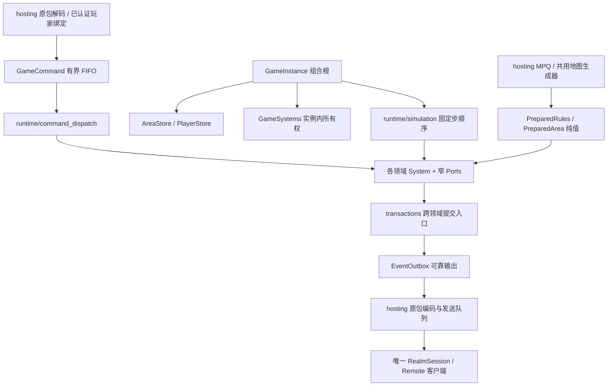

# 自研游戏内核与子系统

更新：2026-10-15。本文维护内核入口、所有权和扩展约定；功能顺序见[总计划](../architecture/MULTIPLAYER.md)，原包入口见[服务端协议](SERVER_PROTOCOL.md)。实现范围见[基线](../../BASELINE.md)，包身份见[开发指南](../development/BUILD_AND_RUN.md#运行包记录)，历史运行证据由对应玩法专题维护。

## 当前范围

跨单位持续效果的新增源码统一接收标志准备、只读列表查询与复制状态来源；NPC与其他非玩家共用唯一MonsterActor、原生属性和资源，AreaNpc只保留出生／任务／服务元数据。是否接收仍由原技能filter及公共投递／直接分配策略分别决定。三种护盾、非玩家自施法、普通攻击的状态属性消费和召唤物死亡撤出共用实际单位候选；所有者边界、源码入口及未完成事件交错见[公共效果边界](../gameplay/skills/COMMON.md#跨单位接收与载体边界)。这些载体／状态切片已纳入已有构建，列出的有限路径以[运行包记录](../development/BUILD_AND_RUN.md#运行包记录)为准；未逐项观察的跨单位／生命周期组合仍未验收。阶段和下一步统一见[总计划2.3节](../architecture/MULTIPLAYER.md#23-战斗重构实际阶段与剩余步骤)。

玩家入场、行走、库存／装备、人物成长、世界换区、多人投影、普通近战、女巫及亚马逊技能、掉落／消耗、玩家死亡、普通物件／NPC和五幕27项个人任务／奖励／旅行由权威内核执行。26个领域加玩家／移动形成28项目录；各自具有独立State、read、类型化请求及显式Ports，由GameSystems持有。inventory规划物品，attributes计算总值，progression规划成长，transactions提交人物事务；World管理区域准备／驻留，Travel提交位置／区域过渡，replication派生可见参与者，social实现广播／私聊、屏蔽关系、队伍邀请／成员权威及可见头顶消息，trade实现双人原子物品／金币交换。其他规则保持NotImplemented；总体未完成，当前范围以本页、[库存](INVENTORY.md)、[人物](CHARACTER.md)和[ACT1](../gameplay/quests/ACT1.md)为准。

命令目录中的Scaffold在入队前被拒绝，不因有函数入口就宣称Queued。3A／3B成长、13的UNIT_TILE及15同局聊天已执行领域入口；传送点、门户、普通物件／NPC、城镇服务及跨幕旅行已接；队伍及有向敌意由social执行；玩家交易见[PLAYER_TRADE](../gameplay/items/PLAYER_TRADE.md)。普通攻击／选技／热键／停止已接skills；人口准入已准备的第一幕普通／精英／首领怪物。世界物品生成与普通掉落已接items／loot，不能据此宣称全部来源规则完成。

属性候选已接当前MPQ的物品单位事件注册链、物品光环逐写回调和运行态计时器；reactions::ItemTriggers消费已发布注册链及原始参数层几率。光环激活／撤销、零值状态撤出、逐来源资源上限、独立状态位及被动刷新在同一候选中按序执行；非零immediate的BasicAura已同步准备拥有者与周围接收者。玩家、佣兵、铁魔及女武神来源，嵌套回调与单人／双库存／人物成组事务已接共享候选图，输出接受和修订复验后一起发布。这些来源／持续效果机制已纳入前序构建；代表光环、诅咒、战吼、祭坛及伤害前回调有各自有限运行记录，完整非玩家属性回调、队列2物品事件交错、生命周期及全局排序仍未认证。具体算法与限制见[COMMON](../gameplay/skills/COMMON.md#当前持续效果入口)，当前飞弹／周期事件的迁移及验证边界见下节。

## 原生帧事件迁移

`GameSystems.frameEvents`单独拥有玩法定时器，`EventOutbox`仍只负责可靠输出；两者没有混用。公共`gameplay/events/frame_queue`保留原五类队列、64桶、持续／到期插入顺序、拥有者索引、逐身份取消、回调延迟删除和跨背压游标。PreparedInsertion与PreparedEdit先分配节点并捕获原登记集合，接受领域候选后再链接，废弃候选不发布；状态列表的本地事件身份随不可变候选保留，实例事件通过payload映射回原状态候选。

`effects/frame_events`接收玩家／单位REMOVESTATE，`monsters/frame_events`接收独立AIRESET。人物事务、单位光环候选及直接佣兵／怪物状态路径一起准备／发布期限，旧每帧批量AIRESET扫描已撤出。`runtime/frame_event_dispatch`只路由至负责领域，`Simulation`保留Events阶段，事件未完成不进入后续逻辑帧；人物离场、怪物实体撤出及任务实体撤出取消各自的实例定时器。诊断frameEvents与可靠输出历史分开。当前派发还包括飞弹MODECHANGE、玩家／非玩家PERIODICSKILLS／PERIODICSTATS／STATREGEN及非玩家MonsterModifier；Object／Item／Game和其他事件仍没有完整派发，见`runtime/frame_event_dispatch`。AI已有单单位think入口，兼容遍历仍保留；AI思考期限、完整动作模式、房间休眠／激活及死亡取消顺序仍需迁入；此底座／持续效果期限模块的CMake/all构建、两包更新及列出的有限Single Player观察通过；实际包身份及未覆盖范围见构建运行记录。不能据类别队列存在就宣称全部原版时序已完成。

飞弹后续迁移已提供`missiles::System::frameEvent`单单位入口，保留自己的Advance候选；发射批次持续事件先准备节点，再随发射接受发布。玩家、怪物、子弹体及直接技能实际子弹体已准备／发布持续事件，结束自注销；实例事件阶段先刷新只读空间索引，飞弹回调同步推进接受命中，并保留发射／HP阶段，原后续域阶段不再重复推进。Advance现记录子弹体／命中／诅咒的调用顺序，逐项发布并同步完成联系后才进入下一项；任意4096弹体阈值已撤出，同步SpellImpact准备不等待后续阶段释放256节点阈值，正常排队联系仍有独立准入限额。持续效果的任意128列表阈值也已撤出，避免同步回调阻塞在尚未执行的REMOVESTATE之前；原列表仍由候选准备实际分配，输出容量独立处理。装备光环接原PeriodicStats 9，右手光环及雷云风暴接PeriodicSkills 8，旧玩家光环／风暴轮询已撤出。右手选择候选在装备来源更新后清旧拥有者列表、执行immediate或投递无期限空列表，并一起准备custom ID -1；周期读取当前active槽等级。雷云按原目标GUID循环，临时弹体从game seed初始化私有随机流，伤害后通知与重排保留游标。佣兵／召唤光环使用原AssignSkill右手选择及custom ID -1，旧佣兵光环轮询已撤出；正skill ID保留原列表驱动分支。怪物模型新增独立rightSkill槽，单位选择由无人物主请求的事务图准备，复验状态／生命／接收者／定时器后一起发布，避免借用无关人物提交。光环附魔在创建后SetSkills／AssignSkill，都瑞尔在正常AI执行时首次分配原Aura；旧自然怪物双光环轮询已移除，附魔选择不再与当前右手光环并行保留。怪物技能分配通过共享来源／被动刷新候选，创建与机关／任务／诊断准入传入实际逻辑帧。嵌套接收者准备保留Capacity／Stale等失败类别。child_creation保留拥有式蓝图／创建程序，子体的实际技能、等级伤害与来源属性在有序操作处准备；节点、计时器和事实先分配，SUNIT身份／game seed消费形成独立保留阶段，输出背压不重掷、不覆盖已变化的游戏随机流。正常玩家／怪物发射及寒冰甲反射已从game seed生成弹体私有种子，不再以技能请求注入施放者种子；怪物发射返回其原行动种子。共同依据为固定D2MOO SUNIT_InitSeed、MISSILES_CreateMissileFromParams及SkillSor.EventFunc01；尚未运行认证，也不能把此迁移视作全部1.13c随机顺序认证。公共missiles/damage_data又接原范围构造、逐属性写入、加倍判定及FullDamageParams／单元素投掷；D2Common 1.13c字节确认unsigned加倍判定及来源恶魔ED一次累加，范围投掷与雷云先接新公共入口。普通敌方弹体现保存范围并逐目标进入combat/missile_contact，四类种子的所有者分别持有，格挡／双爪格挡／闪避读取实际受击者属性，内部命中类别游标先于同步回调推进；玩家恢复种子随HP事务提交。子体准备来源范围后一次接受实际拥有者／父体种子贷款。内容层monster_type_data按当前MPQ的MonType三等价关系准备只读目录，伤害的参数层匹配保留原128边界。combat/drain和missile_drain区分百分比／直接吸取，实际来源资源先于目标HP补回，怪物目标资源在HP后写回公共来源。effects/missile_delay为NextHit准备原JUSTHIT状态、空列表与REMOVESTATE，门控等原回调而非到期帧比较，零NextDelay也保留原排期。敌方弹体来源换区／死亡／归属变化不直接删弹，来源撤出抑制后续命中／子体。佣兵弹体已改为无投掷程序参数与共用伤害范围分开，创建阶段不再生成武器固定伤害；精通按实际当前usedSkill，判定由共享公式目录导入。公共damage_program与逐目标执行接原SrvDmg，转换与额外选定元素投掷保留阶段，冻结／冷却分别传入受击端；GetHit／SoftHit／KnockBack由MPQ和实际不可中断位准备，6／8目标标志与图形按顺序发布。原1.13c D2Game实际31槽表及1–14入口片段已与DLL字节匹配；狂犬病仍要求真实期限参数，缺失不假定。玩家武器弹体旧快照已在后续源码撤出；技能／物品事件统一顺序、特殊命中程序及全局执行交错仍待完成。已有飞弹／周期、数值／接触切片已纳入Release构建，代表Single Player观察及包身份见运行包记录；完整数值、随机和组合尚未验收，不沿用历史样例认证全部程序。

装备光环PeriodicStats的节点跟随人物事务／单位生命候选发布；候选放弃不登记，提交无分配链接。来源GUID和技能参数保留，当前聚合等级在单事件开始时采样；取消决定、接收者／伤害阶段和下一期限跨背压保留。玩家死亡事务、怪物死亡／退休取消周期事件；活冻结怪物跳过PeriodicStats，单次事件消耗、持续事件等解冻。旧全单位装备光环扫描和旧飞弹推进公开入口已撤出。此大模块已通过本轮构建与代表路径冒烟，完整周期／原版时序仍未验收。

### 飞弹数值与接触收尾源码

玩家法术／武器弹体与怪物／佣兵弹体的数值来源现统一到`Missile::nativeDamage`，`EnemyProjectile`只保留行为和程序参数，不再另持伤害范围。`missiles/damage_sources`负责当前实际拥有者的属性／手位与技能／飞弹公式采样；`gameplay/missiles/damage_data`保持原范围构造、SetDamageStats、FullDamageParams和单元素投掷。原始SrcDamage、SrcMissDmg、MissileSkill、Holy、Half2HSrc、ApplyMastery、SrvDmg、HitClass及NextHit从MPQ准备目录读取。原弓箭技能的ToHitFactor不自动变成弹体TOHIT，Throw／LeftHandThrow／DoubleThrow和技能伤害初始化按其原程序单独写入；不能用统一技能命中加成覆盖这些差异。

武器弹体的创建期固定HP通道已撤出；所留WeaponSkillDamage为CB／OW等程序参数，逐目标准确率、范围投掷、格挡／闪避与HP走公共联系。普通移动弹体和怪物弹体的`CollisionFlight`保留接触阶段：穿刺计数→准确率→JUSTHIT／HitByMissile→SrvHit子体／范围／来源治疗→FullDamageParams／SrvDmg→目标防御／HP。按原HandleMissileCollision每帧只处理首个被选中的单位，穿刺保留弹体并在下一帧继续；同一接触的子体／范围与伤害仍同步完成。HitByMissile不再受ReturnFire整体门控，寒冰甲的反击回调单独读取该标志。子体和来源／父体／弹体／受击者的种子分别保留，容量重试不重做已完成阶段。父体来源按显式owner传递，规则共享寿命不依赖操作者仍在PlayerStore；换区、死亡和归属变化不直接撤销已发射弹体，专属程序的死亡分支仍保留，实体真正撤出后不再创建伤害／子体。

飞弹时钟区分原生有符号16位TotalFrames／CurrentFrame、激活门槛、路径年龄与实际回调帧executionTick。状态采样、JUSTHIT、尸体模式及公式上下文使用实际事件帧；不会以created+age推算或让倒计时续命改变世界时间。原GetRemainingFrames返回TotalFrames减CurrentFrame；周期和发射窗口读取该差值，追踪和跟随续命只重设CurrentFrame，不改TotalFrames或激活门槛。该差值已对1.13c D2Common ordinal 10985的字节确认。

路径推进开始统一到`gameplay/missiles/motion`的FP16候选、原128项方向表和最多10个SavedSteps；`missiles/motion`按保存格子与原房间单位链选首个目标，命中程序读取移动后的实际端点。跨房间平移保留小数位，地形／物件碰撞按实际房间查询。`LastCollide`、`Explosion`及`CollideFriend`独立从MPQ准备，持续火场不再无条件排除上次目标。`native_programs`和`native_hit`分别承接专属Do／Hit；子体保留SubMissile／HitSubMissile、循环寿命、路径初始化与原参数，并支持创建后立即同步命中及其背压阶段。暴风雪、充能路径、冰封球／新星、追踪二阶段、轨迹发射、藤蔓回收资源和熔浆巨岩分支进入后续源码；狂犬病的传播载体归感染者，传播弹归最初施法者，沿用感染列表的绝对到期帧，不刷新已有感染。此段不表示所有专属程序或完整技能施放已实现。

SrvHit01／13及献祭箭／药瓶范围程序共用一次GetDamageValue，Meteor范围使用一次FullDamageParams；共享抽样对象也保留无目标时的抽样。范围查询开始复用原整数半径、filter与相邻房间单位链；跨区域按原遍历中连续的区域段提交，共享一次抽样，不按区域重排接收者。祝福之锤的专注加成改写实际magic上下限，GlacialSpike独立长度继续覆写对应元素字段。FireHead的单元素来源治疗在普通伤害投掷前经原生资源候选执行。多重箭外围箭抑制来源DealtMissileDamage和物品Hit登记，保留受击者事件及百分比吸取。目标item_damagetargetac在成功准确率的直接联系结束后处理，格挡／闪避也执行，佣兵与范围复制除外；HP与后置属性写入分阶段，重试不重复扣血。物品触发准备的任意4096工作数门槛已撤出，避免同步联系等待尚未进入的后续领域阶段。

原版1.13c的SrvHit表、指法师SrvHit19和SpiderGoo的SrvHit16已从本地D2Game.dll提取（表VA `6FD2DA48`，指法师函数RVA `3E8A0`，证据`artifacts/missile-native-20261015/`）。两者首次分配后仍将空指针传入六槽写入及续期函数，已有列表才写属性；实现保留该分支。SrvHit52也保留原版检查HitSubMissile1却向创建器传入零飞弹ID的行为，不自行修正D2MOO中的疑似遗漏。这些字节核对不能外推成本轮所有程序都已验证。

公共公式计算器的飞弹Rand按原D2Common ordinal 10231、回调`6FDBB140`和范围助手`6FD51180`处理：回调的上下文偏移别名到本次调用按值传入的ID／等级参数，构成每次求值独立的64位种子；不会消费拥有者或飞弹的运行种子。SrvDmg转换读取已导入的DmgCalc1，并保留原调用的`(-1,-1)`参数。嵌套技能公式仍使用实际单位随机贷款。祝福之锤使用原Fog.dll浮点表的32个步进值、FP16和截断规则，客户端／服务端共用路径。

普通弹体逐步改由原Do／Hit选择执行，圣光弹接收矩阵取TargetPet／TargetAlly及命中参数；火球、献祭箭、冰尖柱、陨石、药瓶、连锁、闪电之怒和天堂之拳进入公共接触／子体流程。范围复制保留HitFlags／ResultFlags，零结果字不执行接收；无成功位的受击表现不扣血。范围和天堂之拳直接SetDamageFlags阶段不重跑碰撞的HitByMissile／SrvDmg。目标爆发在其实际阶段枚举，天堂之拳先完成主目标，再创建周围子体。Howl、战吼、BattleCry与Grim Ward的原程序分别保留期限、列表拥有者、随机来源及AI入口；Grim Ward周期在飞弹自身属性／种子上计算，并保留难度AI诅咒除数。BaalFx、CairnStones、RadamentDeath与OrbMist已接原Do／Hit及真实所有者／对象GUID。NativeSpawn使用已准备公式／属性目录，区分直接创建与怪物技能包装，保留0x400距离倒计时与0x200构造起始帧，不套多重射击、佣兵武器程序或怪物技能TOHIT附加值。0x200先减Range再分别安装Total／Current／Activate，并独立写动画序列；其后的Current重设仍不修改Total。塔楼及剩余特殊程序、完整碰撞字段与全局事件交错仍在实施；此处不是“全部飞弹已完成”的声明；构建与有限运行范围由运行包记录维护。

`NativeBirthPublication`在私有候选中保留飞弹节点、ID连续区间、世界／实际主人种子、房间节点、定时事件和原包事实；消息容量不足不先提交种子。`transactions::Plan::missileBirth`允许骨墙根段占用同一ID区间前缀，人物／实际Actor与飞弹候选经完整容量接受后共同发布；分组事务和次级接收者不能静默夹带该出生候选。怪物发射及NativeSpawn复用同一构造／发布流程。

骨墙玩家路径由SrvDo60准备根段及两条原控制飞弹，Do13在前次PATH跨格时尝试原位置出生，成功才递减TargetY；根段已经死亡但GUID仍在时仍可生成。旧BoneGrowth队列已删除。墙段从各自出生帧安装MonStats.Skill1所指技能Param2期限及原S2出生动作，AI初次25帧、随后15帧检查；骨牢按原12个偏移保留首段和子列表关系。AIGENERAL所有者／子列表与玩家宠物归属分开持有，UMod15死亡候选按原顺序清除子所有者、处理子列表并切换实际怪物主人死亡模式，不以持续根死亡扫描代替。死亡状态／计时撤出共用effects，墙段DD保留真实Actor供仍活跃的Do13查找；未将死亡动画结束当成GUID立即消失。非玩家施放骨墙的公共召唤生产与完整尸体／房间退休顺序仍待后续闭合，新增源码尚未运行。

原0x40 COLLIDE_MISSILE字段独立于DT1和物件栅格，AreaStore预分配后按原点／十字／方形Set／Reset位操作；普通Collision脚印随出生／移动／撤出更新，Do3／34静止点及Do5范围按实际程序写入。寻位与跨房间地形查询读取同一Grid入口，不用重叠计数替换原位语义。公共`native_spawn`保留边缘／内部扫描顺序、Manhattan优先级、首个同分及PosIncrement；`native_field`从当前MPQ的data/global/expfield.d2逐格追踪，保留11099不检查最终中心格的分支。ClassicData准备原256列方向表，AreaStore提供带房间游标的GetFreeCoordinates／GetFreeSpaceEx候选；size0的CheckMask仍检查中心格，与size0的SetMask无占位分开。world的GetFreeSpaceEx从实际调用者房间开始，保留(+2,+3)及原退路；永久门目的端接size3／0xBE11／PosIncrement5的原生寻位。

spatial提供不依赖旧indexedTick的同步动态碰撞投影，读取真实玩家／怪物／NPC／伙伴、地面物品和门户。单位按原Unit／Pet／Wraith模式写入，死亡后无deadCol的尸体使用SmallNoPresence十字，Revive有显式运行时模式；环境陷阱也从公共MPQ准备入口取得模式。原生飞弹接触只投影相邻房间单位链及所需掩码，避免逐弹复制全局单位。候选按原DRLG房间顺序、房间pUnitFirst顺序和独立尺寸配对表选择，先过模式掩码门控；屏障无单位目标时仍执行终止联系。已迁移Do的HandleMissileCollision阶段在其子体／状态／世界操作发布后才选择接触或执行到期Hit，并在后续背压时保留阶段。尺寸表及门控／屏障分支核对本地1.13c D2Game RVA3F320和D2Common ordinal10389（固定1.10f参考中的#10407），证据在artifacts/missile-native-20261015/native-contact*及native-unit-contact-113c.asm；没有把不同版本同号ordinal当成相同函数。

items::createNativeGold已准备原生落地金币入口：调用方提供已寻位的精确坐标，当前MPQ区域等级由AreaMetadata保留；SUNIT两条出生种子分别用于单位基础属性与物品起始种子，数量使用单位随机流。候选、事实、ID和全局随机一起发布，重试不提前消费。此入口依据固定D2MOO的SUNIT_AllocUnitData／InitItemStats／CreateItemEx，尚未接入Do18；专用开箱不能借用在场玩家或普通Chest流程来代替。

Hit39已接实际房间随机、Levels.mon／isSpawn选择、1.13c普通周界寻位及真实Actor候选，房间随机／全局随机／ID／组件一起发布；出生组件与HP改由实际单位种子按序投掷。详细入口、1.13c依据及水面／完整出生限制见[权威出生](../gameplay/monsters/POPULATION.md)。不再用普通地形nearest或巢穴子怪代替该生成程序，但它仍未完成全路径复刻。

剩余飞弹范围包括Do18高塔专用开箱／金币调用及真实载体、Hit6／23／54、Hit39水面及完整怪物出生程序、模式7的飞弹目标、其余动态模式切换及原生对象／房间生命周期交错、非玩家骨墙出生、狂犬病近战根载体、客户端未迁程序和跨领域事件交错。当前MPQ仍实际引用Hit39／54；Hit6／23为空用法不能替代其公共程序实现。门户还需QUESTS_PortalCheck及源对象出生先于目的端寻位的顺序；同步投影不代表全部历史Set／Reset位交错已迁完。未认证完整原版过程或结果，不以空槽、无操作分支或旧二进制冒烟覆盖这些缺口；已有源码的构建不认证这些剩余分支，当前证据边界见运行包记录。

任务控制飞弹的房间保留使用原HASPORTAL语义（原ToggleHasPortalFlag参数0置位，1清除），并进入world房间退休判定。巴尔死亡只创建当前MPQ的控制飞弹，剩余100帧时才调用泰瑞尔出生；删除原立即出生分支。任务空位助手按原1.13c RVA34130的传入半径、行列顺序和跨房间查找移植，保留RVA3420f实际以Y比较X上界的分支；泰瑞尔调用半径为100，与固定1.10f参考的19不同。凯恩最后激活从STONE LAMBDA位置+(6,-3)创建控制飞弹；已完成角色重建世界的原直接开门入口仍保留。永久门源坐标直接使用控制飞弹位置，目的端按上述公共寻位进入实际目标房间，仍未认证完整门户／房间构造顺序。

强制之球InitFunction60准备真实compellingorb非玩家载体，操作对象与该载体保持不同GUID。脚本死亡、OrbMist的距离倒计时、目标楼梯动画及房间保留／释放接入公共领域；objects静态／动态出生都注册原UNIT_OBJECT房间链，不再只能从旁路坐标表找目标。客户端每次推进的工作预算保留未遍历父／子体及其年龄，撤出2048个弹体的静默丢弃；客户端0x73接收已按本地1.13c D2Client RVA AEEE0拆开构造Total、包内Current和随机动画帧：包只调用D2Common ordinal10970修改Current，动画另取飞弹私有种子。当前新增源码分别保留本地回调数、Total／Current和FP8动画序列；引导箭续期不再清零本地年龄／回调数。Do5及通用动画步进共用sequence助手，绘制直接读取该序列，静态图形仍走原表现生命周期。其余客户端程序、初始化门槛与完整逐帧顺序仍待闭合。

救赎与拉达门特共用原尸体选择入口：实际死亡动作完成、MonStats2 CorpseSel及States Udead掩码，奖励／掉落是否结算不再充当MONMODE_DEAD。玩家及非玩家救赎按原随机顺序求Calc1，再写HP、求Calc3并写MANA；资源／随机流、REDEEMED状态、不可选标记共同发布。拉达门特控制飞弹剩余24至2帧做机会回收，剩余1帧跳过机会；公式及HP／MANA写入留在真实飞弹上，不转给已死所有者。拉达门特死亡前置FX同血鸦／安达利尔共用原UNITFIND顺序、恶方过滤与来源私有随机流，延迟击杀进入实例MonsterModifier事件21；原deathCascades批量扫描已撤出，来源撤出不删除接收者已登记的事件。UNINTERRUPTABLE时按原TempSummon回调延后3帧，不预先扣至0HP。脚本死亡也经公共死亡状态候选撤出列表、保留死亡掩码并提交资源／表现，不把ModeChange伪装成普通受击。其他UMod回调、玩家所有宠物的即时原登记撤出及完整世界／事件交错仍需收尾。

以上是实现与剩余边界，已有切片已纳入构建，不能把它们全部继续标为未编译；逐路径有限运行及最新工作区覆盖以[运行包记录](../development/BUILD_AND_RUN.md#运行包记录)为准。原证据入口为固定D2MOO的`D2Common/src/Units/Missile.cpp`、`D2Game/src/MISSILES/Missiles.cpp`／`MissMode.cpp`、`SKILLS/SkillAma.cpp`／`SkillPal.cpp`及`UNIT/SUnitDmg.cpp`；当前MPQ字段摘录位于忽略目录`artifacts/missile-source-migration-20261015/`。不能用冰封球／毒新星等有限冒烟认证未观察的程序、全部随机或全局顺序。

`missiles/rooms`现沿当前房间及原相邻房间数组查询单位，碰撞排序保留等距单位的房间链顺序。单帧几何使用原区域坐标，发布后统一转换弹体及保留路径到目标区域；创建按实际拥有者的当前房间查找，未找到时不消费创建种子。弹体准入／移动／退出接房间单位链，Town／SrcTown分别按当前MPQ判断。原73的ClientSend、真实拥有者、剩余帧和穿刺值进入统一编码与视野准入，后来进入视野的玩家也能同步当前弹体；协议没有飞弹GUID，不虚构RemoveUnit(3)。Holy Bolt治疗在HitByMissile后重新计算，使用弹体种子；HP和Overlay保留各自提交阶段，背压不重复治疗。BaalInferno的玩家法力撤出在普通伤害前作为有序操作执行。

仍未完成的完整战斗边界包括：技能／物品事件的原全局顺序与队列2、直接攻击的全部种子及来源采样、Rabies真实传播初始化和未实现职业／怪物专属飞弹程序。TargetX／TargetY已成为创建参数及弹体拥有值，伤害程序读取真实参数；未初始化的原生零值只会取消Rabies毒，不再抛出缺参异常，但传播生产端仍须完成。跨区域及原生伤害状态已有源码和构建；全部创建初始化、来源与组合仍需同版本证据及获授权后的运行验收。

## 组合与所有权

GameInstance只组装实例级区域、玩家、ID、随机、命令、系统、调度和输出，并提供参与者准入／进入／移除入口；不实现物品、怪物、技能或任务规则。PlayerStore唯一拥有角色值和每人不可变EquipmentRules／CharacterRules，防止后来加入的职业复用房主经验表或物品ID。MovementSystem保留既有寻路／碰撞执行。GameHost负责句柄代次、暂停、固定步预算和参与者快照。NativeRealmHost共享只读MPQ内容、管理房间／地形并每帧只推进一次；每个NativeRealmService持有自己的协议会话、角色名册版本及存档租约。

GameSystems只供组合／分派／调度使用，不传入领域函数。它的构造函数一次性为各系统注入本领域的Ports；领域入口只接收业务参数，调用另一个系统时不必重新拼装对方的依赖。跨域读取为const，可以提交协作请求的引用明确列出；没有字符串服务定位器、万能可变世界对象或能够调用UI／MPQ／socket的回调。

构造函数只保存依赖引用，不访问或调用尚未构造完的同伴；所有系统就绪后才准入玩家并执行命令。GameInstance／GameSystems禁止复制和移动，依赖的规则、玩家、区域和输出先构造、后析构；系统析构不回调同伴。调度线程串行访问实例。跨阶段工作应提交类型化请求或事实，不能通过互相调用执行函数形成递归结算链。

GameSettings按实例保存地图种子和难度，由建房选中角色提供；后来加入者采用房间配置，不能用自己的存档覆盖它。随机流、EntityIds、命令和可靠事件按实例隔离；玩家ID不因离开而复用。最多256个宿主实例、每局1–8人；暂停私有一人局不影响其他实例，共享房间不随客户端ESC／失焦暂停。

PersistentCharacter在PlayerStore中唯一持有，包含库存、人物记录、任务、尸体和铁魔等持久数据。items只持有不属于角色的世界物品；merchant保存句柄／报价版本；trade持有报价状态及不可变取消／保存快照，不形成另一份可写库存。spatial是派生查询，attributes只读已提交Totals；均不另建可写的位置／人物基础属性真值。companions拥有归属和控制关系，活动实体归monsters。公开read只读，不能从UI取得可写状态。

## 领域目录

除players、movement外，路径均为src/server/systems/<目录>/system.hpp／system.cpp；inventory另有planning／placement／equipment规则文件。除明确注明的切片外，表内操作为骨架。

| 目录 | 拥有的运行态／职责 | 操作边界 |
| --- | --- | --- |
| players | PlayerStore中的角色持久值、位置、移动状态和命令序号 | 入场组装；持久导出仍由GameHost交宿主存储 |
| movement | 原有路线、走跑及碰撞执行，数据归PlayerStore | execute／step／suspend |
| world | 区域驻留、准备请求、原生出口／边界／物件身份；AreaStore唯一拥有碰撞 | 请求合并／过期结果拒绝／失败记录／可见邻区；不生成地图，Sleeping保留值不卸载 |
| spatial | 按区域／网格重建的活玩家与活动非玩家候选索引 | query／step；稳定ID顺序、不移动实体；物件／弹体／物品尚未纳入 |
| items | 世界物品，沿用ItemInstance／InventoryState | create／resolve；生成不等于提交或放入背包 |
| inventory | 容器访问、摆放／装备／数量规划 | execute已接移动／交换／装备／切组／合堆／入书；新增地面拾取／丢弃、金币丢弃、卷轴／书本鉴定、药水和仓库授权／关闭，库存仍归PlayerStore |
| attributes | 纯派生计算与当前Totals只读查询 | calculate／evaluate；提交前同步求值，无dirty队列；已接支持的临时状态，完整被动仍待恢复 |
| crafting | 方块／镶嵌与原38任务加工事务 | execute／pending／install；hosting准备不可变输出，前置任务资格由quests负责 |
| loot | 掉落选择与来源结算记录 | plan／step；沿用LootRequest／LootPlan，不写死概率 |
| population | 区域人口、已准入spawn key | admit／step；保留MonsterIdentity及显式实现类型 |
| monsters | 活动非玩家实体、身份、位置和版本 | admit／requestMove／remove／step；与人口生成、AI决策分离 |
| ai | 目标、决策时间与控制器 | step；产生动作，不直接结算伤害 |
| skills | 选技／热键／施放及持续动作 | execute／requestCast／step；AI使用实体来源请求，不伪装成玩家 |
| missiles | 弹体实体和寿命 | spawn／step；碰撞后向combat提交结算请求 |
| effects | 状态效果、来源、持续时间 | apply／step；原状态定义由宿主准备 |
| combat | 命中／减免／伤害结算请求 | enqueue／step；死亡转移归death |
| death | 死亡发生标识、复活／尸体回收 | execute／step；死亡终态及击杀奖励去重；经验委托progression，已接死亡结算、城镇复活与本人尸体回收 |
| companions | 雇佣兵／召唤物／铁魔归属 | summon／execute／step；不复制活动实体 |
| objects | 门、箱、祭坛及任务物件状态 | admit／execute／step；掉落／效果／任务各归其领域 |
| npc | 对话会话和对白确认 | execute／close；商店、雇佣、工艺、旅行各自分派 |
| merchant | 商品句柄、报价版本和买卖／鉴定／维修请求 | execute；成交走事务边界 |
| quests | 游戏级任务状态；个人进度仍归人物记录 | execute／step；资格与奖励不可由客户端授予 |
| progression | 属性／技能分配、经验封顶／升级规划 | execute／award已接；经CharacterEdit提交，step无额外改写 |
| travel | 自然边界／UNIT_TILE、门户及NPC待过渡状态 | walk／execute／step／cancel；按来源校验原邻接或NPC资格、活人、来源代次、碰撞及路线；先可靠事实再改区域／位置。已接传送点、本人回城门、五幕任务门户和Warriv／Meshif旅行；完整特殊场景及队伍锁仍待实现 |
| social | 广播、私聊、聊天屏蔽、头顶消息、队伍邀请／成员及有向敌意 | 原15／14／5D(2,3,4)／5E(6–9)，捕获收件人／关系，头顶消息与公开队伍状态支持晚入；组队范围见[联网](NETWORK.md#组队邀请客户端) |
| trade | 双方报价、同意状态及交换版本 | 原13/4F，库存运行态报价格、只读镜像、原子成交和取消恢复，见[PLAYER_TRADE](../gameplay/items/PLAYER_TRADE.md) |
| transactions | 跨域计划、版本前置条件、提交身份 | prepare／commit已接单人物InventoryEdit／CharacterEdit原子提交；commitInventories接实际双人物交易，commitCharacters接人物技能组及最多8人钱包／地面共同提交；通用Exchange类型仍为stub |
| replication | 每个收件人的兴趣与可见玩家集合 | visible／step；按本人区域及准备好的直接自然邻区过滤，普通怪物使用本区RoomLayout邻室及直接邻区距离过滤；完整房间兴趣仍待实现；编码留hosting |

目录在runtime/subsystems.inc维护身份、阶段和范围。players／movement为walking-slice，inventory为inventory-slice，attributes／progression／transactions为character-slice，World／Travel为world，replication／social为multiplayer；范围表示已接切片，不代表该领域全部规则完成。population／monsters／ai／skills／missiles／combat／death及spatial为combat-slice。items／loot／merchant为inventory，effects为character，objects／npc／quests为world；companions已接Hydra、诱饵／女武神及血乌奖励罗格，完整雇佣服务／通用请求仍明确拒绝；trade为multiplayer；crafting已接方块／镶嵌及原38任务加工，命令按具名意图检查。

## 命令与固定步

GameCommand由服务端产生sequence、来源area及areaGeneration，负载为MovementCommand及13种领域Request的variant。实例绑定由GameHost校验，操作者从PlayerStore构造ActorContext，不信任客户端传来的玩家身份。入队校验玩家、区域身份和代次、递增序号、实现范围和256条容量；固定步执行前再次核对来源区域，防止两个不同区域代次相同而误执行旧命令。未实现请求不占FIFO、不更新acceptedSequence。

runtime/command_dispatch为每个负载显式映射SystemId与领域入口，没有默认成功分支。CommandStatus区分Queued、Applied、NotImplemented、Stale、Conflict等结果。PlayerSnapshot.command只保存最近执行结果，movementSequence单独触发原移动回复；最近结果可以被覆盖，不能用作物品／交易的可靠完成通知。

Travel独立于人物事务：自然边界按原room连接和统一坐标确认接触面，沿既有速度逐步走过接缝；瓦片出口按原13/type=5绑定World分配的UNIT_TILE，接近后进入唯一反向出口，保留LvlWarp的ExitWalk偏移。区域、来源generation、移动意图序号在提交前复验，库存／成长命令不会取消路线；新移动／旅行、退役和离开取消旧过渡。完整TravelFact进入Outbox后才提交区域／位置／新路线，失败不半换区。多重反向出口、原任务锁入口及未核实资格明确暂缓。

runtime/simulation固定顺序为：区域／人口 → 属性 → 初次空间索引 → 伙伴／AI → 技能 → 玩家移动 → 库存恢复／地面恢复与过期 → 怪物／空间索引 → 弹体／效果／战斗 → 死亡 → NPC／商店／加工 → 物件／任务 → 掉落／成长 → 旅行 → 投影。P5补merchant／crafting／items.step调度，不依赖界面操作推进维护。此处不宣称已核实原版全部结算细节；规则接入按生产者／消费者依赖调整。所有步沿用25Hz，不用渲染delta执行玩法。

只有具有运行维护工作的领域被调度，transactions／social在命令边界按需规划／提交。World在准备需求存在时返回Blocked，Travel等待准备或接近路线时返回Blocked，replication更新派生兴趣后Complete；其余stub不产生状态变化。Blocked只描述相应领域，其他阶段／实例继续运行。

FrameFacts是有界的本步临时事实，只允许后续阶段消费；每步开始清空。需要在下一步继续处理的请求必须留在所属系统pending状态，不能靠临时事实延后。可靠通知进入EventOutbox，不能依赖FrameFacts或覆盖式快照。

## 内容、事务与输出

SkillRules只持有公共SkillRuleSpec数值和程序参数，不持有动画／声音资源路径。hosting从当前MPQ的SkillSpec准备rules()纯值；resolveSkill、伤害／耗蓝／持续时间、序列时序和有依据的弹体纯计算供两端调用。服务端skills／missiles／effects负责世界状态与调度，combat负责权威命中／伤害，客户端仅从原包及本人已知属性生成表现。原版公共职责和每项技能分派见[女巫技能](../gameplay/skills/SORCERESS.md#30项公共职责核对)及[亚马逊技能](../gameplay/skills/AMAZON.md#30项职责核对)，不能把D2Game整套执行器解释为客户端共享接口。

PreparedRules持有不可变纯值；全局ItemCatalog共享同一宿主只读内容，每位PlayerState持有自己的EquipmentRules／CharacterRules／MeleeRules／SkillRules。hosting/game_content与character_content从MPQ准备碰撞、职业、各等级物品属性、经验、学习、基础被动及难度抗性；内核不持有ClassicData／Archives或MPQ回调。普通攻击动画和区域人口由hosting/combat_content准备；hosting/skill_content准备女巫全部主动技能、SC／序列动画、三类支配及Hydra，以及亚马逊武器／状态／序列／宠物规则；hosting/companion_content准备女武神原MonEquip装备；其他职业与宝物类契约仍未准备；空规则明确Unavailable，新增或跨人转移物品须显式准备新身份对应属性，不能套用旧缓存。

区域交接由GameHost.pendingAreas／installArea／failArea提供，结果带GameHandle及PrepareArea身份。World合并同目的请求，最多16项在途；来源须为原生邻接，失败地区明确Unavailable，不重复生成或替换地图。宿主prepareWorldArea调用同一NativeMapGenerator准备原房间／碰撞／出口／边界及objects.txt中立碰撞，按调度线程交纯值。按玩家及直接自然邻区派生Active／Sleeping；当前不驱逐已准备区域，地图随实例释放，导航借用保持有效。客户端按原03／07／08及位置包调用同一生成器，不接收地图对象。

transactions的Plan含TransactionId、库存／人物双RevisionGuard、InventoryEdit／CharacterEdit及候选PersistentCharacter／Totals。inventory和progression只改临时值；事务prepare重算总值、装备失效标志和资源，commit复验身份／区域、双版本及发生标识，先插入完整不可变Outbox批，再以不抛异常的值交换提交库存／人物／总值／revision，并按候选技能移除事实清空actions中的玩家used引用；此引用不作为整动作取消命令。经验最后发生标识按玩家仅在成功后更新；事务身份递增，旧计划拒绝，无无界集合。通用ItemTransfer／Reward／Exchange类型仍为stub；实际交易使用commitInventories，人物技能组使用commitCharacters，自然金堆共享使用最多8名同区域人物及一个WorldEdit，先统一预留全部事实，再共同提交钱包及世界；经验及邪恶洞穴奖励由CharacterEdit提交，地面转移／尸体通过WorldEdit及对应计划提交，不假装通用Reward完成。随机物品由hosting读取MPQ准备，领域仅安装值；实例实体ID单调分配不复用，失败可留下空号，不回退为已存在身份。

实现提交时必须一起处理：目标／所有权／版本再校验、所有参与者资源及空间资格、事件容量预留、随机及ID的提交语义、去重，以及完整成功后的状态／事件发布。失败不得部分扣费、移物、推进随机或记录已领奖；不能先改库存再发现输出队列已满。掉落发生标识、任务奖励资格和交易版本均由服务端产生，不能以客户端重试次数结算。

EventOutbox有256批／4096事实容量及有序累计确认。InventoryFact保留当次稀疏物品值，CharacterFact保留前后人物／Totals，TravelFact保留提交区域／位置，ChatFact保留提交时收件人。NativeRealmHost集中路由：库存／人物／换区仅本人，聊天仅已捕获的同局连接。每位接收者完整编码后一次提交字节队列；失败明确终止该连接、移出投影并保留可恢复存档租约，再确认已送达或明确退役的批，不向其他连接重复发送。Area受众按同实例可见区域及单位过滤；未实现事实明确拒绝。玩家／世界／怪物增量由独立player_replication／world_replication／monster_replication编码；只发别人穿戴外观，不发背包、Cursor、私人箱或人物属性。

普通攻击／弓弩／左手动作／投掷药瓶统一进入skills.weapon与missiles／combat；隐藏Kick由普通桶OperateFn5调用skills.objectKick，左右键选择不变，objects／loot仍持有破坏和掉落；Unsummon由原程序入口执行，四项卷轴／书本由inventory和travel复用原事务。来源资格、释放复验、公共函数及限制见[通用十项](../gameplay/skills/GENERAL.md)。

玩家武器吸取、压碎和撕裂沿同一combat接触阶段执行，纯值计算见[武器命中效果](../gameplay/combat/WEAPON_EFFECTS.md)。monsters持有伤口和生命；目标命中提交后保留待资源回补阶段，transactions将本人资源与区域原Overlay成组发布，后续反噬背压不会重复目标伤害或回补。replication从活怪物的wound投影原openwounds状态，包含首次可见、重新进入兴趣及背压等待，直到伤口事务真正清理；不能在持续快照中撤销刚发出的开启事实。

## 怪物战斗与生命周期

hosting交付人口纯值、RoomLayout、组件与populationDeferred；population按区域代次／spawn key准入，monsters唯一持活动实体、生命、路线和特殊运行值。ai只决策并提交窄动作，actions持施放记录、玩家used-skill ID／GUID与待释放值，skills执行开始／释放，怪物中断代次仍由monsters持有；missiles／effects分别持运动／接触和状态时钟。combat最多4096待命中动作，每个来源最多一个。死亡、掉落、经验与任务仍由对应领域消费事实，不借AI代办。

当前源码的`combat/participants.hpp`仅提供轻量声明，实现位于`participants.cpp`；复用`PlayerStore::findActor`，不复制生命／位置或维护另一份队伍表。普通玩家法术保留已知怪物目标的直接查询；静态NPC不因此接入敌怪AI。关系、来源和提交边界见下节。

源码入口见[怪物模块](MONSTERS.md)；规则准备、随机／事务／背压及生命周期见[怪物COMMON](../gameplay/monsters/COMMON.md)。[怪物目录](../gameplay/monsters/README.md)唯一链接五幕覆盖、精英／首领、人口、表现与证据，不在本页复制范围或历史运行清单。替身当前适用于邪恶洞穴及第二至第五幕的缺失敌对类型，真实身份保留，中立不替换；具体准入条件以COMMON及源码为准。

## 战斗关系与提交

普通怪物准入保留显式`hostile`事实；`Actor::alignment`统一原表阵营、主人与转化覆盖，`enemyTarget`还要求原敌对身份、与玩家善方不同阵营且非环境控制器。网络投影与权威关系使用同一有效值，不再将任意无主人实体视为敌人。`gameplay/combat/alignment.hpp`提供两端共用的原单位枚举：恶方0、中立1、善方2；MonStats.Align的善方1／中立2只在内容准备时转换。两个不同单位只有恶方／恶方、善方／善方算同阵营，中立／中立不算。

`Participants`按当前玩家、实际宠物主人和social关系返回Self／Allied／Neutral／Hostile／Unknown；普通攻击要求Hostile与目标受伤能力，帮助资格独立。玩家及宠物之间按攻击者→目标主人的位8决定PvP资格，优先于队伍；非队友不等于敌对，Unknown拒绝攻击。依据为本地D2MOO `STATLIST_AreUnitsAligned`、`SUnit::SUNIT_AreUnitsAligned`、`SUNIT_CanPetBeTargetedBySkill`、`SUNIT_CanAllyBeTargetedBySkill`；当前技能参数和过滤标志仍来自MPQ准备。原1.13c客户端静态依据与未复验边界见[阵营专题](../gameplay/monsters/PRESENTATION.md#客户端与服务端阵营规则)。

| 双方／用途 | 当前策略 |
| --- | --- |
| 本人、同主人伙伴 | Self／Allied；禁止普通伤害，技能专用资格独立 |
| 同队玩家及伙伴 | 友方光环按social当前同队关系，候选和提交均复验 |
| 不同主人玩家及伙伴 | 有攻击者方向敌意为Hostile，否则按队伍或Neutral；不自动授予光环 |
| 玩家／伙伴与明确敌怪 | Hostile；目标还须具备受伤能力，活人／区域／城镇／碰撞另验 |
| 敌怪与敌怪 | Allied；特殊复活／死亡级联仍由专用规则执行 |
| 诱饵、女武神、佣兵 | 关系随控制者；攻击能力独立，诱饵不因友方身份获得攻击 |
| Hydra | 保留不可受普通伤害、独立发射者表现和主人施法归功 |
| 转换单位 | 临时善方；施法者记录用于AI／归功，不当作原AIGENERAL宠物主人；不因此获得宠物治疗资格。转换开始／结束递增控制代次，旧来源请求失效 |
| NPC、未知实体 | NPC按真实阵营及isAtt能力进入公共参与者视图；服务／任务身份本身不授权伤害或帮助，未知实体拒绝 |

AI、怪物施法、普通武器／范围目标、伙伴选敌、弹体、周期效果与最终combat已接共享关系或敌怪能力查询。Holy Bolt、Enchant、Unsummon、Redemption及尸体仍保留各自资格，不把同队当作所有技能的通用授权。非玩家光环在提交时复验当前关系，避免候选捕获后离队／转换仍授予效果。

Enchant按原SrvDo025对齐主人／队伍后的盟友关系，已知活目标不合资格时退回施法者；无主善方怪物／NPC也可获得附魔，NPC阵营由hosting准备并用于同一AA投影。Holy Bolt的治疗候选包含玩家及怪物，只接受自己的宠物或队友／队友宠物，碰撞与生命提交均复验；不能以“非敌对”代替治疗资格。Conversion只接受当前恶方，结束回到恶方；原A7不清旧属性，因此hosting在阵营非零变零时用A8显式发送零值。

GreaterMummy辅助候选按原Fn022要求与施法者同阵营且目标非善方，避免转化后继续治疗／复活恶方；独特FallenShaman回调按原Fn013要求尸体为恶方，不能仅凭非善方通过。

`SourceBinding`保存攻击来源、控制者、击杀归功、有效阵营、敌对／转换状态和控制代次。近战入队、弹体创建与法术准备建立绑定，提交重新读取当前身份；死亡本身不改变绑定，换区／断线仍由原来源资格取消，转换往返不会让旧请求重新有效。绑定不保存裸指针，也不写D2S；Hydra等现有主人代理技能的独立emitter仍保留于弹体。

结算保持资格、命中／闪避／格挡、六通道与减免、提交、后续效果顺序。`follow_up.cpp`负责已命中后的转换／牺牲反冲，独立记录转换完成，背压不会再次命中或转换。武器目标首次具备输出容量后预留局部随机流，跨帧重试不覆盖全局随机；每目标保留已扣耐久标记，效果准备移至耐久提交之前。该随机分流与关系复验改变了结算语义，不宣称与重构前随机序列相同。死亡、经验、掉落仍由各领域拥有。

`combat/player_damage.cpp`接玩家目标：共享命中、跑动格挡、闪避、六通道、护盾／减伤／吸收、NextDelay和受击事务；玩家／佣兵／重生怪对玩家先乘17%，持续时长不乘。武器、范围、连锁、周期光环与伙伴候选包含敌对玩家，客户端按相同方向关系允许提交玩家目标。属性诅咒通过成组CharacterEdit原子扣蓝和更新接收者，AI诅咒不用于玩家。生命吸取／反伤／死亡边界由[武器与PvP](../gameplay/combat/WEAPON_EFFECTS.md#pvp伤害)和[玩家死亡](../gameplay/characters/PLAYER_DEATH.md)维护。

近战队列使用稳定list节点，删除不搬移剩余请求；不改处理顺序或4096容量。空间索引按区域与16-subtile网格派生活单位候选，在AI前与怪物移动后同步；保留未跨桶单位的节点，只迁移跨桶／跨区成员并移除死亡／退役成员，按X、Y两层范围索引查询，避免反复清空容器与扫描无关Y桶。查询稳定按EntityId排序，武器及通用法术直线接触采用保守半径后执行原精确碰撞。只在该阶段位置稳定时使用索引，效果／战斗后的位置变化留到下个同步点；AI、范围爆炸、怪物弹体仍有遍历，不将此切片标为全场景空间优化。

地面物品按items.State.revision缓存区域→GUID索引，发布只合并所需区域并按原GUID顺序返回；拾取、掉落、事务提交、消失和属性恢复后的revision使索引失效。批量掉落一次建立区域地面格占用集合，每次确定落点后更新集合，避免每个候选格反复扫描全部物品；落点环顺序、碰撞、容量、事务和身份分配时点保持原行为。

动作记录、玩家恢复动作以及玩家／怪物待释放队列由[actions/state](../../src/server/systems/actions/state.hpp)唯一持有；技能私有Runtime只持待处理输入并借用两类释放队列，技能程序仍负责推进。释放参数在[actions/release](../../src/server/systems/actions/release.hpp)，不进入公开System头。求值逻辑在`skills/evaluation.cpp`，参与者策略在`combat/participants.cpp`。公共动作计算位于`gameplay/actions`；怪物实体的busy／中断字段、移动和死亡模式尚未统一为同一个动作生命周期，不代表原版事件调度已实现。

物品触发由[reactions/item_triggers](../../src/server/systems/reactions/item_triggers.hpp)唯一持有队列，装备事件生产者通过显式Ports准备并提交，effects仍在既有阶段推进它。actions与reactions由GameSystems直接持有，实例帧队列已加入Simulation的Events阶段。飞弹的状态、发射请求和私有推进候选分开；当前源码的commitAdvance按程序操作顺序逐项发布子弹体、命中及诅咒，同步完成联系后再进入下一项，背压保留已接受阶段。事务计划在[transactions/plan](../../src/server/systems/transactions/plan.hpp)，世界物品候选在[items/state](../../src/server/systems/items/state.hpp)，不通过执行器头暴露。死亡奖励推进位于[death/rewards](../../src/server/systems/death/rewards.cpp)，沿用首次捕获与分阶段重试。

公共减免、物理护盾、法力护盾与六通道接收使用原整数算子；人物资源、施法费用／伤害、光环数值、人物资源事实和快照正在贯穿迁入`Fixed8`。最大资源保留CharStats四分之一点增量及ItemStatCost.ValShift，物品每级资源加成不先截成整点。普通玩家攻击已进入武器技能接触路径，非玩家武器／普通伤害共享分通道减免、吸收及来源类别比例；完整阶段反应和帧顺序仍待后续任务。装备贡献记录只解释本次聚合，不是第二份可写属性账本。2026-10-13实施前审查源码通过Windows／MinGW／Ninja Release的CMake及d2x、d2x_pvpgn、d2x_assets编译链接，未运行或打包；该构建含非致命警告，日志位于`artifacts/combat-refactor-build-20261013/`。此后数值／属性和持续效果迁移已完成多轮模块构建、打包及有限运行；当前飞弹帧推进／周期驱动增量已通过本轮Windows Release构建及代表路径冒烟，尚未完成全部语义验收。实际状态见页首和运行包记录，历史审查构建不认证后续修改。

属性计算保存带原层的只读来源：玩家／单位基础、实际装备与套装、逐技能被动、逐状态列表及怪物模式分别持有，普通查询消费FullStats缓存；原始SetStat、KeepZero、参数层和MinAccr查询分别表达。FHR／FCR／FBR、基础属性、抗性／吸收、手位与六通道数值已消费该来源，技能公式查询区分基础／总值和基础／有效技能等级，原1.13c递减参数采用公共原整数算子。

效果安装、复用、逐SetStat、旧来源撤出、状态位与移除回调分别准备；人物PlayerResourceTrace及单位MonsterResourceTrace保留中间资源上限，费用／状态／资源与事实在同一候选中复验后发布，避免重复缩放。原始光环、诅咒、护甲、战吼、祭坛及伤害前技能回调已接这些入口，状态期限由实例REMOVESTATE事件处理；兼容效果仍保留自己的维护路径。转换、诱饵／女武神、死灵召唤与Hydra也已接原始属性／技能来源，具体原顺序及未闭合程序分别由所属职业页维护。这些前序迁移已纳入构建；运行只认证列出的有限路径，不能写成全职业／全组合精确一致。

玩家与非玩家已接STATREGEN资源事件，非玩家消费当前HPREGEN、States.life／PreventHeal及AI再生桥接，毒／烧伤／开放伤口由原生列表贡献负值；具体期限、药剂与延迟死亡入口见COMMON。已纳入已有构建，实际药剂／资源有限观察与未覆盖范围以运行包记录及COMMON为准。完整直接属性回调、所有技能生产端、随机消费、动态主人关系、模式／中断、死亡及跨领域执行顺序未闭合；当前飞弹／周期增量见[原生帧事件迁移](#原生帧事件迁移)。详细来源入口见[COMMON](../gameplay/skills/COMMON.md)、[装备](../gameplay/items/EQUIPMENT.md)及[公共规则](../architecture/COMBAT_SHARED_RULES.md)。

技能公式参数环境位于`gameplay/skills/formula_parameters`，宿主从当前MPQ已准备源复制不可变标量、公式、引用、描述飞弹及原类型层号，不向玩法传入MPQ或界面对象。`skills/evaluation`为玩家借用基础／有效等级与原始基础／总属性，并为具备原始来源的怪物／佣兵保存本次总属性采样的共享寿命；当前资源在调用点借用。MonStats全部八个正等级技能槽按原槽顺序准备，难度技能加成属于基础等级；佣兵表的正等级技能覆盖同名基础槽。怪物等级共用原allskills、single、nonclass、element与最大等级算法，单项技能不会替怪物创建新槽。普通怪物入场按槽赋值刷新被动；同等级缓存不重算，等级变化逐槽覆盖旧值。SkillDamage已能从玩家或当前所属区域内身份匹配的怪物主人采样公共物理范围及命中系数。`stat(base)`读取基础，`mod/accr`在D2Common回调中读取总值，`tohit`始终调用公共UNITS命中率算法。技能引用的有效等级与`blvl`分开，玩家等级改从原始属性快照读取all／class／tab／single／nonclass／element加成，已有槽只在完整求和后限幅，等级零的已有槽保留；初始装备StartSkill进入原single层，内建技能和额外装备技能也准备等级上下文。技能／飞弹参数词汇和伤害取整顺序分开。主技能伤害协同、法力、元素持续时间及圣光弹治疗已接此环境；最小伤害跳过协同的分支和最小／最大独立求值保留。未知词汇／缺随机回调明确拒绝。公式技能引用已按D2MOO优先无物品所有者项、缺项才选最高充能等级，并使用Experience原零号职业最大等级限幅；诅咒削弱免疫已共用原基础抗性判断，并排除玩家和佣兵；有原始来源时读取基础列表，不把总抗性当基础。完整技能实例更新／撤销、触发来源、全部召唤物上下文、跨区原主人关系、各专属Do/Hit/Dmg采样及原增量缓存时点仍待后续任务，不能据此认定所有公式已迁移。

`gameplay/items/native_sources`统一准备装备／套装原始列表，`statListWithWeapon`只复制手位标记并依据ItemStatCost.damagerelated排除另一武器；`native_equipment_stats`从每个选定手位投影近战、投掷、命中与IAS输入。近战保留ItemNormalDamage，投射物取源范围时排除它，投掷专精按技能ITypeA[0]原类型祖先与Range选择，不因其数值为零回退到近战专精。战斗标量编码与投影共用一份属性字段绑定。原始属性及技能公式目录已提升为当前MPQ加载后共享的不可变目录，玩家、怪物、伙伴和佣兵规则借用同一份，不按单位重复构造。佣兵装备已消费同一原始列表及手位算法，最大生命保留Fixed8，基础列表按MonsterAI原字段保存佣兵表伤害到secondary、基础hpregen按maxhp/2000保存；状态叠加后重新求原始上限；最大资源变化共用ItemMode回调的double除／乘、int64截断后signed32窄化及raw下限1，怪物回调的hpregen先把上限右移8位再乘后右移4位，与入场unsigned原始乘积区分。现有玩家事务与佣兵／怪物上限刷新已接此算子，逐条物品／状态回调的完整更新顺序仍待迁移。入场和装备刷新安装只读来源／快照并绑定真实单位ID；防御、原抗性和吸收开始读取它们。佣兵上限刷新与即时非玩家查询共用独立效果来源；全部佣兵被动更新触发与旧类型化行为仍待迁移。普通怪物入场也安装原基础属性，保留MONSTERS_Initialize的原速率基线；多人生命加成先在整点计算、按原23位上限限幅、最后左移8位。玩家／佣兵共用逐槽被动属性刷新。ElemTypes层号从当前MPQ准备，不写死元素目录。普通模式的primary伤害／命中属于MonsterMode临时列表，未作为A1猜测写入基础列表。模式表现在共享MonStats原字段及MonLvl非L／L两组六项比例，按单位当前等级、难度和模式在玩法层求值；宿主现在传递原nGameType与ladder条件的合并选择：本地／TCP-IP准备L列，独立PvPGN非天梯房间准备普通列；入场生命、护甲、经验和动作比例共用该选择，初始区域与异步区域使用相同配置。已具备原始来源的怪物／佣兵攻击准备模式列表，原单位种子在候选中抽取元素概率，chance>=100不掷数，随机元素在此选择，同类型槽按SetStat覆盖。模式列表随动作开始安装，近战／飞弹读取既定元素，容量失败不提前安装列表或提交概率种子。武器命中／发射前从该发生的模式列表、当前装备和状态重新采样原范围／命中／元素／专精，避免佣兵保留装备准备时的primary空值。这些基础／武器来源迁移已纳入前序构建；完整模式切换与事件调度、原种子所有权、精英程序／再生次序、召唤装备、转换及直接属性回调仍未全部闭合或运行认证。

模式计算的版本边界：固定D2MOO中MonsterMode调用元素标志为0x40+i，MonsterTbls的noRatio元素分支写入S1字段，存在需要原1.13c证据裁定的转录／版本疑点；当前新模式目录按MPQ各槽保留原字段，未把这两个旧版本疑点认证为1.13c规则。怪物为主人时的SkillDamage公式环境仍需接入，当前明确拒绝该缺输入路径；玩家主人物理范围及tohit已沿共享公式环境采样。Burn数值已保留于MonsterHit，持续Burn提交程序尚待结算阶段接入，不能据此认定全部通道及技能程序已完成。

充能技能直接从同一批生效装备贡献提取，完整套装贡献没有独立物品充能所有者；选择、绑定和施放共用来源解析，实际扣费仍由事务复验物品。死亡奖励使用Restore、HirelingExperience、Loot、PlayerExperience单向阶段，并保留逐玩家经验游标；奖励值仍在首次捕获，不随背压后的装备和等级重算。death/rewards.cpp在实施前审查构建通过，本轮资源类型迁移已通过Release构建，完整运行语义仍待后续复验。

恢复动作通过预分配的单单位节点准备，在人物事务或动作事实成功后安装，效果模块不再直接写恢复表。法术接触使用Contact／FollowUp／Recoil阶段，新请求只允许Contact入队；已提交目标伤害后，资源吸取、转换和反冲按原有顺序继续，反冲背压不重复转换。普通非武器弹体由创建时固定伤害改为保存区间并在接触候选中逐目标抽样；玩家格挡读取对应目标伤害。上述抽样时点、吸收回血及资源归零变化的原版依据和未覆盖分支见[公共规则](../architecture/COMBAT_SHARED_RULES.md#当前源码适配边界)，不能用既有运行证据认证。

本节敌意及PvP增量在实施前审查构建通过，后续整数语义迁移也已纳入前序Windows Release构建与打包；当前重构后的完整PvP路径未运行复验，既有佣兵代表单机结果不认证本轮修改，完整运行与性能验收仍未完成。现有快照提供阶段耗时、Blocked、队列与空间候选计数，见[调试管道](../development/DEBUG_PIPE.md)。运行验收仍需同地图／种子／人数的单人、2人、8人、密集弹体对照，以及转换往返、离队／断线、来源死亡、换区、背压、反伤／牺牲／耐久和击杀归功；没有p50／p95／p99或内存收益测量，不以结构改善代替性能结论。

## 女巫全技能执行

当前内核已接女巫26项主动及4项被动，逐项范围、原版证据和未认证边界见[女巫技能](../gameplay/skills/SORCERESS.md)。技能、法力、伤害、碰撞、动画、冷时长／难度下限、召唤身份及期限由hosting准备当前MPQ纯值，协同取基础等级，支配取有效等级；不把旧GameSession带回内核。

- `skills/casting`准备SC／seq12／seq6时序、延迟及Inferno通道，待释放值存放于actions。开始和释放复验活人、区域代次、选择、目标、城镇许可与资源；Inferno转向仅广播目标，不重扣启动蓝或重启节拍。
- `missiles/launch`／`programs`按行为族管理直线、带电、环射、冰封球、连锁、地面火、陨石与暴风雪；子弹节点、视觉事实和伤害请求一起准备。`combat/spell_damage`逐目标执行抗性、ColdMastery、冷时长、Static下限、NextDelay与击退，保留结果和游标，不在背压时重掷。
- `effects`持有状态／恢复、周期和有界反击队列；护盾在伤害减免前计算，装甲事件按命中／尝试／ReturnFire分离。Enchant跨玩家采用最多两份CharacterEdit成组提交；友方单位状态单独由effects持有，晚入局状态可查询。
- `companions`管理原三头Hydra生命周期和AI；monsters仍拥有单位／生命／路线，controlled入口准备受控单位，死亡不发敌怪经验或掉落。Hydra不跟随跨区。
- 远程心灵传动依旧走inventory／objects／travel的真实资格、距离和事务；Teleport同区位置与扣蓝一起提交。已释放弹体在施法者死亡后可继续，换区／断线清理；未释放动作取消。

hosting仅对原ClientSend弹体编码73；该标志不等同常规创建广播，Blaze／FireWall／Meteor／Blizzard的创建及子火段由原动作／状态重建，不重复发送73。普通本人4C／4D按原PlrMsg省略，其他可见客户端仍接收；当前未接晚入视野弹体重同步。4C／4D派生普通投射、连锁、Inferno及Hydra，A3呈现ThunderStorm，A7／A9呈现单位状态，67/action20呈现原击退，11／2C呈现叠层／附加音效。私有资源仍用1F，同区传送15，命中0C。原服与自研客户端只有传输来源差异，所有新增表现写入同一RemoteScene／ClientMissile程序。

运行态施法、弹体、状态、反击和召唤不写D2S。击杀回生命／法力由death捕获并在奖励重试中只提交一次。充能及装备触发接独立来源、事务与reactions队列，准确范围和专用程序暂缓只见[库存](INVENTORY.md)。晚入局恢复单位和状态，不重播历史施法／弹体。完整PvP专用组合、跨区弹体、其他幕怪物及未支持职业尚有缺口，不能据此宣称完整战斗系统。

## 死灵技能与召唤

66–95共30项已接，当前MPQ准备纯规则、动作与资源事实；执行范围和有限单机证据维护在[死灵技能](../gameplay/skills/NECROMANCER.md)。actions持待释放值，skills执行释放与尸体消费编排，effects/necro持有诅咒及接触反应，companions/necro持有召唤上限／同行／墙段增长／重生寿命及准备队列，monsters唯一持有实体和生命；反伤、吸取与血魔分配分阶段重试。精通变化沿hosting重新准备既有伙伴，不重新消费材料。

铁魔地面材料移除、法力／充能和原kf保存值同笔事务提交；存活退出恢复，主人／铁魔死亡、取消或被其他石魔替换清除。尸体可用性、原重生资格与身份由monsters复验；原PetType／7A、状态属性及弹体表现沿公共客户端投影，客户端不判消耗／伤害／材料保存。磁盘仍为v96，见[SAVES](SAVES.md)。

## 亚马逊武器、被动与伙伴

24项主动／6项被动均已接；本轮已构建打包，列出的路径完成有限冒烟和原服回归。完整逐项原回调、共享算法和边界见[亚马逊技能](../gameplay/skills/AMAZON.md)。`skills/weapon`持有武器资格、接近、原Jab／Impale序列和Strafe／Fend回滚释放；`inventory/weapon_cost`及transactions原子提交弹药、数量／耐久、法力和公开事实；`missiles/weapon`管理武器弹体、引导／穿透／毒云／地面火，`combat`使用原六通道快照、命中和目标修正，`effects/amazon`管理内视与慢速箭。接触命中结果只掷一次传给combat；范围回调与箭本体使用不同发生标识，背压不重复扣费／掷伤。

女武神使用类型化 `companions::Preparation／Prepared` 内容队列；hosting读取当前MPQ并沿现有物品生成准备纯值，结果绑定请求及预留种子。装备revision、等级、基础技能及来源区域变化拒绝迟到结果，自然资源恢复不会取消准备。companions控制诱饵期限／替换、女武神AI／同行／换区／主人退出，monsters唯一拥有实体／生命／路线／装备；统一分配实例ID，不使用玩家物品原ID，不发敌怪经验／掉落。

replication的宠物归属投影独立于房间兴趣；hosting按原13字节7A同步名册，死亡／退役删除归属，晚入局重建。原9D传怪物装备，A7／A8／A9传伪装及单位状态属性；客户端仍从原表和同一原包消费者绘制。原7F向主人同步宠物生命／区域，独立于可见单位；客户端头像投影及未专项复验边界见[头像](../gameplay/characters/HIRELINGS.md#召唤物与佣兵头像)。完整装备附加触发、全部PvP伙伴组合与完整伙伴受击动作尚未完成；运行态伙伴／装备及内容准备不写角色D2S。

## 刺客武学、陷阱与影子

251–280 的 30 项职业技能已实现、构建打包；程序映射、同版本证据和有限运行范围见[刺客技能](../gameplay/skills/ASSASSIN.md)，实际包身份只见[运行包记录](../development/BUILD_AND_RUN.md#运行包记录)。`content/skills/assassin_data` 与 `hosting/assassin_summon_content` 读取当前MPQ并准备纯规则；`gameplay/skills/assassin_progressive`、`assassin_summon`、`native_damage` 及 `gameplay/combat/weapon_block` 提供共享整数算法。

`skills/assassin`／`assassin_kick`／`assassin_pet` 编排原开始、序列和动作事件；`combat/native_skill_contact`／`progressive_contact` 与 `missiles/native_weapon_contact` 复用实际接收、资源、耐久、触发和最后动作。蓄气由effects的原状态／属性列表唯一持有；释放游标仅保留已提交步骤，踢击预分配不替换成普通近战或临时弹体。刀盾周期、斗篷和心灵爆震由effects沿公共状态／事件撤出执行。

`companions/assassin`／`assassin_ai`／`shadow_ai` 持宠物控制、弹药和AI阶段；`monsters::Actor` 唯一持有身份、位置、属性、装备、技能和随机。影子由 `skills/native_caster` 读取真实非玩家来源，不构造玩家替身。技能继承通过原子属性事务提交，纯内部变化没有公开事实时不申请空输出；容量重试保留原判定，普通规则拒绝不能成为永久背压。目标选择复用 `ai/target_query`，技能列表保持原追加顺序，宠物上限来自原PetType；归属／解散沿原0x7A及公共协议投影。

客户端两种宿主共用原包、MPQ动画／序列与Clt程序，双爪ht2、蓄气叠层、终结子体、陷阱、持续刃怒、斗篷亮度及影子变身沿现有表现层。有限单机观察不认证全局队列交错、全部物品触发／装备、多人及整套原版调色／音效。

## 扩展与诊断

新增玩法按“准备原表纯值 → 领域状态／请求／规则 → 事务与失败边界 → 原S2C投影 → 开放命令”接入。先完整实现依赖与输出，再更改Scaffold状态；不能只修改目录让半个事务进入执行队列。玩家离开、换区、死亡时涉及的对话／交易／同行者清理，应由相应领域入口组合，不恢复一个全能GameSession。

named pipe的server-systems只读返回28项目录、phase、scope和lastStep。lastStep=null表示尚未执行或该系统没有固定步入口，不表示完成；未接领域正常显示not-implemented，已接切片以scope为准。server-status.command表示最近实际命令结果，替代原来仅描述移动的字段；server-protocol仍负责原包覆盖与计数。这些诊断只在宿主管理端，不参与客户端世界同步。

PersistentCharacter与D2S v96格式保持既有模型，库存位置／Cursor／固定武器组通过既有编码保存；校验与恢复边界由[存档](SAVES.md#文件与值边界)维护。事务身份／revision／Outbox运行态不写D2S；扩展持久值须显式定义恢复边界，不能静默迁移或把空运行态覆盖回完整存档。

## 管理诊断与收尾边界

`runtime/diagnostics`定义纯值快照；`server/diagnostics`在固定步边界只读汇总玩家、容器、近邻怪物、AI、施法、弹体、伤害与旅行状态。路径查询使用当前权威碰撞，不移动角色。`app/debug/server_snapshot`负责JSON，内核不引用调试管道、Win32或JSON。

EventOutbox保存1024条已成功发布事实的紧凑环形历史；GameInstance保存512条命令接收／执行记录，诊断序号与原命令序号分开。读取不消费Outbox，不改变确认、容量、随机流或规则。结果有first／last／gap及截断数量，不能将有界历史当作完整审计日志。GameHost的调试暂停覆盖普通菜单／失焦策略，逐帧推进仍只通过原固定步；恢复自动策略会同步清理应暂停的活动意图。资源恢复走transactions，怪物生成走内容准备／population，不直接改客户端状态。调用方式见[调试管道](../development/DEBUG_PIPE.md)。

原02／04中的type 5出口靠近交给MovementSystem，执行时复验当前区域、GUID及50格范围，路线终点为原出口的可行走到达点；靠近后既有客户端再提交13，Travel才换区。其他type的单位靠近仍明确NotImplemented。

宿主地图准备同时建立原房间范围索引及MPQ Populate标志，供人口与复制兴趣使用。原574–582物件预设回调标记不是Objects.txt实体；现由 hosting/object_content 准备真实物件，具体范围见世界物件基础。缺资源／规则计入 AreaMetadata.objectDeferred，不发送伪造物件。

## 地面物品与普通怪物掉落

loot捕获来源、受益者与准备身份，hosting读取当前MPQ并迁用master的resolveMonsterLoot／planItemLoot；items持有安装后的世界物品，inventory规划拾取／丢弃，transactions同时提交人物和地面草稿。内核不读Archives，世界物品不写角色D2S；掉落选择与准备／安装语义见[LOOT](../gameplay/items/LOOT.md)，原图／回包见[PRESENTATION](../gameplay/items/PRESENTATION.md)。

items维护落地代次、自恢复和过期；inventory接近拾取绑定落地代次，提交时读取最新属性句柄，不把自恢复造成的revision变化视为一次新落地。跨所有权时钟见[DURABILITY](../gameplay/items/DURABILITY.md)，距离／合并／生命周期见[GROUND](../gameplay/items/GROUND.md)，随机、容量和可靠输出边界见[物品COMMON](../gameplay/items/COMMON.md)。诊断item-spawn复用同一内容准备与安装入口；具体未完成范围与历史有限证据由物品专题维护。

## 资源、药水与效果

gameplay/units/resources／restoration、CombatEffectSet与职业药水倍率从master迁入；effects按25Hz拥有定时状态／恢复时钟，资源上限、装备恢复与被动回蓝读取人物总值。跑动耗尽耐力改用步行速度，命中／防御判断读取实际走跑状态；原nomanaregen才抑制自然回蓝，毒伤不代替该状态。人物总值职责见[属性](../gameplay/characters/ATTRIBUTES.md)。

inventory/consumption准备数量、腰带位置和效果计划；effects预先准备状态，transactions先发布完整事实再交换人物／物品／效果草稿。恢复计算、原状态与到期规则统一见[腰带与消耗品](../gameplay/items/BELT_AND_CONSUMABLES.md)，不在本页重复维护药剂参数。effects.heal同样规划NPC治疗；NPC请求入口见[城镇交互](../gameplay/npc/INTERACTIONS.md)，治疗规则与范围见消耗品页。

状态事实的标量数值已改为共用原始属性编码和当前MPQ的ValShift，已提供原始效果映射的程序读取同一映射；状态事实及非玩家快照已改为StatValue，保留原StatKey参数层和signed32数值。A8／AA编码按固定D2MOO证据先取排序后的16项基础值，再跳过Send Bits=0，按原有符号／无符号边界限幅，写真实参数层并保留低位；现有客户端已按Send Param Bits读取。States.nosend已从当前MPQ准备，并同时过滤更新及初始快照；空编码不进入输出队列。完整状态／事件生命周期及其他原版1.13c差异仍待后续闭合。hosting以原1F同步资源／派生属性，以A7／A8／A9同步已提交状态并为晚入视野者重建；effects不持客户端状态，运行时钟不写D2S。反击、护盾、诅咒与持续伤害按对应技能程序登记，未接执行器明确拒绝，不能仅显示状态当作完整效果；已接与未完成程序见[技能目录](../gameplay/skills/README.md)。调试快照提供effects、restoration、loot待处理数及暂缓原因；历史运行结论只见[物品证据](../gameplay/items/EVIDENCE.md)与基线。

## 死亡与尸体

服务端 death 分为死亡结算、复活和拾回规划；transactions 原子提交人物、库存、尸体元数据及地面物品。沿用 master 的装备／Cursor 转尸体、腰带收缩、金币惩罚和掉落、难度经验损失及同局 75% 经验返还规则。生命归零后等待当前 MPQ 死亡动画，原 41 请求回本幕城镇并恢复资源；原 13 只授权本人尸体，依需求反复装备，再尝试空装备位／腰带／背包，余物保留原尸体。carry1与重复方块不能绕过；尸体回收不套地面合书／合堆。经验在尝试物品前只结算一次，与原sub_6FC80440一致。复活／接近拾尸／拾取在背压时保留意图，复验人物、区域代次与走跑意图；死亡落地发布GroundDropFact，身份和世界版本容量有前置检查。对象身份不复用。

原59／8E／0D与9D公开尸体和外观；普通库存命令不能访问尸体容器。局内尸体与持久投影不是同一范围，编码、首具非空尸体及可返还经验规则见[存档](SAVES.md#原格式与保存内容)，玩法限制见[死亡／尸体](../gameplay/characters/PLAYER_DEATH.md)。PvP死亡不扣经验、只掉落金币惩罚额，击杀者信息在致命提交时捕获，并广播原5A/type6；硬核权限及耳朵战利品仍未扩展。

## 世界物件基础

hosting/object_content 沿用旧单机 configureWorldObject、Act 1 人口生成、箱子初始化和神殿选择；运行时 objects 只持准备好的规则和状态。门切换时同步服务端碰撞，关门复验玩家／怪物占位；原生交互距离和靠近路径复用 interaction_geometry。普通箱子、木桶、可搜寻尸体走 loot 的内容准备队列，钥匙消耗与地面物品安装由同一库存事务提交；准备失败保留物件。神殿支持资源恢复和常见定时属性效果，水井支持资源恢复与补充次数；原 51 增量发送状态及 InteractType，进入视野重新投影，客户端未改。

574–579 神殿、580–581 箱子及 582 秘法符号使用真实原物件。野外祭坛1–22、井水解除状态、爆炸桶连锁／伤害箱、宝箱陷阱、地刺／周期火焰及原陷阱怪物AI已按当前MPQ和本地D2MOO接入；`hosting/environment_content`准备规则，objects拥有时钟并向战斗／弹体／掉落提交。环境伤害不假造玩家来源，无经验／击杀恢复，控制器退场无TC；普通敌怪人口仍以已有Act 1实现为限。世界物件、区域掉落和商店不写D2S，宝石消耗／拾取后的库存沿原字段保存；特殊藏物、任务机关、入口与有限运行边界统一见[物件](../gameplay/world/OBJECTS.md)。复杂争用／全部变体未认证，缺规则明确拒绝。

## NPC 与城镇服务

`hosting/npc_content` 从原生地图预置与 MonStats 准备中立 NPC，包括第一幕InitFn54凯恩标记；不生成敌对替身。NPC 子系统管理同区域、活人、距离／视线与交谈身份、首次介绍确认；介绍键沿现有 D2S 字段保存。对白编号从当前 TBL 反查，缺少文本则不编造。静态城镇NPC与五幕任务对白已接；第五幕囚犯使用独立逃离路径，动态任务NPC通过world窄入口准入。NPC的唯一运行位置、资源与属性由monsters::Actor拥有，AreaNpc只保存出生点／GUID及能力元数据；Participants、状态期限／死亡、属性消费和数值复制共用既有非玩家路径，逃离时删除Actor与事件。任务可见性仍按观察者过滤。此源码已纳入当前工作区all目标构建；本轮刺客冒烟不认证完整NPC效果接收矩阵、闲逛AI或中立主动战斗，四类佣兵服务和同行执行见佣兵专题。

content/npc/vendor_stock迁用master的planVendorStock／vendorItem，hosting/merchant_content从MPQ准备物品与报价，merchant唯一拥有NPC货架／个人赌博及准备身份。NPC交谈与原请求复验后交transactions，先提交物品／金币事实再发送原回执；客户端报价不授权扣款。刷新、回购、批量、维修与鉴定规则见[经济](../gameplay/items/ECONOMY.md)，客户端手势见[NPC交易](../gameplay/npc/TRADE.md)，物品位流及2A成功码见[PRESENTATION](../gameplay/items/PRESENTATION.md)。NPC对话沿原AC／27／2F／31。

私人仓库与方块授权归inventory，由真实物件及原请求建立，关闭／死亡／换区／失去交互资格后撤销。容器权限见[STORAGE](../gameplay/items/STORAGE.md)与[CUBE](../gameplay/items/CUBE.md)，金币存取见[GOLD](../gameplay/items/GOLD.md)；不以页面打开代替服务端授权。玩家交易权威由独立trade执行，事务／保存边界见[PLAYER_TRADE](../gameplay/items/PLAYER_TRADE.md)。

## 任务与旅行

quests按幕持有实例事件／机关时钟、个人观察、目标资格和内容准备；PlayerStore唯一持有个人任务记录。五幕27项个人主流程与古代人／巴尔控制器已接入，实际实体、区域、门户和存档仍归既有领域；代码入口、资格／重试及各幕范围统一见[任务系统](../gameplay/quests/SYSTEM.md)，不在GameInstance中增加任务执行器。

travel另持有带菜单代次的传送点授权与回城门对；objects独立管理物件模式／碰撞／动画时钟，world独立准备目的地。operation23首次中性启动只解锁并发送原0x0E，mode1／2再次点击才发送0x63。原49复验授权GUID、原每轴10／女巫22距离及MPQ目录中的已激活目的地；准备内容后再次复验授权代次、区域、人物意图与碰撞落点。level0／同区域关闭取消旧过渡，换区、死亡及离线撤销授权。hosting准备真实DS1传送点落点，公共Grid.nativeSpawn执行有界原扫描，不退回一般出生点。当前规则、原版依据与未完成依赖只维护在[物件／传送点](../gameplay/world/OBJECTS.md#自研传送点)。

回城物品代码和技能号从当前 MPQ 解析，原20使用物品或原右键物品技能都走同一创建入口。卷轴数量／书本charges和门对替换原子提交；城镇落点取原地图标记，图形、范围和开启时间读Objects原59，缺落点或资源拒绝且不消耗。每人一对门，原51／60／82投影，两个GUID的客户端生命周期一并管理；原22更新物品技能数量。本人野外进城保留门，城镇返回野外移除，离线移除；门不进存档。当前没有队伍资格权威，因此只允许主人使用，不猜测共享权限。

NPC旅行接受时捕获交谈身份，允许原客户端随后0x30关闭；目的地准备完成后再次复验真实NPC距离／视线、资格与新交谈身份，完成幕记录与TravelFact一起提交。已接五幕任务门禁与跨幕资格；古代人活动期间成功创建回城门会通知quests重置战斗。队友回城门已复验同队资格，队友穿越不关门；分任务奖励传播已接，完整房间邻接／特殊多人事件和旅行仍有缺口，具体任务例外见各幕专题。

## 原请求与领域协作

原0x27由inventory规划来源、目标和消耗，鉴定属性及数量在同笔事务提交，规则见[IDENTIFICATION](../gameplay/items/IDENTIFICATION.md)。原0x50的钱包／地面共同提交见[GOLD](../gameplay/items/GOLD.md)。原0x51／0x7B的热键绑定、清除与技能来源见[通用技能](../gameplay/skills/GENERAL.md)；发送成功不能代替领域执行。

merchant固定步清理已关闭／死亡／换区／离线交谈的货架与待准备状态，切换NPC发送旧货架移除；生命周期与成交复验见[经济](../gameplay/items/ECONOMY.md)。尸体公开装备缓存清理须跳过已恢复到本人或可见人物装备的GUID，避免地面缓存清理误删人物外观。掉落安装中的唯一物品记账／物件完成状态预分配见[LOOT](../gameplay/items/LOOT.md)，不得在权威提交后再分配导致半成状态。

宿主monster-damage／monster-kill复用monsters.damage，在正常固定步贯通death／progression／loot／quests；限定存活参与者当前区域，原服不可使用。不绕过人口统计，不直接设置任务完成。

移动规划与玩家／怪物路线推进共用Grid.nativeMovementSegment的原生碰撞语义，避免路线可达却被另一套分段检查卡住；弹体及视线仍使用各自语义。门户准备显式使用objects类别，读取MPQ原59范围／模式／帧数；原13在hosting按已发布门户GUID提交TravelRequest，普通物件领域不以“找不到物件”猜测门户。

公共属性准备与D2S校验的Properties函数13依据及百分比最大耐久规则见[AFFIXES](../gameplay/items/AFFIXES.md)，不在本页复制属性实现清单。当前包／有限运行证据见[运行包记录](../development/BUILD_AND_RUN.md#运行包记录)，物品历史范围见[EVIDENCE](../gameplay/items/EVIDENCE.md)。
