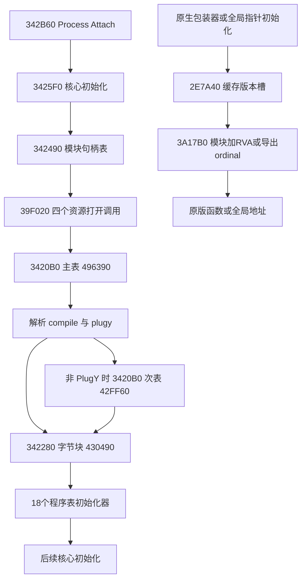

# 启动、补丁与原生桥接逐函数复核

[返回函数目录](README.md)。本页解释PD2如何把原版入口改接到核心，不将安装基础设施算作新增玩法。玩法差异归[领域分册](../../pd2/README.md)，全量记录归[补丁表](HOOKS.md)、[程序表](PROGRAM_TABLES.md)和[原生绑定](NATIVE_BINDINGS.md)。

## 版本与覆盖

全部地址为旧核心SHA-256 `9c2b4d4627112d7f14ab959e71c56e947b7ceeb6f16424a637364f614d39122f`的RVA，ImageBase `0x10000000`。不能套用到当前`17d5…`。本页复核12个入口，其中错误报告、版本字符串生产和两类程序表初始化的下游语义仍有明确限制；这不是全库语义完成声明。

依据为保存的Ghidra 12.1.4函数体及同版本LLVM反汇编；定点材料在`reference/pd2-cn-analysis/ghidra/{006-dll-address,018-init-core,025-core-setup,026-module-name-switch,028-patch-before-options,029-patch-after-options}.json`、`ghidra-server-audit/004-init-roots.json`及`ProjectDiablo.disasm.txt`。持久定位以本页摘要、RVA、表位置和指令位置为准，不依赖缓存长期保留。未执行DLL，未观察本轮进程内实际安装结果。

## 相对原版改变了什么

原版各模块具有自身的代码入口、全局表和程序分派。该核心先取得这些模块的基址，再修改代码／数据和分派表；后续原版调用因此可进入PD2算法，也可经PD2包装器重新调用原模块。只读磁盘D2Game／D2Client不能看到这些内存改写，单看PD2的普通CALL边也找不全表驱动回调。

三类安装相互独立：20字节记录处理DWORD、相对位移和重复字节；0x40C字节记录处理任意字节序列或清零；初始化器直接改写运行时表。没有发现这一层提供逐项旧字节匹配及事务回滚，不能把它解释为通用兼容性验证器。

## 入口目录

| RVA | 用途与核心 | 确认边界 |
| --- | --- | --- |
| 342B60 | DLL事件入口；Process Attach调用3425F0 | 不据返回1认定全部安装成功 |
| 3425F0 | 串联模块、资源、主／次表、字节块和程序表 | 安装顺序已确认，后半初始化未全恢复 |
| 342490 | 27项模块名／句柄表的查找及按需加载 | 全部遍历后固定返回1，含加载失败的零句柄 |
| 3420B0 | 20字节记录解释器 | 字段、位移、填充、跳过及读回行为已确认 |
| 342280 | 0x40C字节块记录解释器 | DWORD低字节压缩和零长度特殊分支已确认 |
| 305090 | 带目标容量的内存复制helper | ABI及参数错误分支已确认；CRT式行为不是玩法 |
| 2E79B0 | 版本匹配，写全局槽号 | 0／1／不支持分支明确；版本字符串生产helper未展开 |
| 2E7A40 | 版本槽的惰性初始化与读取 | 缓存为-1才调用2E79B0 |
| 3A17B0 | 模块编号加RVA／负ordinal解析 | 本体不校验地址所属函数，不持有每目标缓存 |
| 368170 | pSpell表的五个Do槽写入 | 只恢复挂接，具体物品资格归被调程序 |
| 3681A0 | 技能客户端／服务端程序表替换 | 同号跨表不是同一行为；下游算法分别分析 |
| 342020 | 错误文本处理及外部API调用链 | 不是已证实的补丁回滚；外部调用须按IAT解释 |

## 342B60与3425F0：安装编排

342B60读取第二个栈参数，仅当值为1时调用3425F0；后者返回0则调用342020，正常可达返回点为1。其他DLL事件在该函数没有对称卸载逻辑。CRT外层可能有自己的清理，本结论不扩大到全部DLL生命周期。

3425F0在前置helper后调用342490，然后顺序调用39F020，传入`pd2data.mpq`、`pd2assets.mpq`、`pd2maps.mpq`、`pd2monchars.mpq`，四次均含6000及`D2Win.DLL`参数。这证明请求顺序，不单独证明资源覆盖优先级、打开成功或文件内容版本。

关键安装顺序及调用点：

1. `3426DC`将ECX设为VA `10496390`，`3426E1`调用3420B0，安装主表。
2. 随后调用GetCommandLineW／CommandLineToArgvW，从参数1开始按完整宽字符串比较`-compile`和`-plugy`；不是前缀匹配，也未见此处大小写折叠。`-plugy`置全局字节5ABBE4。
3. `3427EF`检查该字节；为0时`3427F8`以ECX=VA `1042FF60`调用3420B0。它不是“关闭全部PD2改动”的开关。
4. `342802`无条件调用342280，随后`342807`至`34285C`按顺序调用18个初始化器。
5. `-compile`分支在上述安装之后才进入3425C0及INT3路径。不能将其理解成不改内存的纯表分析模式。

18项顺序为：368170、3681A0、3A8940、3A9C80、368A30、368AA0、35D970、3A4A00、3A2AB0、3A2CF0、3A24E0、3A1BC0、39CB90、39CD20、345830、3689C0、368600、368B70。各写入见程序表，不根据序号推断初始化器的业务名称。

主表、次表和字节块调用后均未见按EAX返回值分支；下一操作继续执行。因此执行器能报告失败，不等于总初始化会传播失败。正常后半还包含路径／对象构造、VideoConfig.Render读写和srand调用，但本页未把其helper全部恢复，不能声称初始化只有补丁副作用或只有一条游戏随机流。

## 342490：模块句柄表

无显式业务参数；遍历RVA494B90至494C68之前的27个8字节记录，每条为宽模块名指针和句柄槽。先GetModuleHandleW，空则LoadLibraryW，无论是否为空均写回句柄槽，再处理下一条，最终EAX=1。

原指令`3424A4`至`3424C6`没有加载失败后的return 0。3425F0虽保留`if (result==0)`错误分支，本函数正常返回路径不产生该值。句柄表带有27项，不能混用3A17B0内部的15项模块编号。

副作用为装载依赖及写全局句柄；没有发现此函数逐项卸载、核对模块摘要或校验原版指令。加载成功也不能证明模块版本匹配。

## 3420B0：定长补丁解释器

ECX为首记录指针，返回EAX=1或0。每条20字节，字段依次为模块号、模块内写入RVA、值／目标VA、relative、fill。模块号27为终止成功；负数或大于26、写入RVA为0返回失败。模块句柄为0时跳过该条，不计失败。

目标地址为模块基址加记录RVA。relative非零时，写入DWORD为`targetVA - writeVA - 4`，按32位运算；它对应CALL／JMP的位移字段，不包括操作码。不能把写入RVA直接当成整条CALL的地址。

fill为0时写4字节；非零时用值的低8位重复fill次。二者均先请求PAGE_EXECUTE_READWRITE，调用305090，再把目标内容与准备的数据比较，随后发起恢复页面保护调用。VirtualProtect和305090的返回值不作为本函数独立成功判据；恢复保护调用的最后参数为NULL，不能仅凭出现调用便宣称保护恢复成功。

不匹配则返回0，匹配则前进20字节继续。没有保存原字节或回写已成功记录的分支，也没有写前原字节一致性检查。因此可能已经写入前缀记录后再失败，不能按全有或全无解释。填充使用栈缓冲，未见此处对fill进行容量上限检查；这里只描述固定内置表，不把执行器当作可接任意输入的接口。

例：主表记录RVA4963F4将D2Game写入RVA DD746的相对位移指向核心39D6B0。须继续查DD745附近原操作码及39D6B0函数体，才能解释改动；表本身不证明完整伤害语义。

## 342280：字节块解释器

不从调用者接收表指针，固定从RVA430490开始。记录大小0x40C：模块号DWORD、写入RVA DWORD、256个DWORD数据槽、长度DWORD（+0x408）。终止号及模块／地址有效性与定长解释器类似，空模块句柄同样跳过。

长度非零时先复制对应个数的DWORD，再逐项取低8位压成连续字节，向目标写入长度个字节；不能直接把表内DWORD数组按原字节拷贝，否则会引入每项其余三个字节。长度为0时则准备1024个零字节，写入0x400字节，不是空操作。

写后比较、保护调用和失败返回与3420B0同类。此函数未见长度超过256时的拒绝分支，不应为任意外来表推断安全边界。61项目录只表示已经提取的固定表，不代表进程逐项写入成功。

## 305090：内存复制而非另一层补丁算法

指令恢复的输入为ECX=目标、EDX=目标容量、栈参数1=来源、栈参数2=复制长度；调用者清理栈。伪代码只列两个栈参数会漏掉真正的写入目的地。

长度0直接返回0。长度非零而目标为空进入参数错误链并返回0x16；来源有效且容量足够则调用复制helper，返回0。否则先按容量清零目标，再按来源为空或容量不足进入0x16／0x22错误链。外部参数错误处理可能中断控制流，不能假定错误必然正常返回。

该函数不计算模块基址、不调整页权限、不比较旧指令、不判断规则版本；这些职责分别在调用者或其他入口。它的CRT式容量语义不能替代补丁记录自身的栈缓冲边界检查。

## 2E79B0与2E7A40：版本选择

2E79B0先调用2E7A60取得待比较对象，再分别比较RVA446474／44642C对应版本常量。既有绑定证据将它们识别为`1.0.13.60`与`1.0.13.64`，成功分别写全局491BB8为0／1。不匹配写-1并调用错误路径；不能据第二个槽存在推断全部PD2补丁兼容1.13d。

2E7A40读取491BB8，仅值为-1时调用2E79B0并重新读取；返回版本索引。原指令位于2E7A40至2E7A54。它不是每次查询都重新检查磁盘模块，也不是DLL完整摘要校验。本页未展开2E7A60的版本字段来源，不能单独据此声明它逐个检查了所有原版DLL。

## 3A17B0：原生地址解析

ECX为内部15项模块编号，EDX为有符号地址值，结果在EAX。先查模块句柄，必要时LoadLibraryW；仍为空返回0。EDX小于0时以其相反数作为ordinal调用GetProcAddress；其余返回模块基址加EDX。

本体未见ECX的数组边界检查，也未见EDX为0的特殊拒绝。于是“版本表中0表示未登记”属于目录含义，不是解析器返回空的保证：若把0实际传进这里，所得为模块基址。是否避免这样的调用必须看包装器／构造器。

本函数不缓存每个目标的结果；缓存位于各包装器或指针初始化链。也不判定结果是函数还是数据、不核对原生签名。业务身份必须沿“包装器→指针初始化→版本表→模块RVA／ordinal→真实指令”闭合，不能只采用自动匹配名。

当前核心对应解析器为3A3B30，详见[当前包装器纠正](../../pd2/BUILDS.md#包装器解析与反编译纠正)，不由全局地址偏移推导其他函数。

## 368170与3681A0：程序表挂接

368170经全局5D8954写D2Game的pSpell表107238，五处偏移为14、1C、2C、64、6C，对应回调37EBE0、37EC70、37ECF0、37ED40、37FB80。这里的记录是8字节Start／Do对，Do槽满足`index*8+4`，分别为2、3、5、12、13；不能直接用偏移除4得到pSpell编号。12是地图开图链，13涉及无限书，具体条件分别见[地图](../../pd2/MAPS.md#开图程序与属性分派)和[物品函数](ITEM_FUNCTION_REVIEW.md#37fb80无限书执行)。

3681A0修改多个技能程序表，客户端CltDo表由全局5D866C指向D2Client DEA48，偏移20写3A65C0，即槽8；偏移190写3A6C30，即槽100。服务端另一表由5D884C指向D2Game1074A8，不能将两表同号槽或相近地址视为同一函数。完整写入仍以PROGRAM_TABLES为准。

挂接只说明引擎可以通过该槽调用回调。是否被当前MPQ记录引用、是否满足起手资格、是否由渐进事件间接调用，均需另查。技能效果、子飞弹、伤害和状态生命周期分别由下游函数决定；安装器本身没有完成这些玩法。

## 342020与失败边界

342020以ECX传入文本，先构造字符串并调用3B25C0，随后调用IAT 3D9360、3D9048、3D904C；原指令34207B至342094含文本、图标值0x10及-1参数。此处只确认错误报告／外部调用结构，不把未在本页解析的IAT行为笼统命名为“卸载”或“回滚”。

函数体没有遍历补丁表恢复原字节；342B60也没有为Detach撤销这些写入。不能由“初始化失败调用了342020”推导原模块会恢复至未修改状态。异常、进程终止和CRT清理的完整外部行为仍应另行核对。

## D2X责任与未决项

D2X不实现上述Win32内存修改器，也不加载核心DLL。它们的价值是定位原版被替换的调用点和表项，随后将规则分别落到内容准备、权威领域、客户端副本或持久化边界。

仍未完成：新版启动链逐函数对应；剩余16个程序表初始化器的独立契约；四次资源打开的完整返回／优先级；后半初始化对象及完整清理；每个挂接目标的原版差分与下游闭合。旧核心全量目录中的未命名函数不因本页增加而变成已分析。