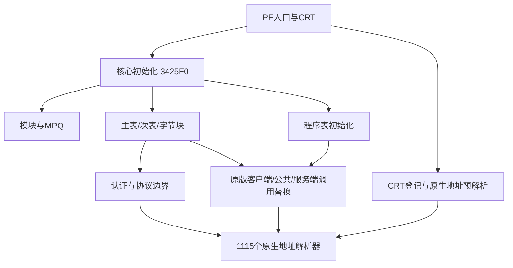

# ProjectDiablo.dll：函数目录与功能概览

本目录用于按地址查函数、按补丁查改动、按调用关系继续逆向。固定文件为首批冻结CN Normal副本的`ProjectDiablo.dll`，5,230,080字节，SHA-256为`9c2b4d4627112d7f14ab959e71c56e947b7ceeb6f16424a637364f614d39122f`，ImageBase为`0x10000000`。`.sn`副本与它摘要相同；`.ss`是另一文件，不能套用本目录地址。模块在服务端也被使用，不意味着所有函数都在远端客户端路径执行。

当前完整编目**20,196个分析器函数体和82,290个独立CRT跳板，共102,486个入口**。这不是102,486项游戏功能：大部分登记入口用于地址解析、初始化和清理。已恢复1,115个原生地址解析器、2,492条主补丁、65条非PlugY次补丁、61个可变字节块，以及18个程序表初始化器中的354条直接写入。函数识别不等于语义全部恢复；另已深化82个核心函数的静态查询并回填11项语义；CN附加mdll1补建7个裸函数，另行统计。仍有1,463段未归属指令范围，见[覆盖情况](COVERAGE.md)。

2026-10-21后续复核发现安装目录核心已更新为`17d5fb1b…aba57`；本目录全量地址仍限定上面的旧SHA，不混入新版本函数。新版周期协议及资源登记见[当前协议边界](../PD2_CN_DLL_ANALYSIS.md#原客户端抓包确认的周期上报与候选修复)。更新版只做定点复核，未计入本目录覆盖统计。

## 如何查询

| 需要回答的问题 | 入口 |
| --- | --- |
| 某个RVA或`FUN_地址`在哪里、有什么已知作用 | [分段函数索引](INDEX.md)、[全部函数体CSV](FUNCTIONS.csv) |
| 某个跳板最终去哪里 | [全部CRT跳板CSV](ALIASES.csv)，再查[原生绑定](NATIVE_BINDINGS.md) |
| 核心修改了原版哪个模块、哪个地址 | [全部定长补丁及字节块](HOOKS.md) |
| 哪些程序通过表项挂接，普通callers为什么找不到 | [运行时程序表写入](PROGRAM_TABLES.md) |
| 哪些游戏包改了长度、回调 | [协议回调目录](PROTOCOL.md)、[具体字段与时序](../PD2_CN_DLL_ANALYSIS.md#d2gs运行时长度表与处理器) |
| 函数调用谁、谁调用它 | [调用／跳转边CSV](CALLS.csv)，按caller／target列查询；跳板边另见ALIASES |
| 哪些调用未由导出器解析为直达目标 | [间接调用点CSV](INDIRECT_CALLS.csv)；其中IAT等目标可另按PE确定，不能一概认作未知 |
| 核心真实对外导出哪些接口 | [四项PE导出](EXPORTS.md)，与自动匹配名称分开 |
| 有哪些源码路径、库函数线索 | [源码路径引用](SOURCE_ANCHORS.md)、[外部函数记录](EXTERNALS.md) |
| 角色存档、共享仓库与compendium的已知容器差异 | [磁盘存档与独立存储容器](../PD2_CN_DLL_ANALYSIS.md#磁盘存档与独立存储容器) |
| 哪些部分还没有函数归属 | [完整未归属指令范围CSV](UNASSIGNED_CODE.csv)、[覆盖方法与限制](COVERAGE.md) |

例如VA`0x103928B0`对应RVA`0x3928B0`，在函数索引可查到C2S0x5C接收入口；原生绑定的`0x319E60`则解析D2Game的`0x4B7F0`，这是原生移除函数，不是该解析器自行执行踢人判断。CSV保留完整记录，没有只截前若干项；地址查询忽略十六进制字母大小写。CSV中的函数体边界为含末地址范围，多个不连续范围分别保留。

## 核心实际承担的工作

| 范围 | 已核实入口／机制 | 对D2X的意义与边界 |
| --- | --- | --- |
| 启动、资源与运行时补丁 | `0x3B381B → 0x3B36E5 → 0x342B60 → 0x3425F0`；模块解析、MPQ打开、主／次补丁、字节块与程序表初始化 | 不能只比较磁盘原DLL；原版和PD2应通过固定配置隔离。资源挂载与程序兼容是不同契约 |
| 原生地址桥接 | `0x2E79B0／0x2E7A40`选择1.13c／1.13d；`0x3A17B0`按模块、RVA或负ordinal解析并缓存。82,290个E9入口归并到1,115个解析器 | 先归并再追调用，避免把同一解析器的数十个别名当成不同检查。另一版本地址存在不代表全部补丁跨版本兼容 |
| 认证与大厅 | Bnclient补丁转到`0x3947E0`；D2MCPClient等模块有局部布局补丁 | 认证、MCP、GS字段需逐阶段对齐；本目录不重复账号材料。实际登录闭环与原始布局见既有专题 |
| 游戏消息 | `0x368600`改S2C回调／长度和C2S长度，主补丁另改D2Game回调；`0x3928B0`接C2S0x5C，`0x291D90`在自动地图房间入口发0x5B | 包长、分派、字段及状态消费者须一起闭合。长度改为5不等于已恢复0x5B的线上接收者 |
| 物品位流与扩展数据 | 原读取／写入转到`0x382E40／0x381AA0`，`0x2F8AC0`分配扩展ItemData；旧format与新增format分条件处理 | 网络物品与存档／realm路径不能混为一套；新增属性宽度、存储身份、外层action及目标MPQ表须绑定版本 |
| 客户端UI、物品展示和声音 | 有对D2Client UI／inv／showitems的挂接，以及DrawHoverItem、SoundChannel／Instance／Sample等源码路径引用 | 这些证明核心含客户端展示和声音职责；具体函数内部规则未全部命名，路径引用清单不充当完整复刻规范 |
| 技能、飞弹、状态和世界程序 | 多组运行时表替换原D2Game／D2Client程序；主表也有大量D2Game、D2Common调用替换 | 不是所有差异都能通过MPQ表达。程序表保留原表地址、槽偏移与回调，不给未核实的槽位猜技能名 |
| 公会与独立存储域 | `0x34B2B0 → 0x3540A0`处理公会展示分片，`0x34B600／0x34B640`属于GuildCommon相关链 | 公会展示、个人背包和账号仓库不能共用所有权推断；当前CN附加仓库还涉及mdll1，不能只看核心 |
| 保存、角色预览和释放 | `0x39C100`重建角色预览，`0x39A770`释放扩展字段；移除包装转接原D2Game函数 | 已决定移除后的保存／释放不等于拒绝原因；外部回调和运行配置仍需追查 |
| CRT、容器和通用运行库 | 大量初始化登记、退出清理、原生解析跳板及库函数自动名称 | 这些构成很大一部分函数数量；自动名称可能误匹配，不能直接当作PD2源码中的真实名字 |

具体字段、分支条件、限制和线上观察统一维护于[CN DLL与位流取证](../PD2_CN_DLL_ANALYSIS.md)；架构与实现范围见[PD2兼容设计](../../architecture/PD2_COMPATIBILITY.md)。本目录提供全量定位底座，不另造一份协议规范。

## 函数分类与证据强度

分类按证据优先级分配，每个函数体只计一次。例如已确认的移除解析器会优先列入语义锚点，不再重复计入“原生地址解析”。“登记”和“挂接”确认入口及使用方式，尚不意味着恢复其全部内部语义。

| 分类 | 函数体数 | 解释 |
| --- | --- | --- |
| CRT初始化登记 | 5,501 | 已确认在初始化数组中；具体初始化对象未逐一命名 |
| 退出清理登记 | 4,167 | 明确传给_atexit的入口；具体清理对象未逐一命名 |
| 原生地址解析 | 1,114 | 另1个已核实解析器优先列入原生桥接，总计1,115 |
| 定长补丁目标 | 457 | 已恢复主／次补丁挂接，内部语义待复核 |
| 程序表回调／初始化 | 255／18 | 已恢复表项和初始化入口；相同回调可以挂多个槽位 |
| 分析器跳板 | 151 | 分析器给出的thunk记录，目标另核对 |
| 源码路径引用 | 125 | 引用断言／诊断路径，不能直接作为原始函数名 |
| 自动名称线索 | 2,741 | 库函数、异常处理等自动匹配名称，仍需复核 |
| PE导出接口 | 4 | 按原PE表取得名称；不代表内部行为已全部恢复 |
| 其他已核实行为锚点 | 53 | 初始化8、原生桥接8、协议12、物品／存档6、公会4、状态2、存档预览6、世界事件6、玩法程序1 |
| 语义待核实 | 5,610 | 已有函数体、边界与关系，尚未确认业务含义 |

默认REA分析只给出14,415个模块内函数和338个外部记录。补全后，独立Ghidra工程导出20,196个函数体；CRT登记的82,290个单跳转别名另用原字节核对。二者合计是当前目录的完整入口清单，不是“已经找到了理论上所有函数”的证明。46,101字节已定义指令仍未归属函数体或这些跳板，完整范围已保留；未解码字节、混淆及间接构造也不能由统计排除。

## 协议实现入口

当前入场选项、房间计数、周期tick、路径坐标及BH文件CRC32报告的字段、原生发送入口和D2X边界统一见[CN协议证据](../PD2_CN_DLL_ANALYSIS.md#cn入场选项与自动地图报告)及[周期报告](../PD2_CN_DLL_ANALYSIS.md#原客户端抓包确认的周期上报与候选修复)。本目录只保留固定版本的函数定位、已核实行为与证据级别，不把函数名称或未闭合的调用关系当作服务器拒绝条件。

## 复核和维护

实际使用REA 6.7.0／Ghidra 12.1.4完成默认清单、关键函数反编译与交叉引用；另用同版本Ghidra在隔离工程补入口并批量导出真实函数body、调用边、字符串和未归属范围，LLVM／原PE字节复核跳板及表。未执行目标DLL／EXE，未修改D2X代码或原版目录。PDB未取得，自动分析名称与反编译类型不等于原始符号／源码。

本地证据位于忽略的`reference/pd2-cn-analysis/core-catalog/`：`output/functions.ndjson`、`output/coverage.json`、`output/hook-seed-report.json`、`crt-aliases.json`、`native-bindings.json`、`program-table-writes.json`及输入摘要清单。分析脚本与Ghidra工程留在该目录，不加入构建。此处只保存事实目录、地址关系与限制，不保存目标程序或整批反编译源码。

更新时先固定新摘要，再重建目录；不同构建不能覆写同一地址的旧语义。函数名的新推断须标证据级别，已核实行为回填对应专题，不能仅按相邻地址批量命名。工具和开源参考的版本、用途及许可见[资料来源](../THIRD_PARTY.md)。
